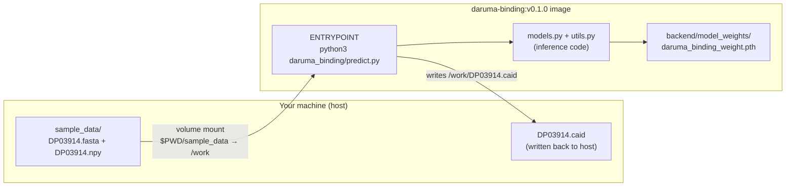
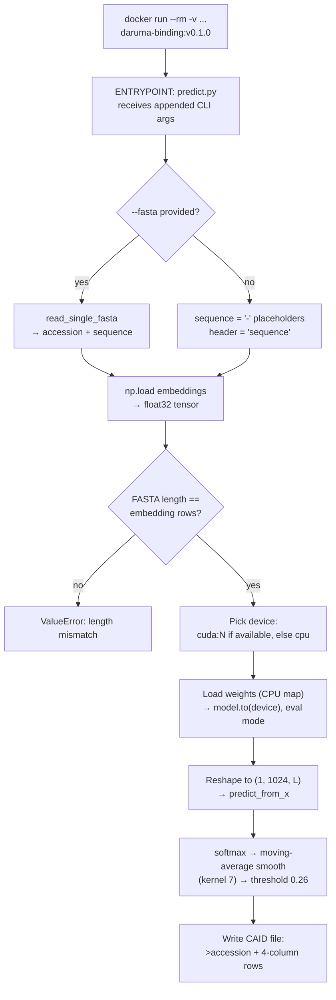

This page covers the self-contained Docker packaging of DARUMA-binding that was submitted to the CAID 4 experiment, found in the `caid/` directory. You will learn what the Docker image contains, how to run a prediction inside the container, how to interpret the CAID-format output file, and how this minimal environment differs from the full repository pipeline. All commands shown here are verified against the repository's scripts and source code.

## Why a Dedicated CAID Docker Image

CAID (Critical Assessment of protein Intrinsic Disorder prediction) is a community-wide benchmarking experiment in which participating groups submit a fixed, reproducible version of their predictor. The root README explicitly identifies the `caid/` directory as "Code submitted to CAID 4", and notes that this code originally lived in the repository root before being relocated [README.md](README.md#L60-L66), [README.md](README.md#L84-L86).

Because experiment evaluators must rerun your method exactly as submitted, the CAID packaging follows a minimal-and-frozen philosophy: the image bundles only the inference code, the trained weights, and two pinned dependencies (`numpy==1.26.4`, `torch==2.2.2`) [requirements.txt](caid/DARUMA-binding/requirements.txt#L1-L2). Everything needed to turn an embedding into a prediction lives inside the image; everything expensive or external (the ProtT5 language model itself) stays outside. The project README is explicit that "ProtT5 model and weights: not included in this Docker image" — the container consumes **precomputed** embeddings only [README.md](caid/DARUMA-binding/README.md#L19-L31).

The diagram below shows how the pieces fit together at runtime: your data files enter through a volume mount, the container's entrypoint processes them using its baked-in weights, and the output is written back into the mounted directory.



Sources: [README.md](README.md#L60-L66), [requirements.txt](caid/DARUMA-binding/requirements.txt#L1-L2), [README.md](caid/DARUMA-binding/README.md#L19-L31)

## Inside the Image: The Dockerfile Walkthrough

The Dockerfile is only 20 lines, and each line makes a deliberate packaging decision worth understanding before you run anything.

The image starts from `python:3.10-slim`, a lightweight official Python base rather than a GPU-capable or heavyweight image [Dockerfile](caid/DARUMA-binding/Dockerfile#L1-L3). It then installs exactly the two pinned requirements before copying any code — this ordering takes advantage of Docker's layer caching, so dependency installation is skipped on rebuilds when only source files change [Dockerfile](caid/DARUMA-binding/Dockerfile#L5-L6).

Four `COPY` instructions assemble the application: the `daruma_binding/` package (which includes the model weights at `backend/model_weights/daruma_binding_weight.pth`), the `sample_data/` example files, the local run script, and documentation/license files [Dockerfile](caid/DARUMA-binding/Dockerfile#L8-L12). Because the weights are copied in, **no model download is needed at runtime** — the image is fully self-sufficient for inference.

The environment variables pin CPU threading behavior inside the container: OpenMP and MKL at 8 threads, OpenBLAS and NumExpr at 1 [Dockerfile](caid/DARUMA-binding/Dockerfile#L14-L17). This mirrors the settings applied programmatically in `predict.py` itself [predict.py](caid/DARUMA-binding/daruma_binding/predict.py#L26-L37), so the thread configuration holds whether the code runs inside Docker or directly on a host.

The final two lines define the container's behavior as a command-line tool. `ENTRYPOINT ["python3", "daruma_binding/predict.py"]` means the Python script *is* the container — any arguments you place after the image name in `docker run` are appended to this script's command line. The default `CMD ["--help"]` means running the bare image with no arguments prints the script's usage help [Dockerfile](caid/DARUMA-binding/Dockerfile#L19-L20).

| Directive | What it does | Why it matters for you |
|---|---|---|
| `FROM python:3.10-slim` | Minimal Python 3.10 base | Small image; no GPU stack preinstalled |
| `RUN pip install -r requirements.txt` | Installs numpy + torch only | Reproducible, frozen dependency set |
| `COPY daruma_binding /app/daruma_binding` | Code **and** model weights | No runtime weight download needed |
| `COPY sample_data /app/sample_data` | Bundled example files | Image works out of the box |
| `ENV OMP/MKL/OPENBLAS/NUMEXPR...` | Pins threading | Deterministic CPU resource usage |
| `ENTRYPOINT ["python3", "daruma_binding/predict.py"]` | Script = container | Args after image name go to `predict.py` |
| `CMD ["--help"]` | Default arguments | Bare `docker run` shows usage help |

Sources: [Dockerfile](caid/DARUMA-binding/Dockerfile#L1-L20), [predict.py](caid/DARUMA-binding/daruma_binding/predict.py#L26-L37)

> [!TIP]
> The `ENTRYPOINT`/`CMD` combination means `docker run daruma-binding:v0.1.0` with no arguments simply prints `predict.py`'s argparse help text — that is not an error, it is the container's designed default behavior.

## Running a Prediction with Docker, Step by Step

The canonical invocation is captured in `run_example_docker.sh`, which predicts binding residues for one example protein end-to-end [run_example_docker.sh](caid/DARUMA-binding/run_example_docker.sh#L1-L9):

```bash
docker run --rm \
  -v "$PWD/sample_data":/work \
  daruma-binding:v0.1.0 \
  --fasta /work/DP03914.fasta \
  --embeddings /work/DP03914.npy \
  --output /work/DP03914.caid \
  --device cpu
```

Each flag plays a specific role. `--rm` removes the container after it exits, since the only artifact you care about is the output file. The `-v "$PWD/sample_data":/work` mount makes your local `sample_data/` folder visible inside the container at `/work` — this is essential, because the container cannot see host files otherwise, and because writing output to `/work` persists it on your host. Note the path convention: input and output paths (`--fasta`, `--embeddings`, `--output`) must be **container-internal** paths like `/work/...`, while the volume mount determines where they land on your machine. Run the script from within the `caid/DARUMA-binding/` directory so that `$PWD/sample_data` resolves correctly.

The project README also shows `docker pull daruma-binding:v0.1.0` as the way to obtain the image before running [README.md](caid/DARUMA-binding/README.md#L32-L42).

The following flowchart traces what happens inside the container after you execute that command, from argument parsing through output writing:



The full CLI contract, as defined by argparse in `predict.py`, is summarized here [predict.py](caid/DARUMA-binding/daruma_binding/predict.py#L46-L52):

| Short flag | Long flag | Required | Meaning |
|---|---|---|---|
| `-f` | `--fasta` | No | Input FASTA file; supplies the sequence ID and residue letters. If omitted, a generic `>sequence` header and `-` placeholders are used |
| `-e` | `--embeddings` | Yes | Precomputed ProtT5 per-residue embedding in NumPy `.npy` format, shape `L × 1024` |
| `-o` | `--output` | Yes | Path for the CAID-format prediction output file |
| `-d` | `--device` | No (default `cpu`) | `cpu`, or a GPU index such as `0`, `1`, ... |

Two validation behaviors protect beginners from silent mistakes. First, `read_single_fasta` rejects files whose first line is not a `>` header [utils.py](caid/DARUMA-binding/daruma_binding/utils/utils.py#L3-L14). Second, the script raises a `ValueError` if the FASTA sequence length does not match the first dimension of the embedding array — the classic failure mode when a `.npy` and a `.fasta` get out of sync [predict.py](caid/DARUMA-binding/daruma_binding/predict.py#L76-L77).

Sources: [run_example_docker.sh](caid/DARUMA-binding/run_example_docker.sh#L1-L9), [README.md](caid/DARUMA-binding/README.md#L32-L42), [predict.py](caid/DARUMA-binding/daruma_binding/predict.py#L46-L77), [utils.py](caid/DARUMA-binding/daruma_binding/utils/utils.py#L3-L14)

## Understanding the CAID Output Format

The output file follows the CAID submission format: one header line with the sequence identifier, then one tab-separated row per residue [predict.py](caid/DARUMA-binding/daruma_binding/predict.py#L89-L103). The bundled example output for protein DP03914 (708 residues) shows the format in practice [DP03914.caid](caid/DARUMA-binding/sample_data/DP03914.caid#L1-L15):

```text
>DP3914
1	M	0.331179	1
2	Q	0.335192	1
3	A	0.341306	1
4	R	0.347953	1
...
```

| Column | Content | Example from sample | Rule |
|---|---|---|---|
| 1 | Residue position (1-based) | `1` | Sequential index over the sequence |
| 2 | Amino acid letter | `M` | From the FASTA, or `-` if no FASTA was given |
| 3 | Binding probability | `0.331179` | Softmax class-1 probability, 6 decimal places |
| 4 | Binary prediction | `1` | `1` if probability > 0.26, else `0` |

Two details of column 4 deserve attention. The decision threshold is fixed at `0.26`, which the code documents as the value maximizing F1 score on validation data [models.py](caid/DARUMA-binding/daruma_binding/backend/models.py#L189-L193). And before thresholding, raw network probabilities pass through a **moving-average smoother with kernel size 7** (replicate padding at the boundaries) inside `predict_from_x` [models.py](caid/DARUMA-binding/daruma_binding/backend/models.py#L196-L204). The probabilities printed in column 3 are therefore already smoothed values, and the binary column is derived from those smoothed values — do not expect column 4 to equal "raw probability > 0.26" recomputed by hand.

The same format is described in the CAID README's output section [README.md](caid/DARUMA-binding/README.md#L44-L52). For a deeper treatment of output conventions across both the CAID image and the full pipeline, see [Output Format Reference](3-output-format-reference).

Sources: [DP03914.caid](caid/DARUMA-binding/sample_data/DP03914.caid#L1-L15), [predict.py](caid/DARUMA-binding/daruma_binding/predict.py#L89-L103), [models.py](caid/DARUMA-binding/daruma_binding/backend/models.py#L189-L204), [README.md](caid/DARUMA-binding/README.md#L44-L52)

> [!TIP]
> The binary column (column 4) is computed from the *smoothed* probability, not the raw network output — the moving-average smoothing (kernel 7) happens inside `predict_from_x` before both the probability values and the threshold comparison are produced.

## Device Selection and Resource Behavior

The `--device`/`-d` flag has forgiving semantics designed for benchmark environments. Passing `cpu` (as the example does) always runs on CPU. Passing a GPU index such as `0` selects `cuda:0`, but **only if CUDA is actually available** — otherwise the code silently falls back to CPU rather than crashing, printing which device was chosen [predict.py](caid/DARUMA-binding/daruma_binding/predict.py#L61-L66). This makes the container safe to run on machines without GPUs while still exploiting them when present. Note that using a GPU from inside a container additionally requires NVIDIA drivers and the NVIDIA Container Toolkit on the host; the image itself ships a standard pip-installed PyTorch.

Threading is deliberately constrained for predictable resource usage: `predict.py` sets 8 OpenMP/MKL threads, 1 thread each for OpenBLAS and NumExpr, and calls `torch.set_num_threads(8)` with `set_num_interop_threads(1)` before any tensor work [predict.py](caid/DARUMA-binding/daruma_binding/predict.py#L26-L37). These are mirrored by the `ENV` directives baked into the image [Dockerfile](caid/DARUMA-binding/Dockerfile#L14-L17). For very long proteins, inference is performed on the whole sequence at once with no chunking in this CAID path — the tensor is simply reshaped to `(1, 1024, L)` and fed to the model [predict.py](caid/DARUMA-binding/daruma_binding/predict.py#L85-L87). For a discussion of when and why chunking matters, see [ProtT5 Embedding Chunking Strategy](9-prott5-embedding-chunking-strategy).

Sources: [predict.py](caid/DARUMA-binding/daruma_binding/predict.py#L26-L87), [Dockerfile](caid/DARUMA-binding/Dockerfile#L14-L17)

## CAID Image vs. the Full Repository Pipeline

The CAID image is intentionally a stripped-down sibling of the full predictor in `src/`. The root README documents the full pipeline's richer interface and output set, which includes predicted pLDDT, RSA, and secondary structure alongside binding predictions [README.md](README.md#L45-L58). This table summarizes the practical differences so you can pick the right tool for your task:

| Aspect | `caid/` Docker image | Full repository (`src/`) |
|---|---|---|
| Purpose | Frozen CAID 4 benchmark submission | General research/production use |
| Input format | Precomputed `.npy` ProtT5 embeddings (required) + optional FASTA | FASTA only (`-i example.fasta`) |
| Proteins per run | Single protein | One or more sequences per file |
| Embedding source | User-supplied `.npy` file | Generated internally by the pipeline |
| Output columns | Probability + binary binding only | Binding + pLDDT + RSA + SS3 + SS8 |
| Dependencies | Pinned inside the image (numpy, torch) | User installs PyTorch per OS/CUDA [README.md](README.md#L14-L20) |
| Invocation | `docker run ... daruma-binding:v0.1.0 <args>` | `python3 src/daruma_binding/predict.py -i ... -o ...` |

The contrast in invocation style is visible in the repository's own example scripts: the full pipeline is run directly with `python3 ../src/daruma_binding/predict.py -i example.fasta -o example.out` [predict_example.sh](examples/predict_example.sh#L1-L4), while the CAID path wraps everything in the container as shown above. Note also that `run_example.sh` inside the CAID directory runs the same `predict.py` directly on the host — useful for testing the code without Docker, using identical arguments [run_example.sh](caid/DARUMA-binding/run_example.sh#L1-L13).

If your goal is to predict from raw FASTA files with full structural-feature output, start with [Quick Start](2-quick-start). If you need to generate the `L × 1024` `.npy` embeddings the CAID image expects, see [ProtT5 Embedding Chunking Strategy](9-prott5-embedding-chunking-strategy). For how the CAID datasets themselves are organized and evaluated, see [CAID Benchmark Datasets](11-caid-benchmark-datasets).

Sources: [README.md](README.md#L14-L20), [README.md](README.md#L45-L58), [predict_example.sh](examples/predict_example.sh#L1-L4), [run_example.sh](caid/DARUMA-binding/run_example.sh#L1-L13)

## Troubleshooting Common Issues

Beginners hitting the Docker workflow most often trip on path mapping, input mismatch, or device expectations. Each symptom below maps to a verified cause in the code.

| Symptom | Likely cause | Fix |
|---|---|---|
| `ValueError: Length of sequence (X) does not match the first dimension of ProtT5 vector (Y)` | FASTA and `.npy` describe different-length sequences | Regenerate the embedding for the exact FASTA you pass via `--fasta` [predict.py](caid/DARUMA-binding/daruma_binding/predict.py#L76-L77) |
| `ValueError: Invalid FASTA format` | File missing a `>` header on line 1 | Ensure the first line starts with `>` [utils.py](caid/DARUMA-binding/daruma_binding/utils/utils.py#L9-L10) |
| Output file does not appear on host | Output path pointed inside the container but outside the mounted volume | Always write outputs to `/work` (the mounted directory) |
| Header says `>sequence` instead of your protein ID | `--fasta` was not provided | Pass `-f/--fasta` to get the real accession [predict.py](caid/DARUMA-binding/daruma_binding/predict.py#L96-L100) |
| Prints "Using cpu device" though you passed `-d 0` | CUDA not available inside container; code falls back silently | Set up NVIDIA Container Toolkit on the host, or accept CPU [predict.py](caid/DARUMA-binding/daruma_binding/predict.py#L61-L66) |
| Bare `docker run daruma-binding:v0.1.0` just prints help text | Default `CMD ["--help"]` is active | Append your arguments after the image name [Dockerfile](caid/DARUMA-binding/Dockerfile#L19-L20) |
| Container can't find `/work/DP03914.fasta` | Script run from a directory where `$PWD/sample_data` doesn't exist | `cd caid/DARUMA-binding/` before running the script |

Sources: [predict.py](caid/DARUMA-binding/daruma_binding/predict.py#L61-L100), [utils.py](caid/DARUMA-binding/daruma_binding/utils/utils.py#L9-L10), [Dockerfile](caid/DARUMA-binding/Dockerfile#L19-L20)

## Where to Go Next

You now know how to run the CAID submission container and read its output. The logical next steps in this documentation depend on your goal: to understand what happens inside the model between the embedding input and the probability output, continue to [Prediction Pipeline Architecture](5-prediction-pipeline-architecture); to understand how the 0.26 decision threshold and output conventions were established, see [Inference Orchestration and Decision Threshold](10-inference-orchestration-and-decision-threshold); to learn how to produce the `L × 1024` embeddings this container consumes, read [ProtT5 Embedding Chunking Strategy](9-prott5-embedding-chunking-strategy); and for a broader review of conventions covered earlier in this guide, revisit [Output Format Reference](3-output-format-reference).
