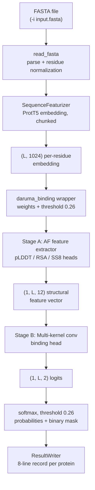
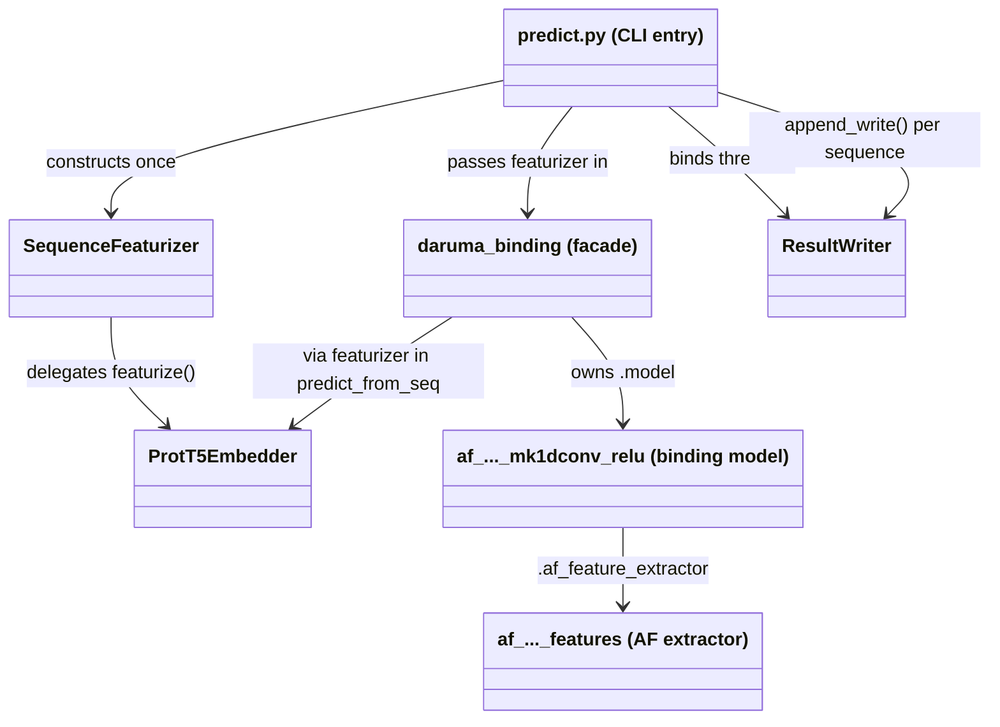
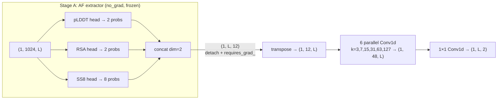

This page dissects the end-to-end inference path of DARUMA-binding: how a raw FASTA file is transformed into per-residue binding probabilities and auxiliary structural annotations. We trace every tensor transformation from input parsing through ProtT5 featurization, the two-stage neural core, threshold-based binarization, and final serialization. This is the architectural "map" of the system — detailed internals of individual components are delegated to their dedicated pages in the Deep Dive section.

## The Pipeline at a Glance

The system is a linear, single-pass pipeline orchestrated by one script (`predict.py`) that delegates to three cooperating modules in `backend/`. There is no batching across sequences — each protein flows through the entire chain independently, making the architecture inherently streaming-friendly and memory-predictable.

The following table traces tensor shape evolution at every stage boundary — this is the contract each module must honor:

| Pipeline Stage | Producer | Input Shape | Output Shape | Notes |
|---|---|---|---|---|
| FASTA parsing | `read_fasta` | raw text | `dict[str, str]` | accession → sequence |
| Featurization | `ProtT5Embedder.embed` | string, length L | `(L, 1024)` | chunked, overlap 512 |
| Batch + channel permute | `predict_from_seq` | `(L, 1024)` | `(1, 1024, L)` | Conv1d layout |
| AF feature extraction | `af_daruma_like_ProtT5_features` | `(1, 1024, L)` | `(1, L, 12)` | 2+2+8 concatenated heads |
| Multi-kernel conv | `MultiKernelConv1d_withDropout` | `(1, 12, L)` | `(1, 48, L)` | 6 kernels × 8 channels |
| Binding head output | 1×1 Conv1d | `(1, 48, L)` | `(1, L, 2)` | transposed back |
| Decision | `logit_to_prob` + threshold | `(1, L, 2)` | `(L,)` probs, `(L,)` binary | class 1 = binding |

Sources: [predict.py](/src/daruma_binding/predict.py#L57-L73), [models.py](/src/daruma_binding/backend/models.py#L222-L257), [functions.py](/src/daruma_binding/backend/functions.py#L60-L117)

## Module Interaction Map

Responsibility is cleanly separated across three backend modules and the CLI entry point. `predict.py` performs no tensor math itself — it is pure orchestration: device resolution, one-time construction of the featurizer/model/writer, and a per-sequence loop.

| Module | Responsibility | Key Exports |
|---|---|---|
| `predict.py` | CLI, device resolution, sequence loop | script entry |
| `functions.py` | I/O and featurization | `read_fasta`, `SequenceFeaturizer`, `ResultWriter`, `ProtT5Embedder` |
| `models.py` | Neural architecture + inference facade | `daruma_binding`, `af_daruma_like_ProtT5_features_mk1dconv_relu` |

The `daruma_binding` class is the critical facade: it binds the frozen model weights, the decision threshold, the (currently disabled) smoother, and the featurizer into a single callable unit with `predict_from_seq()` as its public API. This facade pattern means `predict.py` never touches model internals — a deliberate isolation that keeps the neural graph opaque to the orchestrator.

Sources: [predict.py](/src/daruma_binding/predict.py#L21-L65), [models.py](/src/daruma_binding/backend/models.py#L190-L203), [functions.py](/src/daruma_binding/backend/functions.py#L123-L133)

## Stage 1: Ingestion and Device Resolution

Two normalization steps occur before any neural computation. First, `read_fasta` splits the file into blocks, strips whitespace/newlines from sequences, and remaps ambiguous or non-canonical residue codes (`U`, `B`, `J`, `O`, `Z`) to `X` so downstream tokenizers never encounter invalid symbols. Second, the CLI device argument is resolved: `cpu` selects CPU; a numeric index selects `cuda:N` via `torch.cuda.set_device` — with a silent fallback to CPU if CUDA is unavailable. Note the asymmetry: device selection happens in `predict.py`, but the model is loaded to CPU first and then transferred, which avoids GPU-anchored checkpoints entirely.

| `-d` Argument | CUDA Available | Effective Device |
|---|---|---|
| `cpu` | either | `cpu` |
| `0`, `1`, … | yes | `cuda:N` (`set_device` called) |
| `0`, `1`, … | no | `cpu` (fallback, no error) |

Sources: [functions.py](/src/daruma_binding/backend/functions.py#L12-L23), [predict.py](/src/daruma_binding/predict.py#L42-L55), [models.py](/src/daruma_binding/backend/models.py#L192-L195)

## Stage 2: Sequence Featurization

The featurizer wraps a single HuggingFace encoder — `Rostlab/prot_t5_xl_half_uniref50-enc` — instantiated in half precision and moved to the resolved device (`float()` conversion on CPU, where fp16 is unsupported). The `SequenceFeaturizer` is intentionally thin: it exists solely to bind a feature-type string to an embedder instance, making future alternative featurizations a one-line extension point. Inside `embed()`, the sequence runs under `torch.inference_mode()` and is processed in windows of `chunk_size=2048` with `overlap=512`, producing per-residue 1024-dimensional embeddings that are concatenated into a single `(L, 1024)` tensor. A second residue remap (`U`, `Z`, `O`, `B` → `X`) guards the tokenizer input.

The chunk/overlap/trim mechanics — why 256 residues are trimmed from each interior chunk boundary and how positional artifacts are avoided — are documented in detail on the dedicated embedding page: [ProtT5 Embedding Chunking Strategy](9-prott5-embedding-chunking-strategy).

Sources: [functions.py](/src/daruma_binding/backend/functions.py#L26-L59), [functions.py](/src/daruma_binding/backend/functions.py#L62-L66), [functions.py](/src/daruma_binding/backend/functions.py#L123-L133)

## Stage 3: The Two-Stage Neural Core

The binding model is architecturally a **composition, not a monolith**: a frozen feature extractor (Stage A) feeding a trainable prediction head (Stage B). This split is the single most important structural decision in the pipeline.

**Stage A — Auxiliary Feature (AF) extractor.** Three parallel `daruma_like` networks (each a Conv1d stack: FEU encoder + PU pooling unit) predict pLDDT (2-class), RSA (2-class), and SS8 (8-class) independently from the same `(1, 1024, L)` embedding input. Each head internally zero-pads 60 residues on both sides before its convolution stack, then softmaxes and concatenates — producing a `(1, L, 12)` structural feature vector with layout `[plddt, 1-plddt, 1-rsa, rsa, ss0…ss7]`. The internal FEU/PU design is covered in [Convolutional Backbone: FEU and PU](6-convolutional-backbone-feu-and-pu) and per-head specialization in [Auxiliary Structural Feature Heads](7-auxiliary-structural-feature-heads).

> [!TIP]
> The AF extractor runs under `torch.no_grad()` inside the binding model's forward pass, so predicted structure is a **fixed input** to Stage B — no gradients flow back into the structural heads during binding inference. However, `return_af_features=True` (the production configuration) stores a `detach().requires_grad_(True)` copy of the features, re-anchoring a gradient leaf on the feature tensor. This is the deliberate hook that later enables gradient-based attribution analysis ([Occlusion-Based Feature Attribution](15-occlusion-based-feature-attribution)).

**Stage B — Multi-kernel binding head.** The `(1, L, 12)` feature vector is transposed to channel-first `(1, 12, L)` and passed through six parallel 1D convolutions with kernels spanning `[3, 7, 15, 31, 63, 127]` — capturing binding-motif context from local to long-range — each contributing 8 channels, concatenated to `(1, 48, L)`. A single 1×1 convolution then projects to 2 logits per residue. The multi-scale kernel rationale is detailed in [Multi-Kernel Conv Binding Head](8-multi-kernel-conv-binding-head).

Sources: [models.py](/src/daruma_binding/backend/models.py#L135-L151), [models.py](/src/daruma_binding/backend/models.py#L154-L186), [models.py](/src/daruma_binding/backend/models.py#L173-L186)

## Stage 4: Decision and Post-Processing

Logits map to probabilities via a single softmax restricted to index 1 (`logit_to_prob`), yielding the binding probability per residue. A moving-average smoother is applied, but the production configuration instantiates it with `kernel_size=1` — a deliberate no-op (the `kernel_size=7` variant exists in the code but is commented out), so raw head probabilities are what get serialized. Binarization is a hard comparison against the fixed threshold `0.26`, chosen to maximize F1 on validation data. The selection methodology, sensitivity of this constant, and orchestration-level behavior around it belong to [Inference Orchestration and Decision Threshold](10-inference-orchestration-and-decision-threshold).

> [!TIP]
> The smoother's no-op is not dead code — `MovingAverageSmoothing(kernel_size=1)` still executes the full pad/unfold/mean path, returning the input unchanged. This preserves a single insertion point if smoothing is ever re-enabled, without changing the output contract of `predict_from_x`.

Sources: [models.py](/src/daruma_binding/backend/models.py#L76-L78), [models.py](/src/daruma_binding/backend/models.py#L222-L229), [models.py](/src/daruma_binding/backend/models.py#L197-L199)

## Stage 5: Result Assembly and Serialization

`predict_from_seq` closes the loop by un-stacking the `(L, 12)` AF matrix into human-interpretable channels: `plddt` (column 0, scaled ×100 to the 0–100 confidence scale), `rsa` (column 3), `ss8` (columns 4–12), and a derived SS3 where helix = Σ(ss0–ss2), strand = Σ(ss3–ss4), coil = Σ(ss5–ss7). Discrete SS strings are produced by argmax through the `q8_to_char` / `q3_to_char` maps, and the original sequence is re-attached — yielding a flat result dictionary that is the sole interface between the neural world and I/O.

`ResultWriter` was opened once at startup (writing the 8-line format header) and appends one record per sequence — stream-friendly for multi-protein FASTA inputs:

| Output Line | Content | Source Field |
|---|---|---|
| 1 | `>accession` | FASTA header |
| 2 | sequence | input sequence |
| 3 | binding probability, 4-decimal floats | `prob` |
| 4 | binary prediction (1/0) | threshold 0.26 comparison |
| 5 | pLDDT (float) | AF column 0 × 100 |
| 6 | RSA (float) | AF column 3 |
| 7 | SS3 string (H/S/C) | derived argmax |
| 8 | SS8 string (H/G/I/E/B/T/S/-) | derived argmax |

The byte-level format specification lives in [Output Format Reference](3-output-format-reference).

Sources: [models.py](/src/daruma_binding/backend/models.py#L205-L220), [models.py](/src/daruma_binding/backend/models.py#L245-L257), [functions.py](/src/daruma_binding/backend/functions.py#L136-L158)

## Architectural Properties and Trade-offs

Several deliberate engineering properties emerge from the code, each with direct operational implications:

| Property | Evidence | Implication |
|---|---|---|
| Single-sequence loop, no batching | `predict.py` iterates `input_datas.items()` one at a time | O(1) peak VRAM per protein; long proteins handled via embedding chunking |
| Inference-only graph | `torch.inference_mode()` in embedder, `no_grad` in `predict_from_x`, `model.eval()` | Minimal activation memory; dropout inert at dropout_rate=0 |
| Explicit VRAM hygiene | `del hidden, input_ids, attention_mask, tok` per chunk | Embeddings of very long proteins stay bounded |
| CPU-anchored weight loading | `map_location='cpu'` then `.to(device)` | Checkpoint is device-portable; no GPU required at load time |
| Gradient firewall between stages | `no_grad` around AF extractor, detached re-anchored leaf | Stage B cannot corrupt Stage A; attribution remains possible |
| Threshold as configuration constant | `threshold = 0.26` set once at facade init | Threshold travels with the model object, shared by writer and decision logic |

The overall design philosophy is clear: a **fixed, frozen feature contract** (the 12-channel structural vector) between a language-model front end and a compact convolutional head. This makes the binding head cheap, the system debuggable at the feature boundary, and the entire pipeline reproducible from a single weight file plus the threshold constant.

Sources: [predict.py](/src/daruma_binding/predict.py#L69-L73), [functions.py](/src/daruma_binding/backend/functions.py#L69-L114), [models.py](/src/daruma_binding/backend/models.py#L174-L179)

## Where to Go Next

Follow the data flow downstream through the Deep Dive catalog:

- Go deeper into the neural components in pipeline order: [Convolutional Backbone: FEU and PU](6-convolutional-backbone-feu-and-pu) → [Auxiliary Structural Feature Heads](7-auxiliary-structural-feature-heads) → [Multi-Kernel Conv Binding Head](8-multi-kernel-conv-binding-head)
- Understand the memory/accuracy trade-off inside Stage 2: [ProtT5 Embedding Chunking Strategy](9-prott5-embedding-chunking-strategy)
- Examine how the threshold constant was derived and validated: [Inference Orchestration and Decision Threshold](10-inference-orchestration-and-decision-threshold)
- For practical invocation and output interpretation, return to [Quick Start](2-quick-start) and [Output Format Reference](3-output-format-reference)