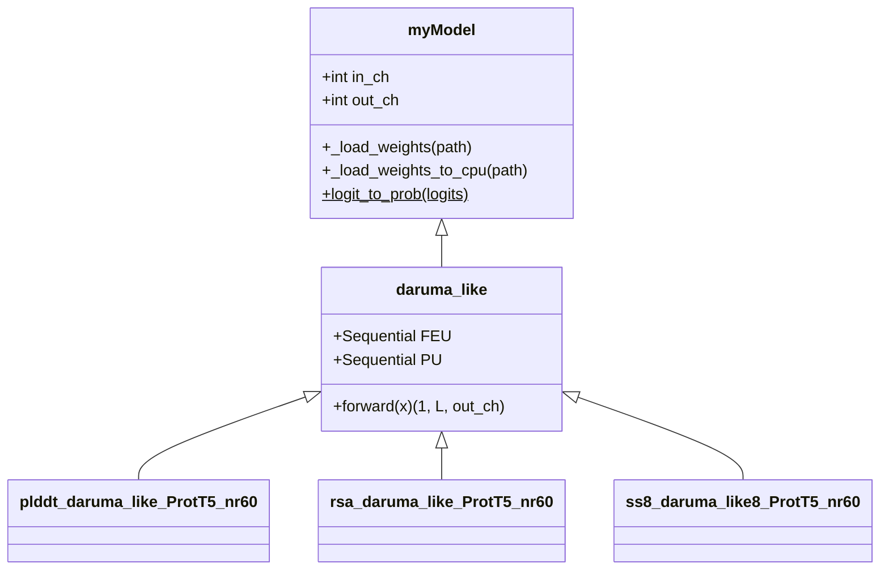
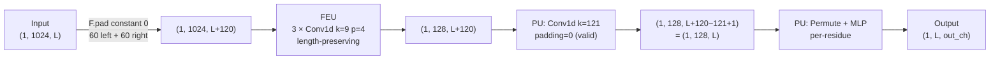

This page explains the convolutional backbone of DARUMA-binding: a two-stage, fully convolutional stack named `daruma_like` that transforms per-residue ProtT5 embeddings (1024 channels) into per-residue binding logits. The two stages — the **Feature Extraction Unit (FEU)** and the **Prediction Unit (PU)** — are implemented as explicitly named `nn.Sequential` submodules and define the architectural template that the auxiliary structural heads also inherit. We analyze the layer composition, receptive field geometry, the shape contract enforced by zero-padding, and the parameter budget, at the level of detail required to reason about or modify the network.

Sources: [models.py](/src/daruma_binding/backend/models.py#L82-L114), [predict.py](/src/daruma_binding/predict.py#L58-L61)

## Position in the Architecture: The `daruma_like` Template

The backbone lives in the `daruma_like` class, which extends the minimal base class `myModel`. The base class contributes three infrastructure concerns — weight loading (with a CPU-mapped variant for portable inference), an `in_ch`/`out_ch` channel contract, and a static `logit_to_prob` helper that applies `softmax(logits, dim=-1)[..., 1]` to extract the binding-class probability from the two-channel output. Everything below that is the FEU+PU design itself: `daruma_like.__init__` builds the `self.FEU` and `self.PU` submodules, and its `forward` is a three-line composition of pad → FEU → PU.

This inheritance structure matters for the rest of the "Neural Model Design" section: the pLDDT/RSA/SS8 predictors are **the same FEU+PU backbone with only `out_ch` changed**, wrapped by a separate ensemble class, while the final binding head is a different, multi-kernel design that consumes those heads' outputs rather than reusing FEU/PU directly. Those two systems are documented in [Auxiliary Structural Feature Heads](7-auxiliary-structural-feature-heads) and [Multi-Kernel Conv Binding Head](8-multi-kernel-conv-binding-head) respectively; this page stays strictly within the `daruma_like` template.

Sources: [models.py](/src/daruma_binding/backend/models.py#L63-L114), [models.py](/src/daruma_binding/backend/models.py#L117-L133)

## Feature Extraction Unit (FEU): Local Pattern Compression

The FEU is three identical Conv1d blocks: 1024 → 128, then two 128 → 128 layers, each with `kernel_size=9` and `padding=4` followed by `ReLU(inplace=True)`. The `padding=4` is floor-division padding (`k//2`), which makes every layer **length-preserving** — the FEU never changes the sequence dimension, it only reshapes the channel dimension. Its two jobs are therefore (1) to compress the 1024-dimensional ProtT5 embedding into a 128-channel representation, an 8× reduction that contains the vast majority of the network's first-layer parameters, and (2) to build local motif features by stacking local convolutions.

The receptive field grows linearly with depth: each kernel-9 layer adds 8 positions, so after three layers each FEU output position integrates **1 + 3 × (9−1) = 25 residues** of context (±12 around the residue). This is deliberately modest — the FEU detects local patterns, and long-range aggregation is delegated entirely to the PU. The design pattern is the classic "narrow early, aggregate late" motif of sequence convnets: the expensive 1024×128 projection happens once with a small kernel, and all subsequent layers operate on cheap 128-channel tensors.

| FEU Layer | Operation | Channels | Kernel | Padding | Output Shape |
|---|---|---|---|---|---|
| `FEU[0]` | Conv1d + ReLU | 1024 → 128 | 9 | 4 | `(1, 128, L')` |
| `FEU[2]` | Conv1d + ReLU | 128 → 128 | 9 | 4 | `(1, 128, L')` |
| `FEU[4]` | Conv1d + ReLU | 128 → 128 | 9 | 4 | `(1, 128, L')` |

*`L'` is the padded sequence length (see the shape contract below); the FEU preserves it exactly.*

Sources: [models.py](/src/daruma_binding/backend/models.py#L87-L94)

## Prediction Unit (PU): Global Aggregation and Per-Residue Classification

The PU is a hybrid conv + pointwise-MLP head organized in two halves. The first half is a single **wide, valid** convolution: `Conv1d(128 → 128, kernel_size=121, padding=0)` followed by ReLU and `Dropout(0.5)`. This layer is the network's long-range context mechanism — with a 121-residue window it adds 120 to the receptive field, extending the total to **145 residues (±72)**. Because `padding=0`, this convolution *shrinks* the sequence by 120 positions, a property the forward pass deliberately exploits (next section).

The second half is a per-residue classifier operating in `(B, L, C)` layout: a custom `PermuteLayer(0, 2, 1)` swaps to channels-last, then `Linear(128 → 128)` + ReLU + `Dropout(0.5)` + `Linear(128 → out_ch)`. These linear layers act as **1×1 convolutions** — each residue is classified independently from its 128-dim aggregated feature vector, with no further mixing across positions. The final `out_ch=2` logits are two-class (binding / non-binding) scores, later converted to probabilities by `myModel.logit_to_prob` outside the backbone.

| PU Stage | Operation | Layout | Output Shape | Role |
|---|---|---|---|---|
| `PU[0]` | Conv1d + ReLU | channels-first | `(1, 128, L'−120)` | 121-residue context aggregation |
| `PU[2]` | Dropout (p=0.5) | channels-first | `(1, 128, L'−120)` | regularization |
| `PU[3]` | `PermuteLayer(0, 2, 1)` | → channels-last | `(1, L'−120, 128)` | layout switch for Linear |
| `PU[4]` | Linear + ReLU | channels-last | `(1, L'−120, 128)` | non-linear feature refinement |
| `PU[6]` | Dropout (p=0.5) | channels-last | `(1, L'−120, 128)` | regularization |
| `PU[7]` | Linear (128 → out_ch) | channels-last | `(1, L'−120, out_ch)` | per-residue logits |

Note the custom `PermuteLayer` (a thin wrapper around `x.permute(*dims)`) — it exists so the entire PU, including the layout switch, can live inside a single `nn.Sequential`, keeping the forward pass a flat composition.

Sources: [models.py](/src/daruma_binding/backend/models.py#L15-L21), [models.py](/src/daruma_binding/backend/models.py#L96-L106), [models.py](/src/daruma_binding/backend/models.py#L77-L79)

## The Shape Contract: Why Forward Pads Exactly (60, 60)

The `forward` method begins with `F.pad(x, (60, 60), mode="constant", value=0)` before touching any layer. This is not an arbitrary context margin — it is the exact algebraic compensation for the PU's valid convolution, and it is the single most important invariant of the backbone:

The arithmetic: the input grows by 120 positions; the PU's kernel-121 valid convolution removes exactly 121 − 1 = 120 positions; the FEU layers in between are length-preserving. The result is that **the output length always equals the input length**, residue-for-residue, so binding probabilities from the backbone can be aligned directly with the input sequence without any trimming or bookkeeping. The zeros also serve as a neutral "blank embedding" at sequence termini, letting boundary residues receive a full 145-residue receptive field instead of being truncated.

> [!TIP]
> If you modify the PU's kernel size `K`, you must change the forward padding to `((K−1)//2, (K−1)//2)` — with the current odd `K=121` this is `(60, 60)`. Breaking this pairing silently misaligns the output against the input sequence, which would corrupt every downstream residue-level output written by the predictor.

Sources: [models.py](/src/daruma_binding/backend/models.py#L108-L114), [models.py](/src/daruma_binding/backend/models.py#L35-L59)

## Input Contract and Parameter Budget

The backbone's input contract is fixed by its instantiators: every `*_daruma_like_ProtT5_nr60` subclass raises `ValueError` unless `in_ch == 1024`, matching the ProtT5 embedding dimension. In the deployed pipeline, `predict.py` constructs a `SequenceFeaturizer(feature_type="ProtT5")` and the wrapper's `predict_from_seq` transposes the featurized sequence into the channels-first `(1, 1024, L)` tensor the backbone expects; the full embedding-to-tensor path is detailed in [ProtT5 Embedding Chunking Strategy](9-prott5-embedding-chunking-strategy) and the surrounding orchestration in [Inference Orchestration and Decision Threshold](10-inference-orchestration-and-decision-threshold).

Despite the wide PU kernel, the total budget is modest at **3,474,306 parameters**, with an interesting distribution: the PU's kernel-121 convolution alone is the single largest layer (1.98M, ~57%), because kernel size multiplies the per-position weight cost — 121 × 16,384 weights versus 9 × 131,072 for the FEU's projection layer. Channel width, not kernel size, dominates the FEU's cost.

| Layer | Parameters | Share |
|---|---|---|
| `FEU[0]` Conv1d 1024→128, k=9 | 1,179,776 | 34.0% |
| `FEU[2]` Conv1d 128→128, k=9 | 147,584 | 4.2% |
| `FEU[4]` Conv1d 128→128, k=9 | 147,584 | 4.2% |
| `PU[0]` Conv1d 128→128, k=121 | 1,982,592 | 57.1% |
| `PU[4]` Linear 128→128 | 16,512 | 0.5% |
| `PU[7]` Linear 128→out_ch | 258 | <0.1% |
| **Total** | **3,474,306** | 100% |

Sources: [models.py](/src/daruma_binding/backend/models.py#L117-L127), [predict.py](/src/daruma_binding/predict.py#L58-L61), [models.py](/src/daruma_binding/backend/models.py#L245-L251)

## Runtime Behavior: Dropout and the Backbone as a Frozen Feature Extractor

Although `daruma_like` defaults to `dropout_rate=0.5`, dropout is **inactive in the deployed system** through two independent mechanisms. First, the top-level wrapper instantiates the whole model with `dropout_rate=0`, and the auxiliary `daruma_like` heads inside it are likewise built with `dropout_rate=0`; second, inference always runs under `torch.no_grad()` with the module in `eval()` mode, which disables dropout regardless. For the binding head, the backbone-derived structural heads are additionally wrapped in `torch.no_grad()` inside `forward` and detached — they act as a **frozen feature extractor**, meaning gradients never flow back through the FEU/PU weights of the auxiliary heads during binding-head inference. The OCCLUSION analysis tooling exploits exactly this: it re-enters the graph at the exposed `af_features` tensor rather than at the raw embeddings.

This page's scope ends at the backbone. How these `daruma_like` instances are composed into the pLDDT/RSA/SS8 ensemble, and how the 12-channel structural feature tensor feeds the multi-kernel binding head, are covered in [Auxiliary Structural Feature Heads](7-auxiliary-structural-feature-heads) and [Multi-Kernel Conv Binding Head](8-multi-kernel-conv-binding-head). For the identical FEU/PU code shipped as the CAID 4 submission snapshot, see [Docker and CAID Usage](4-docker-and-caid-usage).

> [!TIP]
> The CAID directory (`caid/DARUMA-binding/daruma_binding/backend/models.py`) contains a byte-for-byte equivalent FEU/PU implementation — the architecture is intentionally frozen across both entry points. If you ever patch the backbone, both copies must change, or the CAID benchmark results will silently diverge from the `src/` pipeline.
