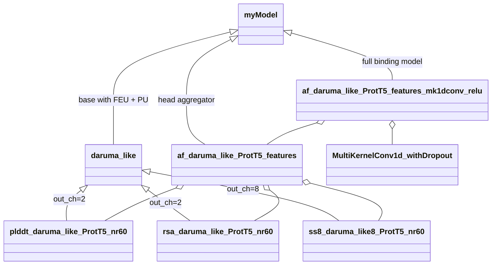
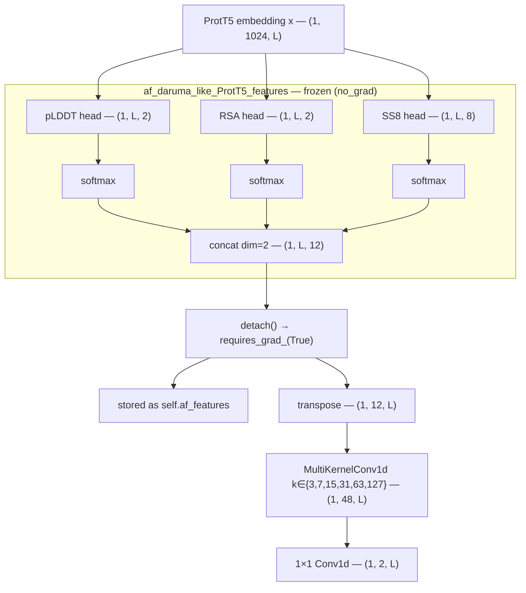

Beneath DARUMA-binding's binding head lies a layered feature substrate: three independently trained per-residue predictors that convert ProtT5 embeddings into interpretable structural signals — predicted **pLDDT**, **RSA**, and **eight-state secondary structure (SS8)**. This page dissects how these auxiliary heads are constructed, how their outputs are fused into a 12-channel feature vector, and how that vector is consumed downstream. It sits between the shared convolutional backbone ([Convolutional Backbone: FEU and PU](6-convolutional-backbone-feu-and-pu)) and the specialized binding head ([Multi-Kernel Conv Binding Head](8-multi-kernel-conv-binding-head)). All definitions live in a single file: `src/daruma_binding/backend/models.py`.

## Three Heads, One Backbone: The DAF Predictor Family

The auxiliary heads are three thin specializations of the same `daruma_like` architecture used for binding prediction itself. Each is a standalone residue-level classifier that consumes the same 1024-dimensional ProtT5 embedding and differs **only in output width**: two heads emit binary logits (2 channels), one emits 8-class logits. The repository's data documentation refers to this family as the **DAF models** — DAF-pLDDT, DAF-RSA, and DAF-SS — each with its own training and validation splits archived separately from the binding data. The `nr60` suffix in every class name encodes the training protocol: ProtT5 inputs at 60% sequence-identity redundancy reduction, whose construction details the data documentation defers to the manuscript.

| Class | Task | `out_ch` | Output classes | Dedicated training/validation data |
|---|---|---|---|---|
| `plddt_daruma_like_ProtT5_nr60` | pLDDT (high/low confidence) | 2 | 2 | `train/val_plddt.txt` (DAF-pLDDT) |
| `rsa_daruma_like_ProtT5_nr60` | Relative solvent accessibility | 2 | 2 | `train/val_rsa.txt` (DAF-RSA) |
| `ss8_daruma_like8_ProtT5_nr60` | Q8 secondary structure | 8 | 8 | `train/val_ss.txt` (DAF-SS) |

Sources: [models.py](src/daruma_binding/backend/models.py#L117-L133), [data/README.md](data/README.md#L11-L27)

The specialization classes are deliberately minimal — each is a constructor that pins `out_ch` (2, 2, 8) and hard-fails if `in_ch` deviates from 1024, protecting the ProtT5 dimensionality contract. Note that the class names carry semantic weight beyond typing: `daruma_like8` for the SS8 head signals its widened output, while every name ending in `ProtT5_nr60` documents the embedding source and redundancy protocol at a glance.

## Class Hierarchy: Specialization by Output Width

The inheritance structure is a textbook example of **template specialization through width**: a fully parameterized base (`daruma_like`, itself extending the weight-loading `myModel`), three zero-logic subclasses that vary only `out_ch`, and two composition classes that aggregate heads or stack them behind the binding head. No auxiliary head redefines `forward` — they inherit the padding → FEU → PU pipeline verbatim from `daruma_like`.

Sources: [models.py](src/daruma_binding/backend/models.py#L82-L133), [models.py](src/daruma_binding/backend/models.py#L136-L187)

Each head instance is **weight-independent** — the aggregator instantiates three separate `daruma_like` objects, so a pLDDT specialist shares nothing with the RSA specialist despite identical topology. This is parallel ensemble architecture, not shared-trunk multi-task learning: the three tasks were decoupled at training time (each with its own dataset), then coupled at inference time by concatenation.

## The 12-Channel AF Feature Vector

The aggregator `af_daruma_like_ProtT5_features` runs all three heads on the same input, applies `softmax` along the class dimension of each, and concatenates along the feature dimension: 2 (pLDDT) + 2 (RSA) + 8 (SS8) = **12 channels per residue**, shaped `(1, L, 12)`. The channel semantics are codified in the composite model's `af_list` attribute — a self-documenting contract that downstream code indexes against:

| Channels | Labels (`af_list`) | Producer | Consumer |
|---|---|---|---|
| 0–1 | `plddt`, `1-plddt` | pLDDT head softmax | `plddt = ch[0] × 100` |
| 2–3 | `1-rsa`, `rsa` | RSA head softmax | `rsa = ch[3]` |
| 4–11 | `ss0(Alphahelix)` … `ss7(other)` | SS8 head softmax | SS8 output line; Q8→Q3 reduction |

Sources: [models.py](src/daruma_binding/backend/models.py#L136-L152), [models.py](src/daruma_binding/backend/models.py#L170-L171)

Because each binary head's two softmax channels are complementary, the labels literally read as *p* and *1−p* — but observe the **ordering asymmetry**: for pLDDT the positive class is channel 0, while for RSA it is channel 3. This asymmetry is not a defect; it is the exact indexing convention that `predict_from_x` honours, and misreading it would invert an exported signal.

> [!TIP]
> The channel layout is a positional contract, not a named mapping. `af_list` exists for documentation and future attribution analysis; every consumer in production code uses raw integer indices (`[..., 0]` for pLDDT, `[..., 3]` for RSA, `[..., 4:12]` for SS8). When extending the feature set, insert new channels at the end — reordering would silently corrupt every downstream slice.

## From Standalone Predictors to Frozen Feature Extractor

Inside the production model `af_daruma_like_ProtT5_features_mk1dconv_relu`, the head aggregator runs under `torch.no_grad()`: at inference the heads are a **frozen feature extractor**, not a trainable pathway. Their 12-channel output is then transposed to channels-first `(1, 12, L)` and handed to the multi-kernel convolution stage, which is documented on the next page ([Multi-Kernel Conv Binding Head](8-multi-kernel-conv-binding-head)). The full inference flow, with verified tensor shapes:

Sources: [models.py](src/daruma_binding/backend/models.py#L156-L187)

The most architecturally significant line in the file is `features.detach().requires_grad_(True)` — executed only when `return_af_features=True`, which the deployed `daruma_binding` wrapper always enables. Detaching makes the feature tensor a **leaf tensor** that gradients can flow *into* (but not through to the frozen heads), and storing it on `self.af_features` preserves it after the forward pass. This is precisely the mechanism that later lets occlusion-based attribution ask: *how much does each of the 12 structural channels contribute to the binding score at this residue?* — the subject of [Occlusion-Based Feature Attribution](15-occlusion-based-feature-attribution).

> [!TIP]
> The `no_grad` → `detach` → `requires_grad_(True)` sequence is not redundant. `no_grad` blocks graph construction inside the heads (memory + speed); `detach` severs the returned tensor from any remaining history; the final `requires_grad_(True)` re-arms it as an autograd leaf so `backward()` on the binding output can compute gradients *with respect to the features themselves*. Delete any one of the three and the attribution workflow breaks.

## Post-Processing: Channel Indexing, Q8→Q3 Reduction, and the Output Surface

The `daruma_binding` wrapper's `predict_from_x` converts raw AF probabilities into the human-facing structural outputs. Three transformations occur: pLDDT channel 0 is **scaled by 100** to recover the conventional 0–100 AlphaFold confidence scale; RSA is read directly from channel 3; and the 8 SS8 probability channels undergo a **Q8→Q3 reduction** by grouped summation — helix = sum of channels 4:7 (H, G, I), sheet = sum of 7:9 (E, B), coil = sum of 9:12 (T, S, coil). The mappings between Q8 indices and one-letter codes are held in `q8_to_char`/`q3_to_char` dictionaries, and `predict_from_seq` renders argmaxed probabilities into `ss8_str`/`ss3_str` strings.

| AF channel | `q8_to_char` | State |
|---|---|---|
| 4 | `H` | Alpha helix |
| 5 | `G` | 3-10 helix |
| 6 | `I` | pi helix |
| 7 | `E` | Extended strand |
| 8 | `B` | Isolated beta bridge |
| 9 | `T` | Turn |
| 10 | `S` | Bend |
| 11 | `-` | Other (coil) |

Sources: [models.py](src/daruma_binding/backend/models.py#L222-L240), [models.py](src/daruma_binding/backend/models.py#L205-L220)

These derived signals are not internal only — they are a first-class part of the output contract. `ResultWriter` writes them as lines 5–8 of every result file: per-residue pLDDT floats, per-residue RSA floats, an SS3 character string, and an SS8 character string. In other words, users receive the auxiliary heads' predictions as *explainable structural context* alongside the binding probabilities, at no extra inference cost since the heads run anyway to produce the binding model's input features. The full file format is specified in [Output Format Reference](3-output-format-reference).

Sources: [functions.py](src/daruma_binding/backend/functions.py#L133-L160)

## Training Provenance and Naming Conventions

Three facts about how these heads came to be are verifiable in the repository. **First**, each head has dedicated supervision: `data/README.md` lists separate training and validation files for the DAF-pLDDT, DAF-RSA, and DAF-SS models, distinct from the binding data. **Second**, the large training corpora (including `train_plddt.txt`, `train_rsa.txt`, `train_ss.txt`) are archived on Zenodo rather than in-repo, so reproduction requires that download — detailed in [Training Data and Zenodo Archive](12-training-data-and-zenodo-archive). **Third**, dataset construction, redundancy reduction, and splitting are documented in the manuscript, with the `nr60` class-name suffix matching the redundancy-reduction theme. At deployment, inference-time dropout is disabled everywhere (`dropout_rate=0` in both the aggregator's heads and the composite model), consistent with a deterministic `eval()`-mode pipeline assembled by the `daruma_binding` wrapper.

Sources: [data/README.md](data/README.md#L11-L37), [models.py](src/daruma_binding/backend/models.py#L136-L142), [models.py](src/daruma_binding/backend/models.py#L191-L198)

## Where This Fits in the Pipeline

The auxiliary heads are the **information bottleneck** of DARUMA-binding: 1024 generic embedding dimensions are compressed into 12 interpretable structural channels, and only those channels reach the binding head. Reading onward in catalog order: [Convolutional Backbone: FEU and PU](6-convolutional-backbone-feu-and-pu) details the FEU/PU blocks each head inherits; [Multi-Kernel Conv Binding Head](8-multi-kernel-conv-binding-head) covers the multi-scale convolutions that consume the 12-channel vector; and [Occlusion-Based Feature Attribution](15-occlusion-based-feature-attribution) exploits the stored `af_features` leaf tensor to quantify which structural channel drives each binding prediction.
