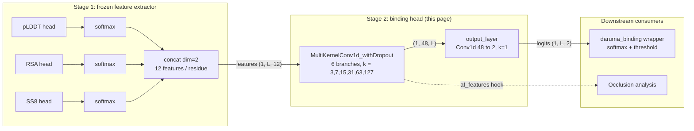
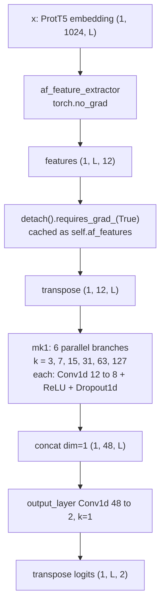

The multi-kernel conv binding head is the final classification stage of DARUMA-binding: it converts a 12-channel per-residue structural feature vector into 2-way binding logits by fusing evidence from six parallel 1D convolutions with kernel sizes spanning 3 to 127. This page dissects the head's module anatomy, its branch topology and receptive-field design, the frozen-feature contract it enforces on its input, and the integration hooks it exposes to the inference wrapper and the occlusion-attribution pipeline.

## Architectural Position: Where the Head Sits

DARUMA-binding is organized as a two-stage cascade. Stage one — documented in [Convolutional Backbone: FEU and PU](6-convolutional-backbone-feu-and-pu) and [Auxiliary Structural Feature Heads](7-auxiliary-structural-feature-heads) — trains three `daruma_like` networks (pLDDT, RSA, SS8) that map a ProtT5 embedding to per-residue structural probabilities. Stage two is the binding head: the class `af_daruma_like_ProtT5_features_mk1dconv_relu` consumes the concatenated 12-channel output of those three heads (`plddt` + `1-plddt` + `1-rsa` + `rsa` + 8 SS8 states) and produces the final binding/non-binding logits. The stage-one extractor runs entirely under `torch.no_grad()` inside the head's forward pass, so it behaves as a fixed, deterministic feature front-end rather than a trainable component of the binding decision.

The head's composition is declared in its constructor: `mk1` (the multi-kernel block), `output_layer` (a single pointwise convolution), and `af_feature_extractor` (the frozen stage-one ensemble), plus the `return_af_features` flag that controls the gradient hook. The 12-channel input ordering is pinned by `af_list`, which documents channel 0 as pLDDT, channel 3 as RSA, and channels 4–11 as the eight Q8 secondary-structure states — an ordering the inference wrapper later relies on when unpacking outputs.

Sources: [models.py](src/daruma_binding/backend/models.py#L156-L171), [models.py](src/daruma_binding/backend/models.py#L135-L152)

## The Core Module: MultiKernelConv1d_withDropout

`MultiKernelConv1d_withDropout` is a compact fan-out/fan-in primitive: it builds an `nn.ModuleList` of parallel branches, one per requested kernel size, where each branch is `nn.Sequential(Conv1d(in_channels, out_channels, kernel_size=k, padding=k//2), ReLU, Dropout1d)`. Its forward pass runs every branch on the same input tensor and concatenates the results along the channel dimension, producing the shape contract documented in its docstring: input `(B, C_in, L)` maps to output `(B, C_out * len(kernel_sizes), L)`. The constructor enforces that `kernel_sizes` and `dropout_rates` have equal length, making per-branch regularization an explicit, paired configuration rather than a global scalar.

Note that `Dropout1d` is resolved defensively at module import time — `getattr(nn, "Dropout1d", None) or nn.Dropout` — because `nn.Dropout1d` only exists from PyTorch 1.12 onward, while the project's tested environment is PyTorch 1.12.1+cu102. Semantically this matters: `Dropout1d` zeroes entire channels of a `(B, C, L)` tensor, so on these branches it would ablate whole learned feature maps across all residues simultaneously — a channel-wise regularization suited to multi-branch designs where a branch's maps are semantically coherent units.

> [!TIP]
> The concat-along-channels design means the six branches never interact until the output layer — each branch is an independent scale-specific detector, and cross-scale integration happens exactly once, inside the 1×1 output convolution. This is the defining property of the head's inception-style topology.

Sources: [models.py](src/daruma_binding/backend/models.py#L13-L59)

## Branch Topology: Receptive Fields as a Design Choice

The deployed configuration instantiates six branches with kernel sizes `[3, 7, 15, 31, 63, 127]`, each mapping the 12 input channels to 8 output channels, each with dropout rate `0.0`, and ReLU enabled. The kernel sizes follow the pattern `2^n − 1`, which is not cosmetic: for odd kernels, symmetric zero padding of `k//2` exactly preserves sequence length, so all six branches produce length-aligned outputs that remain residue-indexed — a precondition for the channel-wise concatenation to be meaningful. Receptive fields therefore range from ±1 residue (short local motifs) to ±63 residues (extended IDR segments), giving the head six distinct context scales without stacking convolutional depth.

| Branch | Kernel size | Padding | Per-side context | Branch output |
|--------|-------------|---------|------------------|---------------|
| 1 | 3 | 1 | ±1 residue | 8 channels |
| 2 | 7 | 3 | ±3 residues | 8 channels |
| 3 | 15 | 7 | ±7 residues | 8 channels |
| 4 | 31 | 15 | ±15 residues | 8 channels |
| 5 | 63 | 31 | ±31 residues | 8 channels |
| 6 | 127 | 63 | ±63 residues | 8 channels |

Six branches × 8 channels = 48 concatenated channels, which is exactly the input width expected by `output_layer = nn.Sequential(Conv1d(48, 2, kernel_size=1))`. This pointwise convolution is the sole point of cross-channel mixing: it learns, per residue, how to weight the 48 scale-specific evidence channels into two logits. Branches use `Conv1d`'s default zero padding, meaning edge residues see zero-padded context rather than replicated boundary values — worth remembering when interpreting predictions near sequence termini.

Sources: [models.py](src/daruma_binding/backend/models.py#L160-L164), [models.py](src/daruma_binding/backend/models.py#L35-L59)

## Inside the Head: The Forward Pass and the Gradient Hook

The forward pass sequences four operations. First, the frozen extractor computes the 12-channel feature tensor under `torch.no_grad()`, severing the computation graph from stage one. Second — when `return_af_features=True`, as it is in deployment — the features are detached and re-attached to the graph as a fresh leaf via `features.detach().requires_grad_(True)`, then cached on the model as `self.af_features`. Third, the features are transposed to channel-first `(1, 12, L)` and pushed through the six-branch multi-kernel block. Fourth, the 48-channel result passes through the 1×1 output convolution and is transposed back to `(1, L, 2)`.

The `detach().requires_grad_()` pattern is architecturally deliberate. Because stage one is frozen, the binding head is the only differentiable consumer of the features; re-rooting the graph at the feature tensor makes `af_features` a legitimate gradient input. The occlusion-based attribution workflow — detailed in [Occlusion-Based Feature Attribution](15-occlusion-based-feature-attribution) — exploits exactly this: it can perturb the cached feature tensor and backpropagate into it to measure per-channel sensitivity, without ever touching stage-one weights. The wrapper exposes the same tensor read-only via `get_af_features()`.

> [!TIP]
> Observe that the head's `dropout_rate` constructor parameter is effectively vestigial: it is accepted and forwarded to the base class, but the branch dropout rates passed to `mk1` are a hardcoded list of six `0.0` values. In the shipped model, regularization is fully determined by that literal list, not by the parameter — a detail that matters when re-instantiating the architecture for retraining.

Sources: [models.py](src/daruma_binding/backend/models.py#L174-L187), [models.py](src/daruma_binding/backend/models.py#L192-L193), [models.py](src/daruma_binding/backend/models.py#L242-L243)

## Tensor Shape Contract

The head's data flow is length-invariant end to end — every operation either preserves or explicitly restores the residue axis. This is what allows logits to be index-aligned with the original sequence, and what allows the wrapper to unpack `af_features` by absolute channel position.

| Stage | Operation | Tensor shape |
|-------|-----------|--------------|
| Input | ProtT5 embedding | `(1, 1024, L)` |
| Feature extraction | Frozen heads + softmax + concat | `(1, L, 12)` |
| Gradient hook | `detach().requires_grad_()` | `(1, L, 12)` (new graph leaf) |
| Transpose | channel-first | `(1, 12, L)` |
| Multi-kernel block | 6 branches, concat | `(1, 48, L)` |
| Output layer | pointwise Conv1d | `(1, 2, L)` |
| Output | transpose, residue-first logits | `(1, L, 2)` |

Two length-restoration facts underwrite this contract. Upstream, the stage-one `daruma_like` models zero-pad the embedding by 60 on each side and consume it with kernels totaling exactly 120 positions of reduction (three k=9 FEU convolutions plus one k=121 PU convolution), returning the sequence to length L. Downstream, each head branch pads `k//2` on both sides for odd `k`, again preserving L. The head therefore never distorts the residue axis at any scale it inspects.

Sources: [models.py](src/daruma_binding/backend/models.py#L174-L187), [models.py](src/daruma_binding/backend/models.py#L108-L114)

## Deployment Configuration and Repository Variants

The shipping wrapper `daruma_binding` instantiates the head with `dropout_rate=0, in_ch=1024, return_af_features=True`, loads `model_weights/daruma_binding_weight.pth` onto CPU, calls `.eval()`, and stores the decision threshold of `0.26` — chosen to maximize F1 on validation data (thresholding itself is covered in [Inference Orchestration and Decision Threshold](10-inference-orchestration-and-decision-threshold)). The state dict covers the entire cascade, frozen extractor included; only execution-time `no_grad` enforcement keeps stage one out of any gradient computation.

The repository carries two near-identical copies of the model code, and their divergence is instructive:

| Aspect | `src/daruma_binding/backend/models.py` (canonical) | `caid/.../backend/models.py` (CAID 4 submission) |
|--------|-----------------------------------------------------|---------------------------------------------------|
| Head class | Identical: same kernel sizes, channel counts, hook | Identical |
| Wrapper constructor | Accepts injected `featurizer` | No featurizer parameter |
| Posterior smoothing | `MovingAverageSmoothing(kernel_size=1)` — disabled | `MovingAverageSmoothing(kernel_size=7)` |
| Feature-order metadata | Declares `af_list` channel labels | Absent |

The `caid/` tree is the frozen code submitted to CAID 4 (per the repository README) and retains the k=7 smoothing window that the canonical `src/` version has since disabled. The canonical version additionally formalizes the 12-channel ordering as `af_list` and supports featurizer injection via `predict_from_seq`, which featurizes a raw sequence to a `(1, D, L)` embedding before invoking the head.

Sources: [models.py](src/daruma_binding/backend/models.py#L191-L200), [models.py](src/daruma_binding/backend/models.py#L245-L257), [models.py](caid/DARUMA-binding/daruma_binding/backend/models.py#L186-L194), [README.md](README.md#L84-L86)

## Downstream Integration: What the Head Exposes

The wrapper's `predict_from_x` treats the head's logits as the sole classification signal and the cached `af_features` as an interpretable byproduct: logits pass through `logit_to_prob` (softmax over the last axis, keeping index 1 as binding probability), while the `(1, L, 12)` feature tensor is squeezed and unpacked by absolute channel index — `[..., 0]` as pLDDT (scaled ×100), `[..., 3]` as RSA, `[..., 4:12]` as the eight SS8 probabilities, with channels 4–6, 7–8, and 9–11 summed into helix/sheet/coil for SS3. This unpacking is only safe because `af_list` guarantees the channel ordering established at head construction — the multi-kernel head and the output writer are coupled by that implicit contract.

For attribution workflows, the head offers two access paths to the same tensor: the in-place cache `self.model.af_features` and the accessor `get_af_features()`. Both hand consumers a graph leaf rooted at the head's input, which is the entry point occlusion analysis perturbs when measuring which structural features drive binding predictions — the mechanism explored in [Occlusion-Based Feature Attribution](15-occlusion-based-feature-attribution).

Sources: [models.py](src/daruma_binding/backend/models.py#L222-L243), [models.py](src/daruma_binding/backend/models.py#L170-L171)

## Key Takeaways and Where to Go Next

Three properties define this head. It is **scale-decomposed**: six parallel kernels from 3 to 127 capture motif-scale through segment-scale context, with cross-scale fusion deferred entirely to a single 1×1 convolution. It is **frozen-input**: stage-one structural predictions enter under `no_grad`, so the head's trainable surface is exactly the multi-kernel branches plus the pointwise output layer. It is **attribution-ready**: the `detach().requires_grad_()` hook turns its input features into a gradient-addressable leaf, making the head not just a classifier but a designed interface for interpretability.

Recommended reading progression from here:

- Revisit the frozen upstream heads consumed by this page: [Auxiliary Structural Feature Heads](7-auxiliary-structural-feature-heads) and their shared backbone [Convolutional Backbone: FEU and PU](6-convolutional-backbone-feu-and-pu)
- Understand how the head's outputs are smoothed, thresholded, and written: [Inference Orchestration and Decision Threshold](10-inference-orchestration-and-decision-threshold)
- See the gradient hook exploited in practice: [Occlusion-Based Feature Attribution](15-occlusion-based-feature-attribution)
- For the embedding side that feeds stage one: [ProtT5 Embedding Chunking Strategy](9-prott5-embedding-chunking-strategy)
