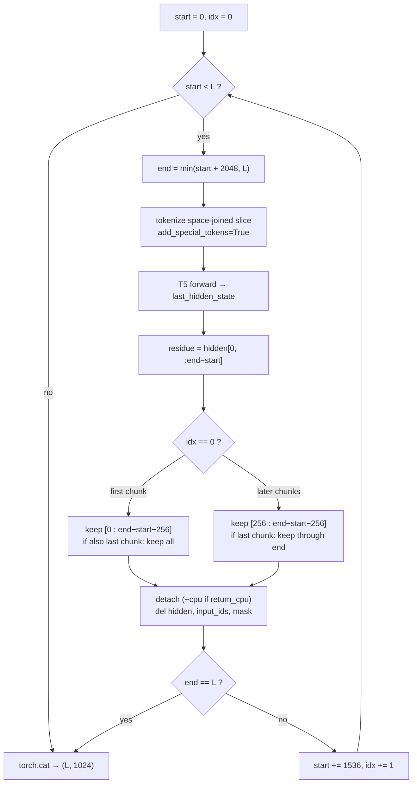
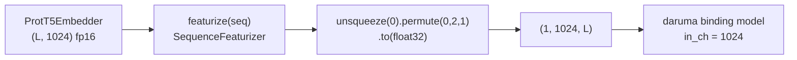

This page explains how DARUMA-binding converts arbitrarily long amino acid sequences into fixed-width ProtT5 embeddings without exhausting GPU memory or corrupting residue-level alignment. The strategy lives entirely in the `ProtT5Embedder` class of the standalone pipeline: long sequences are encoded as **overlapping 2048-residue windows**, each window's boundary-contaminated vectors are **trimmed**, and the surviving vectors are **concatenated into a single `(L, 1024)` tensor** that is bit-exactly what a full-length encode would need to produce. Chunking is invisible to the binding network itself — it is a pure embedding-stage concern.

Sources: [functions.py](/src/daruma_binding/backend/functions.py#L26-L120), [predict.py](/src/daruma_binding/predict.py#L54-L71)

## Why Long Sequences Force a Chunked Encoder

Self-attention cost and activation memory grow with sequence length, so running a T5 XL encoder over a 20,000-residue protein in one shot is impractical on typical hardware. DARUMA-binding resolves this at the featurization layer: `SequenceFeaturizer` instantiates `ProtT5Embedder` with a hardwired window size, and the binding network downstream always receives the complete protein as one tensor of shape `(1, 1024, L)`. The architecture therefore decouples *encoder context* (bounded per window) from *model receptive field* (full sequence, via the convolutional trunk). The full pipeline positions chunking as follows:


Two structural facts anchor this design. First, the encoder is `Rostlab/prot_t5_xl_half_uniref50-enc`, loaded in half precision and eval mode, with a CPU fallback that upcasts to float32. Second, every residue is tokenized individually (space-joined string), so the token count per window equals the residue count plus tokenizer special tokens — the basis of the exact residue-to-vector alignment described below.

Sources: [functions.py](/src/daruma_binding/backend/functions.py#L26-L59), [functions.py](/src/daruma_binding/backend/functions.py#L123-L133), [models.py](/src/daruma_binding/backend/models.py#L245-L257)

## Window Geometry: chunk_size, overlap, trim, step

The constructor takes four interlocking parameters and enforces two invariants that make the whole scheme mathematically sound:

| Parameter | Default value | Role |
|---|---|---|
| `chunk_size` | 2048 | Residues per encoder window |
| `overlap` | 512 | Shared context band between adjacent windows |
| `trim` | `overlap // 2` = 256 | Vectors discarded at each seam before concatenation |
| `step` | `chunk_size - overlap` = 1536 | Stride between window starts |

The two assertions are not stylistic — they encode correctness conditions. `overlap < chunk_size` guarantees `step ≥ 1`, so the loop always makes forward progress. `overlap % 2 == 0` guarantees the overlap band can be split symmetrically into `trim` residues on each side, which is precisely what makes adjacent windows' kept regions abut with no gap and no duplication (proven in the stitching section below). `SequenceFeaturizer` fixes `chunk_size=2048, overlap=512` at construction; there is currently no CLI override.

| Constraint | Assertion | Consequence if violated |
|---|---|---|
| Forward progress | `overlap < chunk_size` | `step ≤ 0` → infinite loop |
| Seamless stitching | `overlap % 2 == 0` | Asymmetric trim → off-by-N misalignment between chunks |

Sources: [functions.py](/src/daruma_binding/backend/functions.py#L27-L42), [functions.py](/src/daruma_binding/backend/functions.py#L66), [functions.py](/src/daruma_binding/backend/functions.py#L127)

## The Chunk Embedding Loop

The `embed()` method iterates windows under a single `torch.inference_mode()` context. The loop is short enough to reason about completely:



Three details deserve attention. First, sequences are sanitized twice — non-standard residues `[UBJOZ]` are mapped to `X` at FASTA load, and `[UZOB]` are re-mapped to `X` inside `embed()`, making the embedder robust even when called directly on raw strings. Second, `padding=False` and batch size 1 mean every token position in the window is a real residue except the appended EOS. Third, the chunk index `idx` distinguishes the first window only; its trim policy handles both the "first chunk followed by more" case and the degenerate "single chunk covers everything" case (`L ≤ 2048`).

> [!TIP]
> The slice `residue = hidden[0, :(end - start), :]` exists because `add_special_tokens=True` makes the T5 tokenizer append `</s>` after the last residue, producing `end − start + 1` hidden states. Slicing to `end − start` discards that EOS vector and restores 1:1 residue-to-vector alignment. Delete this slice and every chunk after the first shifts by one residue — the concatenation would still "succeed" while silently corrupting the sequence.

Sources: [functions.py](/src/daruma_binding/backend/functions.py#L61-L90), [functions.py](/src/daruma_binding/backend/functions.py#L92-L114), [functions.py](/src/daruma_binding/backend/functions.py#L12-L23)

## Seam Trimming: Keeping Only Context-Deep Vectors

Each window produces a hidden state for every residue it contains, but vectors near a window's edge were computed with truncated flanking context — the encoder never saw what lies beyond the window. The trim policy discards exactly those vectors and keeps only positions whose encoder context is deep on every emitted side:

| Chunk position | Kept window-local slice | Rationale |
|---|---|---|
| First chunk (`idx == 0`), not last | `[0, end − 256)` | N-terminus needs no left context; drop 256 seam-side vectors |
| First chunk, also last (`L ≤ 2048`) | `[0, end)` | No seam exists — keep everything |
| Interior chunks | `[256, end − 256)` | Every kept vector has ≥ 256 residues of encoder context on both sides |
| Final chunk (not first) | `[256, end)` | C-terminus needs no right context; drop 256 seam-side vectors |

The consequence is a strong quality invariant: **every emitted vector comes from a window in which the residue has at least 256 flanking residues encoded on any side that actually exists in the protein.** A vector is only discarded when its window truncated real sequence context. The 512-residue overlap is thus not redundant output — it is *context insurance*: each seam region is encoded twice, once as the tail context of window *k* and once as the head context of window *k+1*, and the higher-quality interior copy survives.

Sources: [functions.py](/src/daruma_binding/backend/functions.py#L41-L42), [functions.py](/src/daruma_binding/backend/functions.py#L92-L99)

## Lossless Stitching: The Abutment Invariant

Trimming only works if the kept regions tile the sequence exactly. They do, and the arithmetic is checkable. For interior chunk *k* starting at `start_k = 1536k`, the kept slice in global coordinates is:

```
kept(k) = [start_k + 256, start_k + 2048 − 256)
        = [1536k + 256,  1536(k+1) + 256)
```

The end of `kept(k)` equals the start of `kept(k+1)` — the kept regions form a perfect partition of `[256, L)` with zero gaps and zero overlaps, capped on the left by chunk 0's kept region `[0, 1792)`. A concrete trace for a protein of `L = 5000` (which yields `n = ⌈5000/1536⌉ = 4`? no — verify: starts are 0, 1536, 3072, and the window at 3072 reaches 5000, so `n = 3`):

| Chunk | Window `[start, end)` | Kept (global) | Emitted positions | Count |
|---|---|---|---|---|
| 0 | [0, 2048) | [0, 1792) | 0 – 1791 | 1792 |
| 1 | [1536, 3584) | [1792, 3328) | 1792 – 3327 | 1536 |
| 2 | [3072, 5000) | [3328, 5000) | 3328 – 4999 | 1672 |
| **Total** | 6024 encoded | — | **0 – 4999** | **5000 = L** ✓ |

The cost side of the ledger: 6024 residues were encoded to emit 5000 vectors — the 1024 encoded-twice residues are the two 512-residue overlap bands. In general, roughly `512·(n−1)` extra residues are encoded (less when the final window is shorter than the overlap), a bounded, predictable redundancy that buys context depth at every seam. Note that a chunk shorter than `chunk_size` can only be the final one: `end < start + 2048` implies `end == L`, so the trim policy's "if last chunk, keep through end" branch is the only variable-length case the loop must handle.

> [!TIP]
> The abutment identity `start_k + chunk_size − trim = start_{k+1} + trim` holds *because* `trim = overlap // 2`. This is the concrete reason the constructor asserts `overlap % 2 == 0`: with an odd overlap, the trim budget cannot split evenly, kept regions would overlap or gap by one residue, and `torch.cat` would silently produce an `(L ± 1, 1024)` tensor that breaks the sequence-length check downstream.

Sources: [functions.py](/src/daruma_binding/backend/functions.py#L66-L73), [functions.py](/src/daruma_binding/backend/functions.py#L92-L116)

## Precision and Memory Discipline

Chunking alone bounds the *sequence* dimension; the implementation also bounds the *per-window* memory footprint so peak VRAM depends on `chunk_size`, not `L`. The measures, all visible in the code:

| Mechanism | Implementation | Effect |
|---|---|---|
| Half-precision weights | `.half().to(device).eval()` | XL encoder resident in half the memory; matches the `*_half` checkpoint |
| CPU fallback | `self.model.float()` when device is CPU | fp16 matmul is unsupported/slow on CPU |
| Whole-loop inference mode | single `with torch.inference_mode()` | No autograd graph across any chunk |
| Per-chunk teardown | `del hidden, input_ids, attention_mask, tok` | Activations freed before the next window is encoded |
| Optional CPU offload | `return_cpu` flag (default `False`) | Kept chunks stay on GPU for a single device-side `torch.cat` |
| Async host-to-device | `non_blocking=True` transfers | Overlaps copy with compute |

One precision transition is deliberate and easy to miss: embeddings are computed in fp16 but the binding model runs in fp32. `predict_from_seq` upcasts with `.to(torch.float32)` immediately after the permute, so the numerical contract of the trained conv weights is preserved even though their inputs were produced by a half-precision encoder.

Sources: [functions.py](/src/daruma_binding/backend/functions.py#L49-L59), [functions.py](/src/daruma_binding/backend/functions.py#L69-L108), [models.py](/src/daruma_binding/backend/models.py#L249)

## Integration Contract: From `(L, 1024)` to the Binding Network

The chunking strategy is encapsulated behind a one-call interface. `ProtT5Embedder.__call__` delegates to `embed()`, `SequenceFeaturizer` exposes `featurize(seq)`, and the `daruma_binding` wrapper invokes it in `predict_from_seq`:



The width 1024 is not coincidental — it is `d_model` of `prot_t5_xl`, and every binding-head variant in `models.py` validates `in_ch == 1024`, raising `ValueError` otherwise. The downstream network then pads ±60 and runs FEU/PU convolutions over the *entire* sequence at once; per-residue outputs at position 0 and position L−1 are therefore informed by global context via the conv trunk, compensating for the fact that chunking only constrained the *embedding* stage.

A contrasting integration exists in the CAID 4 submission package: `caid/DARUMA-binding/daruma_binding/predict.py` accepts **pre-computed** ProtT5 vectors as a `.npy` file, validates `X.shape[0] == len(seq)`, and contains no embedder at all. Chunking is a feature of the standalone end-to-end pipeline only — a distinction that matters when reproducing benchmarks via the CAID harness.

| Aspect | Standalone pipeline (`src/`) | CAID package (`caid/`) |
|---|---|---|
| Input | Raw FASTA sequences | Pre-computed ProtT5 `.npy` |
| ProtT5 encoding | Internal, chunked (`ProtT5Embedder`) | Not performed; delegated to the caller |
| Chunking parameters | `chunk_size=2048, overlap=512` | Not applicable |
| Length validation | Guaranteed by construction | Explicit `X.shape[0] != len(seq)` check |

Sources: [functions.py](/src/daruma_binding/backend/functions.py#L119-L133), [models.py](/src/daruma_binding/backend/models.py#L83-L121), [models.py](/src/daruma_binding/backend/models.py#L245-L257), [predict.py](/caid/DARUMA-binding/daruma_binding/predict.py#L69-L87), [predict.py](/src/daruma_binding/predict.py#L66-L71)

## Tuning Considerations and Trade-offs

Although `SequenceFeaturizer` hardwires the defaults, the `ProtT5Embedder` constructor exposes the knobs, and their trade-space is worth understanding before changing anything:

| Adjustment | Gain | Cost / Risk |
|---|---|---|
| Smaller `chunk_size` | Lower peak VRAM; runs on smaller GPUs | More chunks, more seams; trim regions re-encoded more often |
| Larger `overlap` | Deeper encoder context at seams → more stable boundary vectors | More duplicated compute (≈ `overlap` residues per seam encoded twice) |
| Smaller `overlap` | Less redundant encoding | Vectors near seams computed with thin flanking context |
| Odd `overlap` | — | Blocked by assertion; breaks the abutment invariant |

The default `(2048, 512)` reflects a deliberate middle point: 1536 useful residues of forward progress per encoder pass, 256 residues of retained context beyond every emitted vector's window edge, and total redundancy confined to the seam bands. Note the loop's per-window cost is dominated by the T5 forward pass; the Python-side slicing, trimming, and `torch.cat` are negligible by comparison.

Sources: [functions.py](/src/daruma_binding/backend/functions.py#L27-L42), [functions.py](/src/daruma_binding/backend/functions.py#L123-L133)

## Where to Go Next

Chunking is the bridge between the protein language model and the neural predictor. To see where the stitched `(L, 1024)` tensor travels next — through the FEU/PU convolutional trunk, the auxiliary structural-feature heads, and the multi-kernel binding head — continue with [Prediction Pipeline Architecture](5-prediction-pipeline-architecture), [Convolutional Backbone: FEU and PU](6-convolutional-backbone-feu-and-pu), and [Multi-Kernel Conv Binding Head](8-multi-kernel-conv-binding-head). For how the resulting per-residue probabilities are thresholded and written out, see [Inference Orchestration and Decision Threshold](10-inference-orchestration-and-decision-threshold). If you intend to reproduce CAID benchmark results with externally generated embeddings, [Docker and CAID Usage](4-docker-and-caid-usage) covers the precomputed-`.npy` workflow described above.
