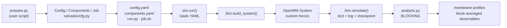
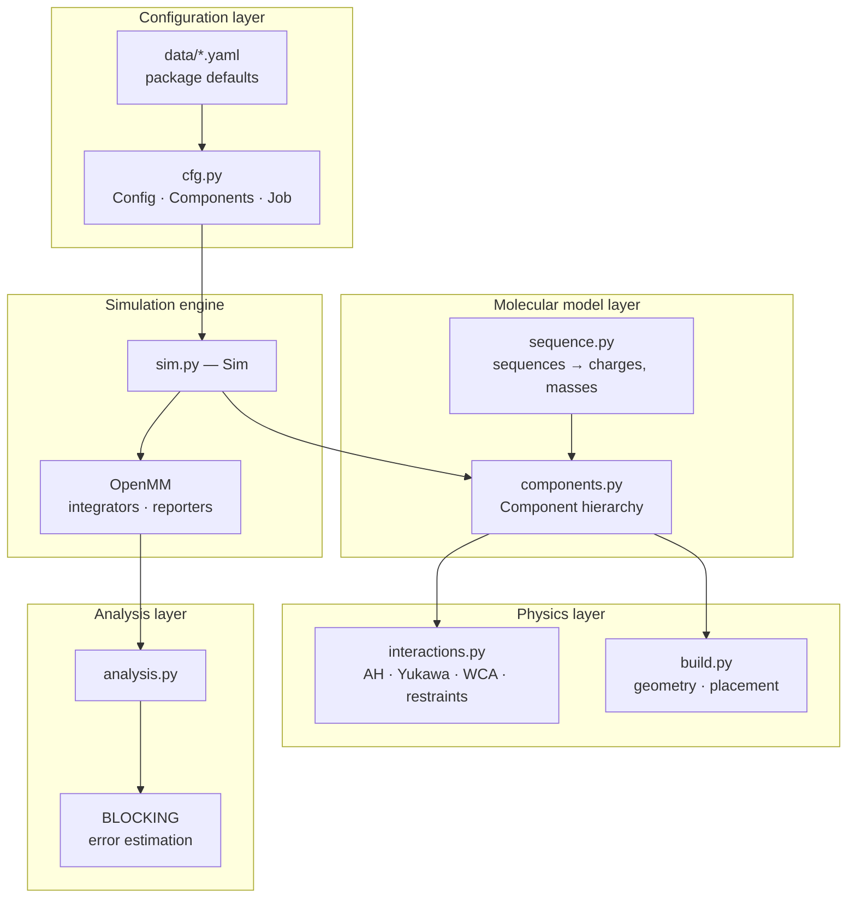
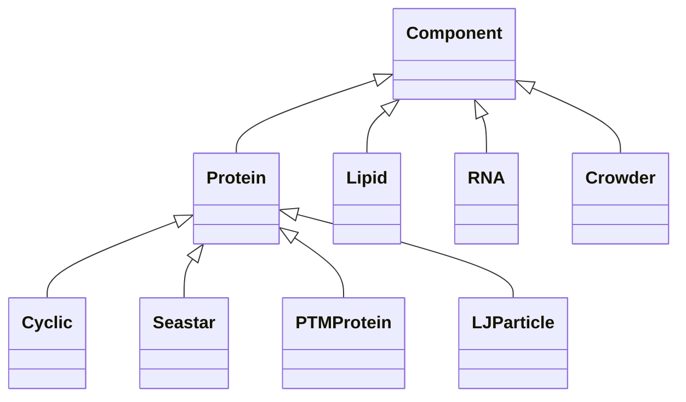

This page is the entry point to the MEM-CALVADOS documentation. It answers three questions for a newcomer: *what* this software does, *how* the repository is organized, and *where* to go next. Rather than diving into implementation details — those live in the Deep Dive pages — we build a mental model of the package from first principles: a YAML-driven workflow that turns a short Python "preparation script" into a full coarse-grained molecular dynamics simulation and its analysis.

## What Is MEM-CALVADOS?

MEM-CALVADOS is a Python package for **coarse-grained, implicit-solvent molecular dynamics simulations of biomolecules at membrane interfaces**. It is a branch of the CALVADOS family of models (originally developed for intrinsically disordered proteins) that implements the MEM-CALVADOS v1 residue-level model for flexible proteins near lipid membranes. Under the hood, every simulation is driven by [OpenMM](https://openmm.org) — an open-source molecular dynamics engine that runs on CPUs and GPUs.

In practical terms, one "bead" in a MEM-CALVADOS simulation typically represents one amino-acid residue, one nucleotide, or one lipid tail group. This level of coarse-graining makes it feasible to simulate large systems — multi-domain proteins, disordered protein chains, lipid bilayers, RNA — on timescales that would be prohibitively expensive for all-atom models.

Sources: [README.md](README.md#L1-L12), [setup.py](setup.py#L12-L13)

## The Big Picture: Define → Build → Simulate → Analyze

The package follows a deliberate **four-stage pipeline**, and understanding this pipeline is the key to reading the entire codebase. Stage 1 is a user-written `prepare.py` script that uses three small configuration classes to emit plain-text YAML files. Stage 2 loads those files, assembles every molecule into an OpenMM `System` with custom force definitions. Stage 3 runs the dynamics, writing trajectories, logs, and checkpoints. Stage 4 analyzes trajectories with MDAnalysis and estimates statistical errors with block analysis.



You can see the whole chain in the single transmembrane-protein example: `Config(...)` collects simulation settings, `Components(...)` lists the molecules, and `components.add(name='POPC', molecule_type='lipid', nmol=N_lipids)` registers lipids by name. Each `*.write(path, ...)` call emits a file that Stage 2 consumes.

Sources: [prepare.py](examples/single_TMP/prepare.py#L27-L46), [prepare.py](examples/single_TMP/prepare.py#L77-L90), [sim.py](calvados/sim.py#L870-L882), [cfg.py](calvados/cfg.py#L13-L30)

> [!TIP]
> The split between `config.yaml` and `components.yaml` is the package's central design decision: the **config** describes the *environment* (temperature, box, pressure coupling, runtime), while the **components** file describes the *molecules* (types, sequences, numbers of copies). Keeping them separate lets you reuse one environment across many molecular systems — and `Config.write()` even auto-generates the `run.py` launcher that binds the two together.

## Repository Map

The repository is a single installable Python package (`calvados/`) surrounded by three support rings: packaged data (`calvados/data/`), runnable examples (`examples/`), and a test suite (`tests/`). The annotated tree below is the fastest way to orient yourself:

```text
MEM-CALVADOS/
├── calvados/                  ← the installable package
│   ├── cfg.py                 ← Config, Components, Job (YAML writers)
│   ├── sim.py                 ← Sim class: OpenMM engine + run() entry point
│   ├── components.py          ← molecule classes: Protein, Lipid, RNA, ...
│   ├── sequence.py            ← FASTA/PDB parsing, charges, residue properties
│   ├── build.py               ← initial geometry, placement, clash checks
│   ├── interactions.py        ← potential energy functions (AH, Yukawa, WCA)
│   ├── analysis.py            ← trajectory analysis + membrane profiles
│   ├── utilities.py           ← helper functions
│   ├── forcegroupreporter.py  ← per-force-group energy reporting
│   ├── pressuredatareporter.py← pressure tensor/time-series reporting
│   ├── BLOCKING/              ← block analysis (fetched at install time)
│   └── data/                  ← default YAMLs, residues.csv, job templates
├── examples/                  ← 18 ready-to-run scenarios (IDRs, slabs, bilayers, TMPs, RNA)
├── tests/                     ← pytest suite for potentials, RNA bonds, restraints
├── docs/                      ← Sphinx documentation source
├── residues.csv               ← top-level residue parameter table
└── setup.py                   ← installation metadata + dependencies
```

Every public module is imported at package level, so `import calvados` makes the whole toolkit available at once. The `data/` directory is distributed as package data and holds the three default YAML files plus the residue parameter tables that define each bead's size, hydrophobicity, charge, and bond length.

Sources: [calvados/\_\_init\_\_.py](calvados/__init__.py#L1-L12), [setup.py](setup.py#L28-L40)

| Module | Key symbols | Responsibility |
|---|---|---|
| `calvados/cfg.py` | `Config`, `Components`, `Job` | Merge user settings with YAML defaults; write `config.yaml`, `components.yaml`, `run.py`, cluster `job.sh` |
| `calvados/sim.py` | `Sim`, `run()` | Build the OpenMM system, manage equilibration stages, run dynamics, attach reporters |
| `calvados/components.py` | `Component`, `Protein`, `Lipid`, `RNA`, ... | Per-molecule sequence parsing, property calculation, bond/angle/restraint construction |
| `calvados/sequence.py` | `read_fasta`, `seq_from_pdb`, `get_qs` | Sequence I/O, pH-dependent charge states, terminal patching |
| `calvados/build.py` | `build_box`, `build_spiral`, `check_clash` | Box geometry, spiral/linear/compact initial coordinates, collision-free placement |
| `calvados/interactions.py` | `init_ah_interactions`, `genParamsDH`, `init_wca_interactions` | Custom OpenMM force definitions |
| `calvados/analysis.py` | `calc_membrane_profiles`, `BlockAnalysis` | Trajectory post-processing and statistical error estimation |

Sources: [calvados/\_\_init\_\_.py](calvados/__init__.py#L1-L12), [cfg.py](calvados/cfg.py#L13-L120), [sim.py](calvados/sim.py#L25-L47), [components.py](calvados/components.py#L21-L40)

## Layered Architecture

Reading the import graph reveals five clean layers. The configuration layer depends on nothing but YAML and Jinja2. The model layer (sequence + components) converts biomolecular data into per-bead parameters. The physics layer defines the energy functions, and the engine layer assembles everything into a running simulation. The analysis layer is deliberately decoupled — it only needs the output files, never a live simulation object.



This separation is visible in the code: `sim.py` imports only `build` and `interactions` plus the component classes, while `analysis.py` is imported by user-written post-processing code (which `Config.write()` appends to the generated `run.py`) rather than by the simulation engine itself.

Sources: [sim.py](calvados/sim.py#L1-L19), [analysis.py](calvados/analysis.py#L26-L28), [cfg.py](calvados/cfg.py#L13-L30)

## The Component Zoo

Every molecule in a simulation is an instance of a class derived from `Component`. The base class handles the universal machinery — loading per-residue parameters from `residues.csv`, computing charges at a given pH, and building initial coordinates — while each subclass overrides just the parts that differ between molecule types, such as which bead pairs get bonded.



When `Sim.build_system()` iterates over your `components.yaml`, it dispatches on the `molecule_type` string and selects an appropriate **initial geometry** (`comp_setup`): proteins start compact, lipids unroll linearly, and RNA nucleotides wind in a spiral — choices that minimize initial clashes before dynamics begin.

| `molecule_type` | Class | Initial geometry | Notes |
|---|---|---|---|
| `protein` | `Protein` | compact (or exact PDB coordinates when restraints are on) | Optional harmonic or Go-type restraints from PDB/AlphaFold data |
| `lipid` | `Lipid` | linear | Extra per-bead bond/angle force constants read from the residue table |
| `rna` | `RNA` | spiral | Special bond/angle topology including base-pair terms |
| `crowder` | `Crowder` | compact | Generic volume-filling chain |
| `cyclic` | `Cyclic` | compact | `Protein` with a closing bond between termini |
| `seastar` | `Seastar` | compact | Branched peptide with `n_ends` arms |
| `ptm_protein` | `PTMProtein` | compact | Protein plus post-translational modification beads attached at given sites |
| `lj_particle` | `LJParticle` | compact | Non-bonded Lennard-Jones fluid particles |

Sources: [sim.py](calvados/sim.py#L49-L100), [components.py](calvados/components.py#L118-L124), [components.py](calvados/components.py#L450-L456), [components.py](calvados/components.py#L558-L570), [components.py](calvados/components.py#L604-L610), [components.py](calvados/components.py#L627-L634), [components.py](calvados/components.py#L420-L448)

## Configuration-Driven Design

Nothing in a MEM-CALVADOS simulation is hard-coded. Three classes in `cfg.py` implement a *defaults-plus-overrides* pattern: each loads a packaged YAML file (`default_config.yaml`, `default_component.yaml`, `default_job.yaml`), then overwrites entries with whatever keyword arguments you pass. `Config.write()` serializes the merged dictionary and — importantly — also emits a self-contained `run.py` launcher whose post-processing hooks you can supply as a string. `Job.write()` renders a PBS or SLURM submission script from a Jinja2 template, so the same preparation script produces both a local run and a cluster job.

| Config key (default) | Meaning | Typical user override |
|---|---|---|
| `sysname` (`'default_simulation'`) | Prefix for all output files | `'myprotein_1'` |
| `box` (user-supplied) | Simulation box dimensions in nm | `[30, 30, 100]` |
| `temp`, `ionic`, `pH` (user-supplied) | Thermodynamic state point; ionic strength feeds the Debye length, pH feeds protonation | `310`, `0.15`, `7.4` |
| `eps_lj` (`0.2`), `cutoff_lj` (`2.0`), `cutoff_yu` (`4.0`) | Interaction strength (kcal/mol) and cutoffs (nm) | tuned per model variant |
| `steps`, `wfreq`, `logfreq` | Total MD steps; trajectory and log write frequencies (1 step = 10 fs) | `1000*5e4`, `5e4` |
| `platform` (`'CPU'`), `gpu_id`, `gpu_precision` | Execution backend | `'CUDA'` |
| `restart` (`'checkpoint'`), `frestart` | Resume behavior and checkpoint filename | — |
| `slab_eq`, `bilayer_eq`, `box_eq`, `pressure_coupling` | Equilibration-stage switches (slab restraints, bilayer ordering, semi-isotropic box scaling, barostat) | `True`/`False` |
| `pressure` (`[0,0,0]`), `pressure_ramp`, `pressure_max` | Target pressures and a logarithmic ramp schedule | `[0,0,0]` |
| `custom_restraints`, `pmf_force` | Attach external restraint files or a pre-computed PMF force | `True` + file path |

Component defaults work the same way: a component entry in `components.yaml` only needs the keys that differ from `default_component.yaml`, which supplies everything from the number of molecules (`nmol`) to Go-restraint strengths (`k_go`) and RNA bond constants (`rna_kb1`, `rna_kb2`).

Sources: [cfg.py](calvados/cfg.py#L13-L38), [cfg.py](calvados/cfg.py#L39-L55), [cfg.py](calvados/cfg.py#L57-L88), [cfg.py](calvados/cfg.py#L90-L120), [default_config.yaml](calvados/data/default_config.yaml#L1-L50), [default_component.yaml](calvados/data/default_component.yaml#L1-L44)

## The Physics Toolkit

All non-bonded interactions are expressed as OpenMM `CustomNonbondedForce` objects with analytic energy expressions — no look-up tables, so every parameter remains inspectable in `interactions.py`. The three workhorses are the **Ashbaugh–Hatch** potential (an attractive Lennard-Jones term with a per-residue λ parameter controlling hydrophobicity), the **Yukawa (Debye–Hückel)** potential for screened electrostatics whose parameters are derived from temperature and ionic strength, and the **WCA** purely repulsive potential used for excluded volume.

| Potential | Constructor | Physical role |
|---|---|---|
| Ashbaugh–Hatch | `init_ah_interactions(eps, rc, fixed_lambda)` | Protein-protein interactions; λ mixes repulsive and attractive regimes per residue |
| Yukawa / Debye–Hückel | `genParamsDH(temp, ionic)` | Salt-screened electrostatics; prefactor and Debye length computed from T and ionic strength |
| WCA (repulsive) | `init_wca_interactions(eps, rc)` | Purely repulsive excluded volume |
| Lipid-specific Ashbaugh–Hatch | `init_ah_lipid_interactions(eps, rc)` | Protein–lipid mixing via a geometric λ combination (`sqrt(l1*l2)`) |
| SA (short-range attraction) | `init_sa_interactions(eps, rc)` | Attractive tail interactions with a per-particle range parameter (`sqrt(o1*o2)` mixing) |

On top of the energy functions, `sim.py` orchestrates membrane-specific **equilibration stages**: slab restraints (`slab_eq`) hold molecules in a liquid slab during setup, bilayer equilibration orders lipids, and pressure coupling supports semi-isotropic box scaling and even a logarithmic pressure ramp across 200 batches — features central to membrane coexistence simulations. Outputs are captured by three reporter types: a DCD trajectory, a tab-separated state log, and a pressure time-series saved as `.npy`, with optional per-force-group energy logs.

Sources: [interactions.py](calvados/interactions.py#L4-L14), [interactions.py](calvados/interactions.py#L24-L36), [interactions.py](calvados/interactions.py#L38-L51), [interactions.py](calvados/interactions.py#L53-L68), [interactions.py](calvados/interactions.py#L69-L80), [sim.py](calvados/sim.py#L829-L833), [default_config.yaml](calvados/data/default_config.yaml#L22-L27)

> [!TIP]
> Note the unit convention hidden in `Sim.__init__`: `eps_lj` is specified in kcal/mol in your YAML but converted to OpenMM's kJ/mol (`self.eps_lj *= 4.184`) internally. Keep this in mind when comparing energies in logs against your input parameters.

## Analysis and Error Estimation

The analysis layer operates purely on output files — a PDB topology plus DCD trajectory — using MDAnalysis and mdtraj. It provides membrane-specific observables such as `calc_membrane_profiles` (density and order profiles across the slab), `calc_domain_angles`, `calc_domain_rgs`, and contact-map selections, all of which the transmembrane-protein example chains together in its generated `run.py`. For statistical rigor, long trajectories are subsampled and analyzed with `BlockAnalysis` from the bundled **BLOCKING** code, which estimates how much of an observable's variance is real signal versus sampling noise — essential for phase-behavior studies where independent replicas are recommended.

Sources: [analysis.py](calvados/analysis.py#L26-L28), [analysis.py](calvados/analysis.py#L34-L47), [prepare.py](examples/single_TMP/prepare.py#L64-L73), [README.md](examples/slab_IDR/README.md#L1-L9), [setup.py](setup.py#L4-L11)

## Running Your First Simulation

The canonical workflow is deliberately two commands. First, a preparation script materializes all input files; second, the auto-generated `run.py` executes the simulation:

```bash
python prepare.py --name hnRNPA1LCD --replica 1
python hnRNPA1LCD_1/run.py --path hnRNPA1LCD_1
```

Inside `run.py`, the generated call is simply `sim.run(path=..., fconfig='config.yaml', fcomponents='components.yaml')` — the function that loads both YAML files, constructs a `Sim`, and invokes `build_system()` and `simulate()` in sequence. The `examples/` directory contains eighteen variations of this pattern, from single intrinsically disordered proteins (`single_IDR`) to slab coexistence simulations (`slab_IDR`), lipid bilayers (`bilayer`), transmembrane proteins with AlphaFold-derived restraints (`single_TMP_AF`), and RNA systems (`single_RNA`), each with its own README.

Sources: [README.md](examples/slab_IDR/README.md#L1-L9), [sim.py](calvados/sim.py#L870-L882), [cfg.py](calvados/cfg.py#L39-L55)

## Quality Assurance: The Test Suite

The package ships with a pytest suite (`python -m pytest`) covering three critical invariants. `test_potentials` simulates two free amino acids, recomputes potential energies from the saved trajectory in Python, and compares them against OpenMM's own log — a strong end-to-end check that the custom force expressions are implemented identically in both places. `test_rna_bonds` verifies correct bond ordering in the RNA model, and `test_custom_restraints` checks restraint construction. The pytest configuration lives in `pytest.ini` at the repository root, and test fixtures (FASTA files, residue tables, charge lists) are in `tests/data/`.

Sources: [README.md](README.md#L44-L50)

## Installation in a Nutshell

Installation follows a three-step conda/pip recipe: create a Python 3.13 environment, optionally install OpenMM with CUDA support from conda-forge for GPU acceleration (alongside MDAnalysis and mdtraj), then `pip install .` the cloned repository. One detail catches newcomers: `setup.py` **downloads the BLOCKING block-analysis code from GitHub at install time** using `wget` or `curl`, so an internet connection is required during installation. Core Python dependencies — numpy, pandas, biopython, Jinja2, matplotlib, PyYAML, statsmodels, localcider, numba, scipy — are resolved automatically by pip.

Sources: [README.md](README.md#L26-L42), [setup.py](setup.py#L4-L11), [setup.py](setup.py#L20-L33)

## Suggested Learning Path

This overview gave you the map; the catalog takes you into the territory. The recommended progression for a new developer is:

| Order | Page | Why read it now |
|---|---|---|
| 1 | [Quick Start](2-quick-start) | Run your first simulation end-to-end with copy-paste commands |
| 2 | [Example Workflows Tour](3-example-workflows-tour) | See how the 18 example scenarios map onto real research questions |
| 3 | [Architecture Overview](4-architecture-overview) | Deepen the layered model introduced above |
| 4 | [YAML Configuration System](5-yaml-configuration-system) | Master every `config.yaml` and `components.yaml` key |
| 5 | [Component Class Hierarchy](7-component-class-hierarchy) | Understand the `Component` inheritance tree in full |
| 6 | [Ashbaugh-Hatch And Yukawa Potentials](10-ashbaugh-hatch-and-yukawa-potentials) | The mathematical core of the force field |
| 7 | [Sim Class Workflow](16-sim-class-workflow) | Inside `build_system()` and `simulate()` |
| 8 | [Trajectory Analysis Functions](19-trajectory-analysis-functions) and [Block Analysis And Error Estimation](21-block-analysis-and-error-estimation) | Turn trajectories into publishable numbers |

If you are implementing or extending a potential, [Testing Potentials And Bond Topologies](22-testing-potentials-and-bond-topologies) shows you how to use the test suite as a verification harness for your own changes.
