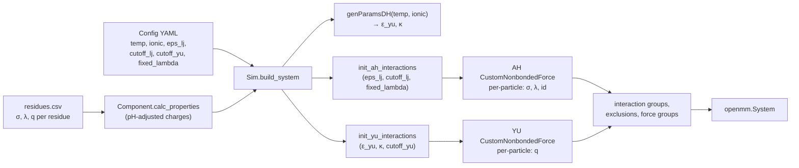
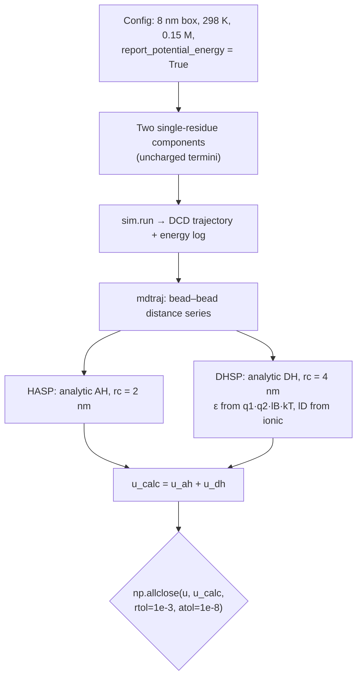

Every CALVADOS simulation is governed by two non-bonded pair interactions: an **Ashbaugh-Hatch (AH)** potential that combines short-range excluded volume with a residue-specific hydrophobic attraction, and a **Yukawa (Debye-Hückel)** potential that handles long-range screened electrostatics between charged beads. This page dissects both potentials from first principles — their mathematical forms, their derivation from physical state variables (temperature, ionic strength), their translation into OpenMM `CustomNonbondedForce` energy expressions, and how `sim.py` wires them into the `System` — closing with the end-to-end numerical validation that guarantees the implemented forms match theory. All non-bonded force construction lives in a single module, `calvados/interactions.py`, which is the anchor for everything on this page.

Sources: [interactions.py](calvados/interactions.py#L40-L106), [test_potentials.py](tests/test_potentials.py#L11-L19)

## The Two-Potential Model at a Glance

The AH potential encodes the *identity* of each residue (via its σ and λ parameters), while the Yukawa potential encodes its *charge state* (via q). They are deliberately separated into two independent `CustomNonbondedForce` objects so that each can have its own cutoff, its own force group (enabling per-force energy decomposition), and its own exclusion set. The comparison below consolidates every implementation detail verified in the code:

| Aspect | Ashbaugh-Hatch (`ah`) | Yukawa / Debye-Hückel (`yu`) |
|---|---|---|
| Physical role | Excluded volume + λ-scaled hydrophobic attraction | Screened charge–charge electrostatics |
| Energy scale | `eps_lj` (default 0.2 kcal/mol, converted ×4.184 to kJ/mol) | `eps_yu = kB·T·lB` (temperature and ionic strength dependent) |
| Cutoff | `cutoff_lj` (default 2.0 nm) | `cutoff_yu` (default 4.0 nm) |
| Per-particle parameters | `s` (σ), `l` (λ), `id` (particle class) | `q` (charge) |
| Pair parameter rule | σ arithmetic mean; λ arithmetic mean or `fixed_lambda` (see §6) | q = q₁·q₂ |
| Continuity at cutoff | Both branches shifted by `4ελ·shift` with `shift = (s/rc)¹²−(s/rc)⁶` | Shifted by `ε·exp(−κ·rc)/rc` |
| OpenMM method | `CustomNonbondedForce.CutoffPeriodic` | `CustomNonbondedForce.CutoffPeriodic` |
| Default force group | 0 (force group 1 in lipid systems) | 1 (force group 3 in lipid systems) |

Sources: [interactions.py](calvados/interactions.py#L40-L56), [interactions.py](calvados/interactions.py#L92-L106), [default_config.yaml](calvados/data/default_config.yaml#L5-L8), [sim.py](calvados/sim.py#L42), [sim.py](calvados/sim.py#L269-L292)

The concept relationship between the parameter sources, the force factories, and the assembled system is summarized in the following diagram:



Sources: [sim.py](calvados/sim.py#L138-L180), [interactions.py](calvados/interactions.py#L1-L106)

## Ashbaugh-Hatch: The Piecewise Form and the λ Hydrophobicity Scale

The reference implementation in `init_ah_interactions` builds this energy expression:

```
eps*select(step(r-rmin), 4*l*((s/r)^12-(s/r)^6-shift),
           4*((s/r)^12-(s/r)^6-l*shift)+(1-l))
; shift=(s/rc)^12-(s/rc)^6; rmin=2^(1/6)*s
; s=0.5*(s1+s2); l=select((id1+id2)*step(id1+id2), 0.5*(l1+l2), fixed_lambda)
```

OpenMM's `step(x)` returns 1 for x ≥ 0 and 0 otherwise, and `select(a, b, c)` returns `b` when `a > 0`, else `c`. Therefore the first branch (the λ-scaled attractive tail) is active when `r ≥ rmin = 2^(1/6)·s` — the Lennard-Jones minimum — and the second branch (the repulsive wall) is active inside it. Because OpenMM's expression is parsed as a single closed form, the entire piecewise potential, its cutoff shift, and the pairwise λ mixing rule live in one string.

Sources: [interactions.py](calvados/interactions.py#L40-L56)

Decomposing the expression region by region (with `shift = (s/rc)¹² − (s/rc)⁶` evaluated per pair from the mixed σ):

| Region | Condition | Energy (units of ε = `eps_lj`) |
|---|---|---|
| Repulsive wall | r < 2^(1/6)·s | 4[(s/r)¹²−(s/r)⁶] − 4λ·shift + (1−λ) |
| Attractive tail | 2^(1/6)·s ≤ r < rc | 4λ[(s/r)¹²−(s/r)⁶ − shift] |
| Beyond cutoff | r ≥ rc | 0 |

Two properties are worth anchoring conceptually. First, the interior branch adds `ε(1−λ)` — the hallmark of Ashbaugh-Hatch: the repulsive core is *λ-independent*, so hydrophobicity tunes only the attraction, never the bead size. Second, at λ = 1 the exterior branch is a full energy-shifted Lennard-Jones potential, while at λ = 0 the exterior vanishes and the interior collapses to the pure repulsive WCA form — making λ a continuous dial between "inert" and "sticky" beads. The residues database exploits this dial aggressively: λ spans from 0.0007 for GLU (charged, fully solvated) to 0.989 for TRP (maximally hydrophobic).

Sources: [interactions.py](calvados/interactions.py#L43-L45), [residues.csv](calvados/data/residues.csv#L1-L17)

## Yukawa: Debye-Hückel Parameterization from Temperature and Ionic Strength

`genParamsDH(temp, ionic)` derives both Yukawa constants from physical state variables rather than user-specified force-field entries. The chain of computation is:

| Quantity | Code | Physical meaning |
|---|---|---|
| `kT` | `8.3145*temp*1e-3` | Thermal energy in kJ/mol |
| `epsw` | `fepsw(T)` polynomial | Empirical fit of water's dielectric constant vs. temperature |
| `lB` | `1.6021766²/(4π·8.854188·epsw)·6.02214076·1000/kT` | Bjerrum length in nm (≈ 0.71 nm at 298 K) |
| `eps_yu` | `lB*kT` | Yukawa energy prefactor, kJ·nm/mol |
| `k_yu` | `sqrt(8π·lB·ionic·6.02214076/10)` | Inverse Debye length κ in nm⁻¹ |

The κ formula is the linearized Poisson-Boltzmann result κ² = 8π·lB·n for a 1:1 electrolyte, where `n = ionic·NA/10²⁴` is the ion number density in nm⁻³ (hence the `/10` after the 6.022 factor absorbs NA and the liter-to-nm³ conversion). At the test-suite conditions (298 K, 0.15 M) this yields κ ≈ 1.27 nm⁻¹, i.e. a Debye length near 0.79 nm. Crucially, `build_system` calls `genParamsDH` *before* components are created, because Go-type restraints need `eps_yu`/`k_yu` to reconstruct scaled pairwise electrostatics for restrained pairs.

Sources: [interactions.py](calvados/interactions.py#L4-L15), [sim.py](calvados/sim.py#L152-L156), [test_potentials.py](tests/test_potentials.py#L112-L119)

The force factory itself is compact: `init_yu_interactions(eps, k, rc)` precomputes the cutoff shift in NumPy (`shift = exp(-k·rc)/rc`), then embeds it into the expression `q*eps*(exp(-k*r)/r - shift); q=q1*q2`. Note the dimensional bookkeeping: `eps_yu` carries kJ·nm/mol while `1/r` contributes nm⁻¹, so the product is kJ/mol. As a built-in sanity diagnostic, the constructor prints the residual energy between two *unit* charges sitting exactly at the cutoff — the value that the shift term nullifies.

Sources: [interactions.py](calvados/interactions.py#L92-L106)

## OpenMM Mechanics: Per-Particle Parameters and the Crowder `id` Trick

Both forces use per-particle parameters registered via `addPerParticleParameter`: AH stores triplets `[s, l, id]` while YU stores singletons `[q]`. The `id` slot is the elegant mechanism that implements crowders without a separate force. The λ mixing rule inside the expression,

```
l = select((id1+id2)*step(id1+id2), 0.5*(l1+l2), fixed_lambda)
```

routes every pair through one of two regimes:

| Pair composition | `(id1+id2)·step(id1+id2)` | λ_ij used |
|---|---|---|
| protein–protein / RNA (id = 1, 1) | 2 → `select` takes first branch | Arithmetic mean (λ₁+λ₂)/2 |
| protein–crowder (id = 1, −1) | 0 → not > 0 | `fixed_lambda` |
| crowder–crowder (id = −1, −1) | −2·0 = 0 → not > 0 | `fixed_lambda` |

With the default `fixed_lambda: 0`, any pair involving a crowder becomes pure WCA repulsion — crowders interact sterically with everything but never attract. Only `add_interactions` may set `id` to −1, and only for `molecule_type == 'crowder'`; proteins and RNA receive id = 1.

Sources: [interactions.py](calvados/interactions.py#L45-L52), [sim.py](calvados/sim.py#L520-L528), [default_config.yaml](calvados/data/default_config.yaml#L5)

## Wiring into the System: The sim.py Data Flow

`Sim.build_system` orchestrates potential construction in a strict order. After converting `eps_lj` from kcal to kJ/mol (×4.184) and computing the Debye-Hückel constants, it instantiates forces under two mutually exclusive regimes. Lipid-containing systems build five forces (WCA, protein-protein AH `ah_pp`, lipid AH `ah`, SA, YU) with tailored cutoffs; all other systems build exactly two: `self.ah = init_ah_interactions(eps_lj, cutoff_lj, fixed_lambda)` and `self.yu = init_yu_interactions(eps_yu, k_yu, cutoff_yu)`. The lipid variants (`init_ah_lipid_interactions`, which mixes λ geometrically via `sqrt(l1*l2)` and uses a WCA-form interior, and the WCA/SA functions) are covered on the lipid page.

Sources: [sim.py](calvados/sim.py#L42), [sim.py](calvados/sim.py#L152-L180), [interactions.py](calvados/interactions.py#L58-L90)

Per-particle assignment happens in `add_interactions`, called once per molecule: each bead contributes `[sig*nm, lam, id]` to AH and `[q]` to YU, with values sourced from the component's residue-resolved `sigmas`, `lambdas`, and `qs` arrays (charges themselves being pH/termini-adjusted upstream). Immediately after, bonds, angles, and restraints generate exclusion maps that `add_exclusions` applies to both forces — a bonded neighbor, an angle-connected pair, or a restrained pair never feels AH or YU. This is why AH and YU must be *separate* force objects with *identical* exclusion sets: exclusions are declared per-force in OpenMM, so every force that models a pair interaction needs the exclusion replayed.

Sources: [sim.py](calvados/sim.py#L500-L528), [sim.py](calvados/sim.py#L487-L498)

Finally, forces are registered into the `System` (`add_forces_to_system`) and organized into force groups — AH in group 0 and YU in group 1 for non-lipid systems, or groups 1 and 3 respectively within the five-force lipid layout. Force groups are what make per-interaction energy reporting possible downstream.

Sources: [sim.py](calvados/sim.py#L317-L334), [sim.py](calvados/sim.py#L269-L292)

For restrained pairs — pairs excluded from the global AH/YU forces because a restraint already connects them — the module provides pairwise re-incarnations of both potentials as `CustomBondForce` objects: `init_scaled_LJ` reproduces the AH piecewise form with per-bond parameters `s`, `l`, and a scaling factor `n` (`comp.bondscale[i,j]`), while `init_scaled_YU` reproduces the shifted Yukawa form with a hard-coded 4.0 nm reference distance for the shift. These variants are consumed by Go-type restraint construction and are examined on the restraints page.

Sources: [interactions.py](calvados/interactions.py#L137-L158), [interactions.py](calvados/interactions.py#L189-L196), [sim.py](calvados/sim.py#L95-L101)

## End-to-End Validation Strategy

`tests/test_potentials.py` validates both potentials *through the full simulation stack*, not in isolation. The reference analytic forms are defined as NumPy lambdas mirroring the expressions above:

```python
HALR = lambda r,s,l : 4*0.8368*l*((s/r)**12-(s/r)**6)              # AH tail
HASR = lambda r,s,l : 4*0.8368*((s/r)**12-(s/r)**6)+0.8368*(1-l)   # AH wall
HA   = lambda r,s,l : np.where(r<2**(1/6)*s, HASR(r,s,l), HALR(r,s,l))
HASP = lambda r,s,l,rc : np.where(r<rc, HA(r,s,l)-HA(rc,s,l), 0)   # cutoff-shifted AH
DHSP = lambda r,yukawa_eps,lD,rc : np.where(r<rc, DH(r,yukawa_eps,lD)-DH(rc,...), 0)
```

The constant 0.8368 kJ/mol is exactly the default `eps_lj` after the kcal→kJ conversion in `Sim.__init__`, confirming the test targets the production code path rather than a parallel implementation.

Sources: [test_potentials.py](tests/test_potentials.py#L11-L19), [sim.py](calvados/sim.py#L42)

The test harness builds minimal two-particle systems — one bead of each of five residue pairs (e.g. E–R, E–W) in an 8 nm box at 298 K and 0.15 M ionic strength — runs the simulation via `sim.run`, then replays the physics analytically:



Note the subtle detail: the test reconstructs `yukawa_eps` per residue pair from the *residues.csv charges* (`q₁·q₂·lB·RT`) rather than calling `genParamsDH` directly, so both the parameterization math and the OpenMM expression are verified independently. Any drift between the shipped energy expressions and the analytic reference — a typo in the shift, a wrong `step` polarity, a mismatched cutoff — breaks the `rtol=1e-3` agreement and fails the build.

Sources: [test_potentials.py](tests/test_potentials.py#L21-L95), [test_potentials.py](tests/test_potentials.py#L97-L126)

## Key Implementation Insights

> [!TIP]
> The AH λ-mixing rule lives *inside* the energy expression, not in Python. Because OpenMM parses `l=select((id1+id2)*step(id1+id2), 0.5*(l1+l2), fixed_lambda)` per pair at runtime, adding a new particle class (e.g. a new crowder variant) requires only a new `id` value in `add_interactions` — no new force object, no Python-level pair loop. This is also why the crowder is "free": it reuses the protein force with id = −1.

> [!TIP]
> `genParamsDH` must run before `make_components` in `build_system` — the code comments this explicitly — because Go-type restraints bind `eps_yu`/`k_yu` into per-bond scaled forces at component-creation time. Reordering these two calls breaks every restrained system with an uninitialized-parameter error.

## Where to Go Next

The potentials documented here are the "plain" non-lipid regime of CALVADOS. Natural continuations within the catalog:

- **[Lipid Interactions: WCA And SA Terms](11-lipid-interactions-wca-and-sa-terms)** — the five-force regime: `init_wca_interactions`, `init_ah_lipid_interactions`, and `init_sa_interactions` with geometric λ/ω mixing.
- **[Force Groups And Interaction Exclusions](12-force-groups-and-interaction-exclusions)** — the exclusion-map mechanics and force-group layout referenced in §5.
- **[AF-Guided Harmonic And Go Restraints](13-af-guided-harmonic-and-go-restraints)** — where `init_scaled_LJ`/`init_scaled_YU` re-introduce AH/YU between restrained pairs.
- **[Sequence Processing And Charge States](6-sequence-processing-and-charge-states)** — how `comp.qs` (the per-particle Yukawa charges) are derived from sequence, pH, and termini settings.
- **[Testing Potentials And Bond Topologies](22-testing-potentials-and-bond-topologies)** — the broader test-suite context surrounding `test_potentials.py`.
