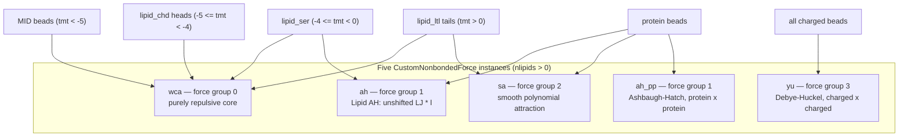

This page documents the nonbonded force field machinery that MEM-CALVADOS deploys when lipids are present in a system. In lipid-free simulations, all nonbonded physics is carried by two forces (Ashbaugh–Hatch and Debye–Hückel). Once a single lipid bead is registered, `Sim.build_system` switches to a **five-force decomposition** in which the Weeks–Chandler–Andersen (WCA) term and the Solvent-Accessible (SA) term each own a precisely defined slice of the pair space. We cover the exact energy expressions, the mixing rules, the cutoff selection logic, the bead-classification scheme (TMT thresholds), and the interaction-group topology that makes the five forces a disjoint partition of all nonbonded pairs.

Sources: [interactions.py](calvados/interactions.py#L26-L90), [sim.py](calvados/sim.py#L160-L181)

## Why Lipids Force A Different Architecture

The design decision lives in one branch point: if `self.nlipids > 0`, the builder instantiates five `CustomNonbondedForce` objects — `wca`, `ah_pp`, `ah` (the lipid-tuned Ashbaugh–Hatch variant), `sa`, and `yu`. Otherwise it falls back to the canonical two-force scheme (`ah` + `yu`). The commented-out lines alongside (`wca_pl`, `ah_ll`, `ah_pl`, `yu_ll`, …) reveal the earlier design intent — one force per pair-type combination — which was abandoned in favor of a single force per *energy functional form*, with pair selectivity delegated to OpenMM interaction groups.

This matters for advanced developers because the energy expressions are global: every particle in the system is registered in **all five forces** with its `(sigma, lambda, omega, q)` parameters, and the actual pair coverage is carved out exclusively by `addInteractionGroup` calls. Changing which beads belong to which class therefore reshapes the entire interaction matrix without touching a single energy expression.

Sources: [sim.py](calvados/sim.py#L160-L181), [sim.py](calvados/sim.py#L500-L528)



Sources: [sim.py](calvados/sim.py#L269-L292)

## The WCA Term: Purely Repulsive Excluded Volume

The WCA force is constructed by `init_wca_interactions(eps, rc)` with the energy expression:

```
4*eps*((s/r)^12-(s/r)^6+0.25)*step(rmin-r);  rmin=2^(1/6)*s;  s=0.5*(s1+s2)
```

The `+0.25` constant is the standard WCA **value shift**: at the Lennard-Jones minimum `rmin = 2^(1/6)·s`, the bracket evaluates to `4·(0.25 − 0.5 + 0.25) = 0`, and the analytic derivative of the 12-6 branch also vanishes at `rmin`. The `step(rmin-r)` gate then zeroes everything at larger separations, so WCA contributes neither energy nor force beyond contact. This is why the repulsive core is C¹-continuous — a property the developer relies on implicitly, since the AH-lipid and SA expressions reuse the identical branch for their `r < rmin` regimes.

Note that WCA defines no attractive term at all and mixes only the size parameter (`s = 0.5·(s1+s2)`, arithmetic mean); there is no `lambda` or `omega` per-particle parameter — beads carry only `[sig]` when registered. The force uses `CutoffPeriodic` with `rc = self.cutoff_wca`, which `build_system` computes as `2**(1/6) * max(sigma)` over **all** components — the largest possible contact distance, guaranteeing the cutoff never truncates the (finite) support of the potential.

Sources: [interactions.py](calvados/interactions.py#L26-L38), [sim.py](calvados/sim.py#L161-L165)

## The SA Term: Smooth, Finite-Range Attraction

`init_sa_interactions(eps, rc)` implements the solvent-accessibility-motivated attractive term:

```
eps*select(step(r-rmin),
    l*(3*u^2-2*u^3-1)*step(rmin+o-r),
    4*((s/r)^12-(s/r)^6+0.25)-l);
u=(r-rmin)/o; rmin=2^(1/6)*s; s=0.5*(s1+s2); l=sqrt(l1*l2); o=sqrt(o1*o2)
```

Three regime behaviors follow directly from the expression. For `r < rmin`, particles feel the familiar WCA core offset by `−l`. For `rmin ≤ r ≤ rmin + o` (with `o > 0`), the attraction is a cubic polynomial in the reduced distance `u`: it starts at exactly `−l` when `u = 0` (since `3·0 − 2·0 − 1 = −1`), rises with zero slope at both ends, and terminates at exactly `0` when `u = 1` (`3 − 2 − 1 = 0`). The inner `step(rmin+o-r)` hard-truncates the term beyond `rmin + o`. The whole function is therefore C¹-continuous at `rmin` (the WCA branch has zero slope there, as does the polynomial at `u = 0`), and reaches zero smoothly at the outer boundary — no force discontinuities anywhere in its support.

The three per-particle parameters are `[sig, lam, ome*nm]`, and mixing uses **geometric means** for both attractiveness and range: `l = √(l1·l2)`, `o = √(o1·o2)`. The `omega` value — the pair-dependent attraction length — is read from the optional `omega` column of the component's residues table, so lipid systems require a residue file that defines it for every bead type. This is a hard requirement, not a convenience: `cutoff_sa = max(2**(1/6)*sig + ome)` is computed only over beads with `ome > 0`, and `add_interactions` unconditionally zips `comp.omegas` for every component in a lipid system.

Sources: [interactions.py](calvados/interactions.py#L75-L90), [sim.py](calvados/sim.py#L163-L171), [components.py](calvados/components.py#L60-L61), [sim.py](calvados/sim.py#L508-L513)

> [!TIP]
> Unlike a shifted truncated LJ tail, the SA attraction is anchored at `−l` exactly at contact and decays over a *per-pair* distance `√(o1·o2)`. Two beads with `omega = 0` contribute no SA attraction regardless of `l` — the cutoff scan explicitly skips them (`if ome > 0`). Tune membrane cohesion by editing the `omega` column, not `lambdas`.

## The Lipid AH Variant: Attractive Headgroup Chemistry

For lipid-bearing systems, the force named `ah` is *not* the standard Ashbaugh–Hatch potential of the non-lipid branch — it is `init_ah_lipid_interactions(eps, rc)`:

```
eps*select(step(r-rmin), 4*l*((s/r)^12-(s/r)^6), 4*((s/r)^12-(s/r)^6+0.25)-l);
shift=(s/rc)^12-(s/rc)^6; rmin=2^(1/6)*s; s=0.5*(s1+s2); l=sqrt(l1*l2)
```

For `r ≥ rmin` this is an **unshifted** 12-6 Lennard-Jones scaled by `l` — the `shift` variable is defined but unused, signaling the cutoff energy offset is deliberately not applied, so the full attractive well (depth `−l` at `rmin`) is preserved and decays to the cutoff. For `r < rmin` the branch is the WCA core minus `l`, matching the SA construction exactly.

Comparing the three LJ-family expressions side by side exposes the design grammar:

| Force | `r < rmin` branch | `r ≥ rmin` branch | Attraction range | `l` mixing | Extra params |
|---|---|---|---|---|---|
| `init_ah_interactions` (protein/RNA, also `ah_pp`) | WCA core `+ (1−l)` | shifted LJ · `l` | shifted LJ to `rc` | arithmetic `0.5·(l1+l2)` via `id` select, else `fixed_lambda` | `s`, `l`, `id` |
| `init_ah_lipid_interactions` (`ah`) | WCA core `− l` | **unshifted** LJ · `l` | unshifted LJ to `rc` | geometric `√(l1·l2)` | `s`, `l` |
| `init_sa_interactions` (`sa`) | WCA core `− l` | `l·(3u²−2u³−1)` | exactly `rmin + o` | geometric `√(l1·l2)` | `s`, `l`, `o` |
| `init_wca_interactions` (`wca`) | WCA core only | zero | none | — | `s` |

The full Ashbaugh–Hatch expression resolves `l` through `select((id1+id2)*step(id1+id2), 0.5*(l1+l2), fixed_lambda)`: arithmetic mixing activates only when the sum of the `id` parameters is non-negative. In lipid systems every particle is registered with `id = 1` in `ah_pp` (so arithmetic mixing always applies there), whereas in lipid-free systems crowders receive `id = −1`, steering their mixed pairs toward `fixed_lambda`.

Sources: [interactions.py](calvados/interactions.py#L40-L73), [sim.py](calvados/sim.py#L508-L525)

## Bead Classification: The TMT Column Drives Everything

During particle registration, `build_system` routes each bead into named index sets by comparing its `tmt` residue-table column against fixed thresholds. The names (defined in [sim.py](calvados/sim.py#L212-L218) with comments marking CHO/PHO charged heads and MID beads) map to the thresholds as follows:

| Condition | Index set | Role in the interaction matrix |
|---|---|---|
| `tmt < -5` | `tmt_mid` → `lipid_mid` | MID beads, repulsion-only partners |
| `-5 <= tmt < -4` | `tmt_chd` → `lipid_chd` | charged headgroups (CHO, PHO) |
| `-4 <= tmt < 0` | `tmt_neg` → `lipid_ser` | serine/linker-class beads with attractive chemistry |
| `tmt > 0` | `tmt_pos` → `lipid_ltl` | hydrophobic tails |
| charge ≠ 0 | `charged_indices` | Debye–Hückel participation |

`lipid_indices` and `protein_indices` are accumulated independently of the TMT scan, and the lipid-specific sets are finally intersected with `lipid_indices` so that the same thresholds applied to protein rows cannot leak protein beads into lipid classes.

Sources: [sim.py](calvados/sim.py#L212-L263), [sim.py](calvados/sim.py#L269-L274)

## Interaction Group Topology: A Disjoint Partition Of Pair Space

The five `addInteractionGroup` calls together cover every chemically admissible pair exactly once. Reading them as (set A × set B):

| Force | Set A | Set B | Pairs covered |
|---|---|---|---|
| `wca` | `lipid_ser` | `lipid_ltl ∪ lipid_mid` | ser–tail, ser–MID (repulsion only) |
| `wca` | `protein ∪ lipid_ltl ∪ lipid_chd ∪ lipid_mid` | `lipid_mid ∪ lipid_chd` | head/MID against proteins, tails, and each other |
| `ah_pp` | `protein` | `protein` | protein–protein Ashbaugh–Hatch |
| `ah` | `lipid_ser` | `lipid_chd ∪ lipid_ser ∪ protein` | serine-attractive contacts (head, ser, protein) |
| `sa` | `protein ∪ lipid_ltl` | `lipid_ltl` | smooth attraction involving tails |
| `yu` | `charged` | `charged` | all Debye–Hückel pairs (overlay, not part of the partition) |

Cross-checking the 15 possible class pairs confirms the partition property: protein–protein → `ah_pp`; ser × {ser, chd, protein} → `ah`; tail pairs and protein–tail → `sa`; everything involving `chd` or `mid` (except ser's attractive slots) → `wca`. No pair receives two non-electrostatic contributions, and none receives zero. The forces are grouped for reporting as: `wca` → group 0, `ah_pp` and `ah` → group 1 (their energies sum in per-group output), `sa` → group 2, `yu` → group 3 — a layout the `ForceGroupReporter` can exploit to attribute virial/energy components per interaction class.

Sources: [sim.py](calvados/sim.py#L275-L292)

> [!TIP]
> Because `ah_pp` and `ah` share force group 1, per-group energy traces do not separate protein–protein from lipid-head attraction. If you need them separated for analysis, reassign one force to a fresh group in `build_system` and update `print_system_summary` accordingly.

## Cutoff Selection And Parameter Flow

Cutoffs are chosen per force at initialization time, before any particle exists. `cutoff_wca` is `2^(1/6) · max(σ)` across all components — conservative, since WCA is identically zero past `rmin`, but cheap and safe. `cutoff_sa` is `max(2^(1/6)·σ + ω)` restricted to beads with `ω > 0` — the minimal radius that fully contains every smooth-tail support. `ah`, `ah_pp`, and `yu` reuse the user-supplied `cutoff_lj` and `cutoff_yu` from the YAML config, and the global `eps_lj` is unit-converted from kcal to kJ/mol in the `Sim` constructor before ever reaching an energy expression.

Per-particle registration (`add_interactions`) then gives **every bead of every component** a slot in all five forces: `[sig]` for `wca`, `[sig, lam, 1]` for `ah_pp`, `[sig, lam]` for `ah`, `[sig, lam, ome·nm]` for `sa`, and `[q]` for `yu`. Since OpenMM evaluates a `CustomNonbondedForce` only for pairs inside its interaction groups, this "register everywhere, compute selectively" pattern keeps parameter bookkeeping uniform while the TMT-driven groups remain the single source of truth for pair physics.

Sources: [sim.py](calvados/sim.py#L41-L42), [sim.py](calvados/sim.py#L161-L174), [sim.py](calvados/sim.py#L500-L528)

## Exclusions And Bonded Context For Lipid Chains

The `Lipid` component supplies the bonded scaffolding that WCA/SA are meant to complement: consecutive beads (`j == i+1`) get harmonic bonds with per-bead `bondk`, and every triple (`i`, `i+1`, `i+2`) gets a harmonic angle with per-bead `angle`/`anglek`. Both `add_bonds` and `add_angles` return exclusion maps that `Sim.add_exclusions` applies to **all five nonbonded forces**, so 1-2 and 1-3 neighbors along a lipid chain are invisible to WCA, AH, SA, and Debye–Hückel alike; 1-4 and beyond still interact. The same exclusion pathway is reused by restraints and custom restraints, which automatically silence all nonbonded terms on restrained pairs. At build completion, `print_system_summary` reports particle and exclusion counts per force — the quickest sanity check that your TMT assignments and residue table produced the expected topology.

Sources: [components.py](calvados/components.py#L450-L524), [sim.py](calvados/sim.py#L456-L498), [sim.py](calvados/sim.py#L382-L387)

## Seeing It In Practice

The bilayer example instantiates this machinery end-to-end: it computes `N_lipids = ceil(Lx·Ly/area_per_lipid)·2` for a 0.6 nm² area per lipid, sets `topol = 'bilayer'` with `bilayer_eq = True` (the `MonteCarloMembraneBarostat` that pairs naturally with these interaction terms), and registers one component as `molecule_type = 'lipid'` using a local `residues.csv` that must carry the `tmt`, `omega`, `bondk`, `angle`, and `anglek` columns the lipid path expects. Lipid placement uses `place_bilayer` on the `bilayergrid` rather than the protein-oriented topology grids, and molecule counting in `count_components` moves proteins to the front of the component array while tallying `nlipids` — the flag that triggers the entire five-force path described above.

Sources: [examples/bilayer/prepare.py](examples/bilayer/prepare.py#L16-L66), [sim.py](calvados/sim.py#L107-L137), [sim.py](calvados/sim.py#L438-L454)

## Where To Go Next

The expressions documented here are the lipid-specific members of the broader potential family: the protein/RNA side — including the full Ashbaugh–Hatch `select` logic and the Debye–Hückel parameter derivation — is covered in [Ashbaugh-Hatch And Yukawa Potentials](10-ashbaugh-hatch-and-yukawa-potentials). The force-group bookkeeping introduced at the end of this page (groups 0–3, per-group reporting, exclusion propagation) is expanded in [Force Groups And Interaction Exclusions](12-force-groups-and-interaction-exclusions). For how lipids get placed into bilayer geometry before these forces act on them, see [Bilayer Assembly And Topologies](9-bilayer-assembly-and-topologies), and for the membrane barostat that equilibrates systems built on WCA/SA cohesion, continue to [Slab Equilibration And Barostats](15-slab-equilibration-and-barostats).