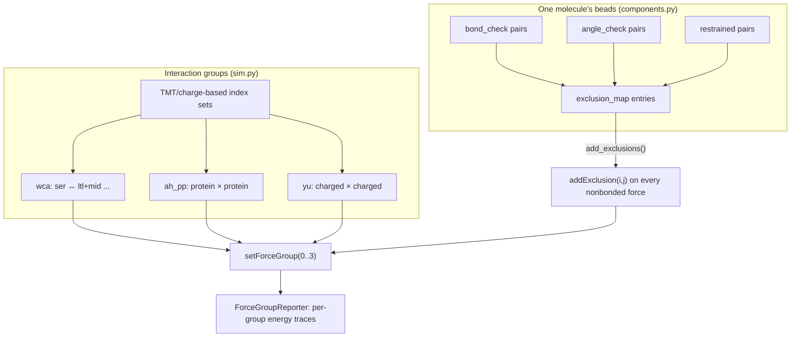
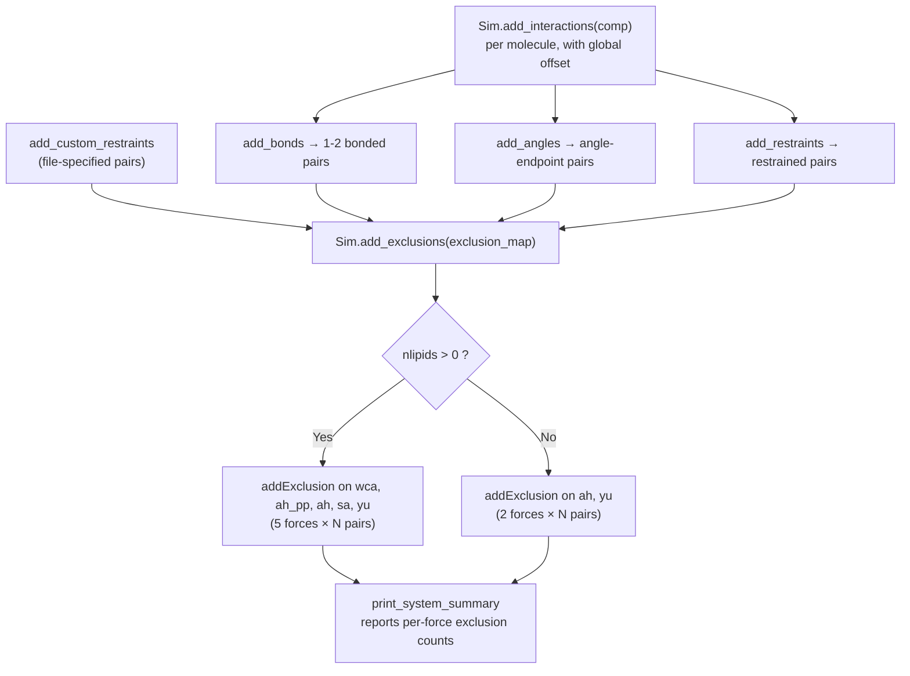

In CALVADOS, every simulation is assembled from a collection of independent OpenMM `Force` objects. Two pieces of bookkeeping turn that collection into a well-defined, efficient, and analyzable energy model: **force group assignment** (which forces are summed into which numbered energy bucket) and **interaction exclusions** (which particle pairs are silently skipped by each nonbonded force). This page documents both mechanisms as they are actually implemented in `sim.py`, `interactions.py`, `components.py`, and `forcegroupreporter.py`. It assumes you already know what the Ashbaugh-Hatch, Yukawa, WCA, and SA potentials *are* — the physics lives in [Ashbaugh-Hatch And Yukawa Potentials](10-ashbaugh-hatch-and-yukawa-potentials) and [Lipid Interactions: WCA And SA Terms](11-lipid-interactions-wca-and-sa-terms); here we cover how those forces are partitioned and pruned.

## Architectural Role: Two Orthogonal Pruning Mechanisms

CALVADOS uses three distinct mechanisms to control *which pairs a force evaluates*, and it is worth separating them from first principles because they operate at different levels:

1. **Force groups** (`setForceGroup(n)`) — a pure energy-accounting concept. The force still evaluates every eligible pair; the group number only determines which bucket `Context.getState()` reports its energy into.
2. **Interaction groups** (`addInteractionGroup(setA, setB)`) — a `CustomNonbondedForce`-level filter. Pairs not drawn from `setA × setB` are never evaluated, saving compute.
3. **Exclusions** (`addExclusion(i, j)`) — a pair-level blacklist. Specific (i, j) pairs are removed from the force entirely, typically because their interaction is handled by an explicit bonded term instead.

The following concept diagram shows how a molecule's beads flow through these three mechanisms in `Sim.build_system`:



The exclusion map is generated *inside* each component class (`components.py`), while group assignment and interaction-group pruning happen *centrally* in `Sim.build_system` (`sim.py`) after all molecules are placed. This split — per-component pair bookkeeping, central force orchestration — is the core architectural pattern of the page.

Sources: [sim.py](/calvados/sim.py#L269-L292), [components.py](/calvados/components.py#L94-L105), [forcegroupreporter.py](/calvados/forcegroupreporter.py#L17-L20)

## The Force Group Map: Two Layouts Depending on Lipid Content

`Sim.build_system` assigns explicit force groups only after all molecules have been added (sim.py L269-L292). The layout depends on whether the system contains lipids, because lipid systems split the Ashbaugh-Hatch attraction into multiple force objects:

| System type | Force | Purpose | Force group |
|---|---|---|---|
| Lipid systems | `wca` | WCA repulsion on lipid chains and heads | 0 |
| Lipid systems | `ah_pp` | Ashbaugh-Hatch, protein × protein | 1 |
| Lipid systems | `ah` | Ashbaugh-Hatch, lipid tail ↔ head/protein | 1 |
| Lipid systems | `sa` | Short-range attraction (SA term) | 2 |
| Lipid systems | `yu` | Debye-Hückel / Yukawa electrostatics | 3 |
| Non-lipid | `ah` | Single Ashbaugh-Hatch force for everything | 0 |
| Non-lipid | `yu` | Yukawa electrostatics | 1 |

A critical subtlety: **group 0 is the OpenMM default**. Every force that never calls `setForceGroup` — the `HarmonicBondForce` (`hb`), `HarmonicAngleForce` (`ha`), harmonic/Go restraints (`cs`), custom restraints (`cres`), scaled LJ/YU bond terms (`scLJ`, `scYU`), the PMF centroid force, and slab equilibration restraints — silently lands in group 0. In lipid systems this means `wca.setForceGroup(0)` (sim.py L277) makes group 0 a *mixture* of WCA repulsion plus all bonded/restraint terms, while groups 1–3 are pure nonbonded classes. In non-lipid systems, group 0 mixes AH with all bonded terms and group 1 is pure electrostatics. Keep this in mind whenever you interpret per-group energies.

Two additional force objects in `interactions.py` carry their own group conventions for lipid model variants not currently wired into `Sim`: the Cooke–Deserno cosine force sets group 2 (`interactions.py` L227) and the charge–nonpolar interaction sets group 1 (L251) — the latter's particle population is commented out in `add_interactions` (sim.py L530-L534). The `init_yu_interactions` function also contains a commented-out `yu.setForceGroup(1)` (L104), evidence that group assignment was deliberately moved out of the force factory and into `Sim`, where it can depend on system composition.

Sources: [sim.py](/calvados/sim.py#L269-L292), [sim.py](/calvados/sim.py#L317-L344), [interactions.py](/calvados/interactions.py#L217-L228), [interactions.py](/calvados/interactions.py#L241-L252), [interactions.py](/calvados/interactions.py#L92-L106)

## Interaction Groups: Pruning the Pair Space with TMT Classes

Before any force evaluates a pair, `CustomNonbondedForce.addInteractionGroup(setA, setB)` restricts evaluation to pairs drawn from the Cartesian product of two particle sets. `Sim.build_system` constructs these sets during the molecule loop by tracking **global particle indices** in Python sets keyed on the lipid `TMT` bead classification and net charge (sim.py L212-L263):

| Index set | Population rule | Code |
|---|---|---|
| `lipid_ser` | lipid beads with `tmt < 0` (negatively charged tails) | `lipid_indices & tmt_neg_indices` |
| `lipid_chd` | lipid beads with `-5 ≤ tmt < -4` (charged heads: CHO/PHO) | `lipid_indices & tmt_chd_indices` |
| `lipid_mid` | lipid beads with `tmt < -5` (midsection) | `lipid_indices & tmt_mid_indices` |
| `lipid_ltl` | lipid beads with `tmt > 0` (positive TMT tails) | `lipid_indices & tmt_pos_indices` |
| `charged_indices` | any bead with non-zero partial charge | `np.isclose(charge, 0.0)` check |

The interaction groups then encode the *physics topology* of each potential (sim.py L275-L289): WCA connects `lipid_ser ↔ (lipid_ltl | lipid_mid)` and `(proteins | ltl | chd | mid) ↔ (mid | chd)`; `ah_pp` is protein × protein only; the lipid AH force connects `lipid_ser ↔ (chd | ser | proteins)`; the SA attraction connects `(proteins | lipid_ltl) ↔ lipid_ltl`; and Yukawa connects `charged_indices ↔ charged_indices`. Because non-participating pairs are never evaluated, this pruning is also a performance optimization, not merely cosmetic — a system with one charged protein among thousands of neutral lipid beads pays electrostatics cost only on the charged subset.

Sources: [sim.py](/calvados/sim.py#L212-L219), [sim.py](/calvados/sim.py#L250-L263), [sim.py](/calvados/sim.py#L275-L289)

## The Exclusion Pipeline: From Local Bond Lists to Global Force Blacklists

Exclusions answer a different question than interaction groups: *which specific pairs should this force skip?* The pipeline is uniform across all component classes and follows one rule — **every pair whose interaction is represented by an explicit bonded term must be excluded from every nonbonded CustomNonbondedForce**. The flowchart below traces the complete path:



Each component class returns an `exclusion_map` — a list of `[global_i, global_j]` pairs — from its bond and angle population methods, and `Sim.add_exclusions` fans it out to every active nonbonded force in one loop (sim.py L487-L498). The exclusion policies per source differ by molecule class:

| Exclusion source | Component | Pair semantics | Policy |
|---|---|---|---|
| Harmonic bonds | All classes (`add_bonds`) | Consecutive bonded beads (1-2) | Always excluded from AH/YU (and WCA/SA in lipid systems) |
| Angles | `Lipid.add_angles` | Beads i and i+2 (1-3) | Excluded |
| Angles | `RNA.add_angles` | Angle endpoints i and i+4 | Excluded (the intervening i+2 bead is already bond-excluded) |
| Harmonic/Go restraints | `Protein.add_restraints` via `Sim.add_restraints` | Every restrained pair | Excluded only if `exclude_nonbonded=True` (default) |
| Custom restraints | `Sim.add_custom_restraints` | File-specified pairs | Excluded if `exclude_nonbonded=True` |
| RNA base-base terms | `RNA.add_bonds` | Bases j = i+2 | Excluded from AH/YU, replaced by scaled bond term |

Two design details deserve emphasis. First, `Sim.add_restraints` accepts an `exclude_nonbonded` flag (sim.py L468-L473), so you can *add* a restraint on top of the native nonbonded interaction rather than replacing it — useful for probing how restraints perturb the baseline model. Second, restraint-driven exclusions are chemically significant: when a pair is restrained, its Ashbaugh-Hatch and Yukawa interaction is *removed* and (for the Go model) substituted, which is the subject of the next section.

Sources: [sim.py](/calvados/sim.py#L456-L498), [sim.py](/calvados/sim.py#L500-L544), [components.py](/calvados/components.py#L227-L238), [components.py](/calvados/components.py#L249-L281), [components.py](/calvados/components.py#L417-L430), [components.py](/calvados/components.py#L494-L524), [components.py](/calvados/components.py#L389-L415)

## Soft Exclusions: Scaled Bond Terms Replace Pair Interactions

A naive exclusion is binary — the pair either interacts or it does not. CALVADOS implements a **soft exclusion** pattern for cases where a graded residual interaction is physically desirable. Two subsystems use it:

**Go-model restrained pairs.** In `Protein.add_restraints`, any pair with Go scale ≥ `min_scale` (0.05) is added to the exclusion map, *removing* its native AH/YU interaction. But pairs below `cutoff_mix_in_LJYU` (0.15) simultaneously receive `CustomBondForce` replacements — `init_scaled_LJ` and `init_scaled_YU` (interactions.py L137-L158) — whose energy is multiplied by the per-pair `bondscale` factor derived from bfac/PAE confidence maps (components.py L155). The pair's interaction strength therefore interpolates continuously between "fully restrained + no nonbonded" and "weakly restrained + proportionally scaled nonbonded", avoiding the discontinuity a hard exclusion would impose on low-confidence contacts.

**RNA base-base stacking.** `RNA.init_bond_force` creates a dedicated `scLJ_rna` scaled-LJ force (components.py L336), and base pairs passing `basebase_check` (j = i+2, odd i) are added as scaled bonds with scale `n = rna_nb_scale` while their AH/YU counterparts are excluded (components.py L404-L414). The pattern is identical: blacklisted from the group-based force, reinstated as a pair-specific, parameterized bond.

> [!TIP]
> A pair in the exclusion map is not necessarily interaction-free. Always check whether the same pair appears in `scLJ`, `scYU`, or `scLJ_rna` before assuming zero nonbonded energy — the scaled bond forces are `CustomBondForce` objects and are unaffected by nonbonded exclusions.

Because these scaled forces are per-pair bonds, they inherit group 0 by default (see the force group map above). This means in a Go-restraint simulation, group 0's energy trace includes the scaled LJ/YU compensation terms — an important consideration when attributing energy changes to the restraint itself (see [AF-Guided Harmonic And Go Restraints](13-af-guided-harmonic-and-go-restraints) for the restraint physics and [Custom Restraints And PMF Forces](14-custom-restraints-and-pmf-forces) for the PMF centroid force, which also defaults to group 0).

Sources: [components.py](/calvados/components.py#L240-L281), [components.py](/calvados/components.py#L332-L343), [components.py](/calvados/components.py#L404-L414), [interactions.py](/calvados/interactions.py#L137-L158), [interactions.py](/calvados/interactions.py#L189-L204), [sim.py](/calvados/sim.py#L294-L304)

## Runtime Energy Decomposition with ForceGroupReporter

Force groups exist to be read. `ForceGroupReporter` (forcegroupreporter.py) is a compact OpenMM reporter that emits the potential energy of a single force group at every report interval, enabling you to watch, e.g., electrostatic energy drift or lipid SA relaxation independently of the total. Its mechanics hinge on OpenMM's bitmask convention: `Context.getState(..., groups=...)` accepts an integer whose bit *n* selects force group *n*, so selecting one group is `1 << group`:

```python
e = simulation.context.getState(getEnergy=True, groups=1 << self._group).getPotentialEnergy()
```

| API element | Signature / behavior | Notes |
|---|---|---|
| Constructor | `ForceGroupReporter(file, reportInterval, group, append=False)` | `file` may be a path (opened/closed internally) or an open file object |
| Output format | Tab-separated `step<TAB>energy` header + rows | Energy in kJ/mol |
| `describeNextReport` | Returns `{'steps': ..., 'periodic': None, 'include': []}` | No positions/velocities requested — minimal state construction cost |
| `report` | Queries energy of group `self._group` only | Flushes every write for live monitoring |

The reporter is wired into the simulation module via `from .forcegroupreporter import ForceGroupReporter` in `sim.py` (L22), alongside `PressureDataReporter`. Because `groups` is a bitmask, you can also query multiple groups at once by OR-ing masks (`groups=(1<<1)|(1<<3)`) — useful when interpreting the merged group 1 in lipid systems, where protein-protein AH and lipid AH are intentionally reported together.

> [!TIP]
> The `include: []` return from `describeNextReport` is what makes this reporter cheap: OpenMM skips position/velocity/force computation for the report unless you request it. If you extend the reporter to also pull `groups`-filtered state objects, keep `periodic: None` so box vectors aren't forced into the state build.

Sources: [forcegroupreporter.py](/calvados/forcegroupreporter.py#L1-L25), [sim.py](/calvados/sim.py#L19-L23)

## Verification and Practical Guidance

`Sim.print_system_summary` (sim.py L374-L398) serializes the full system to XML and prints particle/exclusion counts per nonbonded force — your first stop when debugging exclusion mistakes. A mismatch between expected and reported exclusion counts almost always traces to one of three causes: (1) a `bond_check` returning `True` where the topology doesn't warrant a bond (note `Cyclic` adds the closing bond i=0 ↔ j=nbeads-1, components.py L564-L570, so cyclic peptides exclude that pair too); (2) restraint pairs added with `exclude_nonbonded=False` and thus absent from the summary; or (3) offsets — exclusion maps use *global* indices via `offset = self.nparticles - comp.nbeads` (sim.py L505), so any refactor that changes particle insertion order changes exclusions globally. When designing a new component class, the contract is simple: override `bond_check`/`angle_check`/`basebase_check` as static predicates, populate forces through `add_bonds`/`add_angles`, and return an exclusion map — `Sim` handles the fan-out. To observe the resulting energy decomposition at runtime, pair a `ForceGroupReporter` per group of interest with the workflow in [Sim Class Workflow](16-sim-class-workflow); the reporters themselves are covered further in [OpenMM Integration And Reporters](17-openmm-integration-and-reporters).

Sources: [sim.py](/calvados/sim.py#L374-L398), [sim.py](/calvados/sim.py#L505-L537), [components.py](/calvados/components.py#L558-L580)

## Where to Go Next

This page closes the "Force Field And Potentials" section. To continue the natural progression: study how the exclusion-linked restraints are constructed from structural data in [AF-Guided Harmonic And Go Restraints](13-af-guided-harmonic-and-go-restraints), how file-driven and PMF-based forces extend the same patterns in [Custom Restraints And PMF Forces](14-custom-restraints-and-pmf-forforces) and [Custom Restraints And PMF Forces](14-custom-restraints-and-pmf-forces), and how the assembled system finally runs in [Sim Class Workflow](16-sim-class-workflow). If you need the underlying potentials rather than their bookkeeping, return to [Ashbaugh-Hatch And Yukawa Potentials](10-ashbaugh-hatch-and-yukawa-potentials) and [Lipid Interactions: WCA And SA Terms](11-lipid-interactions-wca-and-sa-terms).