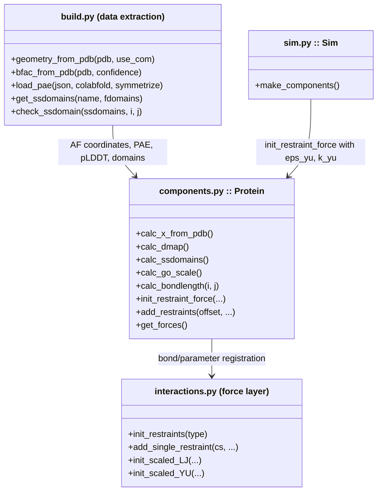
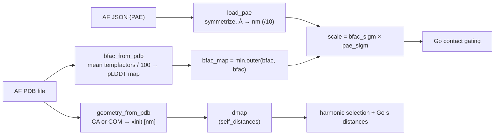
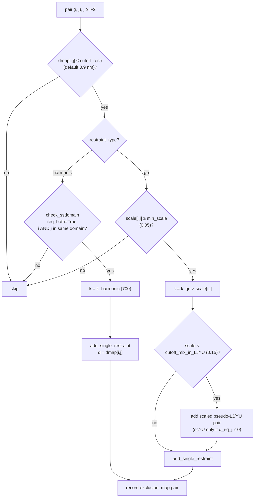

This page explains how MEM-CALVADOS enforces **folded structure** on coarse-grained protein beads using two AF-guided (AlphaFold-guided) restraint engines: **domain-bounded harmonic restraints** and **confidence-gated Go-type contacts**. Both engines share a single pipeline: geometry and confidence data are extracted from an AlphaFold PDB + PAE pair, contact pairs are selected per restraint type, and restraint forces are registered as OpenMM bond forces alongside the standard CALVADOS potentials. The page covers the force definitions in `interactions.py`, the selection/gating logic in the `Protein` class, the supporting parsers in `build.py`, default parameters, and how `Sim` wires everything at runtime.

## Architectural Layout: From AF Data To OpenMM Forces

The restraint subsystem is deliberately layered so that no OpenMM object is created before contact selection is complete. `build.py` owns **data extraction** (coordinates, pLDDT B-factors, PAE matrices, domain maps), `components.py` owns **selection and gating logic** inside the `Protein` class, and `interactions.py` owns **force-object construction**. `Sim.make_components` is the only orchestrator that decides *which* force flavor gets instantiated, passing the electrolyte-dependent Yukawa parameters (`eps_yu`, `k_yu`) that only Go restraints need.

The triggering condition is a single boolean: a component with `restraint = True` skips the generic spiral/linear initial geometry and instead reads its coordinates directly from `{pdb_folder}/{name}.pdb`, then branches on `restraint_type` to compute either the domain map (`calc_ssdomains`) or the Go contact scale (`calc_go_scale`).
Sources: [components.py](calvados/components.py#L177-L197), [sim.py](calvados/sim.py#L55-L106)

## The Force Layer: One Interface, Two Potential Forms

`interactions.init_restraints(restraint_type)` returns a polymorphic force object keyed on a single string. For `'harmonic'` it returns a plain `openmm.HarmonicBondForce`; for `'go'` it returns a `CustomBondForce` with the asymmetric Go energy expression `k*(5*(s/r)^12 - 6*(s/r)^10)` and two per-bond parameters, `s` (the equilibrium/natural contact distance) and `k` (the energy scale). This 12-10 form is minimized exactly at `r = s`, so unlike a 12-6 Lennard-Jones term it has no attractive tail below `s` — a contact compressed beyond its native distance is purely repulsive, which is the defining property of a Go model.

`add_single_restraint` is the single funnel through which every restraint bond passes. Note the unit asymmetry that follows from the two force types: harmonic `k` is supplied in `kJ/mol/nm²` (a second derivative of energy), while Go `k` is a plain `kJ/mol` energy scale packed with `s` into a per-bond parameter list. Every added pair is also returned as a 1-based record (`[i+1, j+1, dij, k]`) for later file output.

| Property | Harmonic engine | Go engine |
|---|---|---|
| OpenMM force class | `HarmonicBondForce` | `CustomBondForce` |
| Energy form | `k(dij)·(r − dij)²` | `k·(5(s/r)^12 − 6(s/r)^10)` |
| Per-bond parameters | `dij [nm]`, `k [kJ/mol/nm²]` | `s [nm]`, `k [kJ/mol]` |
| Selection criterion | Both residues in a structured domain, `dij ≤ cutoff_restr` | `scale[i,j] ≥ min_scale` (confidence gate) |
| Extra companion forces | none | `scLJ`, `scYU` pseudo-bond forces |
Sources: [interactions.py](calvados/interactions.py#L124-L135), [interactions.py](calvados/interactions.py#L172-L187)

## AF Model Ingestion: Coordinates, pLDDT, and PAE

Three parsers in `build.py` convert AlphaFold artifacts into restraint inputs. `geometry_from_pdb` extracts either CA positions (`name CA` selection) or per-residue centers of mass when `use_com=True`, dividing by 10 to convert Å → nm, and returns the PDB's unit-cell dimensions as the local frame. The `use_com` choice matters because CALVADOS beads represent whole residues: COM placement keeps the restraint network centered on the residue body rather than the backbone trace.

`bfac_from_pdb` reads AlphaFold's per-residue confidence (pLDDT), which AF stores in the B-factor column, averaging atom tempfactors per residue and scaling to [0, 1]; the `confidence` argument acts as a hard floor (the `Protein` caller passes `confidence=0.`, deferring all filtering to the smooth sigmoid instead of a binary cut). `load_pae` handles the three PAE JSON dialects in circulation — EBI AlphaFold (`colabfold=0`, a list of dicts with key `predicted_aligned_error`), ColabFold legacy (`colabfold=1`, top-level dict with `predicted_aligned_error`), and newer ColabFold (`colabfold=2`, key `pae`) — and symmetrizes the matrix as `0.5·(PAE + PAEᵀ)` before conversion to nm.
Sources: [build.py](calvados/build.py#L290-L321), [build.py](calvados/build.py#L331-L343), [components.py](calvados/components.py#L124-L128), [components.py](calvados/components.py#L66-L70)

> [!TIP]
> The PAE matrix in AF JSON files is in **Ångströms** — `calc_go_scale` divides by 10 immediately after loading (`/ 10. # in nm`). If you supply a PAE file in a nonstandard format, an uncaught 10× unit error silently shifts every sigmoid gate, effectively enabling or disabling the entire Go network.

## Engine 1: AF-Guided Harmonic Restraints (Domain-Bounded)

The harmonic engine restains pairs *within annotated folded domains* rather than relying on per-pair confidence scores. `calc_ssdomains` reads `fdomains` (default `domains.yaml`) — a YAML mapping protein name → list of domains, where a domain may be a flat `[start, end]` range or a list of sub-ranges — and expands each 1-based inclusive range into a 0-based residue set. A dPAM CSV format (`uniprot`/`range` columns) is also supported via the `dpam` flag.

Selection happens in `Protein.add_restraints`, which sweeps the strict upper triangle (`j ≥ i+2`, excluding chain neighbors) with three filters applied in order:

Critically, the harmonic engine also rewrites the **covalent chain** inside annotated domains: `calc_bondlength` is called by `add_bonds` for every consecutive pair, and when *either* residue belongs to a structured domain (`req_both=False`), the generic residue bond length `d0` is replaced by the true PDB distance `dmap[i,j]`. This pre-loads the backbone geometry of folded regions so that harmonic restraints stabilize an already-correct local fold rather than pulling a spiral into one.
Sources: [build.py](calvados/build.py#L345-L389), [components.py](calvados/components.py#L249-L281), [components.py](calvados/components.py#L199-L218), [components.py](calvados/components.py#L94-L105)

## Engine 2: Confidence-Gated Go Contacts

The Go engine replaces the binary domain map with a **continuous, per-pair confidence gate** computed from two independent AF signals multiplied together in `calc_go_scale`:

1. **pLDDT gate** — the outer-minimum of residue confidences (`np.minimum.outer(bfac, bfac)`) ensures a contact is only as trusted as its *weakest* participant, squashed through a logistic sigmoid `σ(bfac_width·(bfac_map − bfac_shift))` with defaults `bfac_width=50.`, `bfac_shift=0.8`.
2. **PAE gate** — the symmetrized PAE value itself (in nm) enters with inverted sign, `σ(−pae_width·(pae − pae_shift))`, so low alignment error (high confidence) saturates the gate; defaults `pae_width=15.`, `pae_shift=0.3`.

Their product is `self.scale ∈ (0, 1)`, which plays three distinct roles:

| Role | Mechanism | Threshold logic |
|---|---|---|
| Contact admission | `k = k_go × scale[i,j]` | skip if `scale < 0.05` (`min_scale`) |
| Interaction-regime switch | choose pure Go vs. mixed regime | boundary at `cutoff_mix_in_LJYU = 0.15` |
| Backbone blending | `bondscale = σ(−80·(scale − 0.1))` blends chain bond length between generic `d0` and PDB distance | continuous, per pair |

The mixed regime (`0.05 ≤ scale < 0.15`) is the most subtle part of the design. Weakly confident native contacts still receive a Go bond, but simultaneously the **standard Ashbaugh-Hatch/Yukawa pair potential between those two beads is replaced** by `init_scaled_LJ` / `init_scaled_YU` pseudo-bonds whose per-bond scale factor is `bondscale[i,j]` — a second sigmoid that rises as `scale` falls. This prevents double-counting: without the substitution, a weak native contact would experience both the LJ/YU attraction *and* the Go well, and the Go bond would additionally suppress the excluded-volume that the regular nonbonded force provides. For charged pairs only (`q_i·q_j ≠ 0`), a matching scaled Yukawa bond is added. The substitution bonds carry the raw `eps_lj`, `cutoff_lj`, `eps_yu`, `k_yu` values injected from `Sim` into `init_restraint_force`.
Sources: [components.py](calvados/components.py#L136-L155), [components.py](calvados/components.py#L240-L281), [interactions.py](calvados/interactions.py#L137-L158), [interactions.py](calvados/interactions.py#L189-L204)

> [!TIP]
> Read the two sigmoids as **complementary gates on the same quantity**: `scale` gates the Go force *open* as confidence rises, while `bondscale` gates the *residual* LJ/YU interaction open as confidence falls. At `scale ≈ 0.1` both are mid-transition — this is why the backbone blending uses the same crossover region. When debugging a system where a domain "falls apart" or "clumps", inspect `scaled_LJ_{name}.txt` and `restr_{name}.txt` outputs: their pair lists should partition the contact set below and above `cutoff_mix_in_LJYU`.

## Runtime Wiring In `Sim` And Artifact Output

`Sim.make_components` instantiates each component class by `molecule_type`, and for any component whose effective properties carry `restraint=True` it calls `init_restraint_force` — **with** the system-level LJ/YU parameters when `restraint_type == 'go'` (the scaled pseudo-bond forces need them at construction time), and bare otherwise — then flips the system-wide flag `use_restraints`, which downstream code uses to decide whether restraint forces join the system. Note that `eps_yu` and `k_yu` are computed by `genParamsDH(temp, ionic)` inside `build_system` *before* `make_components` runs, which is the dependency ordering that makes the Go pathway possible.

Every restraint is persisted for inspection: `write_restraints` emits `restr_{name}.txt` (pair, distance, force constant), plus `scaled_LJ_{name}.txt` and `scaled_YU_{name}.txt` for Go systems, and `get_forces` appends `cs` (and `scLJ`, `scYU` for Go) to the component's force list that `Sim` later registers.
Sources: [sim.py](calvados/sim.py#L94-L104), [sim.py](calvados/sim.py#L152-L156), [components.py](calvados/components.py#L283-L307)

## Default Parameter Reference

All restraint knobs live in the component defaults (`calvados/data/default_component.yaml`) and can be overridden globally via `Components(**defaults)` or per-molecule via `components.add(name=..., restraint=True, ...)` — the `cfg.Components` class merges package defaults with user kwargs into the `defaults` block that every component falls back on.

| Parameter | Default | Meaning |
|---|---|---|
| `restraint` | `false` | Master switch; routes geometry to PDB instead of spiral/linear build |
| `restraint_type` | `'harmonic'` | `'harmonic'` or `'go'` |
| `cutoff_restr` | `0.9` nm | Max native distance for a restraint pair (both engines) |
| `k_harmonic` | `700.` | Harmonic force constant, `kJ/mol/nm²` |
| `fdomains` | `'domains.yaml'` | Domain map file (YAML name→ranges, or dPAM CSV) |
| `k_go` | `15.` | Go energy scale (max), `kJ/mol`, scaled by `scale[i,j]` |
| `use_com` | `true` | Bead positions from residue COM instead of CA |
| `colabfold` | `0` | PAE JSON dialect: 0=EBI AF, 1=ColabFold, 2=ColabFold (`pae` key) |
| `bfac_shift` / `bfac_width` | `0.8` / `50.` | pLDDT sigmoid midpoint / steepness |
| `pae_shift` / `pae_width` | `0.3` / `15.` | PAE sigmoid midpoint (nm) / steepness |
| `min_scale` / `cutoff_mix_in_LJYU` | `0.05` / `0.15` (call-site) | Go admission floor / mixed-regime boundary |
| `bscale_shift` / `bscale_width` | `0.1` / `80` (call-site) | `bondscale` sigmoid parameters |
Sources: [default_component.yaml](calvados/data/default_component.yaml#L13-L30), [cfg.py](calvados/cfg.py#L64-L95)

## Worked Configurations From The Examples

The `single_GO` example demonstrates the full Go pathway on a multi-domain protein (hnRNPA1S or TIA1): the component is created with `restraint=True`, `restraint_type='go'`, `use_com=True`, `colabfold=0`, and `k_go=10.`, with `pdb_folder` pointing at a directory holding the AF PDB and its PAE JSON (e.g. `AF-P00698.json`). The `single_TMP_AF` example shows the **per-component override pattern**: defaults set the Go parameters (`k_go=15.`) once for all components, but `restraint=True` is applied only to the transmembrane protein via `components.add(name=args.name, restraint=True, ...)`, leaving the POPC lipid component — which has no PDB/PAE — fully unrestrained. This is the canonical way to mix folded-protein restraints with free (lipid, RNA, crowder) components in one system.

| Example | Engine activated | Key settings |
|---|---|---|
| `single_GO` | Go, whole component | `restraint=True`, `restraint_type='go'`, `k_go=10.`, AF PDB+JSON in `input/` |
| `single_TMP_AF` | Go, protein only | defaults `k_go=15.`, per-component `add(..., restraint=True)` beside lipid component |
Sources: [prepare.py](examples/single_GO/prepare.py#L49-L68), [README.md](examples/single_GO/README.md#L1-L9), [prepare.py](examples/single_TMP_AF/prepare.py#L71-L92)

## Engine Selection Guidance

The two engines embody different philosophies and the choice is structural, not stylistic. Choose **harmonic** when you have trusted domain annotations (`domains.yaml`) and want maximal rigidity — a single uniform force constant, backbone distances pre-loaded inside domains, zero configuration beyond the domain file. Choose **Go** when domain annotations are unavailable or unreliable: the AF confidence signals (`bfac`, PAE) act as a *self-annotating* domain map, graded force constants let marginal contacts break, and the LJ/YU substitution keeps weak-contact regions physically consistent with the CALVADOS force field rather than over-stabilized.

| Dimension | Harmonic | Go |
|---|---|---|
| Required inputs | PDB + `fdomains` YAML | PDB + PAE JSON only |
| Confidence usage | implicit (via domain curation) | explicit, per-pair, continuous |
| Force constant | uniform (`k_harmonic`) | graded (`k_go × scale`) |
| Backbone geometry | rewritten inside domains only | continuously blended by `bondscale` |
| Risk profile | over-rigid if domain map is wrong | over-soft if AF confidence is systematically low |

For the adjacent restraint machinery — external forces and PMF-based tabulated potentials — continue to [Custom Restraints And PMF Forces](14-custom-restraints-and-pmf-forces); for how these forces are registered into force groups and excluded from nonbonded pair lists, see [Force Groups And Interaction Exclusions](12-force-groups-and-interaction-exclusions); for the equilibration restraints that hold slab systems together before production, see [Slab Equilibration And Barostats](15-slab-equilibration-and-barostats).