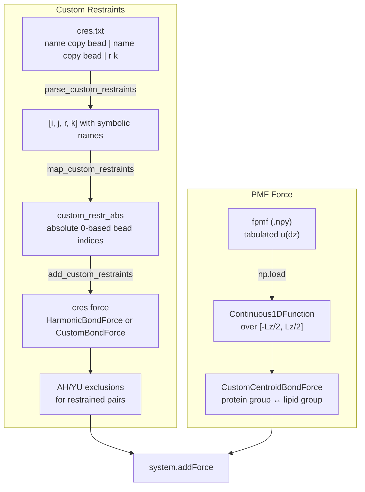
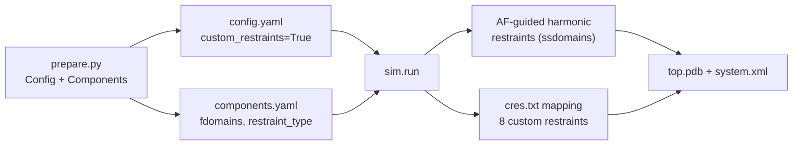

CALVADOS ships two extension mechanisms that operate *outside* the standard AF-guided restraint pipeline: **custom restraints** (arbitrary user-defined restraint pairs supplied via a text file) and the **PMF force** (a tabulated potential of mean force between protein and bilayer centroids). Both are optional Config flags that hook into `Sim.build_system` and are materialized as OpenMM bond-based forces. This page documents the data flow, input formats, force initialization, exclusion strategy, and verification path for both mechanisms, at the level of detail needed to extend or debug them.

Sources: [sim.py](calvados/sim.py#L294-L304), [interactions.py](calvados/interactions.py#L113-L135)

## Architecture Overview

Both mechanisms follow the same lifecycle: a declarative user input is parsed during system construction, converted to absolute particle indices, instantiated as an OpenMM force object, and finally attached to the `openmm.System` after all per-component interactions are in place.



The critical ordering constraint: custom restraints and the PMF force are wired **after** the component loop completes (they need full particle-index space and the `protein_indices` / `lipid_indices` sets), whereas component-internal restraints are added per molecule inside the loop.

Sources: [sim.py](calvados/sim.py#L294-L304), [sim.py](calvados/sim.py#L317-L373)

## Custom Restraints: Input Format And Symbolic Mapping

The custom restraint file (configured via `fcustom_restraints`) uses a pipe-delimited, one-restraint-per-line format:

```
hnRNPA1S 1 72 | hnRNPA1S 1 157 | 0.559 700.0
```

Each line encodes five values: component `name`, `copy` number, `bead` number for both partners (1-based, per the in-code comment), the target distance `r` in nm, and the force constant `k`.

| Field | Position | Convention | Meaning |
|---|---|---|---|
| `name` | token 1 / token 5 | string | Component name in `components.yaml` |
| `copy` | token 2 / token 6 | 1-based | Copy index for multi-molecule components (`nmol > 1`) |
| `bead` | token 3 / token 7 | 1-based | Bead/residue index within the molecule |
| `r` | token 9 | nm | Equilibrium restraint distance |
| `k` | token 10 | kJ/mol/nm² (harmonic) or kJ/mol (Go) | Force constant |

Sources: [cres.txt](examples/custom_restraints/input/cres.txt#L1-L8), [sim.py](calvados/sim.py#L604-L616)

`Sim.parse_custom_restraints` is a static method that reads the file and yields 4-element records `[i, j, r, k]`, where `i` and `j` are the `[name, copy, bead]` triples. `Sim.map_custom_restraints` then resolves symbolic names to **absolute, 0-based particle indices** in the global system. It first accumulates a bead offset per component — `total_beads` grows by `comp.nmol * comp.nbeads` per component, and `comp.start_bead` records the running base — then computes:

```python
x_abs = comp.start_bead + (copy-1)*comp.nbeads + (bead-1)
```

This design decouples the restraint file from system layout: restraints survive reordering of components and multi-copy expansion without the user ever touching OpenMM indices.

Sources: [sim.py](calvados/sim.py#L596-L616), [sim.py](calvados/sim.py#L618-L620)

## Force Initialization And The Exclusion Strategy

`Sim.add_custom_restraints` instantiates the force via `interactions.init_restraints(self.custom_restraint_type)` and dispatches parameterization through the shared `add_single_restraint` helper. The force type is selected by the `custom_restraint_type` config key:

| Type | OpenMM Force | Energy Form | Per-bond Parameters | Units of `k` |
|---|---|---|---|---|
| `harmonic` | `HarmonicBondForce` | ½k(r−r₀)² | `r₀` (nm), `k` | kJ/mol/nm² |
| `go` | `CustomBondForce` | `k*(5*(s/r)^12-6*(s/r)^10)` | `s` (nm), `k` (kJ/mol) | kJ/mol |

Both variants enable periodic boundary conditions via `setUsesPeriodicBoundaryConditions(True)`.

Sources: [sim.py](calvados/sim.py#L475-L485), [interactions.py](calvados/interactions.py#L124-L135), [interactions.py](calvados/interactions.py#L172-L187)

Every restrained pair is also registered in an `exclusion_map` and passed to `Sim.add_exclusions`, which removes the pair from the native nonbonded forces — `ah` and `yu` in protein-only systems, plus `wca`, `ah_pp`, and `sa` in lipid systems. This is the double-counting safeguard: a custom restraint *replaces* the default Lennard-Jones/Debye-Hückel contact rather than augmenting it. If you pass `exclude_nonbonded=False`, restraint pairs keep their native interactions on top of the restraint potential — rarely the physical intent.

> [!TIP]
> Force ordering in the serialized system is deterministic but positional: for a single-protein system the force stack is `[ah, yu, hb, cres]`, which is why the test retrieves `system.getForces()[3]` for the custom restraint force. Enabling component-level restraints (which append `cs` per component) or extra forces shifts this index — deserialize and search by force type rather than hardcoding indices in downstream tooling.

Sources: [sim.py](calvados/sim.py#L484-L498), [sim.py](calvados/sim.py#L346-L349), [test_custom_restraints.py](tests/test_custom_restraints.py#L99-L107)

## PMF Force: Tabulated Protein–Bilayer Potential

The PMF mechanism computes an effective interaction between two **centroids** — the collection of all protein beads and the collection of all lipid beads — along the periodic box z-axis. The construction in `interactions.init_pmf_force` combines two OpenMM primitives:

1. **`Continuous1DFunction`** — the array `u` loaded from `fpmf` (a `.npy` file via `np.load`) is interpolated into a smooth tabulated function spanning `[-Lz/2, Lz/2]` with periodic continuation enabled.
2. **`CustomCentroidBondForce(2, ...)`** — computes `dz = z1 - z2 - Lz*floor((z1-z2)/Lz + 0.5)`, the minimum-image z-separation between group centroids, and evaluates `pmf(dz)`.

```python
table = openmm.Continuous1DFunction(list(map(float, u)), -Lz/2., Lz/2., True)
f = openmm.CustomCentroidBondForce(2, f'pmf(dz); dz=z1-z2-{Lz}*floor((z1-z2)/{Lz}+0.5)')
f.addTabulatedFunction('pmf', table)
f.setUsesPeriodicBoundaryConditions(True)
```

The floor-based minimum-image expression is what makes the potential periodic: a protein crossing the box boundary in z continues to sample the same PMF curve. Because `Lz` is interpolated directly into the expression string, changing the box size invalidates the domain of the tabulated function — regenerate the table (and the `.npy` file) whenever `box[2]` changes.

Sources: [interactions.py](calvados/interactions.py#L113-L118)

Wiring happens in `Sim.build_system` after the molecule loop, gated on the `pmf_force` config flag. The two centroid groups are built from the `protein_indices` and `lipid_indices` sets accumulated during particle enumeration (sorted for deterministic ordering), then connected by a single centroid bond:

```python
u = np.load(self.fpmf)
self.pmf = interactions.init_pmf_force(u, self.box[2])
g_pep = self.pmf.addGroup(sorted(protein_indices))
g_lip = self.pmf.addGroup(sorted(lipid_indices))
self.pmf.addBond([g_pep, g_lip], [])
```

The force is added to the system last, after the barostat conditional block, in `add_forces_to_system`. Note this is a *collective* coordinate by design — one PMF between two ensembles, not per-molecule forces — so it requires a system containing both proteins and lipids (the `protein_indices` / `lipid_indices` sets are only populated for those molecule types).

Sources: [sim.py](calvados/sim.py#L298-L304), [sim.py](calvados/sim.py#L371-L372), [sim.py](calvados/sim.py#L244-L248)

## Configuration Reference

Both mechanisms are activated purely through `Config` keyword arguments (each key is applied as a `Sim` attribute via the generic config setattr loop) plus, for PMF, a data file path:

| Config Key | Type | Effect | Consumed By |
|---|---|---|---|
| `custom_restraints` | `bool` | Triggers parsing, mapping, force creation, exclusions, and `system.addForce` | `build_system` |
| `custom_restraint_type` | `str` | `'harmonic'` or `'go'` — selects `HarmonicBondForce` vs. Go-style `CustomBondForce` | `init_restraints` |
| `fcustom_restraints` | `str` | Path to the pipe-delimited restraint file | `parse_custom_restraints` |
| `pmf_force` | `bool` | Triggers PMF force construction and centroid-group wiring | `build_system` |
| `fpmf` | `str` | Path to `.npy` array with PMF values | `np.load` in `build_system` |

A minimal activation in a `prepare.py`-style script:

```python
config = Config(
    ...
    custom_restraints = True,
    custom_restraint_type = 'harmonic',
    fcustom_restraints = f'{cwd}/input/cres.txt',
)
```

Sources: [sim.py](calvados/sim.py#L31-L33), [prepare.py](examples/custom_restraints/prepare.py#L45-L47), [test_custom_restraints.py](tests/test_custom_restraints.py#L73-L76)

## Verification: The Test Harness Pattern

`tests/test_custom_restraints.py` establishes the canonical verification pattern: build a minimal single-protein system with custom restraints enabled, run `sim.run`, then round-trip the system through OpenMM XML serialization and introspect the force stack:

```python
system = openmm.XmlSerializer.deserialize(open(f"{cwd}/tests/data/{sysname}/{sysname}.xml").read())
force = system.getForces()[3]
N = force.getNumBonds()
f = force.getBondParameters(0)
i, j = f[0], f[1]
assert (N == 1) and (i == 0) and (j == 9)
```

The assertion validates the full symbolic-to-absolute mapping chain end-to-end: the restraint declared against named beads must materialize as exactly one bond between absolute indices 0 and 9 in the serialized system. This is also a regression guard on `map_custom_restraints` offset arithmetic — any change to component ordering or bead accounting that breaks `start_bead` accumulation will fail here.

Sources: [test_custom_restraints.py](tests/test_custom_restraints.py#L54-L107)

## Worked Example: `examples/custom_restraints`

The example combines both restraint layers on a single hnRNPA1S construct. The end-to-end flow from user input to serialized system:



In the example's `Config`, `custom_restraints = True` with `custom_restraint_type = 'harmonic'` and `fcustom_restraints` pointing at `input/cres.txt`, whose 8 lines each restrain a bead in the N-terminal folded domain to a bead in the C-terminal domain at distances of ~0.5–1.1 nm with `k = 700.0`. The same script separately configures `Components` with `fdomains`/`restraint_type`/`k_harmonic` — that is the AF-guided pipeline (sequence extraction from PDB, substructure-domain distance maps, AH/YU exclusions) and is covered in [AF-Guided Harmonic And Go Restraints](13-af-guided-harmonic-and-go-restraints). The important architectural point is that the two layers coexist multiplicatively in one system: component restraints attach per-molecule inside the build loop, custom restraints attach once globally afterward, each maintaining its own exclusion bookkeeping.

Sources: [prepare.py](examples/custom_restraints/prepare.py#L26-L48), [prepare.py](examples/custom_restraints/prepare.py#L64-L82), [cres.txt](examples/custom_restraints/input/cres.txt#L1-L8), [domains.yaml](examples/custom_restraints/input/domains.yaml#L1-L3)

> [!TIP]
> When authoring `cres.txt` for multi-copy components, remember `copy` and `bead` are 1-based while the resolved indices are 0-based absolute particle numbers; the verbose run output prints every mapped `(name, copy, bead, r, k)` tuple during `map_custom_restraints` — cross-check those prints against `start_bead` accumulation before launching long productions.

Sources: [sim.py](calvados/sim.py#L604-L616)

## Related Pages

- [AF-Guided Harmonic And Go Restraints](13-af-guided-harmonic-and-go-restraints) — the `restraint=True` component pipeline, Go potential scaling, and shared `init_restraints`/`add_single_restraint` helpers reused by custom restraints.
- [Sim Class Workflow](16-sim-class-workflow) — the `build_system` → `add_forces_to_system` sequence in which both mechanisms execute.
- [Slab Equilibration And Barostats](15-slab-equilibration-and-barostats) — the external/restraint-based equilibration forces (`slab_eq`, `ext_force`) that share the `add_ext_restraints` path adjacent to this page's mechanisms.
- [Testing Potentials And Bond Topologies](22-testing-potentials-and-bond-topologies) — the XML round-trip test methodology in full.