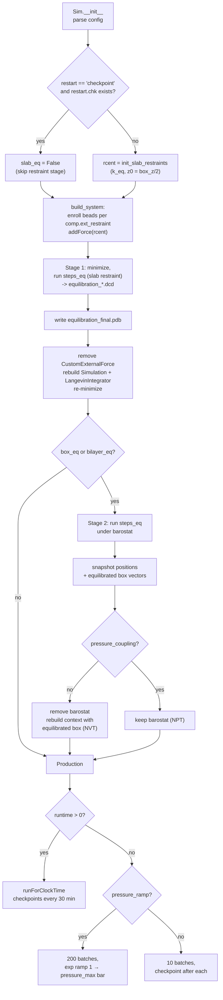
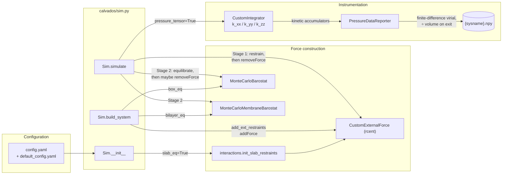

Phase-separated systems — condensate slabs and lipid bilayers — cannot be run productively straight from their initial coordinates. CALVADOS implements a staged equilibration protocol inside `Sim.simulate()`: an optional **slab restraint stage** that pulls components toward the box midplane while the condensate forms, followed by an optional **pressure equilibration stage** driven by one of two Monte Carlo barostats. This page documents the force definitions, the staged workflow, the barostat selection logic, production-phase pressure protocols, and the pressure-tensor instrumentation that supports these regimes.

Sources: [sim.py](calvados/sim.py#L637-L770), [interactions.py](calvados/interactions.py#L160-L170)

## Why Slab Systems Need Staged Equilibration

Direct coexistence simulations require a dense phase to form and stabilize before meaningful statistics can be collected. When `topol = 'slab'`, `build_system()` lays proteins and RNA on a 3D grid confined to a band of thickness `slab_width` centered at `box[2]/2` in z; crowders are placed in two dilute-phase bands separated from the slab region by a `slab_outer` margin, so the dense phase is flanked by dilute buffer on both sides. On a fresh start, molecules sit at their grid positions and the condensate has not yet condensed — unrestrained dynamics would let the incipient slab drift, fragment, or wander off the midplane during the long timescales needed for phase separation.

The solution is temporal decoupling: a soft external potential holds each restrained bead near the midplane (`z0 = box[2]/2`) for `steps_eq` steps, giving interfacial structure time to develop; the restraint is then surgically removed and the system is re-equilibrated before production. Bilayer systems follow the same pattern with a different control variable — instead of restraining particles, a membrane-aware barostat relaxes lateral tension while pinning the z dimension.

Sources: [sim.py](calvados/sim.py#L187-L206), [default_config.yaml](calvados/data/default_config.yaml#L36-L37)

For the full placement grids and geometry construction, see [Initial Geometry And Placement](8-initial-geometry-and-placement).

## The Slab Restraint Force: `init_slab_restraints`

When `slab_eq = True`, `Sim.__init__` constructs the restraint force via `interactions.init_slab_restraints(self.box, self.k_eq)`. The implementation is a compact `CustomExternalForce` with the energy expression `k*abs(periodicdistance(x,y,z,x,y,z0))`:

- **V-shaped, not harmonic.** The potential is *linear* in the distance from the midplane, so every bead experiences a constant-magnitude force of `k` kJ/(mol·nm) toward `z0`, regardless of displacement. This avoids the stiff-wall artifacts a quadratic term would introduce at large initial displacements.
- **Periodicity-aware.** `periodicdistance` measures the z-offset through the periodic boundary, keeping the restraint correct even as particles wrap.
- **Two global parameters:** `k` is set from the `k_eq` config key (default `0.02` kJ/(mol·nm)), and `z0` is fixed at box z/2 — meaning the restraint target does not follow box rescaling.

Particle enrollment is deliberately selective: during `build_system()`, a component contributes beads to the restraint only `if (self.slab_eq or self.ext_force) and comp.ext_restraint`. The `add_ext_restraints` method then registers each bead index of the component in sequence, so the restraint applies per-bead, not per-molecule. Note that `self.rcent` is a shared handle — if `ext_force` is also enabled, its custom expression overwrites the slab restraint force object in `__init__`, so the two mechanisms should not be combined on the same `rcent` instance.

Sources: [sim.py](calvados/sim.py#L44-L53), [sim.py](calvados/sim.py#L265-L267), [sim.py](calvados/sim.py#L552-L561), [interactions.py](calvados/interactions.py#L160-L170), [default_config.yaml](calvados/data/default_config.yaml#L19-L28)

> [!TIP]
> The restraint force is added to the System under the comment "Equilibration forces" (sim.py L342-L344), separate from the "External force" block used by `ext_force`. If you need a different slab profile (e.g., harmonic wells per leaflet), `init_slab_restraints` is the single function to modify — everything downstream (particle enrollment, staging, removal) keys off the resulting `CustomExternalForce` object.

## The Slab Equilibration Stage In `Sim.simulate()`

The slab stage executes immediately after energy minimization on a fresh start, before any barostat logic. It runs `steps_eq` integration steps with a `DCDReporter` writing to `equilibration_{sysname}.dcd`, then snapshots the final state to `equilibration_final.pdb`. The critical mechanism follows:

1. The loop over `system.getForces()` finds the first `CustomExternalForce` instance and calls `system.removeForce(index)`.
2. A **new `Simulation` object is built from scratch** with a fresh `LangevinIntegrator`, the equilibrated positions are loaded from the intermediate PDB, and energy is **minimized again**.

The rebuild is mandatory, not stylistic: an OpenMM `Context` caches compiled force kernels, so mutating the `System` after context creation invalidates it. CALVADOS therefore serializes the state through a PDB round-trip. A subtle side effect is the integrator swap — the pre-equilibration phase uses `LangevinMiddleIntegrator`, while every post-stage rebuild uses the older `LangevinIntegrator` at the same 0.01 ps timestep, so the two phases differ slightly in their Langevin discretization scheme.

A restart guard protects this stage from re-execution: at construction time, if `restart == 'checkpoint'` and the checkpoint file exists, `slab_eq` is forced to `False`. A resumed run therefore continues production directly without re-restraining the slab — the `equilibration_*.dcd` append flag only matters for the pressure stage below.

Sources: [sim.py](calvados/sim.py#L709-L731), [sim.py](calvados/sim.py#L647-L655), [sim.py](calvados/sim.py#L44-L45)

## Barostat Selection: Isotropic vs Membrane Coupling

Two mutually exclusive flags inject barostat forces into the System during `add_forces_to_system()`:

- **`box_eq` → `MonteCarloBarostat`**: isotropic coupling at `pressure[0]` bar and the simulation temperature, attempting a volume move every **1000** steps. Immediately below it in the source sits a fully-formed but **commented-out** `MonteCarloAnisotropicBarostat` that would consume the full `pressure` vector and the per-axis `boxscaling_xyz` mask — the plumbing for axis-selective coupling exists but is not active.
- **`bilayer_eq` → `MonteCarloMembraneBarostat`**: configured with `pressure[0]` bar, **zero surface tension** (hardcoded `0*unit.bar*unit.nanometer`), `XYIsotropic` geometry scaling and `ZFixed` z-length, attempting a move every **10000** steps. A commented `ConstantVolume` alternative marks the third supported mode.

Only `pressure[0]` of the three-element `pressure` list is consumed by both active paths; the remaining entries exist for the dormant anisotropic branch. `print_system_summary()` logs which equilibration machinery is live — the restraint particle count, "Equilibration under zero lateral tension", or "Equilibration through changes in box side lengths along X and Y and Z" (derived from `boxscaling_xyz`).

| Barostat | Trigger flag | Pressure input | Coupling geometry | Move interval | Intended regime |
|---|---|---|---|---|---|
| `MonteCarloBarostat` | `box_eq` | `pressure[0]` | Isotropic, all axes | 1000 steps | Slab production with pressure coupling |
| `MonteCarloAnisotropicBarostat` | *(disabled in source)* | full `pressure` vector | Per-axis via `boxscaling_xyz` | 1000 steps | Reserved for axis-selective coupling |
| `MonteCarloMembraneBarostat` | `bilayer_eq` | `pressure[0]`, σ=0 | XY isotropic, Z fixed | 10000 steps | Bilayer zero-tension equilibration |

Sources: [sim.py](calvados/sim.py#L351-L369), [sim.py](calvados/sim.py#L392-L398), [default_config.yaml](calvados/data/default_config.yaml#L20-L24)

## Pressure Equilibration Stage And `pressure_coupling` Semantics

If `box_eq` or `bilayer_eq` is set, a second equilibration block runs `steps_eq` steps under the barostat — appending to the same `equilibration_{sysname}.dcd` trajectory — then captures the final positions *and* the evolved periodic box vectors. The box vectors are pushed into the mdtraj topology (`topology.setPeriodicBoxVectors`) so the rebuilt context inherits the equilibrated cell dimensions.

What happens next is governed by `pressure_coupling` (default `False`):

- **`pressure_coupling = False`**: the loop iterates forces, matches each barostat type by `isinstance` (`MonteCarloMembraneBarostat`, `MonteCarloAnisotropicBarostat`, `MonteCarloBarostat`), removes the first match, rebuilds the Simulation with a fresh `LangevinIntegrator`, and restores positions plus the equilibrated box. Production then runs **NVT** in the equilibrated cell — the barostat was a tool to find the right volume, not a production companion.
- **`pressure_coupling = True`**: the barostat survives into production, giving an NPT ensemble at `pressure[0]`.

Consistent with the slab guard, loading a checkpoint explicitly sets `bilayer_eq = False` inside `simulate()`, so resumed runs skip the membrane equilibration even if it is enabled in the YAML. (`box_eq` is *not* disabled on resume — only the slab and membrane stages are guarded.)

Sources: [sim.py](calvados/sim.py#L733-L770), [sim.py](calvados/sim.py#L680-L688), [default_config.yaml](calvados/data/default_config.yaml#L21-L21)

## Production Pressure Protocols

After all equilibration stages, the production branch offers three mutually exclusive modes:

- **Wall-clock mode** (`runtime > 0`): `runForClockTime` with checkpoints every 30 minutes overrides the step count entirely — the standard pattern for cluster jobs with time limits.
- **Pressure ramp** (`pressure_ramp = True`): the total `steps` budget is split into **200 batches**. Batch *i* sets the barostat pressure to `exp(frac·ln(pressure_max))` — an exponential schedule from **1 bar** up to `pressure_max` bar (default 1) — applied via `context.setParameter(MonteCarloBarostat.Pressure(), ...)` before running each batch. Every (batch, start, end, pressure) tuple is logged to `pressure_ramp.txt`. This mode presupposes an isotropic `MonteCarloBarostat` in the System, since it references the `MonteCarloBarostat.Pressure()` global parameter by name.
- **Default batched mode**: 10 equal batches with a checkpoint written after each — the resumability backbone that pairs with `restart = 'checkpoint'`.

Sources: [sim.py](calvados/sim.py#L838-L860)

## Pressure Tensor Instrumentation

Setting `pressure_tensor = True` switches the whole simulation onto a bespoke path. Instead of `LangevinMiddleIntegrator`, a `CustomIntegrator` (dt = 0.01 ps) implements the BAOAB-style Langevin scheme with global variables `k_xx`, `k_yy`, `k_zz` that accumulate mass-weighted kinetic contributions (`m·v·v` per diagonal) inside an `if` block that fires only when `step == pressurefreq − 1` — i.e., kinetic sampling is throttled to every `pressurefreq` steps (default 1, every step).

The companion `PressureDataReporter` completes the tensor on each report. Its `_compute_pressure_tensor` evaluates the **configurational (virial) part by finite differences**: for each diagonal axis it scales the box vectors by ±1×10⁻⁴, re-sets positions and box vectors on the context, evaluates the potential energy at both deformations, and takes the central-difference derivative as the virial. Combined with the integrator's kinetic accumulators, each diagonal entry is appended in memory; division by the initial box volume happens once at interpreter exit in `__del__`, which `np.save`s the full history to `{sysname}.npy`. Note that only the diagonal (xx, yy, zz) components are computed — the off-diagonal terms are present but commented out at both the integrator and reporter level.

| Artifact | Producer | Contents |
|---|---|---|
| `equilibration_{sysname}.dcd` | `DCDReporter` (stages 1–2) | Restrained slab / barostat equilibration trajectory |
| `equilibration_final.pdb` | `PDBReporter` | Post-stage snapshot; re-read to rebuild the context |
| `pressure_ramp.txt` | Ramp loop | Batch → pressure schedule log |
| `{sysname}.npy` | `PressureDataReporter.__del__` | Volume-normalized diagonal pressure tensor time series |
| `restart.chk` | Batch checkpointing | Resumable state (disables all equilibration on reload) |

Sources: [sim.py](calvados/sim.py#L772-L827), [pressuredatareporter.py](calvados/pressuredatareporter.py#L139-L183), [pressuredatareporter.py](calvados/pressuredatareporter.py#L58-L100)

> [!TIP]
> The ±1e-4 box deformation is applied *per report* by mutating the live context — box vectors and positions are always restored afterward (pressuredatareporter.py L175-L176). Because `__del__` performs the only file write, a reporter that is garbage-collected abnormally (e.g., on an unhandled exception mid-simulation) silently loses the pressure history. Treat the `.npy` as written only after a clean exit.

## The Complete Equilibration Pipeline

The following diagram traces control flow from configuration parsing through both equilibration stages into the three production modes. Read it alongside the source: every diamond corresponds to a YAML flag, every rectangle to a block in `simulate()`.

At the module level, the dependencies concentrate in two files — `interactions.py` supplies the force factory, while `sim.py` owns orchestration, staging, and teardown; `pressuredatareporter.py` operates independently against the live context:

Sources: [sim.py](calvados/sim.py#L24-L53), [sim.py](calvados/sim.py#L317-L372), [sim.py](calvados/sim.py#L637-L860)

## Configuration Reference

All parameters below are read from the user `config.yaml`, falling back to these defaults in `default_config.yaml` and attached directly to the `Sim` instance as attributes.

| Parameter | Default | Role |
|---|---|---|
| `slab_eq` | `false` | Enable the z-midplane restraint stage |
| `k_eq` | `0.02` | Linear restraint slope, kJ/(mol·nm) |
| `steps_eq` | `1000` | Duration of *each* equilibration stage (steps) |
| `slab_width` | `100` | Initial dense-phase thickness (nm) |
| `slab_outer` | `40` | Buffer margin between slab and crowder bands (nm) |
| `box_eq` | `false` | Isotropic `MonteCarloBarostat` during equilibration |
| `bilayer_eq` | `false` | `MonteCarloMembraneBarostat`, zero tension |
| `pressure` | `[0, 0, 0]` | Target pressures (bar); only `pressure[0]` is consumed |
| `boxscaling_xyz` | `[true, true, true]` | Per-axis masks for the dormant anisotropic barostat |
| `pressure_coupling` | `false` | Keep the barostat alive for production (NPT) |
| `pressure_ramp` | `false` | Exponential 200-batch pressure schedule |
| `pressure_max` | `1` | Ramp endpoint pressure (bar) |
| `pressure_tensor` | `false` | Diagonal tensor instrumentation via `PressureDataReporter` |
| `pressurefreq` | `1` | Tensor sampling interval (steps) |

Sources: [default_config.yaml](calvados/data/default_config.yaml#L19-L33), [default_config.yaml](calvados/data/default_config.yaml#L36-L42)

## Putting It Together: Reference Workflows

The shipped examples anchor each regime to concrete numbers. In `examples/slab_IDR`, 100 copies of an IDR are packed into a tall box (`15 × 15 × 150` nm) with `slab_width = 20` and the slab stage extended to `steps_eq = 100·N_save` (5×10⁶ steps at 10 fs/step) — far beyond the 1000-step default, reflecting how slow condensate coalescence is. `examples/slab_MDP` repeats the pattern at `20 × 20 × 270` nm with `slab_width = 40` for a multi-domain protein, while `examples/bilayer` activates the membrane path with `topol = 'bilayer'` and `bilayer_eq = True` to relax its pre-assembled lipid stack at zero lateral tension. In every case the production trajectory lands in `{sysname}.dcd`, with equilibration cleanly quarantined in the `equilibration_*` files.

| Example | Topology | Equilibration flag | Stage length | Purpose |
|---|---|---|---|---|
| `slab_IDR` | `slab`, width 20 | `slab_eq = True` | 100·N_save | IDR condensate direct coexistence |
| `slab_MDP` | `slab`, width 40 | `slab_eq = True` | 100·N_save | Multi-domain protein slabs |
| `bilayer` | `bilayer` | `bilayer_eq = True` | `steps_eq` default | Membrane zero-tension relaxation |

Sources: [prepare.py](examples/slab_IDR/prepare.py#L21-L43), [prepare.py](examples/slab_MDP/prepare.py#L21-L42), [prepare.py](examples/bilayer/prepare.py#L24-L44)

## Next Steps

To see how these stages sit inside the full build-and-run lifecycle, continue with [Sim Class Workflow](16-sim-class-workflow), then [OpenMM Integration And Reporters](17-openmm-integration-and-reporters) for the reporter plumbing that `PressureDataReporter` extends. The restraint force here is the sibling of the molecule-level restraints covered in [AF-Guided Harmonic And Go Restraints](13-af-guided-harmonic-and-go-restraints) and [Custom Restraints And PMF Forces](14-custom-restraints-and-pmf-forces); the slab placement grids it anchors are defined in [Initial Geometry And Placement](8-initial-geometry-and-placement). Once production trajectories exist, quantify the resulting phase behavior with [Membrane Property Profiles](20-membrane-property-profiles) and [Block Analysis And Error Estimation](21-block-analysis-and-error-estimation).