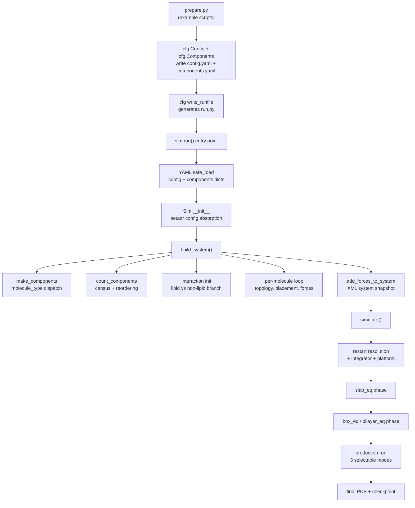
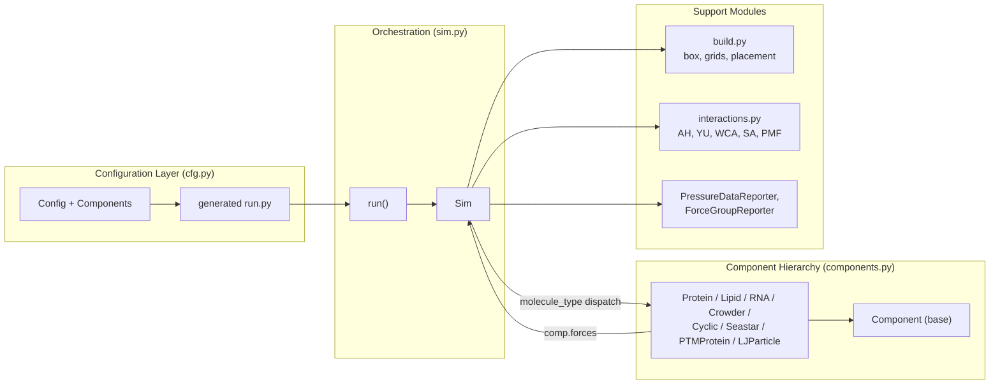

The `Sim` class in `calvados/sim.py` is the execution orchestrator of MEM-CALVADOS: it converts the declarative outputs of the YAML configuration system into a live OpenMM simulation and drives it through construction, phased equilibration, and production. This page explains the complete lifecycle — from the `run()` entry point through constructor config absorption, component census, system assembly, integrator selection, restart semantics, and the three production run modes. Potential mathematics, component geometry, and reporter internals live on their own pages and are only referenced here.

Sources: [sim.py](calvados/sim.py#L24-L28), [cfg.py](calvados/cfg.py#L13-L38)

## Architectural Position: The Orchestration Layer

`Sim` sits at the top of the runtime stack and is deliberately thin in its contract: it receives three arguments — a working `path`, a flat `config` dictionary parsed from `config.yaml`, and a `components` dictionary parsed from `components.yaml` — and executes two methods, `build_system()` and `simulate()`. The module-level `run()` function is the canonical entry point: it loads both YAML files with `safe_load`, instantiates `Sim`, and invokes the two-phase pipeline, returning the fully resolved object for optional programmatic inspection. This entry point is exactly what the `run.py` file generated by `cfg.Config.write()` calls, closing the loop between the preparation scripts and cluster execution.

Sources: [sim.py](calvados/sim.py#L871-L881), [cfg.py](calvados/cfg.py#L40-L61), [prepare.py](examples/single_IDR/prepare.py#L26-L73)

The class interaction topology below shows why `Sim` remains tractable despite its ~880 lines: it delegates specialized state to the component hierarchy, delegates geometry to `build.py`, delegates functional forms to `interactions.py`, and delegates output instrumentation to the two custom reporters. Every arrow into `Sim` is a service call; every arrow out of the component hierarchy returns force objects that `Sim` aggregates into the OpenMM `System`.

Sources: [sim.py](calvados/sim.py#L13-L22), [cfg.py](calvados/cfg.py#L64-L95)

## Constructor Phase: Config Absorption via Dynamic Attributes

`Sim.__init__` performs no explicit parameter validation or named field assignment. Instead, every key in the `config` dictionary is attached to the instance through `setattr`, and every key in `components['defaults']` is attached with a `default_` prefix — so YAML content *becomes* the object's attribute surface verbatim. The constructor then applies a small number of derived transforms: the box list becomes a NumPy array, `eps_lj` is converted from kcal/mol to kJ/mol (×4.184), and two conditional state initializations occur. If `restart == 'checkpoint'` and the checkpoint file already exists on disk, `slab_eq` is force-disabled (a resumed run must not re-pin molecules to the box center). If `slab_eq` is active, slab centering restraints are created immediately via `interactions.init_slab_restraints`; if `ext_force` is set, an `openmm.CustomExternalForce` is built from the user-supplied expression, with a `q` per-particle parameter registered when the expression references charge.

> [!TIP]
> The `setattr` absorption means a typo in `config.yaml` (e.g., `wfreq` misspelled) creates a *new* attribute rather than raising an error — the failure surfaces later as an `AttributeError` deep inside `build_system()` or `simulate()`, not at load time. When extending the config surface, remember that validation responsibility lives entirely with the consumer attribute access, not the constructor.

Sources: [sim.py](calvados/sim.py#L25-L53)

## Component Instantiation and the Census Invariant

`make_components()` iterates `components['system']` and dispatches on the `molecule_type` field (falling back to `default_molecule_type`) to construct the appropriate component class. Each instance receives its `eps_lj` and runs `calc_properties(pH, verbose, comp_setup)`, where `comp_setup` encodes the initial conformation generator: `compact` for proteins/crowders/cyclic/seastar/PTM, `linear` for lipids and the generic fallback, and `spiral` for RNA. Components requesting restraints get their restraint force initialized here — Go-type restraints require the Yukawa parameters (`eps_yu`, `k_yu`) that `build_system` computed beforehand, which is why `genParamsDH` is called *before* `make_components` (the source comment marks this ordering as required). A `use_restraints` flag is set if any component carries restraints.

Sources: [sim.py](calvados/sim.py#L55-L106), [sim.py](calvados/sim.py#L152-L157)

`count_components()` then produces a census: total components, total molecules, and per-type molecule counts (`nlipids`, `nproteins`, `nljparticles`, `ncrowders`, `nrnas`). Two structural rules are enforced here. First, the `single` and `center` topologies raise `ValueError` if the system contains more than one molecule, since centering a multi-molecule assembly is geometrically undefined. Second, the components array is **reordered so that protein components precede all non-protein components** — a placement-ordering invariant that downstream code (slab grid allocation, bilayer insertion order) implicitly depends on. This invariant is why consumers of the final `top.pdb` observe proteins occupying the lowest particle indices.

Sources: [sim.py](calvados/sim.py#L108-L136), [sim.py](calvados/sim.py#L129-L136)

The complete dispatch table:

| `molecule_type` | Component class | `comp_setup` | Placement path |
|---|---|---|---|
| `protein` | `Protein` | `compact` | `place_molecule` |
| `lipid` | `Lipid` | `linear` | `place_bilayer` (or `place_molecule` if `topol='random'`) |
| `crowder` | `Crowder` | `compact` | `place_molecule` |
| `rna` | `RNA` | `spiral` | `place_molecule` |
| `cyclic` | `Cyclic` | `compact` | `place_molecule` |
| `seastar` | `Seastar` | `compact` | `place_molecule` |
| `ptm_protein` | `PTMProtein` | `compact` | `place_molecule` |
| `lj_particle` | `LJParticle` | `compact` | `place_molecule` |
| *(fallback)* | `Component` | `linear` | `place_molecule` |

Sources: [sim.py](calvados/sim.py#L59-L106), [sim.py](calvados/sim.py#L231-L241)

## System Assembly: build_system

`build_system()` is the construction core, executing five ordered stages. Stage one creates the container pair — an empty `md.Topology` and an empty `openmm.System` — and installs the periodic box vectors from `build.build_box`. Stage two parameterizes the Debye-Hückel potential (`eps_yu`, `k_yu`) from `temp` and `ionic` *before* component construction, as described above. Stage three initializes the nonbonded force objects, and here the code branches on system composition:

| System composition | Forces initialized | Rationale |
|---|---|---|
| `nlipids > 0` (bilayer) | `wca`, `ah_pp`, `ah`, `sa`, `yu` | Lipid-specific WCA and SA terms plus split protein-protein / lipid AH handling; cutoffs derived from per-component `sigmas`/`omegas` |
| protein/RNA/crowder only | `ah`, `yu` | Standard CALVADOS pair set |
| empty system | `ah` only | Degenerate-case fallback |

Stage four builds the placement geometry: for `slab` and `grid` topologies a 3D lattice is generated (`build_xyzgrid`), for `shift_ref_bead` an XY grid pinned at mid-z, and for lipid-containing systems an XY bilayer grid — allocation sizes are computed from the census counts established previously. Stage five is the per-molecule assembly loop: for every molecule of every component, the code appends chain/residue/atom records to the mdtraj topology (`add_mdtraj_topol`), adds particles with masses to the OpenMM System (`add_particles_system`), positions the molecule (`place_molecule` or `place_bilayer`), registers that molecule's interaction parameters (`add_interactions`), and accumulates index sets — lipid, protein, TMT-classified, and charged — used afterwards to wire interaction groups onto the five lipid-system forces. For an in-depth treatment of group partitioning and force-group numbering, see [Force Groups And Interaction Exclusions](12-force-groups-and-interaction-exclusions); for placement geometry details, see [Initial Geometry And Placement](8-initial-geometry-and-placement).

Sources: [sim.py](calvados/sim.py#L138-L206), [sim.py](calvados/sim.py#L212-L292), [sim.py](calvados/sim.py#L500-L550)

After the loop, three assembly terminators run: custom restraints are parsed from file and mapped to absolute bead indices (`map_custom_restraints` → `add_custom_restraints`), an optional PMF force is loaded from `.npy` and bonded to protein/lipid groups, and the assembled trajectory snapshot is written to disk as `top.pdb`/`top.cif` — *unless* `restart == 'pdb'`, in which case the user-supplied structure is authoritative and the generated topology is discarded. `add_forces_to_system()` and `print_system_summary()` then finalize: the latter serializes the complete `System` to `{sysname}.xml` on disk, giving advanced users an inspectable, reloadable artifact of exactly what will be simulated.

Sources: [sim.py](calvados/sim.py#L294-L315), [sim.py](calvados/sim.py#L374-L399), [sim.py](calvados/sim.py#L596-L635)

### Force Assembly Budget

`add_forces_to_system()` composes the final force list in layers, each gated by configuration. The intermolecular layer selects the branch identified during assembly (five forces for bilayer systems, two otherwise). The intramolecular layer iterates components and appends every force returned by `comp.get_forces()` — bonds, angles, and per-component restraints. Then the conditional layer adds: the external-centering force (`ext_force` or `slab_eq`, both sharing `self.rcent`), custom restraints (`self.cres`), the **barostat** (`box_eq` → `MonteCarloBarostat` at `pressure[0]` with 1000-step application frequency; `bilayer_eq` → `MonteCarloMembraneBarostat` in XYIsotropic/ZFixed mode with 10000-step frequency), and the PMF force. Note that only *one* barostat branch can be meaningfully active, and both are removed again later during production unless pressure coupling is retained — see [Slab Equilibration And Barostats](15-slab-equilibration-and-barostats) for the physical reasoning.

Sources: [sim.py](calvados/sim.py#L317-L372), [sim.py](calvados/sim.py#L338-L372)

## Execution Phase: simulate() Integrators and Restart Strategy

`simulate()` opens with diagnostics — printing whether the system and each force use periodic boundary conditions — then resolves the three restart modes before any dynamics occur:

| `restart` mode | Position source | Trajectory behavior | Side effects |
|---|---|---|---|
| `None` | generated `top.pdb` | New `{sysname}.dcd` | Existing DCD backed up with timestamp |
| `pdb` | `{frestart}` read as `PDBFile` | New DCD; generated topology not re-saved | Energy minimization applied to input coordinates |
| `checkpoint` | `{frestart}` checkpoint via `loadCheckpoint` | **Append** to existing DCD/log (hard error if DCD missing) | `bilayer_eq` disabled; minimization skipped |

Sources: [sim.py](calvados/sim.py#L637-L652), [sim.py](calvados/sim.py#L680-L707)

The production integrator is a **`LangevinMiddleIntegrator`** fixed at a 0.01 ps timestep with friction taken from `friction_coeff`, and an optional deterministic seed. Platform selection branches on `self.platform`: CPU threads are set from `self.threads`, whereas GPU platforms receive `DeviceIndex` (only when `CUDA_VISIBLE_DEVICES` is unset, deferring to the scheduler otherwise) and `gpu_precision`. For all non-checkpoint starts — including the `pdb` restart mode — the context receives positions and `minimizeEnergy()` runs before any equilibration or production stepping; this guarantees that even imported structures begin from a local energy minimum.

Sources: [sim.py](calvados/sim.py#L654-L670), [calvados/sim.py](calvados/sim.py#L699-L707)

## Phased Equilibration and Context Rebuilding

Equilibration is implemented as sequential *phases* that mutate the system between them, and the mutation mechanics are the most architecturally significant pattern in the class. The `slab_eq` phase runs `steps_eq` steps under the external centering restraint, streams the restrained trajectory to `equilibration_{sysname}.dcd`, and persists the final frame as `equilibration_final.pdb`. It then **removes the first `CustomExternalForce` from the system and rebuilds the entire `Simulation` object** from that PDB with a plain `LangevinIntegrator`, re-minimizing before proceeding. The `box_eq`/`bilayer_eq` phase follows the identical pattern for barostats: run `steps_eq` under pressure control, extract final positions *and periodic box vectors* from the context state, remove the barostat if `pressure_coupling` is false, and rebuild the `Simulation` while explicitly restoring box dimensions via `setPeriodicBoxVectors` — preserving any volume equilibration achieved.

> [!TIP]
> The rebuild-and-reconstruct pattern is not stylistic: OpenMM forbids adding or removing forces from a `System` while a `Context` is live, so releasing equilibration restraints or barostats *requires* serializing state (through `equilibration_final.pdb`), constructing a fresh `Simulation`/`Context`, and re-injecting positions — and for barostats, box vectors. If you add a new equilibration phase, budget for this state-transfer round trip, including the box-vector restore that is easy to forget.

Sources: [sim.py](calvados/sim.py#L709-L731), [sim.py](calvados/sim.py#L733-L769)

| Phase | Active control | Integrator during phase | Post-phase mutation |
|---|---|---|---|
| `slab_eq` | `CustomExternalForce` (`k_eq`) holding z-positions | `LangevinMiddleIntegrator` | Remove external force → rebuild → re-minimize |
| `box_eq` | `MonteCarloBarostat` (`pressure[0]`, freq 1000) | same | Extract box vectors → optionally remove barostat → rebuild with vectors |
| `bilayer_eq` | `MonteCarloMembraneBarostat` (XYIsotropic, ZFixed, freq 10000) | same | Same as `box_eq`; disabled on checkpoint restart |
| production | none (or retained barostat if `pressure_coupling`) | `LangevinMiddleIntegrator` or `CustomIntegrator` | terminal checkpoint + final PDB |

Sources: [sim.py](calvados/sim.py#L709-L769), [sim.py](calvados/sim.py#L352-L369)

## Pressure-Tensor Instrumentation

When `pressure_tensor` is enabled, the production integrator is replaced by a hand-rolled **`CustomIntegrator`** implementing the velocity-Verlet Langevin scheme (Ornstein-Uhlenbeck velocity update with precomputed `a`/`b` coefficients, position-Verlet with constraint projections). The custom part is diagnostic: global variables `k_xx`, `k_yy`, `k_zz` accumulate mass-weighted velocity products (`m*_x(v)*_x(v)` etc.) inside a conditional block that fires every `pressurefreq` steps, paired with a custom kinetic energy expression — this is the integration-side complement of the virial estimate. The phase is completed by a `PressureDataReporter` that receives per-particle masses and the fixed equilibration volume, writing diagonal pressure tensor components to `{sysname}.npy`. This instrumentation path rebuilds its own `Simulation`, re-applies checkpoint loading when applicable, and re-minimizes for fresh starts.

Sources: [calvados/sim.py](calvados/sim.py#L772-L827)

## Production Run Modes and Terminal Persistence

Reporter registration is unconditional for trajectory and log: `DCDReporter` at `wfreq` and `StateDataReporter` at `logfreq` (tab-separated, with step/speed/elapsed time and optional potential energy). When `report_potential_energy` is set, two `ForceGroupReporter`s additionally record force-group energies to `{sysname}_ah_pp.log` (group 0) and `{sysname}_yu_pp.log` (group 1); the group-to-file naming follows the non-lipid force-group convention, which is worth re-checking against the lipid-system group assignments documented in [Force Groups And Interaction Exclusions](12-force-groups-and-interaction-exclusions). Reporter internals are covered in [OpenMM Integration And Reporters](17-openmm-integration-and-reporters).

Sources: [sim.py](calvados/sim.py#L829-L836)

The production stepping itself is a three-way dispatch:

| Mode | Trigger | Mechanics |
|---|---|---|
| Wall-clock | `runtime > 0` (hours) | `runForClockTime` with checkpoint every 30 minutes — overrides `steps` |
| Pressure ramp | `pressure_ramp` truthy | 200 batches with exponentially increasing barostat pressure up to `pressure_max`; schedule logged to `pressure_ramp.txt` |
| Batched steps | default | `steps` split into 10 batches executed under a tqdm progress bar, checkpoint saved after every batch |

All three modes converge on the same terminal sequence: a final `saveCheckpoint` to `restart.chk`, then the last state written twice — once to a timestamped PDB (an immutable record of run completion) and once to `checkpoint.pdb` (a stable-name resume point). Together with the checkpoint file this yields a fully restartable run: a subsequent invocation with `restart: checkpoint` loads velocities and box state exactly where production stopped.

Sources: [sim.py](calvados/sim.py#L838-L860), [sim.py](calvados/sim.py#L862-L869)

## End-to-End Flow: From prepare.py to Production Outputs

Tying the layers together, the canonical advanced workflow is: write a `prepare.py` that instantiates `Config(...)` and `Components(...)`, adds components by name, and calls `.write()` on both — this emits `config.yaml`, `components.yaml`, and a `run.py` whose body is a fixed argparse wrapper around `sim.run()` (optionally with an `analyses` code block appended for in-run post-processing). The simulation directory then contains the full artifact chain: `top.pdb`/`top.cif` (generated initial state), `{sysname}.xml` (serialized force field), `{sysname}.dcd` (trajectory), `{sysname}.log` (thermodynamic log), `restart.chk` (resumable state), and the terminal PDBs.

Sources: [cfg.py](calvados/cfg.py#L13-L61), [cfg.py](calvados/cfg.py#L64-L95), [prepare.py](examples/single_IDR/prepare.py#L26-L73), [sim.py](calvados/sim.py#L306-L315)

## Where To Go Next

The natural continuation is [OpenMM Integration And Reporters](17-openmm-integration-and-reporters), which details the reporter implementations and context properties that `simulate()` wires in. For the physics under the forces assembled in `build_system`, proceed to [Ashbaugh-Hatch And Yukawa Potentials](10-ashbaugh-hatch-and-yukawa-potentials) and [Lipid Interactions: WCA And SA Terms](11-lipid-interactions-wca-and-sa-terms); for the equilibration phases, [Slab Equilibration And Barostats](15-slab-equilibration-and-barostats) explains the barostat thermodynamics; and to see how `run.py` reaches cluster schedulers, continue to [Job Submission And Cluster Templates](18-job-submission-and-cluster-templates).