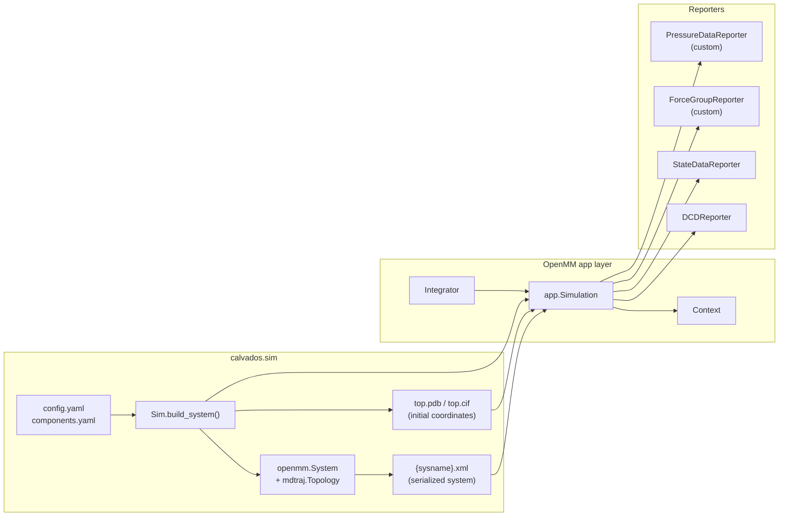
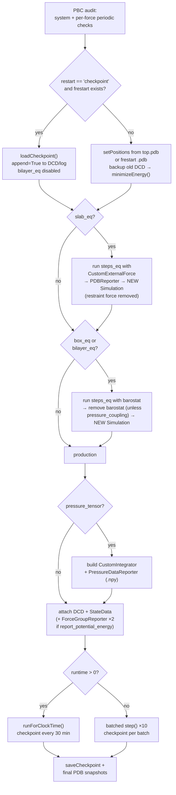

This page documents the boundary layer where CALVADOS hands a fully assembled coarse-grained system to **OpenMM** and how simulation data is captured during execution. It covers the `Sim.simulate()` orchestration: integrator strategy, platform/device selection, the reporter stack (including the two custom reporters, `ForceGroupReporter` and `PressureDataReporter`), and checkpoint/restart mechanics. The physics of the forces themselves are covered in [Ashbaugh-Hatch And Yukawa Potentials](10-ashbaugh-hatch-and-yukawa-potentials) and the building pipeline in [Sim Class Workflow](16-sim-class-workflow).

## Where OpenMM Enters the Architecture

`calvados/sim.py` is the only module that imports OpenMM's application layer, making it the single integration seam of the library. During `build_system()`, two parallel structures grow in lockstep: an `mdtraj.Topology` (`self.top`) for trajectory metadata and an `openmm.System` (`self.system`) for physics. Every molecule contributes particles to both — `add_mdtraj_topol` adds chains/residues/atoms to mdtraj while `add_particles_system` adds identical masses to the OpenMM system ([sim.py](calvados/sim.py#L563-L594)). The completed system is serialized to `{sysname}.xml` as a persistent build artifact before simulation ever starts ([sim.py](calvados/sim.py#L374-L379)).

The reporters are attached *inside* `simulate()`, not at build time, because which reporters exist depends on runtime branches (equilibration phases, pressure-tensor mode, energy-splitting mode) decided only once the context is live.

Sources: [sim.py](calvados/sim.py#L1-L24), [sim.py](calvados/sim.py#L374-L379), [sim.py](calvados/sim.py#L306-L315)

## The Simulation Lifecycle in `Sim.simulate()`

`simulate()` ([sim.py](calvados/sim.py#L637-L869)) is a linear pipeline with four decision branches. Reading it as a state machine clarifies why `Simulation` objects are constructed multiple times: **OpenMM contexts are immutable with respect to their force set**, so any force removal (e.g., stripping equilibration restraints or barostats) forces a full `Simulation` reconstruction.

The PBC audit at entry prints whether the system and each force use periodic boundary conditions — a useful sanity check given that the intermolecular potentials are `CustomForce` objects configured elsewhere.

Sources: [sim.py](calvados/sim.py#L637-L707), [sim.py](calvados/sim.py#L709-L731), [sim.py](calvados/sim.py#L733-L769)

## Integrator Strategy

Two integrators exist, selected by configuration rather than by subclassing:

| Aspect | `LangevinMiddleIntegrator` (default) | `CustomIntegrator` (pressure-tensor mode) |
|---|---|---|
| Activated by | default | `pressure_tensor: true` |
| Timestep | 0.01 ps (hardcoded) | 0.01 ps (hardcoded) |
| Friction / temperature | `friction_coeff` / `temp` from config | same, via `a = exp(-γ·dt)`, `b = √(1−exp(−2γ·dt))` globals |
| Kinetic energy definition | OpenMM default | `m*v*v/2` — **no half-step velocity reinterpretation** |
| Extra state | — | global variables `k_xx`, `k_yy`, `k_zz` accumulating `Σ m·vᵢ²` every `pressurefreq` steps |
| Purpose | production MD | provides the kinetic part of the diagonal pressure tensor to `PressureDataReporter` |

The `CustomIntegrator` implements a velocity-Verlet + Ornstein-Uhlenbeck splitting (lines for the position update `x + 0.5*dt*v`, the stochastic velocity refresh `a*v + b*sqrt(RT/m)*gaussian`, then a second half-kick), with `addUpdateContextState()` at the start so barostats remain functional ([sim.py](calvados/sim.py#L772-L812)). The kinetic accumulators are computed inside a conditional block guarded by `step = pressurefreq-1`, i.e., **only on the step immediately preceding a report**, which keeps the integrator cheap between samples. The seed is settable via `random_number_seed` for reproducibility ([sim.py](calvados/sim.py#L656-L657)).

Sources: [sim.py](calvados/sim.py#L654-L658), [sim.py](calvados/sim.py#L772-L812), [default_config.yaml](calvados/data/default_config.yaml#L32-L40)

## Platform Selection and Device Configuration

Platform selection reads `platform` from the config (`'CPU'` or a GPU platform name such as `'CUDA'`) and configures it through platform *default* properties — a mechanism that applies to all subsequently created contexts on that platform object ([sim.py](calvados/sim.py#L660-L670)).

| Config key | Applies to | Effect |
|---|---|---|
| `platform` | both | `Platform.getPlatformByName(...)`; `'CPU'` branch sets `Threads` from `threads` |
| `gpu_id` | GPU | sets `DeviceIndex`, **but only if `CUDA_VISIBLE_DEVICES` is unset in the environment** — explicit env vars take precedence |
| `gpu_precision` | GPU | sets `Precision` (default `'mixed'` in [default_config.yaml](calvados/data/default_config.yaml#L41-L42)) |
| `threads` | CPU | CPU thread count |

Note that equilibration-phase `Simulation` reconstructions repeat the same platform configuration block, so device settings survive all three Simulation incarnations (initial, post-slab-eq, post-box-eq).

Sources: [sim.py](calvados/sim.py#L660-L678), [sim.py](calvados/sim.py#L724-L728), [default_config.yaml](calvados/data/default_config.yaml#L12-L13)

## The Reporter Stack

Reporters are appended to `simulation.reporters` in phase-dependent combinations. All frequencies are step counts from the config:

| Reporter | File | Frequency key | Output format | When attached |
|---|---|---|---|---|
| `DCDReporter` | `equilibration_{sysname}.dcd` | `wfreq` | binary DCD, `append` aware | slab/box equilibration *and* production |
| `PDBReporter` | `equilibration_final.pdb` | once, manual `.report()` call | PDB snapshot | end of each equilibration phase |
| `PressureDataReporter` | `{sysname}.npy` | `pressurefreq` | NumPy array (pressure tensor rows) | production, only if `pressure_tensor` |
| `DCDReporter` | `{sysname}.dcd` | `wfreq` | binary DCD, `append` aware | production (always) |
| `StateDataReporter` | `{sysname}.log` | `logfreq` | TSV: step, speed, elapsed time, potential energy (if `report_potential_energy`) | production (always) |
| `ForceGroupReporter` | `{sysname}_ah_pp.log`, `{sysname}_yu_pp.log` | `logfreq` | TSV: step + per-group energy in kJ/mol | production, only if `report_potential_energy` |

Every reporter honors the same `append` flag, which is `True` only in the checkpoint-restart path — so trajectory and logs continue seamlessly across job requeues. At the end of a run, two final PDB snapshots are written via manually invoked `PDBReporter.report()`: one timestamped archive copy and one `checkpoint.pdb` that a subsequent `restart: pdb` run can consume ([sim.py](calvados/sim.py#L862-L869)).

Sources: [sim.py](calvados/sim.py#L709-L716), [sim.py](calvados/sim.py#L826-L836), [sim.py](calvados/sim.py#L862-L869)

## ForceGroupReporter: Per-Group Energy Logging

`ForceGroupReporter` implements OpenMM's reporter protocol by **duck typing** — it subclasses nothing and only needs the two methods the `Simulation` step loop calls:

- `describeNextReport(simulation)` returns a dict `{'steps': ..., 'periodic': None, 'include': []}` ([forcegroupreporter.py](calvados/forcegroupreporter.py#L13-L15)). Returning `'periodic': None` defers to the simulation's own setting and requests no state data — the reporter fetches what it needs itself.
- `report(simulation, state)` queries a fresh, single-group energy state: `context.getState(getEnergy=True, groups=1 << self._group)` ([forcegroupreporter.py](calvados/forcegroupreporter.py#L17-L20)). The `groups` argument is a **bitmask**, hence the shift.

The output is a two-column TSV (`step`, `energy` in kJ/mol) with a header written only when not appending. Two instances are registered when `report_potential_energy: true`, named after the *non-lipid* force-group convention:

| Reporter file | `group=` | Non-lipid systems ([sim.py](calvados/sim.py#L291-L292)) | Bilayer systems ([sim.py](calvados/sim.py#L275-L289)) |
|---|---|---|---|
| `{sysname}_ah_pp.log` | 0 | Ashbaugh-Hatch (all pairs) | **WCA** (steric lipid term) |
| `{sysname}_yu_pp.log` | 1 | Debye-Hückel (Yukawa) | **AH** (lipid-attractive term) |

> [!TIP]
> The reporter filenames (`_ah_pp`, `_yu_pp`) encode the group assignment of protein-only systems. In bilayer systems five forces occupy groups 0–3 (`wca=0`, `ah_pp=1`, `ah=1`, `sa=2`, `yu=3`), so the same two reporters silently log different potentials. Verify group semantics against the assignment code before interpreting per-group energy traces for membrane systems.

Sources: [forcegroupreporter.py](calvados/forcegroupreporter.py#L1-L25), [sim.py](calvados/sim.py#L275-L292), [sim.py](calvados/sim.py#L832-L836)

## PressureDataReporter: Finite-Difference Pressure Tensor

This reporter ([pressuredatareporter.py](calvados/pressuredatareporter.py#L58-L183)) is a modified OpenMM `StateDataReporter`, descended through Zheng Gong's mstk repository, further modified by Giulio Tesei. Unlike stock OpenMM, it reports the **diagonal pressure tensor** via a thermodynamic finite-difference identity rather than a virial kernel.

The algorithm in `_compute_pressure_tensor` ([pressuredatareporter.py](calvados/pressuredatareporter.py#L139-L178)):

1. Read the kinetic accumulators `k_xx/3`, `k_yy/3`, `k_zz/3` from the `CustomIntegrator` globals (the ideal-gas kinetic contribution).
2. For each diagonal axis, scale that box vector by `1 ± 1e-4` (keeping coordinates affinely transformed via `positions · scale_array`), evaluate `U_plus` and `U_minus`, and form the virial `-(U₊ − U₋) / 2 / scale`.
3. Sum kinetic + virial contributions per axis, then restore the original box vectors and positions before returning.

Persistence is accumulation-then-dump: each report appends a row to an in-memory list, and the array — divided by box volume converted from ų to m³ (`volume * 1e-27`) — is written with `np.save` in `__del__` ([pressuredatareporter.py](calvados/pressuredatareporter.py#L100-L106), [pressuredatareporter.py](calvados/pressuredatareporter.py#L180-L182)). The constructor accepts a `.npy` path specially: on `append` it reloads prior rows so restarts concatenate rather than overwrite ([pressuredatareporter.py](calvados/pressuredatareporter.py#L88-L94)). The masses argument is passed from `simulate()` but is unused by the current finite-difference implementation ([sim.py](calvados/sim.py#L826-L827)).

> [!TIP]
> The reporter mutates the *live* context (`setPeriodicBoxVectors`/`setPositions`) at every report and restores it afterwards. This is safe only because the integration loop is paused during reporting — but it means pressure-tensor mode must run without a barostat, which `simulate()` guarantees by stripping barostats before production unless `pressure_coupling` is enabled. Also note the output file is written in `__del__`: if the process is killed hard (no garbage collection), buffered tensor rows are lost — rely on the batched checkpointing of the run loop, not the `.npy`, for crash recovery.

Sources: [pressuredatareporter.py](pressuredatareporter.py#L58-L107), [pressuredatareporter.py](calvados/pressuredatareporter.py#L139-L182), [sim.py](calvados/sim.py#L744-L759)

## Checkpointing, Restarts, and Run Control

Three restart modes are configured via `restart` in the config, with `frestart` naming the input file:

| Mode | Input expected | Behavior in `simulate()` | `append` to DCD/log |
|---|---|---|---|
| `None` | — | fresh coordinates from `top.pdb`, energy minimization | `False` |
| `'pdb'` | `frestart` PDB | coordinates loaded from that PDB, minimized | `False` |
| `'checkpoint'` | `frestart` checkpoint | `loadCheckpoint()`; requires the matching `.dcd` to exist, else raises | `True` |

The initializer already dampens slab equilibration when a checkpoint exists (`slab_eq` forced off at [sim.py](calvados/sim.py#L44-L45)), so a restarted run proceeds straight to production. When *not* restarting from a checkpoint, any pre-existing trajectory is backed up with a timestamp (`backup_{sysname}_{timestamp}.dcd`) rather than deleted ([sim.py](calvados/sim.py#L699-L703)).

Run-length control has three mutually exclusive paths ([sim.py](calvados/sim.py#L838-L860)):

- **Wall-clock mode** (`runtime > 0`, hours): `runForClockTime` writes `restart.chk` every 30 minutes — this is the mechanism cluster jobs rely on for preemption-safe requeueing.
- **Pressure-ramp mode** (`pressure_ramp: true`): 200 batches with pressure set logarithmically from `exp(0)` up to `pressure_max` bar via the `MonteCarloBarostat` context parameter, logging each batch to `pressure_ramp.txt`.
- **Batched default**: 10 equal `simulation.step()` batches with `saveCheckpoint` after each (via `tqdm` progress), plus a final checkpoint.

Sources: [sim.py](calvados/sim.py#L44-L45), [sim.py](calvados/sim.py#L645-L707), [sim.py](calvados/sim.py#L838-L860), [default_config.yaml](calvados/data/default_config.yaml#L10-L16)

## Adding Your Own Reporter

The duck-typed protocol makes extension trivial — no base class, no registration. To add a reporter:

1. Implement `describeNextReport(simulation)` returning the steps until your next report plus required state flags (dict form `{'steps': ..., 'periodic': None, 'include': [...]}` like `ForceGroupReporter`, or the legacy 5-tuple form like `PressureDataReporter`).
2. Implement `report(simulation, state)` to consume `simulation.context` / `state` and write wherever you like.
3. Append an instance to `simulation.reporters` inside `simulate()` — or, for experimentation, attach it to a manually constructed `app.Simulation` reusing the serialized `{sysname}.xml` and `top.pdb`.

Both shipped custom reporters flush or defer I/O differently (TSV line flush vs. `__del__` array dump), which is a useful pattern reference for choosing your own persistence strategy.

Sources: [forcegroupreporter.py](calvados/forcegroupreporter.py#L13-L20), [pressuredatareporter.py](calvados/pressuredatareporter.py#L108-L125), [sim.py](calvados/sim.py#L374-L379)

## Where to Go Next

- [Sim Class Workflow](16-sim-class-workflow) — how `build_system()` produces the `System`/`Topology` pair consumed here.
- [Force Groups And Interaction Exclusions](12-force-groups-and-interaction-exclusions) — the physics behind the group indices used by `ForceGroupReporter`.
- [Slab Equilibration And Barostats](15-slab-equilibration-and-barostats) — the equilibration phases that trigger the `Simulation` reconstructions described above.
- [Job Submission And Cluster Templates](18-job-submission-and-cluster-templates) — how wall-clock mode and `restart.chk` interplay with cluster requeues.
- [Block Analysis And Error Estimation](21-block-analysis-and-error-estimation) — post-processing the DCD and log files written by this reporter stack.