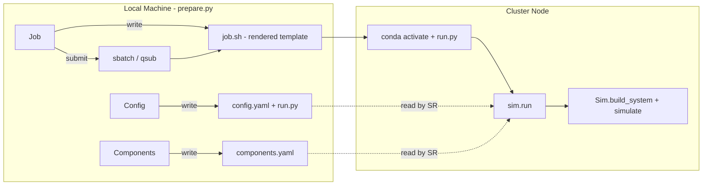
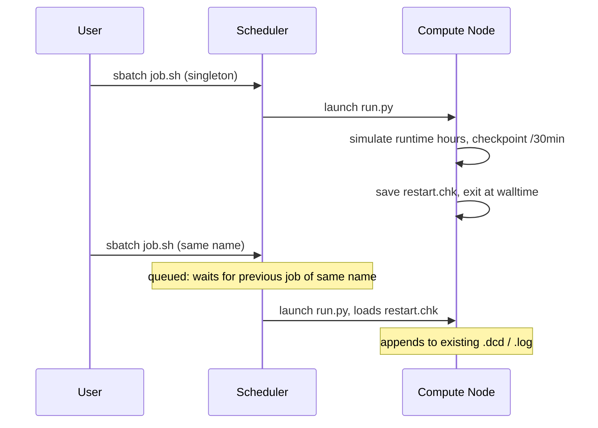

This page explains how MEM-CALVADOS bridges the gap between a locally prepared simulation definition and a long-running process on a high-performance computing (HPC) cluster. The system has three cooperating layers: the `Job` class in `calvados/cfg.py`, which renders Jinja2 templates and dispatches scheduler commands; a small catalog of cluster-specific templates in `calvados/data/templates/`; and the generated `run.py` entry point that the cluster executes. Understanding this pipeline is essential for running simulations beyond a laptop, since the templates encode scheduler dialects (SLURM vs. PBS), GPU/CPU resource allocation, and environment activation. This page covers the `Job` API, template anatomy, submission semantics, and how to adapt templates to your own cluster; for the runtime behavior that the submitted job ultimately triggers, see [Sim Class Workflow](16-sim-class-workflow).

## Architecture: The Three-Layer Submission Pipeline

The submission system follows a *prepare → render → dispatch → execute* chain that cleanly separates Python-side orchestration from shell-side cluster execution. During preparation, a script such as `examples/single_IDR/prepare.py` builds a `Config`, a `Components` object, and a `Job`. Writing the config and components also generates `run.py` — the executable entry point. Writing the job renders a Jinja2 template into a scheduler script (`job.sh`), and submitting it hands that script to `sbatch` or `qsub`. On the cluster, the scheduler script activates a conda environment and invokes `run.py`, which calls `sim.run()` to load the YAML files back in and drive OpenMM.



Sources: [cfg.py](calvados/cfg.py#L24-L30), [cfg.py](calvados/cfg.py#L40-L60), [cfg.py](calvados/cfg.py#L109-L131), [sim.py](calvados/sim.py#L871-L881), [single_IDR/prepare.py](examples/single_IDR/prepare.py#L1-L75)

The loop closes because `Config.write_runfile` emits a `run.py` whose argument names — `--path`, `--config`, `--components` — exactly match the command line hard-coded at the bottom of every cluster template. This contract means a rendered job script never needs to know template-internal details; it simply relocates to the simulation directory and replays the arguments. Any divergence between these two halves would break cluster runs, which is why both are generated from the same library rather than hand-edited.

Sources: [cfg.py](calvados/cfg.py#L42-L58), [robust.jinja](calvados/data/templates/robust.jinja#L20-L26), [deic.jinja](calvados/data/templates/deic.jinja#L14-L20), [computerome.jinja](calvados/data/templates/computerome.jinja#L18-L22)

## The Job Class API

The `Job` class lives in `calvados/cfg.py` alongside `Config` and `Components`, and exposes exactly three responsibilities: loading defaults, rendering a template, and dispatching scheduler commands. Its constructor loads `data/default_job.yaml` from the installed package, computes the absolute path to the bundled template folder, and then overlays any keyword arguments you pass — so a typical instantiation only overrides the one or two settings that differ from defaults.

Sources: [cfg.py](calvados/cfg.py#L99-L107), [default_job.yaml](calvados/data/default_job.yaml#L1-L5)

The `write` method is where Jinja2 rendering happens. It reads the template file selected by `settings["template"]`, instantiates a `jinja2.Template`, and renders it with a merged context: all job settings, **the entire simulation config dict**, plus explicit `fconfig`, `fcomponents`, and `path` values. Because the full config is flattened into the render context, every key in `config.yaml` — including `sysname`, `temp`, `platform`, and `threads` — is available as a template variable. The output is written to `{path}/job.sh` by default.

Sources: [cfg.py](calvados/cfg.py#L109-L121), [default_config.yaml](calvados/data/default_config.yaml#L2-L13)

| Method | Signature | Behavior |
|---|---|---|
| `__init__` | `Job(**kwargs)` | Loads `default_job.yaml`, sets template folder to package data, overlays kwargs |
| `write` | `write(path, config, components, name='job.sh')` | Renders selected Jinja2 template with job settings + full config, writes scheduler script |
| `submit` | `submit(path, njobs=1)` | Runs `sbatch` (SLURM) or `qsub` (PBS) via `os.system`; sleeps 0.5 s between submissions |

Sources: [cfg.py](calvados/cfg.py#L99-L131)

One subtlety in the render context deserves attention: because `**self.settings` is expanded *before* `**config.config`, a key present in both would be won by the config. In practice the namespaces are disjoint (job settings control *where/how to submit*; config controls *what to simulate*), and the explicit `fconfig=config.name` / `fcomponents=components.name` arguments guarantee the templates always reference the actual filenames the two YAML objects were written under — not hardcoded defaults.

> [!TIP]
> The render context merges your **entire** simulation config, so any custom key you add to `Config(...)` (e.g., a `mail_user` or `account` string) is automatically available inside custom templates as `{{ mail_user }}` — no changes to the `Job` class required.

## Default Job Settings

The bundled `default_job.yaml` defines four settings that jointly determine the scheduler dialect, software environment, and template selection. Notably, `fbash` points to a user-specific `.bashrc` path that only exists on the original developer's machine — this is the single most common setting you must override on a new system.

| Setting | Default | Purpose | Consumed by |
|---|---|---|---|
| `batch_sys` | `'SLURM'` | Scheduler command (`sbatch` vs. `qsub`); validated against PBS multi-job limit | `Job.submit` |
| `envname` | `'calvados'` | Conda environment activated on the compute node | All templates |
| `template` | `'robust.jinja'` | Template file resolved inside the package's `data/templates` folder | `Job.write` |
| `fbash` | `'/home/sobuelow/.bashrc'` | Shell init file sourced before `conda activate` | All templates |

Sources: [default_job.yaml](calvados/data/default_job.yaml#L1-L5), [cfg.py](calvados/cfg.py#L102-L105)

Every template then follows the same two-line activation preamble — `source {{fbash}}` followed by `conda activate {{envname}}` — which makes the conda environment choice a job-level concern rather than a cluster-template concern. This means switching conda environments (e.g., to a CUDA-enabled build per the installation instructions) never touches templates; you only change `envname` in the `Job` constructor.

Sources: [robust.jinja](calvados/data/templates/robust.jinja#L20-L21), [deic.jinja](calvados/data/templates/deic.jinja#L14-L15), [computerome.jinja](calvados/data/templates/computerome.jinja#L18-L19)

## Anatomy of a Cluster Template

All three templates share a four-part skeleton: scheduler directives, environment activation, working-directory setup, and a final `run.py` invocation. The directives section is where the scheduler dialects diverge — `#PBS -l` for Computerome's PBS/Torque installation versus `#SBATCH --` for the two SLURM sites — but the semantic content (job name, node count, CPU/GPU resources, memory, walltime, output files) maps one-to-one across them.

| Template variable | Source | Role in the script |
|---|---|---|
| `sysname` | `Config` (`sysname`, default `'default_simulation'`) | Job name and stdout/stderr filenames |
| `temp` | `Config` (`temp`, Kelvin) | Job-name suffix identifying the simulation temperature replica |
| `platform` | `Config` (`platform`, default `'CPU'`) | Branches resource requests between GPU and CPU queues |
| `threads` | `Config` (`threads`, default `1`) | CPU core count when running on the CPU platform |
| `fbash`, `envname` | `Job` settings | Environment activation preamble |
| `path` | Explicit argument to `Job.write` | Working directory for the simulation |
| `fconfig`, `fcomponents` | `config.name`, `components.name` | YAML files passed to `run.py` |

Sources: [default_config.yaml](calvados/data/default_config.yaml#L2-L13), [single_IDR/prepare.py](examples/single_IDR/prepare.py#L26-L43), [cfg.py](calvados/cfg.py#L117-L121)

The most architecturally significant pattern is the **platform-conditional resource request**. Both the Computerome and ROBUST templates branch on `platform == 'CUDA'`: a GPU job requests one GPU with a fixed CPU allocation (20 ppn on Computerome, 18 CPUs on ROBUST), while a CPU job scales cores with `{{threads}}`. This mirrors runtime behavior in `Sim.simulate`, where the CPU platform sets OpenMM's `Threads` property from `self.threads`, whereas CUDA runs ignore it and instead honor `gpu_id`/`gpu_precision`. In other words, `threads` is only meaningful in the `else` branch of the templates — matching its only runtime consumer.

```jinja

#SBATCH --gres=gpu:1
#SBATCH --cpus-per-task=18

#SBATCH --cpus-per-task={{threads}}

```

Sources: [robust.jinja](calvados/data/templates/robust.jinja#L7-L12), [computerome.jinja](calvados/data/templates/computerome.jinja#L7-L11), [sim.py](calvados/sim.py#L661-L669)

The `{{temp}}` variable in job names (`{{sysname}}_{{temp}}` on Computerome and DeIC) embeds the simulation temperature in Kelvin, since `temp` flows straight from the config where users set values like `293.15`. Naming temperature replicas distinctly is what makes `--dependency=singleton` (discussed below) safe when submitting replicas of the same system in parallel: each temperature gets its own job-name namespace.

Sources: [single_IDR/prepare.py](examples/single_IDR/prepare.py#L26-L31), [sim.py](calvados/sim.py#L762), [computerome.jinja](calvados/data/templates/computerome.jinja#L3), [deic.jinja](calvados/data/templates/deic.jinja#L2)

## Template Catalog: Three Cluster Targets

The catalog covers three concrete Danish HPC environments, deliberately spanning both major scheduler families. `robust.jinja` (the default) targets the ROBUST resource with a GPU partition; `deic.jinja` targets a DeIC SLURM partition for CPU runs; `computerome.jinja` targets the Computerome national facility using PBS/Torque. All three request 24-hour walltimes, but memory accounting differs — per-node total (80 GB) on PBS versus per-CPU (10 GB or 8888 MB) on SLURM.

| Property | `robust.jinja` | `deic.jinja` | `computerome.jinja` |
|---|---|---|---|
| Scheduler | SLURM | SLURM | PBS/Torque |
| Partition / queue | `qgpu` | `sbinlab_ib2` | `thinnode` / GPU nodes via `gpus=1` |
| GPU support | Yes (`--gres=gpu:1`) | No | Yes (`gpus=1`) |
| CPU request | 18 (CUDA) or `{{threads}}` | `{{threads}}` | 20 (CUDA) or `{{threads}}` |
| Memory | 8888 MB/CPU | 10 GB/CPU | 80 GB/node |
| Walltime | 24:00:00 | 24:00:00 | 24:00:00 |
| Singleton dependency | Yes | Yes | No |
| Project/account flags | None | None | `-W group_list=ku_10001 -A ku_10001` |

Sources: [robust.jinja](calvados/data/templates/robust.jinja#L1-L27), [deic.jinja](calvados/data/templates/deic.jinja#L1-L21), [computerome.jinja](calvados/data/templates/computerome.jinja#L1-L22)

The two SLURM templates additionally echo `$SLURM_CPUS_PER_TASK` and `$SLURM_JOB_NODELIST` before launching, providing immediate on-node confirmation of the granted allocation in the job log — a lightweight diagnostic that the PBS template omits. None of the templates parameterize memory or walltime; these are fixed per-site values, which is precisely why the catalog approach works: sites differ in schedulers and fixed quotas, while the simulation itself is site-agnostic.

Sources: [deic.jinja](calvados/data/templates/deic.jinja#L17-L18), [robust.jinja](calvados/data/templates/robust.jinja#L23-L24)

## Submission Semantics: Batching, PBS Limits, and Singleton Chaining

`Job.submit` is intentionally thin — an `os.system` call per job with a 0.5-second pause — but it encodes two important constraints. First, requesting `njobs > 1` with `batch_sys == 'PBS'` raises immediately, because the Computerome template lacks the singleton mechanism that makes safe fan-out possible under SLURM. Second, submission happens per rendered script file, so multiple jobs from one directory all share that directory's `job.sh`.

Sources: [cfg.py](calvados/cfg.py#L123-L131)

The `#SBATCH --dependency=singleton` directive in both SLURM templates is the keystone of MEM-CALVADOS's restart workflow. A singleton dependency means a newly submitted job with the *same name as a currently queued or running job* waits until the previous one completes. Combined with `runtime > 0` in the config — which makes the simulation stop after a wall-clock duration (in hours) and checkpoint every 30 minutes via `runForClockTime` — this enables indefinite chaining: re-submitting the identical `job.sh` queues the continuation, which picks up from `restart.chk` on the same trajectory.



Sources: [robust.jinja](calvados/data/templates/robust.jinja#L3), [deic.jinja](calvados/data/templates/deic.jinja#L3), [sim.py](calvados/sim.py#L839-L840), [sim.py](calvados/sim.py#L680-L687)

This chaining design also explains why `deic.jinja` and `robust.jinja` embed `{{temp}}` in the job name while `robust.jinja` alone uses bare `{{sysname}}`: singleton matching is name-based, so the name must uniquely identify the (system, temperature) pair you intend to chain. Equilibration phases such as box equilibration run inside the same job (the `Sim` class performs them in-process before production, as covered in [Slab Equilibration And Barostats](15-slab-equilibration-and-barostats)), so a single script chain covers the full lifecycle rather than requiring separate submissions per phase.

> [!TIP]
> To run a production campaign unattended, set `runtime` (hours) in the config and `restart: 'checkpoint'`, then loop `job.submit(path)` from cron or after each job finishes — each resubmission resumes from the last checkpoint and appends to the existing DCD trajectory, exactly as the templates' singleton dependency and the Sim checkpoint logic anticipate.

## Adapting Templates to Your Cluster

Adding support for a new cluster requires exactly two artifacts: a `.jinja` file in your own template folder (or committed to `data/templates/`) and one keyword argument at instantiation time. Because `Job` resolves templates from `settings["folder"]` — which defaults to the package's bundled folder but can be overridden like any other setting — you can keep site templates in your project directory without patching the installed package. The minimum viable template must render successfully from the merged context and end with the canonical `run.py` invocation.

A practical recipe: copy `robust.jinja` (or `computerome.jinja` if your site runs PBS), adjust the partition, account flags, memory, and walltime to your site's quotas, and keep the activation-plus-`run.py` tail intact. Then instantiate with the overrides — for example, `Job(template='mycluster.jinja', folder='/path/to/my/templates', envname='calvados', fbash='$HOME/.bashrc', batch_sys='SLURM')`. The GPU branch condition can stay as-is if your site follows the same convention of one GPU per CUDA job; adjust only the fixed CPU counts if your nodes have different core counts.

| Customization goal | Where to change | Example |
|---|---|---|
| Different cluster site | New template + `template`/`folder` kwargs | `Job(template='mycluster.jinja', folder='templates')` |
| Conda environment | `envname` kwarg (no template edit) | `Job(envname='calvados_cuda')` |
| GPU vs. CPU run | `platform` in `Config` (branches template) | `Config(platform='CUDA')` |
| CPU core scaling | `threads` in `Config` (CPU branch only) | `Config(threads=8)` |
| Account/booking codes | Add flags in your template | `#SBATCH --account=xxx` |
| Many-job fan-out | `submit(path, njobs=N)` (SLURM only) | `job.submit(path, njobs=8)` |

Sources: [cfg.py](calvados/cfg.py#L100-L107), [cfg.py](calvados/cfg.py#L112-L114), [robust.jinja](calvados/data/templates/robust.jinja#L7-L12), [cfg.py](calvados/cfg.py#L123-L131)

If your site enforces PBS, remember the single-job constraint in `submit` is a deliberate guard, not an omission — without singleton dependencies, parallel resubmissions of identically named PBS jobs would race on the same checkpoint and trajectory files. The equivalent safe pattern under PBS is sequential chaining driven externally (one `qsub` per completed job).

Sources: [cfg.py](calvados/cfg.py#L124-L125), [computerome.jinja](calvados/data/templates/computerome.jinja#L1-L22)

## Summary and Where to Go Next

The job submission layer is deliberately the thinnest slice of MEM-CALVADOS: a ~30-line `Job` class, four default settings, and three site templates bound together by one contract — the `run.py` command line. All scientific variability lives in `config.yaml` and `components.yaml`; all site variability lives in templates. To see what happens after `sbatch` grants your job a node, continue with [Sim Class Workflow](16-sim-class-workflow) and [OpenMM Integration And Reporters](17-openmm-integration-and-reporters); to understand the YAML files the templates pass to `run.py`, see [YAML Configuration System](5-yaml-configuration-system). For error estimation on the trajectories these jobs produce, proceed to [Block Analysis And Error Estimation](21-block-analysis-and-error-estimation).
