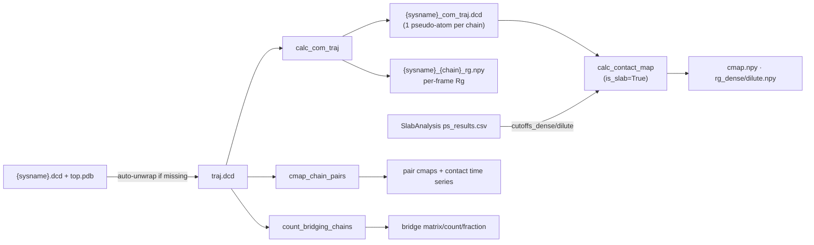

This page documents the trajectory-side of `calvados.analysis`: the functions that take a finished simulation (topology + DCD trajectory) and turn it into quantitative observables — distance/contact maps, chain dimensions, scaling exponents, RMSD, native-contact fractions, energy re-evaluations, and multi-chain contact statistics. The module deliberately separates *geometry primitives* (single-frame, unit-aware) from *trajectory pipelines* (multi-frame, file-oriented), which is the key pattern to internalize before extending it. Slab densitometry and membrane properties are handled by `SlabAnalysis` and `calc_bilayer_prop`/`calc_membrane_profiles`, which live on adjacent pages — see [Membrane Property Profiles](20-membrane-property-profiles).

Sources: [analysis.py](calvados/analysis.py#L1-L28), [analysis.rst](docs/doc_pages/analysis.rst#L1-L8)

## Module Architecture: A Three-Layer Design

The module's imports reveal its strategy: **MDAnalysis** supplies topology-aware universes and PBC-aware distance arrays, **mdtraj** supplies fast pair-distance computation for the high-throughput contact pipelines, **numba** JIT-compotes the energy kernel, and **scipy** performs curve fitting. A `BlockAnalysis` class is imported from the `BLOCKING` package and used at the *pipeline* layer to attach block-averaged standard errors to trajectory means.

Sources: [analysis.py](calvados/analysis.py#L1-L28)

```mermaid
flowchart TB
    subgraph L1["Layer 1 · Geometry primitives (single frame)"]
        A1["calc_dmap<br/>PBC distance array (nm)"]
        A2["calc_raw_dmap<br/>no-box distance array"]
        A3["self_distances<br/>symmetric self-map"]
    end
    subgraph L2["Layer 2 · Frame-level metrics"]
        B1["calc_cmap / calc_cmap_dmin<br/>soft contacts"]
        B2["calc_rg · calc_ete · calc_ocf"]
        B3["calc_energy<br/>numba AH + YU kernel"]
        B4["calc_wcn · calc_fnc · calc_rmsd"]
    end
    subgraph L3["Layer 3 · Trajectory pipelines (file I/O)"]
        C1["cmap_traj · fit_scaling_exp"]
        C2["save_conf_prop"]
        C3["calc_com_traj · calc_com_profiles"]
        C4["cmap_chain_pairs · cmap_selection"]
        C5["calc_contact_map · count_bridging_chains"]
    end
    L1 --> L2 --> L3
    L3 -. .npy / .csv artifacts .-> OUT[("output_path")]
```

Every Layer-3 pipeline writes NumPy arrays (`.npy`) and CSV summaries into an `output_path`, making results consumable by notebooks such as `examples/slab_IDR/example_slab_analysis.ipynb` without re-reading trajectories. The layering also explains import direction: Layer 2's `calc_wcn` reaches back into `calvados.build.get_ssdomains` for secondary-structure domain membership, the only upward dependency in the module.

Sources: [analysis.py](calvados/analysis.py#L18-L19), [analysis.py](calvados/analysis.py#L145-L171), [analysis.py](calvados/analysis.py#L399-L426)

## Trajectory Preprocessing: Centering and Subsampling

Two standalone utilities prepare raw DCD files before analysis. `center_traj` translates every frame so the system's center of geometry sits at the box center (half of `u.dimensions[:3]`), writing a sibling file with the `_c.dcd` suffix. `subsample_traj` performs the mechanical equivalent — frame slicing with `start:stop:step` — writing a `_sub.dcd` file. Both operate purely at the MDAnalysis level: open a `Universe(pdb, traj)`, iterate the slice, write.

Sources: [analysis.py](calvados/analysis.py#L30-L47)

Note the slicing convention used throughout the module: `u.trajectory[start:stop:step]` with `None` defaults meaning "all frames". Every Layer-2 metric (`calc_rg`, `calc_ete`, `calc_ocf`) and Layer-3 pipeline accepts this triple, so equilibration cropping never requires rewriting files.

> [!TIP]
> `center_traj` shifts by `-center_of_geometry() + 0.5*box` but never re-wraps coordinates. For slab geometries where chains straddle periodic boundaries, use `SlabAnalysis.center` instead — it adds `transformations.wrap`/`unwrap` passes (see [Membrane Property Profiles](20-membrane-property-profiles)).

Sources: [analysis.py](calvados/analysis.py#L30-L38), [analysis.py](calvados/analysis.py#L467-L523)

## Distance and Contact Map Primitives

The foundation is `calc_dmap`, which wraps `MDAnalysis.analysis.distances.distance_array` with the simulation box for minimum-image PBC and divides by 10 to convert Å → nm — the module's unit convention in one line. `calc_raw_dmap` is the box-less variant; `self_distances` unpacks MDAnalysis' compact upper-triangular self-distance array into a full symmetric N×N matrix, optionally using the minimum image convention when box dimensions are given.

Sources: [analysis.py](calvados/analysis.py#L108-L143)

The signature function of this layer is `calc_cmap`. Rather than a binary cutoff, contacts are **softly weighted** with a hyperbolic tangent:

```
cmap = 0.5 − 0.5·tanh((d − cutoff) / 0.3)
```

This yields a smooth transition of width ≈ 0.3 nm around `cutoff` (default 1.0 nm, in nm because `calc_dmap` already converted units). The soft form makes trajectory-averaged maps differentiable-like and reduces cutoff sensitivity — the same tanh kernel is reused in mdtraj coordinates inside `calc_contact_map` (`(.5-.5*tanh((d-1.)/.3))` on mdtraj distances, which are natively in nm). `calc_cmap_dmin` returns the contact map together with the frame's minimum pair distance in one pass, which downstream pipelines persist as a `_dmin.npy` time series.

Sources: [analysis.py](calvados/analysis.py#L184-L203), [analysis.py](calvados/analysis.py#L1224-L1238)

| Primitive | Input | Output | PBC | Units |
|---|---|---|---|---|
| `calc_dmap(ag0, ag1)` | MDAnalysis AtomGroups | N×M distance matrix | Yes (box) | nm |
| `calc_raw_dmap(pos0, pos1)` | position arrays | N×M distance matrix | No | input units |
| `self_distances(pos, box)` | positions (+box) | N×N symmetric matrix | Optional | input units |
| `calc_cmap(ag0, ag1, cutoff)` | AtomGroups | N×M soft contact matrix | Yes | — |
| `calc_cmap_dmin(ag0, ag1, cutoff)` | AtomGroups | (contact matrix, min distance) | Yes | nm |

Sources: [analysis.py](calvados/analysis.py#L108-L203)

At the trajectory scale, `cmap_traj` accumulates `calc_cmap` over a `start:end:step` slice and normalizes by the full trajectory length — producing the *average number of contacts per residue pair* map.

Sources: [analysis.py](calvados/analysis.py#L205-L218)

## Single-Chain Conformational Metrics

This group answers "how is one chain shaped over time?" and all functions return per-frame arrays in nanometers. `calc_rg` is mass-weighted: if a sequence and residue table are supplied, `get_masses` looks up the `MW` column of the residues CSV and applies terminal corrections (`masses[0] += 2`, `masses[-1] += 16`) before computing Rg via an einsum contraction of the mass-weighted gyration tensor; otherwise all beads weigh 1. `calc_ete` returns the end-to-end distance series plus its mean and scipy SEM. `calc_ocf` computes the **orientational correlation function** — mean bond-vector dot products as a function of sequence separation |i−j| — averaging over all frames and returning the curve with its SEM.

Sources: [analysis.py](calvados/analysis.py#L275-L337)

The polymer-scaling fit is `fit_scaling_exp`. It builds a *root-mean-square* internal distance map (accumulate d² over frames, then sqrt — this distinguishes it from averaging distances directly), buckets distances by sequence separation |i−j|, and fits `d_ij = r0 · ij^ν` with `scipy.curve_fit`, ignoring separations ≤ `ij0` (default 5) where local geometry dominates. Fixed-`r0` fitting is supported. The returned `ν` (Flory scaling exponent) is the standard IDP compactness diagnostic.

Sources: [analysis.py](calvados/analysis.py#L341-L397)

| Function | Observable | Returns | Units |
|---|---|---|---|
| `calc_rg` | mass-weighted radius of gyration | per-frame array | nm |
| `calc_ete` | end-to-end distance | array, mean, SEM | nm |
| `calc_ocf` | bond orientational correlation ⟨uᵢ·uⱼ⟩ vs \|i−j\| | curve, SEM | dimensionless |
| `fit_scaling_exp` | Flory exponent ν, amplitude r₀ | `ij`, `dij`, `r0`, `ν`, `ν_err` | nm |
| `calc_rmsd` | RMSD to reference & to mean structure, RMSF | 3 arrays | Å (MDAnalysis native) |
| `calc_fnc` | fraction of native contacts vs. reference | per-frame array | dimensionless |
| `calc_wcn` | weighted contact number per residue | per-residue array | dimensionless |

Sources: [analysis.py](calvados/analysis.py#L283-L337), [analysis.py](calvados/analysis.py#L248-L273), [analysis.py](calvados/analysis.py#L220-L246), [analysis.py](calvados/analysis.py#L145-L171)

Two special-purpose metrics deserve detail. `calc_rmsd` performs an **iterative two-stage alignment**: align to the reference structure and compute RMSD, build the trajectory mean structure, re-align to that mean, rebuild a second mean, then report RMSD to the converged mean plus per-atom RMSF — optionally writing the mean structure to `f_out`. `calc_fnc` compares a trajectory universe against a reference (`uref`, e.g. a crystal structure): trivial contacts within `kmax` bonds along the diagonal are removed from the reference contact map, an optional B-factor sigmoid (`exp(w·(bfac−shift))/(1+…)` with `width=50`, `sig_shift=0.8`) can down-weight flexible regions, and the fraction of native contacts per frame is `Σ(c·c_ref·sigmoid)/Σ(c_ref·sigmoid)`.

Sources: [analysis.py](calvados/analysis.py#L248-L273), [analysis.py](calvados/analysis.py#L220-L246)

`calc_wcn` computes weighted contact numbers with a smooth switching kernel `(1−(d/r₀)⁶)/(1−(d/r₀)¹²)` at `r0 = 0.7 nm`. Its `ssonly` mode restricts counting to residue pairs inside the same secondary-structure domain, resolved by calling `get_ssdomains(comp.name, fdomains)` from the build module — connecting structural analysis back to the domain annotations made during model construction.

Sources: [analysis.py](calvados/analysis.py#L145-L171)

## Energy Re-Evaluation with Numba

`calc_energy` is the module's only JIT-compiled kernel: given a distance matrix plus parameter matrices (`sig`, `lam`, `eps_lj`, `qmap`, `k_yu`, cutoffs), it re-evaluates **Ashbaugh-Hatch (LJ branch) and shifted-force Yukawa** energies pair-by-pair, returning two energy matrices. When `same_domain=True`, bonded neighbors with |i−j| ≤ 1 are excluded. The functional forms (`ah_potential`, `lj_potential`, `yukawa_potential`) mirror the simulation potentials exactly, which is what makes post-hoc energy decomposition trustworthy — the mathematics is documented on [Ashbaugh-Hatch And Yukawa Potentials](10-ashbaugh-hatch-and-yukawa-potentials).

Sources: [analysis.py](calvados/analysis.py#L49-L106)

> [!TIP]
> `yukawa_potential` applies the shifted form `q·(e^(−κr)/r − e^(−κrc)/rc)` inside the cutoff `rc_yu = 4.0 nm` and hard-zero outside — identical to the OpenMM force definition. If you ever change `k_yu` or cutoffs in `calvados.interactions`, the analysis kernel must be changed in lockstep or energy maps will silently disagree with the simulation.

Sources: [analysis.py](calvados/analysis.py#L86-L106)

## High-Level Trajectory Pipelines

Layer-3 functions share three conventions. First, the **`traj.dcd` convention**: pipeline entry points look for `{path}/traj.dcd`; if absent, they generate it from `{sysname}.dcd` by adding segment bonds and `unwrap`-ing chains across periodic boundaries (needed because covalent chains may be split across the box). Second, the **`chainid_dict` convention** maps component names to chain index ranges — an `int` or a `(first, last)` tuple, e.g. `{'A1': 0, 'B2': (100, 199)}` — letting one code path serve homo- and multi-component systems. Third, **all results persist as `.npy`/`.csv` in `output_path`**, keyed by `{sysname}_{component}_{quantity}`.

Sources: [analysis.py](calvados/analysis.py#L804-L837), [analysis.py](calvados/analysis.py#L1063-L1098)



The **`save_conf_prop` pipeline** is the canonical single-chain end-to-end job: load `top.pdb` + `{name}.dcd`, compute mass-weighted Rg and Ree series, attach block-averaged SEM via `BlockAnalysis.SEM()`, fit ν for IDRs, and emit `rgs.npy`, `rees.npy`, `internal_distances.npy`, `conf_prop.csv`, and a diagonal-stripped average `cmap.npy` (trivial contacts within `kmax=3` bonds removed).

Sources: [analysis.py](calvados/analysis.py#L399-L426)

The **COM-universe pipeline** is the module's most distinctive construction. `calc_com_traj` collapses each chain to a single mass-weighted center-of-mass pseudo-atom, builds a new mdtraj `Topology` with one residue (`COM`) per chain, and writes `{sysname}_com_traj.dcd` + `_com_top.pdb`; per-chain per-frame Rg arrays are saved alongside. This one-bead-per-chain universe unlocks cheap collective analyses: `calc_contact_map` with `is_slab=True` reads the slab interface cutoffs from `SlabAnalysis`'s `ps_results.csv`, identifies the *central chain per frame* via `argmin|z_com|`, splits Rg populations into dense/dilute phases, and computes interfacial contact maps. `count_bridging_chains` (strictly three components: bridge + two partners) checks, per frame, whether each bridge chain sitting at z < 0 contacts *both* partner types, emitting a boolean bridge matrix plus count/fraction time series. `calc_com_profiles` complements these with z-resolved conditional averages — COM density (converted to mM via the `10/6.02214/volume·10³` factor), plus Rg, Ree, and midplane-alignment `|cos|` averaged over chains whose COM occupies each slab — using `np.histogram` weight accumulation.

Sources: [analysis.py](calvados/analysis.py#L1063-L1146), [analysis.py](calvados/analysis.py#L1148-L1238), [analysis.py](calvados/analysis.py#L977-L1034), [analysis.py](calvados/analysis.py#L804-L914)

| Pipeline function | Purpose | Key outputs |
|---|---|---|
| `save_conf_prop` | single-chain dimensions + contact map | `rgs.npy`, `rees.npy`, `internal_distances.npy`, `conf_prop.csv`, `cmap.npy` |
| `calc_com_traj` | chain→COM coarse universe + per-chain Rg | `_com_traj.dcd`, `_com_top.pdb`, `_rg.npy` |
| `calc_com_profiles` | z-resolved COM density & conditional Rg/Ree/cos | `_com_profiles.npy` |
| `cmap_chain_pairs` | all pairwise chain-type contact maps + contact histograms | `_cmap.npy`, `_contacts.npy`, `_hist.npy` |
| `cmap_selection` | arbitrary MDAnalysis-selection contact maps (+ dmin series) | `_cmap.npy`, `_contacts.npy`, `_dmin.npy` |
| `calc_contact_map` | homotypic/heterotypic residue contact maps, slab-aware | `_cmap.npy`, `_rg_dense/_rg_dilute.npy` |
| `count_bridging_chains` | three-component bridging statistics | `_matrix.npy`, `_count.npy`, `_fraction.npy` |
| `calc_surface_density_hist` | 2D surface-density distributions vs. time | `_surface_density_hist/edges/time.npy` |

Sources: [analysis.py](calvados/analysis.py#L399-L426), [analysis.py](calvados/analysis.py#L916-L975), [analysis.py](calvados/analysis.py#L1036-L1061)

`cmap_chain_pairs` and `cmap_selection` are the general-purpose contact engines: the former enumerates every segment pair across (and within) component types using `itertools.combinations`, accumulating per-frame soft contacts and contact-number histograms; the latter accepts raw MDAnalysis selection strings for both sides and optionally binarizes the soft map at 0.5. Both persist raw contact *time series* (not just means), which is what makes downstream block error analysis possible.

Sources: [analysis.py](calvados/analysis.py#L916-L952), [analysis.py](calvados/analysis.py#L1036-L1061)

## Boundary Interfaces: What Lives on Adjacent Pages

The module intentionally hosts several functions whose documentation belongs elsewhere, and knowing the seam prevents misuse. **`SlabAnalysis`** (a class, ~375 lines) owns slab centering, density profiles, and dense/dilute phase thermodynamics (c_dilute, c_dense, ΔG with Monte-Carlo error propagation) — see [Membrane Property Profiles](20-membrane-property-profiles). **`calc_bilayer_prop`** (area per lipid, P–P thickness, tail order parameter via P₂) and **`calc_membrane_profiles`** (membrane + TMD centering, coarse-graining proteins to `prot_CG.pdb/dcd`) are likewise membrane-domain tools; **`calc_domain_angles`** and **`calc_domain_rgs`** consume the `prot_CG` artifacts those functions produce, computing domain tilt angles to the membrane normal (inertia-tensor principal axes, or simple vectors for 2-atom selections) and per-domain Rg with online Welford statistics for the midplane distance distribution.

Sources: [analysis.py](calvados/analysis.py#L428-L802), [analysis.py](calvados/analysis.py#L1240-L1483), [analysis.py](calvados/analysis.py#L1485-L1560)

On the statistics side, every pipeline that reports an "error" delegates to `BlockAnalysis.SEM()` from the `BLOCKING` package — imported at module load via a `sys.path` append. The block-sizing philosophy and convergence criteria are documented on [Block Analysis And Error Estimation](21-block-analysis-and-error-estimation); here it suffices to know that `save_conf_prop` and `SlabAnalysis` both persist the raw time series (`rgs.npy`, `dense_array`) precisely so block analysis can be re-run with different parameters without touching trajectories.

Sources: [analysis.py](calvados/analysis.py#L26-L28), [analysis.py](calvados/analysis.py#L405-L415), [analysis.py](calvados/analysis.py#L789-L802)

## Units, Coordinates, and I/O Checklist

Three invariants hold across the module and are worth verifying before writing new analysis code. **Units**: MDAnalysis universes report Ångströms; primitives convert to nm (`/10`), while mdtraj distances and positions are natively nm — `calc_contact_map`'s tanh kernel therefore uses a literal `1.` (nm) cutoff. **Coordinate integrity**: any pipeline that measures inter-chain distances first re-centers (`traj.xyz -= unitcell_lengths[0,:]/2`) and, where chains may straddle boundaries, pre-generates an unwrapped `traj.dcd` with explicit segment bonds. **Artifact keys**: outputs follow `{sysname}_{component}_{quantity}.npy` inside `output_path`, and slab-mode functions hard-fail with `ValueError` if prerequisite artifacts (`ps_results.csv`, `_com_traj.dcd`) are missing — the dependency order is `SlabAnalysis` → `calc_com_traj` → `calc_contact_map(is_slab=True)`.

Sources: [analysis.py](calvados/analysis.py#L113-L115), [analysis.py](calvados/analysis.py#L1098-L1099), [analysis.py](calvados/analysis.py#L1233-L1235), [analysis.py](calvados/analysis.py#L1197-L1207)

## Where to Go Next

To see these functions applied end-to-end on a slab simulation, `examples/slab_IDR/example_slab_analysis.ipynb` chains `SlabAnalysis`, `calc_com_traj`, and the contact pipelines into a single workflow. For the statistical machinery behind every reported error, continue to [Block Analysis And Error Estimation](21-block-analysis-and-error-estimation); for slab densitometry, interface fitting, and bilayer observables (APL, order parameters, domain tilts), proceed to [Membrane Property Profiles](20-membrane-property-profiles). If you need to trace where the trajectory and per-frame energies come from, the simulation-side contract is defined in [Sim Class Workflow](16-sim-class-workflow) and [OpenMM Integration And Reporters](17-openmm-integration-and-reporters).
