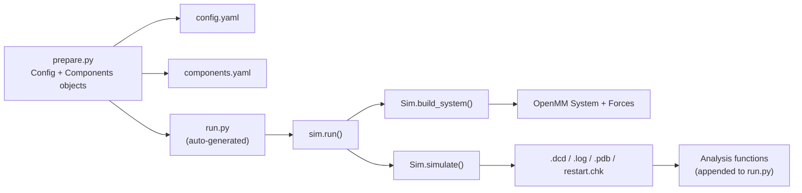
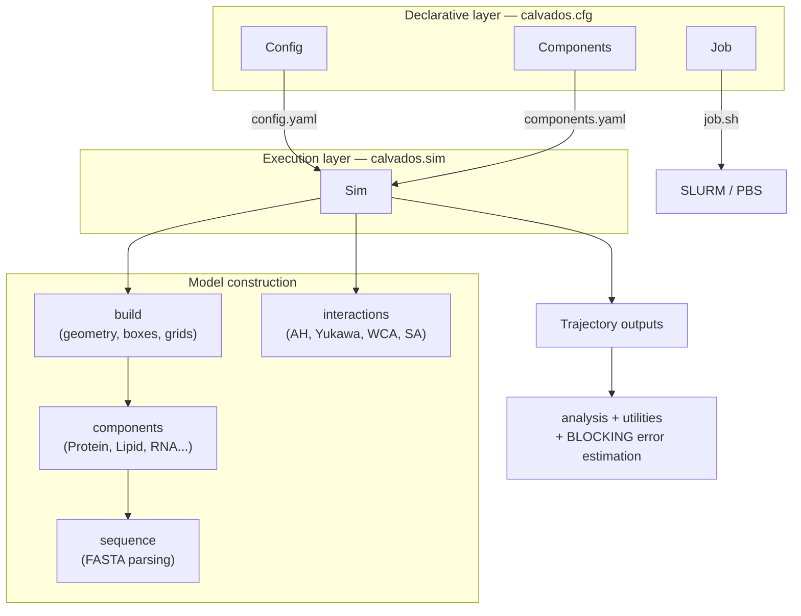

MEM-CALVADOS is a Python package for coarse-grained, implicit-solvent simulations of biomolecules — with a focus on flexible proteins at membrane interfaces — built on top of OpenMM. This page walks you through the shortest path from a fresh installation to a finished simulation trajectory: installing the package, generating a simulation system from a FASTA sequence, running it with two shell commands, and locating your outputs. Everything shown here is based on the canonical `single_IDR` example shipped with the repository.

Sources: [README.md](README.md#L1-L15)

---

## Prerequisites and Installation

MEM-CALVADOS targets **Python 3.13** on Linux, and installation is conda-based to guarantee that OpenMM is available. The workflow recommended in the repository README is:

```bash
# 1. Create and activate an environment
conda create -n calvados python=3.13
conda activate calvados

# 2. (Optional — only for GPU runs) Install OpenMM with CUDA support
conda install -c conda-forge openmm=8.2.0 cudatoolkit=11.8 mdanalysis=2.9 mdtraj=1.11

# 3. Clone and install the package
git clone https://github.com/gitesei/MEM-CALVADOS.git
cd MEM-CALVADOS
pip install .        # or: pip install -e .
```

If you plan to run on CPU only, step 2 can be skipped — pip will pull the remaining pure-Python dependencies automatically. The core dependency set declared at install time is summarized below:

| Dependency | Role |
|---|---|
| `numpy`, `scipy`, `numba` | Numerical core and compiled kernels |
| `openmm` | Simulation engine (install via conda-forge, not pip) |
| `mdanalysis`, `mdtraj` | Trajectory I/O and analysis |
| `biopython`, `localcider` | Sequence handling and IDR property prediction |
| `PyYAML`, `Jinja2` | Configuration files and job-script templating |
| `pandas`, `matplotlib`, `statsmodels`, `tqdm` | Data handling, plotting, batch statistics, progress bars |
| `pytest` | Test suite |

> [!TIP]
> During `pip install`, `setup.py` downloads the BLOCKING error-estimation code (`main.py`, `block_tools.py`) from a remote GitHub repository using `wget`/`curl`. This means **network access is required at install time**, even for an offline target machine — pre-download those files if you are installing on an air-gapped cluster.

**Verify your installation** by running the test suite:

```bash
python -m pytest
```

The `test_potentials` test is a genuine smoke test: it simulates two free amino acids, computes potential energies from the saved trajectory, and compares them against OpenMM's own log output. If all tests pass, your physics stack is correctly wired.

Sources: [README.md](README.md#L28-L53), [setup.py](setup.py#L3-L38), [pytest.ini](pytest.ini#L1-L5)

---

## The Two-Command Workflow

Every MEM-CALVADOS example follows the same pattern, and it is the pattern you should internalize:

```bash
python prepare.py --name <protein name>          # generates config + run script
python <protein name>/run.py --path <protein name>  # executes the simulation
```

The separation of concerns is deliberate: `prepare.py` is the *declarative* step where you describe **what** to simulate; the generated `run.py` is the *executable* step where OpenMM does the work. From `<name>/run.py`'s perspective, the entire pipeline is one call:

```python
sim.run(path=path, fconfig='config.yaml', fcomponents='components.yaml')
```



Sources: [examples/single_IDR/README.md](examples/single_IDR/README.md#L1-L9), [calvados/sim.py](calvados/sim.py#L871-L881)

---

## Step 1: Describe Your System with `prepare.py`

Open `examples/single_IDR/prepare.py` — it is the minimal working template. It instantiates two classes from `calvados.cfg`, both of which merge your settings over package defaults stored in `calvados/data/*.yaml`.

### `Config` — global simulation settings

`Config(**params)` overlays your keyword arguments onto `default_config.yaml` and, crucially, its `.write()` method emits **three files**: `config.yaml`, plus a runnable `run.py` that imports `calvados.sim` and parses `--path`, `--config`, and `--components` arguments.

| Parameter | Example value | Meaning |
|---|---|---|
| `sysname` | `'FUSRGG3'` | Name prefix for all output files |
| `box` | `[50, 50, 50]` | Cubic box side lengths in nm |
| `temp` | `293.15` | Temperature in K |
| `ionic` | `0.19` | Ionic strength in M (sets Debye screening) |
| `pH` | `7.5` | Protonation state assignment for residues |
| `topol` | `'center'` | Initial placement topology |
| `wfreq` | `7000` | Trajectory writing interval (integration steps) |
| `steps` | `1010 × 7000` | Total integration steps |
| `runtime` | `0` | If > 0 (hours), overrides `steps` via wall-clock limit |
| `platform` | `'CPU'` | `'CPU'` or `'CUDA'` |
| `restart` | `'checkpoint'` | Resume from `frestart` checkpoint file if present |

### `Components` — the molecular inventory

`Components(**defaults)` holds shared defaults from `default_component.yaml`, and each call to `.add(name=...)` registers one molecular species:

| Parameter | Example value | Meaning |
|---|---|---|
| `molecule_type` | `'protein'` | One of `protein`, `lipid`, `crowder`, `rna`, `cyclic`, `seastar`, `ptm_protein`, `lj_particle` |
| `nmol` | `1` | Number of copies of this molecule |
| `charge_termini` | `'both'` | Which termini carry formal charge (`N`, `C`, or `both`) |
| `fresidues` | `residues_CALVADOS2.csv` | Residue parameter table (sigma, lambda, charges) |
| `ffasta` | `input/idr.fasta` | FASTA file with your sequence(s) |

The bundled example FASTA contains two sequences (`A1SLCD` and `FUSRGG3`); `components.add(name=args.name)` selects the entry matching the `--name` you passed on the command line. Note that the default `ffasta` in `default_component.yaml` is a placeholder (`'fastabib.fasta'`) — always set it explicitly to your own FASTA path.

Sources: [examples/single_IDR/prepare.py](examples/single_IDR/prepare.py#L29-L75), [calvados/cfg.py](calvados/cfg.py#L13-L90), [calvados/data/default_config.yaml](calvados/data/default_config.yaml#L1-L50), [calvados/data/default_component.yaml](calvados/data/default_component.yaml#L1-L44), [examples/single_IDR/input/idr.fasta](examples/single_IDR/input/idr.fasta#L1-L5), [calvados/sim.py](calvados/sim.py#L68-L91)

---

## Step 2: Run the Simulation

After `prepare.py` completes, the output folder contains `config.yaml`, `components.yaml`, and the auto-generated `run.py`. Launching it triggers `sim.run()`, which loads both YAML files, constructs a `Sim` object, and executes the full build-and-run sequence:

```python
mysim = Sim(path, config, components)
mysim.build_system()   # components, box, interactions, restraints
mysim.simulate()       # minimization, integrators, reporters, production loop
```

The production loop runs in batches with a live progress bar, saving a checkpoint every batch and writing a checkpointed final structure. At completion you will find in your system folder:

| File | Producer | Content |
|---|---|---|
| `<sysname>.dcd` | `DCDReporter` | Trajectory, one frame per `wfreq` steps |
| `<sysname>.log` | `StateDataReporter` | Step, speed, elapsed time per `logfreq` steps |
| `restart.chk` | `simulation.saveCheckpoint` | OpenMM checkpoint for resuming runs |
| `checkpoint.pdb` | `PDBReporter` | Final configuration |
| `<sysname>_<timestamp>.pdb` | `PDBReporter` | Timestamped final configuration |

**Runtime control** works in two modes: fixed step count (`steps`) or wall-clock limit (`runtime > 0`, in hours, using `runForClockTime` with 30-minute checkpointing). For a first test run, shrink `steps` in `prepare.py` so the job finishes in minutes.

> [!TIP]
> `run.py` is regenerated every time you call `config.write(...)` — including the analysis code, which is embedded into `run.py` as a plain string. If you edit `run.py` by hand and then re-run `prepare.py`, your edits are silently overwritten. Treat `prepare.py` as the single source of truth.

Sources: [calvados/sim.py](calvados/sim.py#L871-L881), [calvados/sim.py](calvados/sim.py#L829-L869), [calvados/cfg.py](calvados/cfg.py#L40-L58)

---

## Adding Analysis to Your Workflow

Because `Config.write()` accepts an `analyses` string, analysis code is appended to the generated `run.py` and executes automatically right after the trajectory is finished. The `single_IDR` example uses this to compute conformational properties of the simulated chain:

```python
analyses = f"""

from calvados.analysis import save_conf_prop

save_conf_prop(path="{path:s}", name="{sysname:s}",
               residues_file="{residues_file:s}",
               output_path="data", start=10, is_idr=True, select='all')
"""
config.write(path, name='config.yaml', analyses=analyses)
```

The `calvados.analysis` module ships a large library of reusable analysis functions built on MDAnalysis — for example `calc_rg` (mass-weighted radius of gyration), `calc_ete` (end-to-end distance statistics), and contact-map utilities — all of which can be composed into this `analyses` string. Analysis results land in the `output_path` directory you specify (here, a `data/` folder created by `prepare.py`).

Sources: [examples/single_IDR/prepare.py](examples/single_IDR/prepare.py#L59-L75), [calvados/analysis.py](calvados/analysis.py#L283-L313)

---

## Scaling Up: Cluster Submission Preview

The third class in `calvados.cfg`, `Job`, extends the same declarative pattern to HPC clusters. It renders a PBS or SLURM submission script from a Jinja2 template shipped in `calvados/data/templates/`, merging your scheduler settings with the `config.yaml`/`components.yaml` you already produced:

```python
job = Job(template='slurm.template', batch_sys='SLURM', ...)
job.write(path, config, components)  # produces job.sh
job.submit(path, njobs=1)            # runs sbatch or qsub
```

The engine details — templates, batching rules, and multi-job behavior — are covered on the dedicated cluster page; for your first local runs, direct execution of `run.py` is all you need.

Sources: [calvados/cfg.py](calvados/cfg.py#L94-L134)

---

## Architecture at a Glance

Once installed, the top-level `calvados` package eagerly imports eight modules, giving you a single `import calvados` surface for the whole toolkit. Their roles in the two-command workflow:



The repository is organized around this architecture:

```
MEM-CALVADOS/
├── calvados/            # the package (cfg, sim, build, interactions, components,
│   │                    #  sequence, analysis, utilities + reporters)
│   ├── BLOCKING/        # block-analysis code (fetched at install time)
│   └── data/            # default YAML configs, residues.csv, job templates
├── examples/            # 18 ready-to-run workflows (single chain → bilayers → slabs)
├── tests/               # pytest suite: potentials, RNA bonds, custom restraints
├── docs/                # Sphinx documentation sources
├── residues.csv         # residue parameter table
└── setup.py             # installation entry point
```

Sources: [calvados/__init__.py](calvados/__init__.py#L1-L12), [setup.py](setup.py#L17-L48)

---

## Where to Go Next

You now have a working installation and a mental model of the prepare → run → analyze loop. The recommended progression through this documentation:

1. **[Example Workflows Tour](3-example-workflows-tour)** — survey all 18 example systems (transmembrane proteins, bilayers, slab geometries, RNA, multi-chain condensates) to find the one closest to your science.
2. **[YAML Configuration System](5-yaml-configuration-system)** — a complete reference for every `Config`, `Components`, and `Job` keyword, including the defaults you saw merged behind the scenes.
3. **[Sim Class Workflow](16-sim-class-workflow)** — what `build_system()` and `simulate()` actually do, step by step.
4. **[Job Submission And Cluster Templates](18-job-submission-and-cluster-templates)** — full details on `Job`, templates, and running at scale.
5. **[Trajectory Analysis Functions](19-trajectory-analysis-functions)** — deep dive into the `calvados.analysis` library you previewed in the analysis section.

If you need a reminder of the project's scientific scope, return to the **[Overview](1-overview)** page.
