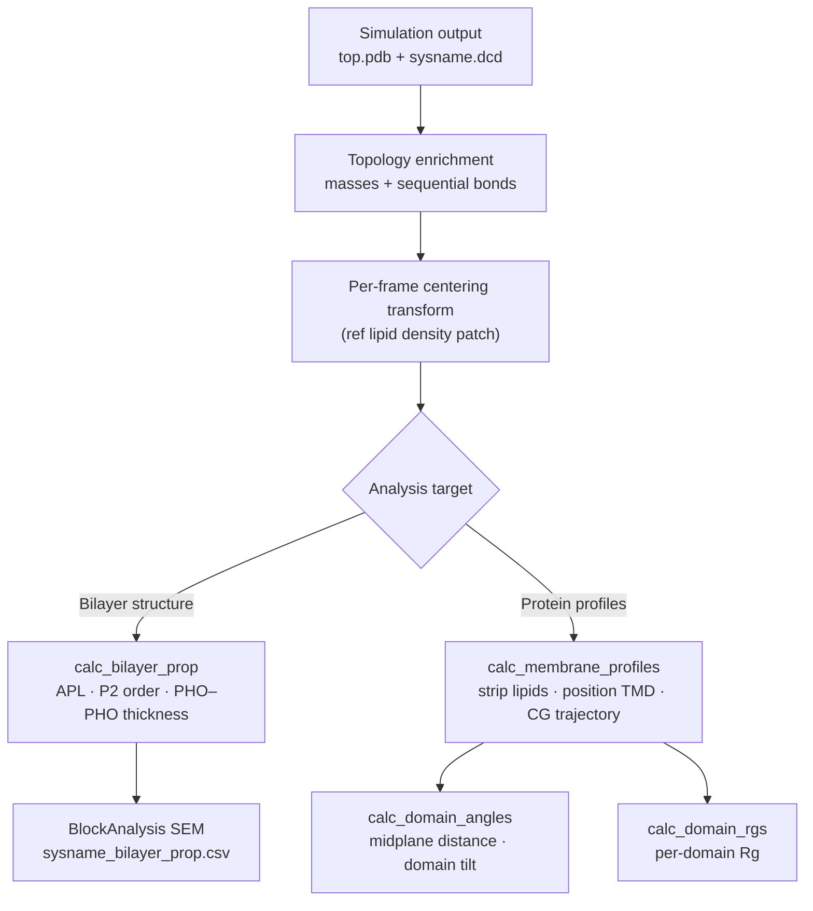

This page documents the membrane-focused post-processing layer of CALVADOS: how raw bilayer trajectories are recentered, how structural membrane observables (area per lipid, tail order, thickness) are extracted, and how protein profiles relative to the membrane are generated and analyzed. All machinery lives in a coherent block of [calvados/analysis.py](/calvados/analysis.py#L1240-L1560), supported by error estimation from the `BLOCKING` package.

Sources: [analysis.py](/calvados/analysis.py#L1240-L1560), [analysis.py](/calvados/analysis.py#L1-L28)

## Pipeline Architecture

The membrane analysis workflow follows a strict stage sequence: every function that computes a profile first reconstructs topology metadata (masses, bonds), applies a per-frame centering transform based on a lipid reference selection, writes a canonical `traj.dcd`, and only then extracts observables. This design decouples geometric stabilization from measurement, so each downstream quantity is computed on a membrane consistently pinned to the box midplane.



The pipeline assumes the input system was built with the bilayer topology workflow (`topol = 'bilayer'`, `bilayer_eq = True`), as in the bundled bilayer example, and that lipid beads carry the repository's standard residue names (`CHO`, `PHO`, `MID`, `TDO`, `TPO`).

Sources: [analysis.py](/calvados/analysis.py#L1246-L1312), [prepare.py](/examples/bilayer/prepare.py#L24-L44)

## Trajectory Preparation And Membrane Centering

Both membrane entry points begin with identical topology enrichment. A three-letter-to-one-letter mapping is built from the residues CSV, per-residue masses are reconstructed from that file (including charged termini via `charge_termini=True`), and attached as a `masses` TopologyAttr. Bonds are then synthesized as sequential index pairs within each MDAnalysis segment — a pragmatic reconstruction because the coarse-grained DCD topologies carry no bond records. This matters because MDAnalysis wrapping and COM operations rely on segment connectivity.

Sources: [analysis.py](/calvados/analysis.py#L1246-L1261), [analysis.py](/calvados/analysis.py#L1379-L1387)

The centering algorithm itself is density-driven rather than COM-driven. Each frame, the z-positions of the **reference selection** (`ref_sel`, default `"resname TDO or resname TPO"` — the lipid tail beads) are histogrammed into 1-unit bins over the box height. The nested `calc_zpatch` helper scans this histogram for the densest *contiguous non-zero patch* — the lipid slab — and the patch's density-weighted centroid `zmid` becomes the translation target: all atoms are shifted by `-zmid + Lz/2`, then wrapped compound-wise by segments. `calc_membrane_profiles` additionally unwraps the protein first and, after centering, translates the transmembrane domain (TMD) center of mass in *xy* to `(Lx/2, 0.2·Lx)` — the code comments this places the protein "close to the edge of the leaflet", an intentional lateral displacement for profile resolution.

> [!TIP]
> The patch-based centering (rather than a global COM shift) is deliberate: it anchors the *lipid bilayer* — not the whole box including solvent and protein — to the midplane, which keeps leaflet-resolved measurements like the PHO–PHO distance stable across frames even when a large protein asymmetrically loads one leaflet.

Sources: [analysis.py](/calvados/analysis.py#L1263-L1305), [analysis.py](/calvados/analysis.py#L1418-L1437), [analysis.py](/calvados/analysis.py#L1439-L1442)

## Bilayer Structural Observables (`calc_bilayer_prop`)

`calc_bilayer_prop` computes three canonical bilayer observables frame-by-frame, saves each as a per-frame `.npy` array, and summarizes them with block-averaged errors in a CSV. The signature is:

```python
calc_bilayer_prop(path, sysname, output_path, residues_file,
                  start=0, stop=-1,
                  ref_sel="resname TDO or resname TPO",
                  input_pdb='top.pdb')
```

Sources: [analysis.py](/calvados/analysis.py#L1240-L1245)

**Area per lipid (APL).** Per frame, the cross-sectional area is `Lx·Ly` from the unit cell; the bead count of `resname MID` (the lipid mid-bead) serves as the lipid count, and APL is `area / n_lipids * 2`. The factor of 2 converts the all-lipid normalization into a **per-leaflet** area, since MID beads span both leaflets — consistent with the build-time estimate `N_lipids = ceil(Lx·Ly / area_per_lipid) · 2` used in the bilayer example. Frame-wise Lx values are also exported as `sysname_lx.npy` to support later area-fluctuation analysis.

**Tail order parameter.** The first tail bond of each lipid is identified as the pair `(MID+1, MID+2)` in atom-index space. Bond displacement vectors are computed with `md.compute_displacements`, the orientational order is evaluated as the second Legendre polynomial

```
P2 = ½ · (3·cos²θ − 1),   cosθ = v_z / |v|
```

averaged over all tail bonds per frame, yielding a single scalar per frame. Values near 1 indicate tails aligned with the membrane normal; near −0.5, perpendicular; near 0, isotropic.

**Phosphate–phosphate distance (thickness proxy).** Per frame, `PHO` bead z-coordinates are histogrammed (1 Å bins, normalized by frame area). The density peak is located independently in each leaflet half of the box, and the peak-to-peak separation — recorded in nm — is the PHO–PHO distance, a standard bilayer-thickness proxy for bead models lacking explicit atomistic headgroups.

Sources: [analysis.py](/calvados/analysis.py#L1314-L1320), [analysis.py](/calvados/analysis.py#L1322-L1330), [analysis.py](/calvados/analysis.py#L1332-L1350), [prepare.py](/examples/bilayer/prepare.py#L16-L19)

All three time series are then passed through `BlockAnalysis` (imported from the `BLOCKING` subpackage) to obtain statistically honest standard errors, and the results are assembled into a `value`/`error` table:

| Observable | Per-frame array | CSV row | Physical meaning |
|---|---|---|---|
| `apl` | `sysname_apl.npy` | mean ± SEM | Per-leaflet area per lipid (nm²) |
| `dpp` | `sysname_dpp.npy` | mean ± SEM | PHO–PHO peak distance (nm), thickness proxy |
| `order` | `sysname_order.npy` | mean ± SEM | Tail P2 order parameter |

The final CSV `sysname_bilayer_prop.csv` is written with the block SEM in the `error` column — see [Block Analysis And Error Estimation](21-block-analysis-and-error-estimation) for the underlying blocking algorithm.

Sources: [analysis.py](/calvados/analysis.py#L1352-L1365), [analysis.py](/calvados/analysis.py#L27-L28)

## Protein–Membrane Profile Generation (`calc_membrane_profiles`)

This function produces the substrate for all protein-side membrane analysis. Its defaults encode the lipid-bead contract explicitly: `strip_sel = "not (resname CHO or resname PHO or resname MID or resname TDO or resname TPO)"` removes every lipid bead so that `prot` contains only the protein component, while `tmd_sel` (a required argument) defines the transmembrane segment used for lateral positioning.

After the unwrap → center → TMD-placement transform chain is registered as trajectory transformations, the centered full-system trajectory is written to `traj.dcd`. The function then performs a **coarse-graining pass**: for every frame, each protein residue is collapsed to its mean atom position, and a fresh MDAnalysis `Universe.empty` is assembled with one bead per residue, per-residue topology attributes (`name`, `resname`, `resid`), segment mapping, and synthetic sequential bonds. The result is persisted as `prot_CG.pdb` + `prot_CG.dcd` — a residue-resolution protein trajectory in the membrane-fixed frame.

Sources: [analysis.py](/calvados/analysis.py#L1367-L1369), [analysis.py](/calvados/analysis.py#L1374-L1377), [analysis.py](/calvados/analysis.py#L1439-L1442), [analysis.py](/calvados/analysis.py#L1444-L1483)

## Downstream Domain-Level Analyses

Two consumers operate directly on the CG products, and both fail naturally if `calc_membrane_profiles` has not been run (they load `prot_CG.pdb`/`prot_CG.dcd` unconditionally).

**`calc_domain_angles`** computes two families of profiles:

- *Midplane distance profile*: per-residue distance `|z − Lz/2|` (converted to nm) is accumulated with **Welford's online algorithm** (streamed mean and variance), avoiding a second trajectory pass; output `sysname_distance_midplane.npy` holds `[resid, mean, std]` columns.
- *Domain orientation*: for each entry in the `angle_sels` dictionary (name → MDAnalysis selection on the CG topology), the angle to the membrane normal z is computed per frame. Two-atom selections use a direct bond-vector angle; larger selections use the principal axes of the mass-weighted inertia tensor derived from the gyration matrix (`I = trace(S)·I₃ − S`). Results — three tilt angles plus sorted eigenvalues — are stored per domain in `sysname_domain_angles.npy` alongside a time axis honoring `saving_interval`.

Sources: [analysis.py](/calvados/analysis.py#L1485-L1504), [analysis.py](/calvados/analysis.py#L1506-L1538), [analysis.py](/calvados/analysis.py#L1539-L1547)

**`calc_domain_rgs`** computes per-domain radius-of-gyration time series over the same CG trajectory by delegating to the shared `calc_rg` routine, storing everything in one dictionary-valued `.npy`. Together, these three functions let you correlate domain tilt, insertion depth, and compaction — the standard signature set for membrane protein/bilayer perturbation studies.

Sources: [analysis.py](/calvados/analysis.py#L1549-L1560)

## Auxiliary Membrane-Proximity Metrics

Two further functions round out the membrane toolbox, both operating on the canonical `traj.dcd`:

- **`calc_surface_density_hist`** tracks the lateral distribution of anchored species: atoms matching `resid` (default 15 — an anchor bead index convention) are histogrammed in 2D over the `Lx × Ly` plane (`bins_xy`, default 35), producing a per-frame surface-density map. The *distribution* of local densities across frames is then accumulated, yielding a probability histogram of surface crowding states — useful for detecting clustering or recruitment at the membrane plane.
- **`count_bridging_chains`** quantifies membrane-mediated bridging in three-component systems: `chainid_dict` must contain exactly three chain types, and a chain of the `bridge_key` type is flagged per frame as *bridging* only if its COM lies below the midplane (`z < 0`) *and* it contacts at least one chain of each of the other two types within `cmap_cutoff`. It consumes the COM trajectory produced by `calc_com_traj` and outputs a boolean matrix, per-frame counts, and fractions. Note the z < 0 criterion implicitly assumes the slab-centered frame convention established by the slab centering workflow.

Sources: [analysis.py](/calvados/analysis.py#L954-L975), [analysis.py](/calvados/analysis.py#L977-L1034)

## Output Artifact Map

All membrane functions communicate exclusively through `.npy`/`.csv`/DCD artifacts in `output_path`, making them composable in notebook or script pipelines:

| Producer | Artifacts | Consumers |
|---|---|---|
| `calc_bilayer_prop` | `sysname_apl.npy`, `sysname_order.npy`, `sysname_dpp.npy`, `sysname_lx.npy`, `sysname_bilayer_prop.csv` | Downstream plotting, [Block Analysis](21-block-analysis-and-error-estimation) |
| `calc_membrane_profiles` | `traj.dcd` (centered), `prot_CG.pdb`, `prot_CG.dcd` | `calc_domain_angles`, `calc_domain_rgs` |
| `calc_domain_angles` | `sysname_distance_midplane.npy`, `sysname_domain_angles.npy` | Plotting notebooks |
| `calc_domain_rgs` | `sysname_domain_rgs.npy` | Plotting notebooks |
| `calc_surface_density_hist` | `sysname_surface_density_hist.npy` (+ edges, time) | Plotting notebooks |
| `count_bridging_chains` | `..._bridging_{matrix,count,fraction}.npy` | Plotting notebooks |

Sources: [analysis.py](/calvados/analysis.py#L1307-L1365), [analysis.py](/calvados/analysis.py#L1439-L1483), [analysis.py](/calvados/analysis.py#L1539-L1560), [analysis.py](/calvados/analysis.py#L970-L975)

## Practical Notes And Next Steps

A few contract details worth internalizing before scripting against these functions. The default `ref_sel` and `strip_sel` values hard-code the repository's lipid bead vocabulary (`TDO`/`TPO` tails for centering, `PHO` for thickness, `MID` for lipid counting) — if you adapt a different lipid model, override these selections explicitly. The functions rely on residue definitions in the residues CSV matching the three-letter codes present in the topology, since masses are rebuilt from that file rather than read from the DCD.

> [!TIP]
> Both `calc_bilayer_prop` and `calc_membrane_profiles` write their centered output to the same path, `{path}/traj.dcd` (lines 1307 and 1439). Run them against distinct output directories — or re-run the producer you need last — because the later call silently overwrites the former's centered trajectory.

For the simulation-side context that produces these trajectories (bilayer equilibration stages and pressure coupling), continue to [Bilayer Assembly And Topologies](9-bilayer-assembly-and-topologies) and [Slab Equilibration And Barostats](15-slab-equilibration-and-barostats). For the lipid interaction model that determines the APL and order values you will measure, see [Lipid Interactions: WCA And SA Terms](11-lipid-interactions-wca-and-sa-terms). For the statistical machinery behind every `error` column on this page, proceed to [Block Analysis And Error Estimation](21-block-analysis-and-error-estimation); for the general (non-membrane) trajectory routines this module shares, see [Trajectory Analysis Functions](19-trajectory-analysis-functions).
