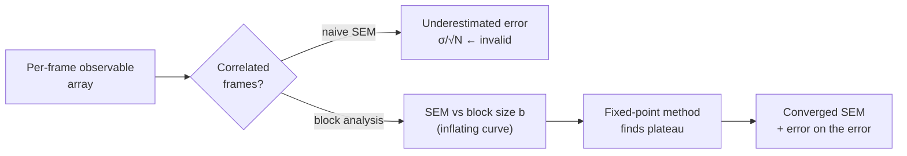
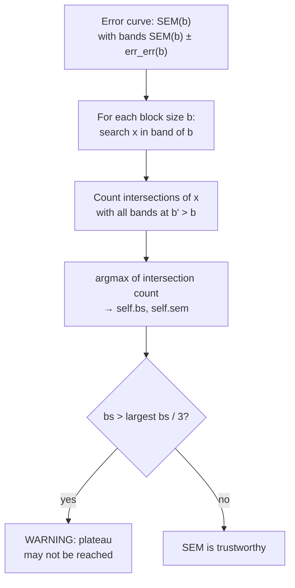
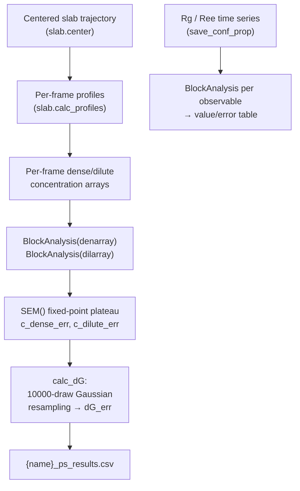

Molecular dynamics trajectories produce **time-correlated** observables: consecutive frames are not statistically independent, so a naive `std/√N` standard error systematically *underestimates* the true uncertainty. This page documents MEM-CALVADOS's solution — a vendored block-averaging subpackage (`calvados/BLOCKING/`) that estimates error bars from the plateau of the block-size-dependent standard error, plus its three integration points in the analysis pipeline: slab phase-separation concentrations, conformational properties (Rg/Ree), and ΔG error propagation via Monte Carlo resampling.

Sources: [block_tools.py](calvados/BLOCKING/block_tools.py#L1-L96), [analysis.py](calvados/analysis.py#L26-L28)

## Why Naive SEM Fails: The Statistical Problem

The observables MEM-CALVADOS analyzes — per-frame dense/dilute phase concentrations, radii of gyration, end-to-end distances — are extracted from MD trajectories whose frames are separated by far less than the system's correlation time. The standard error of the mean `σ/√N` is only valid for *independent* samples; with `N` correlated samples, the effective sample size is `N < N` and the naive SEM shrinks toward zero as trajectory length grows, creating a false impression of convergence.

The **block averaging** strategy sidesteps this by exploiting a key property: the standard error computed over blocks of size `b` inflates with `b` while correlation dominates, then saturates to a plateau once `b` exceeds the correlation time. The plateau value is the true SEM. The codebase computes this curve across all *valid* block sizes and resolves the plateau via an intersection-counting fixed-point method rather than manual inspection.

Sources: [block_tools.py](calvados/BLOCKING/block_tools.py#L39-L61), [main.py](calvados/BLOCKING/main.py#L36-L56)



## Core Algorithms in `block_tools`

The `block_tools` module implements the statistical machinery in five functions. The table below maps each function to its role:

| Function | Line Range | Role |
|---|---|---|
| `blocker(array, multi)` | L3–16 | Enumerates valid block partitions |
| `check(array, multi)` | L18–36 | Length correction for replica-constrained arrays |
| `blocking(array, multi)` | L39–61 | Unweighted SEM curve over all block sizes |
| `fblocking(cv, w, kbt, multi, interval)` | L63–87 | Reweighted (biased-sampling) histogram error curve |
| `autocorrelation(x)` | L89–95 | Normalized autocorrelation function |

`blocker` computes the set of block counts `n` satisfying two divisibility constraints: `dimension % n == 0` **and** `rep % bs == 0`, where `bs = dimension/n` is the block size and `rep = dimension/multi` is the per-replica length ([block_tools.py](calvados/BLOCKING/block_tools.py#L3-L16)). The second constraint is the replica-awareness guarantee — a block never straddles a replica boundary, because `multi > 1` treats the input array as `multi` concatenated independent replicas whose block boundaries must stay aligned.

`blocking` then produces the error curve itself ([block_tools.py](calvados/BLOCKING/block_tools.py#L39-L61)). For each block size `b` with `Nb` blocks, block averages `blocks_av` are computed, and:

- **SEM**: `err = √( Σ(blocks_av − u)² / (Nb(Nb−1)) )`, where `u` is the global mean
- **Error on the error**: `err_err = err / √(2(Nb−1))` — the normal-statistics uncertainty of a variance-based estimate with `Nb` effective samples

The result is returned as a matrix flipped so that block sizes run from largest to smallest: `[block_sizes, errs, errs_errs]` ordered descending ([block_tools.py](calvados/BLOCKING/block_tools.py#L61)).

The `check` function solves a subtle preprocessing problem ([block_tools.py](calvados/BLOCKING/block_tools.py#L18-L36)): short arrays yield fewer than 19 valid block transformations, which is too few points to resolve a plateau. `check` iteratively trims `c` frames (up to 100) *from the bottom of every replica simultaneously* — preserving replica alignment — until the trimmed array admits more than 19 partitions. This means the very first thing any `BlockAnalysis` object does to input data is this length normalization.

> [!TIP]
> The `err_err` column is not cosmetic: the `SEM()` fixed-point method uses `[err − err_err, err + err_err]` as search bounds for plateau detection. Treating these bands as noise tolerance is what makes automated plateau-finding robust.

## The `BlockAnalysis` Class API

`BlockAnalysis` in `main.py` wraps the block_tools functions behind a stateful interface ([main.py](calvados/BLOCKING/main.py#L7-L111)). Its constructor accepts both plain and biased-sampling data:

| Parameter | Type | Purpose |
|---|---|---|
| `x` | array | Observable time series (per-frame values) |
| `multi` | int | Number of concatenated replicas (default 1) |
| `weights` | array | Optional per-frame reweighting factors |
| `bias` | array | Bias potential; converted to weights as `exp(bias/kBT)` after shifting by `max(bias)` (L20–24) |
| `T` | float | Temperature in K; internally `kbT = 0.008314463·T` in kJ/mol (L22, L30) |
| `interval_low/up` | float | Bounds of the histogram interval (widened if data extends beyond) (L14–18) |
| `dt` | float | Time between frames; block sizes are converted from frames to time via `stat[...,0] /= dt` (L34) |

Constructor dispatch is binary (L26–32): with no weights, the unweighted `blocking()` path computes a scalar mean estimate (`self.av`); with weights (supplied directly or derived from `bias`), the `fblocking()` path runs instead, normalizing weights to sum to 1 first ([main.py](calvados/BLOCKING/main.py#L31)).

Beyond SEM, the class provides distributional analysis. `get_pdf` ([main.py](calvados/BLOCKING/main.py#L58-L86)) builds a Silverman-bandwidth Gaussian KDE over the configured interval — optionally reweighted and optionally over a different collective variable `cv` — and estimates its pointwise error by recomputing the PDF per block:

`e(x) = √( Σᵢ wᵢ·(pdfᵢ(x) − u(x))² / (Nb·(W − S/W)) )`

where `W = Σw` and `S = Σw²`. The `W − S/W` denominator is the **Kish effective sample size correction** — with uniform weights it collapses to `W(1 − 1/Nb) ≈ W`, but under strong reweighting it correctly shrinks the effective block count.

Two consumers build on the PDF ([main.py](calvados/BLOCKING/main.py#L88-L110)):

| Method | Output | Formula |
|---|---|---|
| `get_fes(maxkj=25)` | Free energy surface + propagated error | `F = −kbT·ln(H)`, `FE = kbT·E/H`, clamped at `maxkj` kJ/mol |
| `get_av_err()` | Reweighted average + error | `av = Σx·H/ΣH`, `err = √(Σx²·E²)` after normalization |

## The `SEM()` Fixed-Point Plateau Method

Automating plateau detection is the hardest part of block analysis, and `SEM()` implements a distinctive **intersection-counting** approach ([main.py](calvados/BLOCKING/main.py#L36-L56)). For each candidate block size `b` in the error curve, an optimizer (`scipy.optimize.minimize`) searches within the band `[err(b) − err_err(b), err(b) + err_err(b)]` for a value `x` that intersects as many error bars as possible among block sizes **larger** than `b` — the objective counts an intersection for every `p[1] ± p[2]` interval containing `x`, and negates it for minimization ([main.py](calvados/BLOCKING/main.py#L38-L51)).

The intuition: in the plateau region, all sufficiently large block sizes report the same SEM, so their error bars mutually overlap. The block size whose band contains a point overlapping the greatest number of *later* points is the plateau entry — and its `err` becomes the reported `self.sem` ([main.py](calvados/BLOCKING/main.py#L52-L53)). A safety check warns when `self.bs > stat[-1,0]/3`, i.e. when the chosen block size exceeds one third of the largest analyzed block size, meaning the trajectory may be too short to have reached a plateau at all ([main.py](calvados/BLOCKING/main.py#L55-L56)).



Sources: [main.py](calvados/BLOCKING/main.py#L36-L56)

## Reweighted Analysis and Autocorrelation Diagnostics

The `fblocking` function ([block_tools.py](calvados/BLOCKING/block_tools.py#L63-L87)) extends error estimation to **reweighted ensembles**, which matters for biased simulations. It histograms the collective variable with weights into 50 bins over the fixed interval, drops empty bins, normalizes by `N`, and then — for each block size — accumulates per-block squared histogram deviations against the full-sample histogram. The per-bin error is converted from probability space to free-energy space via `kbt·e/u`, and a frame-averaged relative error per block size is reported ([block_tools.py](calvados/BLOCKING/block_tools.py#L80-L86)). This is what makes `get_fes` error bars statistically honest under bias.

The `autocorrelation` function ([block_tools.py](calvados/BLOCKING/block_tools.py#L89-L95)) computes the normalized autocorrelation via `np.correlate` in full mode, taking the last `n` lags and dividing by `variance·(n, n−1, …, 1)`. It serves as a *diagnostic* companion: plotting it against lag reveals the correlation time τ, which should be comfortably smaller than the block size `SEM()` selects. Note it is a direct-summation method (O(n²)), suitable for the short observables MEM-CALVADOS feeds it, not for raw trajectories.

> [!TIP]
> When deriving weights from a bias potential, the code shifts by `max(bias)` *before* exponentiating ([main.py](calvados/BLOCKING/main.py#L21-L23)). This prevents floating-point underflow of `exp(β·V)` for large negative bias values — re-implementing this outside the class without the shift will silently produce zero weights.

## Integration Points in the MEM-CALVADOS Pipeline

The BLOCKING subpackage is not imported as a normal Python package. Instead, `analysis.py` appends the directory to `sys.path` and imports `from main import BlockAnalysis` ([analysis.py](calvados/analysis.py#L26-L28)) — consistent with the vendored module's own flat import (`from block_tools import *`, [main.py](calvados/BLOCKING/main.py#L3)) and the effectively empty `__init__.py`. The practical consequence: `main.py` cannot be imported through the package namespace, and the generic name `main` becomes available globally once `calvados.analysis` is imported.

Three analysis workflows consume block analysis:

**1. Slab phase separation (`SlabAnalysis.calc_block_errors`)** — the primary consumer. Per-frame dense/dilute concentration arrays are produced in `calc_single_conc` ([analysis.py](calvados/analysis.py#L628-L665)) by averaging each frame's profile inside the tanh-fit-derived cutoff regions, then `calc_block_errors` ([analysis.py](calvados/analysis.py#L789-L802)) instantiates one `BlockAnalysis` per array, runs `SEM()` on each, and returns `(eden, edil)`. These land in the results DataFrame as `c_dense_err` and `c_dilute_err` ([analysis.py](calvados/analysis.py#L659-L661)).

**2. ΔG Monte Carlo propagation (`calc_dG`)** — block errors feed directly into free-energy uncertainty ([analysis.py](calvados/analysis.py#L734-L766)). With `dG = ln(c_dil/c_den)`, the method draws `ndraws=10000` Gaussian resamples of each concentration around its block-SEM, recomputes `ln(dil/den)` for each valid draw pair, and reports the standard deviation of the spread as `dG_err`. Degenerate cases (NaN phases, missing dilute/dense phase) are guarded, and `dG` is clamped to `dGmin` with error zeroed ([analysis.py](calvados/analysis.py#L737-L765)).

**3. Conformational properties (`save_conf_prop`)** — Rg and Ree time series from `calc_rg`/`calc_ete` each receive their own `BlockAnalysis(...).SEM()` treatment, with results written into a `value`/`error` table ([analysis.py](calvados/analysis.py#L405-L415)). This is a useful methodological contrast: `calc_ete` also computes the naive `scipy.stats.sem` internally ([analysis.py](calvados/analysis.py#L310)), while the persisted error comes from block analysis.



Sources: [analysis.py](calvados/analysis.py#L628-L665), [analysis.py](calvados/analysis.py#L734-L766), [analysis.py](calvados/analysis.py#L789-L802)

## Using `BlockAnalysis` Directly

The minimal path mirrors exactly what `calc_block_errors` does ([analysis.py](calvados/analysis.py#L789-L802)):

```python
from calvados.analysis import BlockAnalysis  # re-exported via analysis.py imports

block = BlockAnalysis(my_time_series, multi=1, dt=1)
block.SEM()
print(block.bs, block.sem)   # plateau block size, converged SEM
```

For biased-sampling data with a collective variable, the weighted path applies:

```python
ba = BlockAnalysis(cv, weights=w, T=300, dt=10, interval_low=0., interval_up=3.)
ba.SEM()
x, pdf, pdf_err = ba.get_pdf()        # reweighted PDF with pointwise errors
fes_x, F, F_err = ba.get_fes(maxkj=25)
av, err = ba.get_av_err()
```

Key behavioral notes when calling it directly:

- **Input mutation is safe by design** — `check()` returns a trimmed copy; if your array already admits >19 block transformations it is passed through untouched ([main.py](calvados/BLOCKING/main.py#L11))
- **`SEM()` must precede `get_pdf`/`get_fes`/`get_av_err`** — the distributional methods depend on `self.bs` for block partitioning ([main.py](calvados/BLOCKING/main.py#L70-L84))
- **The `dt` parameter changes units, not statistics** — block sizes are divided by `dt` after error computation, so interpret `bs` as a physical time ([main.py](calvados/BLOCKING/main.py#L34))

| Observable | Constructor args | Downstream method | Feeds into |
|---|---|---|---|
| Dense concentration | defaults only | `SEM()` | `c_dense_err`, `calc_dG` |
| Dilute concentration | defaults only | `SEM()` | `c_dilute_err`, `calc_dG` |
| Rg / Ree | defaults only | `SEM()` | `conf_prop.csv` |
| Biased CV | `weights`/`bias`, `T`, `interval_*`, `dt` | `SEM()`, `get_fes()` | custom FES analysis |

Sources: [main.py](calvados/BLOCKING/main.py#L9-L34), [analysis.py](calvados/analysis.py#L405-L415)

## Practical Validation: How to Trust Your Error Bars

When a block analysis result looks suspicious, the codebase provides specific tripwires to check. The `WARNING: fixed point of the error may have not been reached!` message ([main.py](calvados/BLOCKING/main.py#L55-L56)) means the trajectory is too short relative to its correlation time — the remedy is a longer trajectory, not a different analysis setting. If `check` silently trimmed frames, your effective trajectory is shorter than requested; this matters when comparing error bars between replicas analyzed with different lengths. And since ΔG error propagation resamples concentrations independently as Gaussians ([analysis.py](calvados/analysis.py#L754-L761)), correlated errors between `c_dilute` and `c_dense` (e.g., total particle conservation) are not modeled — the propagated `dG_err` is an upper-bound-style estimate under independence assumptions.

A disciplined verification workflow: run `autocorrelation` on your observable, confirm τ is well below the largest analyzed block size (`stat[-1,0]`), verify `SEM()` did not warn, and only then treat `sem` as converged. For slab systems, the end-to-end path from notebook to error bar is fully scripted — as in the `examples/slab_mixed` notebook, `slab.calc_concentrations()` transparently triggers the entire block-analysis chain without any user-facing statistics code.

Sources: [main.py](calvados/BLOCKING/main.py#L55-L56), [block_tools.py](calvados/BLOCKING/block_tools.py#L89-L95), [examples/slab_mixed/example_slab_analysis.ipynb](examples/slab_mixed/example_slab_analysis.ipynb)

## Where To Go Next

Block analysis is the statistical backbone of the post-processing stack. To understand where the per-frame arrays it consumes come from, continue with [Trajectory Analysis Functions](19-trajectory-analysis-functions) for the observable extraction layer and [Membrane Property Profiles](20-membrane-property-profiles) for the `SlabAnalysis` profile/concentration machinery that wraps `calc_block_errors`. For the sampling side that generates correlated trajectories — including the slab equilibration protocols that determine how much converged data reaches your error bars — see [Slab Equilibration And Barostats](15-slab-equilibration-and-barostats). If your goal is validating the force field itself rather than quantifying sampling error, the test suite patterns live in [Testing Potentials And Bond Topologies](22-testing-potentials-and-bond-topologies).