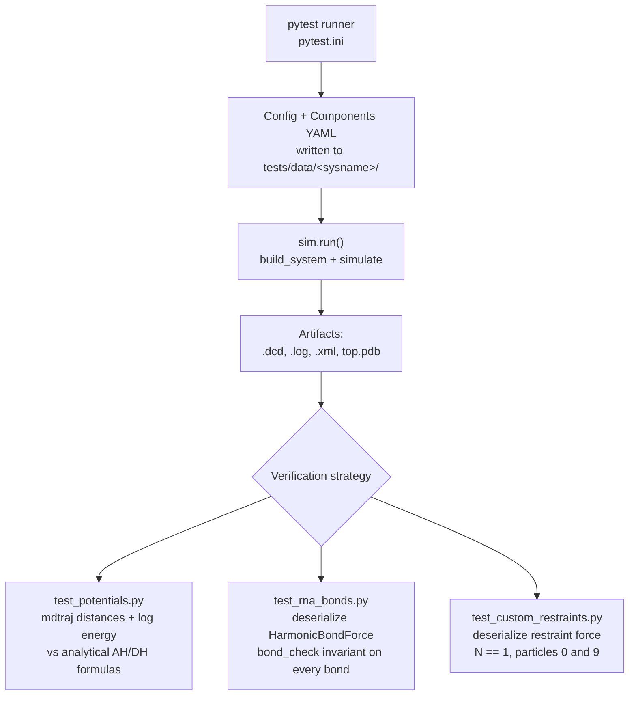
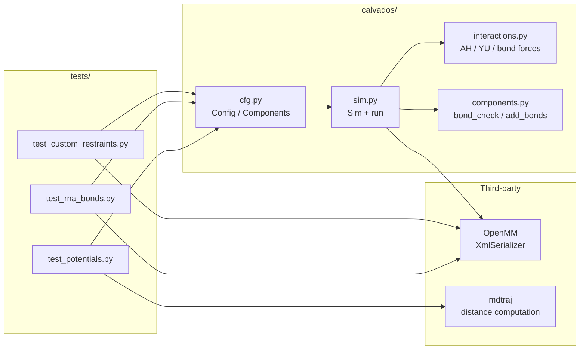

This page documents the test suite that guards the physical correctness of MEM-CALVADOS: `tests/test_potentials.py` validates the Ashbaugh-Hatch and Debye-Hückel pair potentials against independent analytical reference implementations, `tests/test_rna_bonds.py` verifies the phosphate/base bond topology of the C2 RNA model, and `tests/test_custom_restraints.py` checks that user-supplied restraints attach to the correct particles. All three are **integration tests** — they execute real OpenMM simulations through the production entry point rather than mocking components, so what they validate is the exact code path a user would run.

## Test Suite Design Philosophy

The suite deliberately avoids unit-test mocking in favor of *duplicated physics*: each test contains its own reference implementation of the quantity under test (potential-energy formulas, bond rules), written from scratch in NumPy, and compares it against what the OpenMM forces actually produce. This design catches silent regressions in force expressions, parameter propagation, and unit conversions that a mocked test would miss. The cost is runtime — the potential tests execute 100,000 integration steps each — but the reward is that the tests certify the *physics*, not the plumbing.

| Test file | Validates | Strategy | Consumed artifacts |
|---|---|---|---|
| `test_potentials.py` | AH + DH potential energy | Analytical re-computation vs logged energy, per frame | `.dcd` trajectory, `.log` energies |
| `test_rna_bonds.py` | C2 RNA bond topology | XML introspection + topological invariant check | Serialized system `.xml` |
| `test_custom_restraints.py` | Custom restraint attachment | XML introspection + endpoint/count assertions | Serialized system `.xml` |

All tests share the same execution skeleton: write a `Config` and `Components` object to YAML, invoke `sim.run()`, then verify against the generated artifacts.

Sources: [test_potentials.py](tests/test_potentials.py#L12-L19), [test_rna_bonds.py](tests/test_rna_bonds.py#L13-L21), [test_custom_restraints.py](tests/test_custom_restraints.py#L99-L107), [sim.py](calvados/sim.py#L871-L881)

The shared pipeline and the three divergent verification strategies are summarized below:

## Strictness Configuration: pytest.ini

The suite runs under an intentionally strict regime defined at the repository root. `testpaths` restricts collection to `tests/`, while `--doctest-modules` additionally collects executable examples in docstrings across the package — meaning any doctest embedded in `calvados/` modules runs as part of the suite. Warnings are escalated to errors (`filterwarnings = error`) with explicit exemptions for `PendingDeprecationWarning`, `UserWarning`, and `DeprecationWarning`, so new dependency warnings surface as failures rather than being silently absorbed. Verbose reporting (`-r a -v`) prints all test outcomes, which is practical given that each potential test prints its maximum-error diagnostics during execution.

Sources: [pytest.ini](pytest.ini#L2-L15)

## Validating Pair Potentials Against Analytical References

The potential test defines four NumPy lambdas that re-implement the force field from first principles: `HALR`/`HASR`/`HA` for the Ashbaugh-Hatch potential (repulsive LJ branch below `2^(1/6)·σ`, attractive branch with λ-scaling above it), `HASP` for the energy-shifted form `HA(r) − HA(rc)`, and `DH`/`DHSP` for the Debye-Hückel (Yukawa) electrostatic term with its own cutoff shift. The hardcoded prefactor `0.8368` kJ/mol inside these lambdas is the converted default `eps_lj` — the `Sim` constructor multiplies the configuration value by 4.184 to convert kcal/mol to kJ/mol, turning the 0.2 kcal/mol default into exactly 0.8368 kJ/mol. These reference formulas correspond to the OpenMM expressions built by `init_ah_interactions` and `init_yu_interactions`, which embed the cutoff shift analytically (`shift=(s/rc)^12−(s/rc)^6` for AH, `exp(−k·rc)/rc` for Yukawa) — mathematically equivalent to the test's `HA(r)−HA(rc)` construction.

Sources: [test_potentials.py](tests/test_potentials.py#L12-L19), [sim.py](calvados/sim.py#L42), [interactions.py](calvados/interactions.py#L40-L56), [interactions.py](calvados/interactions.py#L92-L106)

The test is parametrized over five residue pairs — (Y,W), (R,W), (E,D), (E,W), (E,R) — chosen to exercise hydrophobic–hydrophobic attraction, charged–neutral, like-charge repulsion, and opposite-charge attraction regimes. Each case builds a system of exactly **two single-bead molecules** (added with `restraint=False, charge_termini='none'`) in an 8 nm cubic box on a `grid` topology. Because each molecule is one bead, bonded terms contribute zero energy and the total potential energy is *purely* the AH + DH pair interaction — the cleanest possible isolation of the nonbonded physics.

Sources: [test_potentials.py](tests/test_potentials.py#L21-L30), [test_potentials.py](tests/test_potentials.py#L83-L95)

After `sim.run()` completes, the test loads the trajectory with mdtraj and computes the inter-bead distance in every frame (`md.compute_distances` with atom pair `[0,1]`), then reads the potential-energy column from the simulation log. The Langevin trajectory naturally samples a spread of distances, so the comparison effectively reconstructs the pair potential curve `u(r)` across the sampled range rather than checking a single point. The expected energy is recomputed per frame from residue-table parameters:

| Quantity | Production source | Test reference computation |
|---|---|---|
| AH ε | `eps_lj × 4.184` (kcal→kJ) in `Sim.__init__` | hardcoded `0.8368` in the HA lambdas |
| σᵢⱼ | per-particle `s`, combined `0.5(s1+s2)` in force expression | `0.5·(sigmas₁+sigmas₂)` from residues CSV |
| λᵢⱼ | per-particle `l`, combined `0.5(l1+l2)` | `0.5·(lambdas₁+lambdas₂)` from residues CSV |
| AH shift | analytic `shift=(s/rc)^12−(s/rc)^6` | `HA(r) − HA(rc)` with `rc = 2` nm |
| Yukawa prefactor | `eps_yu = lB·kT` from `genParamsDH` | `q₁q₂·lB·RT` |
| Debye length | `k_yu = √(8π·lB·I·N_A/10)` | `lD = 1/√(8π·lB·I·N_A/10)`, cutoff `4` nm |

The assertion `np.allclose(u, u_calc, rtol=1e-3, atol=1e-8)` demands agreement to 0.1% relative tolerance per frame — tight enough to catch unit errors, sign errors, or expression drift, but tolerant of OpenMM's floating-point evaluation order.

> [!TIP]
> The AH reference uses an *energy shift evaluated at the cutoff* (`HA(r)−HA(rc)`), while the OpenMM force bakes the same shift analytically into its expression string. If you ever refactor `init_ah_interactions`, preserve this equivalence — e.g., switching to a plain force-shifted form would break the test even if the physics were "close enough" for simulations.

Sources: [test_potentials.py](tests/test_potentials.py#L97-L126), [test_potentials.py](tests/test_potentials.py#L107-L119), [interactions.py](calvados/interactions.py#L4-L15), [sim.py](calvados/sim.py#L66-L74)

## Verifying RNA Bond Topologies

The C2 RNA model represents each nucleotide with two beads — a phosphate and a base — so bond correctness is a *topological* property rather than an energetic one. The test encodes the expected connectivity as an invariant function: a bond `(i, j)` is valid only if `i` is even (phosphate beads occupy even indices) and either `j == i+1` (phosphate–base within a residue) or `j == i+2` (phosphate–phosphate across consecutive residues). Notably, the test file contains its own copy of this rule rather than importing it from `calvados.components` — a deliberate duplication that keeps the test independent of the production implementation it is auditing (the production side keeps a placeholder `bond_check` returning `False` on the generic `Component` class, overridden by molecule-specific subclasses, with an `add_bonds` loop that filters all `(i, j)` pairs through it).

Sources: [test_rna_bonds.py](tests/test_rna_bonds.py#L13-L21), [components.py](calvados/components.py#L81-L92), [components.py](calvados/components.py#L94-L100)

Verification proceeds by deserializing the OpenMM system from the XML written during `build_system`, extracting the force at index 2 (the `HarmonicBondForce` created by `init_bonded_interactions`), and asserting that *every* bond returned by `getNumBonds()`/`getBondParameters()` satisfies the invariant — there is no sampling here, the check is exhaustive over the topology. The test system is a six-residue poly-R chain (`rrrrrr`, `molecule_type='rna'`), which produces 10 bonds (5 phosphate–base + 5 phosphate–phosphate) — enough to cover both bond categories and one cross-residue junction while keeping runtime minimal (only 100 integration steps; `report_potential_energy=False` skips the extra force-group reporters).

Sources: [test_rna_bonds.py](tests/test_rna_bonds.py#L30-L49), [test_rna_bonds.py](tests/test_rna_bonds.py#L95-L103), [sim.py](calvados/sim.py#L374-L379), [interactions.py](calvados/interactions.py#L17-L24)

## Testing Custom Restraint Attachment

The custom restraints test validates the `fcustom_restraints` pathway end-to-end: the `Config` enables `custom_restraints=True` with `custom_restraint_type='harmonic'` and points at `tests/data/cres.txt`. That data file encodes one restraint in a three-part pipe-delimited record — `cres_test 1 1 | cres_test 1 10 | 1.0 700.0` — meaning molecule `cres_test`, residue 1 to residue 10, with the two trailing numeric parameters. After the simulation run, the test deserializes the system XML, pulls the force at **index 3** (the restraint force appended after the component's bond force), and asserts the exact structural outcome: exactly one bond, connecting particles 0 and 9 — the 0-indexed image of the 1-indexed file record. This verifies the complete chain from file parsing through index mapping to OpenMM force population.

Sources: [test_custom_restraints.py](tests/test_custom_restraints.py#L23-L28), [test_custom_restraints.py](tests/test_custom_restraints.py#L73-L75), [cres.txt](tests/data/cres.txt#L1), [test_custom_restraints.py](tests/test_custom_restraints.py#L99-L107)

For a deeper treatment of the restraint physics itself, see [Custom Restraints And PMF Forces](14-custom-restraints-and-pmf-forces); the YAML keys used here are documented in [YAML Configuration System](5-yaml-configuration-system).

## The Force Indexing Contract

Both XML-introspection tests rely on a positional contract: the order in which `add_forces_to_system` appends forces to the `openmm.System` determines the indices the tests query. For the single-component, non-lipid systems used in the tests, the insertion sequence is fully deterministic:

| System force index | Force object | Inserted by | Present in tests |
|---|---|---|---|
| 0 | `CustomNonbondedForce` (Ashbaugh-Hatch) | intermolecular block, `self.ah` | all three tests |
| 1 | `CustomNonbondedForce` (Yukawa/DH) | intermolecular block, `self.yu` | all three tests |
| 2 | `HarmonicBondForce` (component bonds) | per-component `comp.get_forces()` loop | RNA bonds test; precedes restraints in cres test |
| 3 | Custom restraint force (`self.cres`) | `custom_restraints` block | custom restraints test |

This explains why `test_rna_bonds.py` reads `system.getForces()[2]` while `test_custom_restraints.py` reads `system.getForces()[3]`: the protein's bond force occupies index 2, pushing the restraint force to index 3. Lipid-containing systems follow a different ordering (WCA, AH-protein-protein, AH, SA, YU), which is why the tests intentionally use lipid-free systems.

> [!TIP]
> The positional indexing is a hidden coupling between `add_forces_to_system` and the test suite. If you insert any new force into the build sequence — even conditionally — the indices in both XML-introspection tests silently shift. The robust alternative is querying `system.getForces()` by type with `isinstance`, at the cost of a small test refactor.

Sources: [sim.py](calvados/sim.py#L317-L349), [test_rna_bonds.py](tests/test_rna_bonds.py#L97-L98), [test_custom_restraints.py](tests/test_custom_restraints.py#L101-L102)

The module-level dependency graph shows how the three tests converge on the production pipeline while using different verification toolkits:

## Running And Extending The Tests

Running the suite is a single `pytest` invocation from the repository root (collection paths and options come from `pytest.ini`). Because the potential tests are expensive — `steps = N_frames × N_save = 10000 × 10 = 100,000` integration steps per residue pair, on the CPU platform — targeted selection is the practical workflow: `pytest tests/test_rna_bonds.py` for a fast topology-only check, or `pytest tests/test_potentials.py -k "E and R"` for a single residue pair. All artifacts are written under `tests/data/<sysname>/` (the tests create these directories themselves via `mkdir -p`), so repeated runs overwrite prior outputs in place. The fixed `random_number_seed = 12345` makes the initial grid placement reproducible; the per-frame energy comparison remains valid under stochastic Langevin dynamics because each frame is compared against the analytical energy at *its own* sampled distance.

Sources: [test_potentials.py](tests/test_potentials.py#L38-L51), [test_potentials.py](tests/test_potentials.py#L66-L79), [test_rna_bonds.py](tests/test_rna_bonds.py#L46-L49), [test_rna_bonds.py](tests/test_rna_bonds.py#L71)

When extending the suite to new potentials or bond schemes, the failure modes below cover the most common regression patterns observed with this test architecture:

| Symptom | Likely cause | Resolution |
|---|---|---|
| Potential test fails with energy mismatch concentrated at short *r* | Unit error in `eps_lj` conversion or altered AH branch logic | Verify the ×4.184 kcal→kJ conversion and the WCA/attraction branch split at `2^(1/6)·σ` |
| Mismatch uniformly ~`HA(rc)` or `DH(rc)` magnitude | Cutoff shift removed or changed in the force expression | Preserve energy-shift equivalence; update both the force expression and the test lambdas together |
| RNA bond test fails on `j == i+2` bonds | Bead ordering in the residues CSV changed (base before phosphate) | Keep phosphate-first, even-index bead ordering, or update `bond_check` to match the new convention |
| Custom restraint assertions fail (`N ≠ 1` or wrong endpoints) | Force insertion order shifted, or restraint parsing/index mapping changed | Re-derive the force index from `add_forces_to_system`, or switch to `isinstance`-based force lookup |
| New warnings surface as test errors | `filterwarnings = error` escalation | Fix the warning source, or add a targeted exemption in `pytest.ini` |

Sources: [test_potentials.py](tests/test_potentials.py#L12-L19), [interactions.py](calvados/interactions.py#L43-L45), [test_rna_bonds.py](tests/test_rna_bonds.py#L13-L21), [pytest.ini](pytest.ini#L10-L15)

## Summary And Where To Go Next

The test suite implements a three-layer verification strategy: *energetic* validation (analytical potential re-computation at 0.1% tolerance), *topological* validation (exhaustive bond-invariant checking over the serialized system), and *structural* validation (exact restraint endpoint assertions). Its defining characteristic is that every check runs against artifacts produced by the unmodified production pipeline — `sim.run()` → XML/DCD/log — ensuring the tested code is the shipped code. To understand the force expressions being validated, continue to [Ashbaugh-Hatch And Yukawa Potentials](10-ashbaugh-hatch-and-yukawa-potentials) and [Lipid Interactions: WCA And SA Terms](11-lipid-interactions-wca-and-sa-terms); for how the tested forces are organized into force groups and exclusions, see [Force Groups And Interaction Exclusions](12-force-groups-and-interaction-exclusions); for the `Sim` lifecycle the tests drive end-to-end, see [Sim Class Workflow](16-sim-class-workflow).
