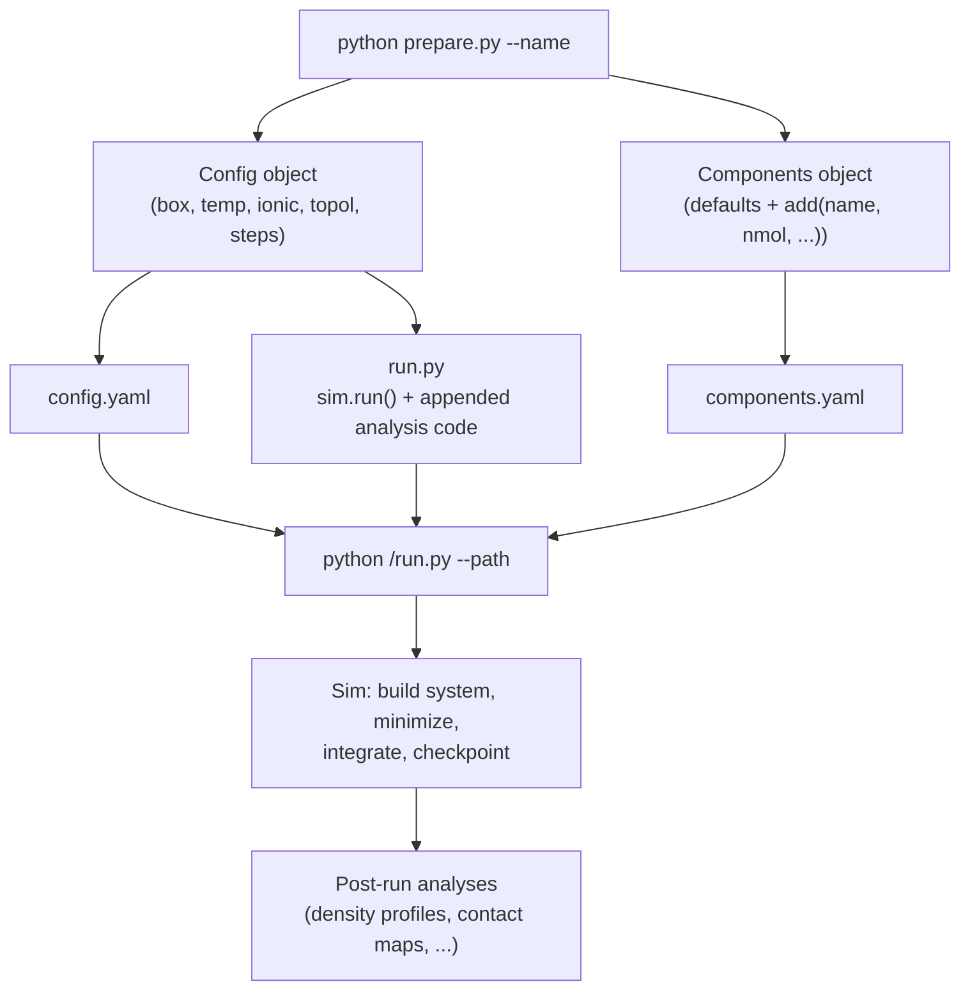
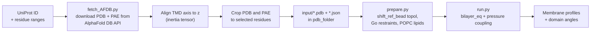

The `examples/` directory is the best map of what MEM-CALVADOS can actually do: eighteen self-contained case studies that span single intrinsically disordered regions (IDRs), multichain condensates, slab coexistence simulations, crowder and RNA mixtures, and full lipid bilayers with transmembrane proteins. This page tours those workflows at the level a beginner needs — what each family of examples demonstrates, what files you run, and what artifacts you get — so you can pick the example closest to your scientific goal and use it as a template. For deeper mechanics, each section points you to the relevant Deep Dive pages.

## The One Pattern Behind Every Example

Every example, regardless of complexity, follows the same two-command, three-file pattern. You first run a `prepare.py` script that builds two declarative YAML inputs — `config.yaml` (simulation settings) and `components.yaml` (molecular inventory) — and auto-generates a `run.py` launcher. You then execute that launcher, which calls `calvados.sim.run()` to build the system and run the OpenMM simulation. This uniformity means that once you understand one example, you understand them all; the differences live entirely in the parameter values, not in the code structure.

The run launcher is not written by hand: `Config.write()` dumps the YAML and then calls `write_runfile()`, which templates a script importing `calvados.sim`, appends any `analyses` code block you passed, and saves it as `run.py` in the system folder. At runtime, `run.py` loads both YAMLs and hands them to `Sim`, which dispatches each named component to a typed class (protein, lipid, crowder, RNA, and others) based on its `molecule_type`. The canonical invocation for every example is documented in its README: `python prepare.py --name <protein name>` followed by `python <protein name>/run.py --path <protein name>`.

| Artifact | Produced by | Contents |
|---|---|---|
| `config.yaml` | `Config(...)` + `.write(path)` | Box, temperature, ionic strength, pH, topology, runtime steps, platform |
| `components.yaml` | `Components(...)` + `.add(name)` + `.write(path)` | Per-molecule defaults plus named entries (`nmol`, `molecule_type`, restraints) |
| `run.py` | `Config.write()` (auto-generated) | `sim.run()` call plus your embedded analysis block |

Sources: [cfg.py](calvados/cfg.py#L30-L64), [cfg.py](calvados/cfg.py#L66-L80), [sim.py](calvados/sim.py#L871-L882), [sim.py](calvados/sim.py#L50-L89), [single_IDR/README.md](examples/single_IDR/README.md#L1-L9), [single_IDR/prepare.py](examples/single_IDR/prepare.py#L21-L75)

## Shared Anatomy: Config and Components

Opening `single_IDR/prepare.py` — the minimal template — reveals the reusable skeleton all eighteen examples share. The `Config` constructor merges your keyword arguments over the package defaults (`calvados/data/default_config.yaml`), so you only specify what differs: box dimensions in nanometers, temperature, ionic strength, pH, the initial-placement topology (`topol`), and runtime controls like `wfreq` (trajectory write interval) and `steps`. The `Components` constructor similarly merges defaults from `calvados/data/default_component.yaml`, and each `components.add(name=..., nmol=...)` call registers one molecular species into the `system` section of `components.yaml`.

The table below collects the knobs you will touch most often while adapting an example. Note how `topol` encodes the geometry family: `center` places a single chain in a cubic box, `random` scatters multiple chains, `grid` places chains on a lattice, `slab` builds the elongated coexistence box, and `bilayer`/`shift_ref_bead` assemble membrane systems.

| Parameter | Meaning | Typical values in examples |
|---|---|---|
| `box` | Simulation box `[Lx, Ly, Lz]` in nm | `[50,50,50]` single chain; `[15,15,150]` slab; `[10,10,120]` bilayer |
| `topol` | Initial placement scheme | `center`, `random`, `grid`, `slab`, `bilayer`, `shift_ref_bead` |
| `ionic`, `pH`, `temp` | Solvent conditions | 0.15–0.19 M, pH 7–7.5, 293–297 K |
| `wfreq`, `steps` | Frame interval and total integration steps | `N_frames * N_save` pattern |
| `platform`, `gpu_id` | OpenMM device | `CPU` (+`threads`) or `CUDA` |
| `slab_eq`, `steps_eq`, `bilayer_eq` | Equilibration stages before production | `True` with step counts |
| `restart`, `frestart` | Checkpointing for resumable runs | `'checkpoint'`, `'restart.chk'` |

Sources: [single_IDR/prepare.py](examples/single_IDR/prepare.py#L21-L56), [cfg.py](calvados/cfg.py#L11-L29), [slab_IDR/prepare.py](examples/slab_IDR/prepare.py#L20-L42), [bilayer/prepare.py](examples/bilayer/prepare.py#L18-L43)

## Family 1 — Single-Chain Box Simulations

The six single-chain examples are the gentlest entry points: one molecule in a cubic box with `topol='center'`, usually on `CPU`, with an embedded `save_conf_prop` analysis for conformational properties. They progressively introduce the force-field and restraint machinery, and each swaps in a different residue-parameter file that encodes the underlying model variant — `residues_CALVADOS2.csv` for CALVADOS 2, `residues_CALVADOS3.csv` for CALVADOS 3, `residues_pCALVADOS2.csv` for phosphorylated residues.

| Example | What it demonstrates | Key settings |
|---|---|---|
| `single_IDR` | Baseline IDR simulation | `topol='center'`, CALVADOS 2 residues, 1010 frames |
| `single_IDR_box_eq` | Same system with box equilibration stage | identical CLI, modified config |
| `single_RNA` | RNA chain with bonded+nonbonded RNA terms | `molecule_type='rna'`, `rna_kb1/kb2/ka/pa`, `residues_C2RNA.csv` |
| `single_GO` | AlphaFold structure held by Go restraints | `restraint=True`, `restraint_type='go'`, `k_go=10`, PAE json in `input/` |
| `single_MDP` | Multi-domain protein, folded domains restrained | `fdomains=input/domains.yaml`, `restraint_type='harmonic'`, `k_harmonic=700` |
| `single_pIDR` | Phosphorylated IDR, pH-dependent charges | pSer/pThr encoded as letters `B`/`O`, `--pH` CLI argument |
| `custom_restraints` | Pairwise distance restraints from a text file | `custom_restraints=True`, `fcustom_restraints=input/cres.txt` |

Three of these deserve a closer look. The RNA example (`single_RNA/prepare.py`) shows that switching molecule type and adding the `rna_*` bond/angle/nonbonded parameters is all it takes to move from proteins to RNA. The multi-domain example (`single_MDP`) reads a small `domains.yaml` file that maps each protein name to a list of folded-domain residue ranges (e.g., hnRNPA1S domains `[11,89]` and `[105,179]`), which the harmonic restraints then enforce using a PDB structure from `pdb_folder`. The custom-restraints example goes further and shows the file format for arbitrary pairwise restraints: each line in `cres.txt` is `name res_i res_j | name res_k res_l | distance force_constant`, and its README is also the only example that displays the (commented-out) cluster-submission pattern using the `Job` class — `job.write(path, config, components)` then `job.submit(path, njobs=1)`.

Sources: [single_IDR/README.md](examples/single_IDR/README.md#L1-L9), [single_IDR_box_eq/README.md](examples/single_IDR_box_eq/README.md#L1-L9), [single_RNA/prepare.py](examples/single_RNA/prepare.py#L37-L51), [single_GO/prepare.py](examples/single_GO/prepare.py#L42-L58), [single_MDP/prepare.py](examples/single_MDP/prepare.py#L59-L67), [single_MDP/input/domains.yaml](examples/single_MDP/input/domains.yaml#L1-L8), [single_pIDR/README.md](examples/single_pIDR/README.md#L1-L9), [custom_restraints/README.md](examples/custom_restraints/README.md#L1-L9), [custom_restraints/prepare.py](examples/custom_restraints/prepare.py#L34-L87), [custom_restraints/input/cres.txt](examples/custom_restraints/input/cres.txt#L1-L8)

> [!TIP]
> When adapting a single-chain example, the residue CSV you point `fresidues` at determines the entire force-field identity of the simulation (CALVADOS 2 vs 3 vs phosphorylated) — always copy the matching CSV from the example's `input/` folder rather than pointing at a file outside the example.

## Family 2 — Multichain Boxes and Geometric Confinement

The two intermediate examples teach you how to scale from one molecule to many and how to impose geometric confinement. `two_IDR` registers two separate components in one system and places them with `topol='random'`; its analysis block builds a `chainid_dict` mapping each component name to chain indices so that center-of-mass trajectories and inter-chain contact maps are computed per species. This is the pattern to copy for any heterotypic (two-species) mixture study.

`ten_IDR_cyl` demonstrates the most unusual trick in the tour: it places ten copies of the same IDR with `topol='grid'` and then compresses them toward the box center using an external force. The `ext_force_expr` string is an OpenMM expression evaluated on each bead — `step(d-3)*0.5*(d-3)^2` with `d` the periodic distance to the box axis — which acts as a cylindrical harmonic wall that drives condensate formation inside a virtual cylinder. Component-level opt-in is done via `ext_restraint=True` on the `components.add()` call, and the external force itself is registered in `Sim.__init__` as a `CustomExternalForce` built from your expression.

Sources: [two_IDR/prepare.py](examples/two_IDR/prepare.py#L26-L64), [ten_IDR_cyl/prepare.py](examples/ten_IDR_cyl/prepare.py#L26-L62), [sim.py](calvados/sim.py#L42-L49)

## Family 3 — Slab Coexistence and Condensate Mixtures

The slab family simulates phase separation directly: hundreds of chains in an elongated box (`[15,15,150]` nm) with `topol='slab'`, an optional slab equilibration stage (`slab_eq=True`, `steps_eq`), and GPU acceleration for the heavier system. `slab_IDR/prepare.py` places 100 copies via `components.add(name=..., nmol=100)` and, importantly, embeds a full post-processing pipeline into the generated `run.py` through the `analyses` string: `SlabAnalysis` centers the trajectory, computes density profiles and phase concentrations, and plots them, while `calc_com_traj` and `calc_contact_map` add chain-level diagnostics. The README also introduces the replication convention — append `_<replica>` to the system name so independent runs can estimate sampling error on phase properties.

| Example | Mixture | Notable additions |
|---|---|---|
| `slab_IDR` | 100× one IDR | `SlabAnalysis` + contact maps; replica CLI; analysis notebook included |
| `slab_IDR_MDP` | IDR + multi-domain protein | CALVADOS 3 residues, harmonic domain restraints |
| `slab_MDP` | Multi-domain proteins only | Same restraint machinery, slab geometry |
| `slab_IDR_PEG` | 100× A1 IDR + PEG crowders | Crowder count from weight/volume via Avogadro conversion; `fixed_lambda`, `slab_outer` |
| `slab_mixed` | 200× FUS-RGG3 + 60× polyU40 RNA | Protein–RNA co-condensation; `ref_chains`/`client_chain_list` per-species analysis |

Two slab examples reward careful reading. `slab_IDR_PEG` shows how to convert a laboratory concentration (weight/volume fraction and PEG molecular weight) into a molecule count using Avogadro's number, and how to register a `molecule_type='crowder'` species alongside the protein; its analysis block centers only on the protein reference (`center_target='ref'`) so the crowder density profile is measured relative to the condensate. `slab_mixed` combines proteins and RNA in one slab and demonstrates the reference/client chain-range convention — `ref_chains=(0,199)` for the 200 protein chains, `client_chain_list=[(200,259)]` for the 60 RNA chains — that lets one `SlabAnalysis` compute per-species profiles; it is also the only example that sets `submit=False` in the config, controlling job submission behavior explicitly. Both `slab_IDR` and `slab_mixed` ship an `example_slab_analysis.ipynb` notebook for interactive re-analysis.

Sources: [slab_IDR/README.md](examples/slab_IDR/README.md#L1-L9), [slab_IDR/prepare.py](examples/slab_IDR/prepare.py#L20-L82), [slab_IDR_PEG/prepare.py](examples/slab_IDR_PEG/prepare.py#L5-L12), [slab_IDR_PEG/prepare.py](examples/slab_IDR_PEG/prepare.py#L40-L90), [slab_mixed/prepare.py](examples/slab_mixed/prepare.py#L43-L87)

## Family 4 — Membranes: Bilayers and Transmembrane Proteins

The membrane family assembles lipid bilayers and embeds transmembrane proteins. `bilayer/prepare.py` is the pure-lipid baseline: it computes the lipid count from a target area per lipid (`Lx*Ly/area_per_lipid`, doubled for both leaflets), sets `topol='bilayer'` with `bilayer_eq=True` equilibration, and registers one component as `molecule_type='lipid'` — internally dispatched to the `Lipid` class with linear chain setup. `single_TMP` embeds a transmembrane protein modeled with CALVADOS 3 into that bilayer.

`single_TMP_AF` is the most elaborate workflow in the repository and introduces the AlphaFold structure pipeline. Its helper script `fetch_AFDB.py` takes a UniProt accession plus residue ranges and: downloads the full-length predicted structure and PAE matrix from the AlphaFold DB API, aligns the transmembrane domain's principal axis to the membrane normal using the inertia tensor, crops both the PDB and the PAE matrix to the requested range, and writes aligned coordinates into the B-factor column. The simulation config then uses `topol='shift_ref_bead'` (a reference-bead placement scheme anchored at `ref_bead=29` in the TMD selection `resid 6 to 281`), `pressure_coupling=True` with an anisotropic target pressure for the membrane, and Go restraints (`k_go=15`) to preserve the folded structure. Its analysis block computes membrane profiles and domain tilt angles via `calc_membrane_profiles` and `calc_domain_angles`.

Sources: [bilayer/prepare.py](examples/bilayer/prepare.py#L15-L59), [single_TMP/README.md](examples/single_TMP/README.md#L1-L8), [single_TMP_AF/prepare.py](examples/single_TMP_AF/prepare.py#L15-L87), [fetch_AFDB.py](examples/single_TMP_AF/fetch_AFDB.py#L50-L127)

> [!TIP]
> The `analyses` string is ordinary Python appended to the generated `run.py` and executed after `sim.run()` returns — so any analysis function from `calvados.analysis` can be embedded there with f-string interpolation of your paths, and it will run automatically at the end of every simulation, including on cluster jobs.

## Choosing a Starting Point and Where to Go Next

Use this decision table to jump straight to the example that matches your goal, then follow the catalog links to the Deep Dive pages that explain the machinery you just ran.

| Your goal | Start from | Then read |
|---|---|---|
| Run your first IDR simulation | `single_IDR` | [Quick Start](2-quick-start), [Architecture Overview](4-architecture-overview) |
| Understand every config option you just wrote | any example's `config.yaml` | [YAML Configuration System](5-yaml-configuration-system) |
| Restrain folded domains with AlphaFold structures | `single_GO`, `single_MDP` | [AF-Guided Harmonic And Go Restraints](13-af-guided-harmonic-and-go-restraints), [Component Class Hierarchy](7-component-class-hierarchy) |
| Model a phosphorylated sequence | `single_pIDR` | [Sequence Processing And Charge States](6-sequence-processing-and-charge-states) |
| Simulate phase separation / measure densities | `slab_IDR` | [Slab Equilibration And Barostats](15-slab-equilibration-and-barostats), [Trajectory Analysis Functions](19-trajectory-analysis-functions), [Membrane Property Profiles](20-membrane-property-profiles) |
| Study crowders or protein–RNA co-condensation | `slab_IDR_PEG`, `slab_mixed` | [Trajectory Analysis Functions](19-trajectory-analysis-functions) |
| Build a bilayer or embed a transmembrane protein | `bilayer`, `single_TMP_AF` | [Bilayer Assembly And Topologies](9-bilayer-assembly-and-topologies) |
| Submit jobs to a cluster | `custom_restraints` (Job pattern) | [Job Submission And Cluster Templates](18-job-submission-and-cluster-templates) |

A recommended beginner path: run `single_IDR` end-to-end to internalize the prepare/run pattern, diff its `config.yaml` against `slab_IDR`'s to see how slab geometry and equilibration change the system, then study `single_MDP` for restraints and `single_TMP_AF` for the full membrane pipeline. When you are ready to look under the hood of what `run.py` actually executes, continue to [Sim Class Workflow](16-sim-class-workflow), and for the YAML files you have been generating, see [YAML Configuration System](5-yaml-configuration-system).
