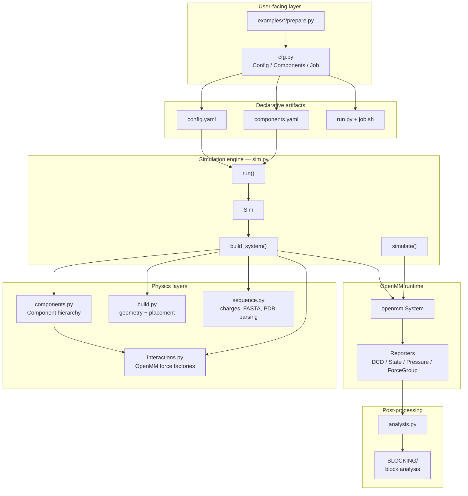
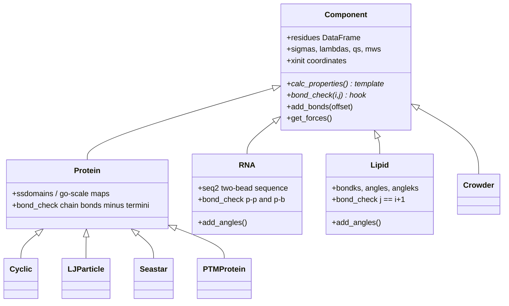
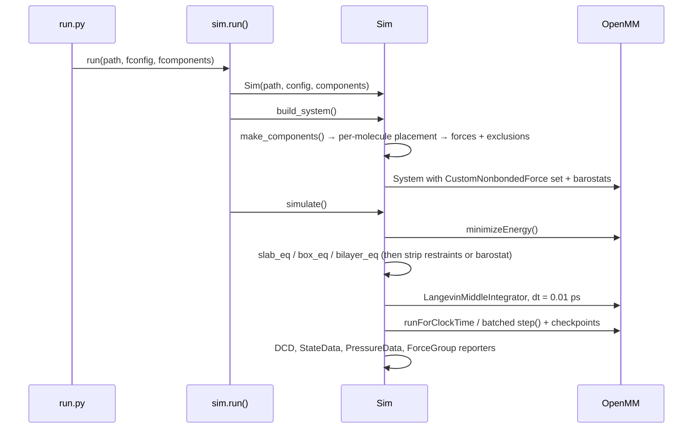

This page maps the internal architecture of **MEM-CALVADOS**, a Python framework for coarse-grained molecular dynamics of biomolecular condensates, intrinsically disordered proteins (IDRs), RNA, and lipid membranes built on top of **OpenMM**. It explains how the modules fit together, how control flows from YAML configuration files to a running simulation, and where each responsibility lives in the codebase. The goal is to give you a mental model you can carry into the deeper topic pages.

## Architectural Layers

The codebase follows a layered design with a strict dependency direction: a thin **configuration layer** produces declarative YAML, a **simulation engine** consumes it, and two horizontal support layers — a **component class hierarchy** and a **force-field factory** — supply the physics. A separate **analysis layer** operates on simulation output and is deliberately decoupled from the build/simulate path.



The dependency direction is one-way: `sim.py` imports `build` and `interactions`; `components.py` imports all three support modules; nothing in the physics layers imports the engine. This makes the component classes independently testable, which is exactly what `tests/test_potentials.py` and `tests/test_rna_bonds.py` exploit.
Sources: [__init__.py](calvados/__init__.py#L1-L12), [sim.py](calvados/sim.py#L13-L23), [components.py](calvados/components.py#L1-L9), [analysis.py](calvados/analysis.py#L1-L28)

## Module Responsibility Map

Each top-level module has a single, well-bounded role:

| Module | Role | Key entry points |
|---|---|---|
| `calvados/cfg.py` | Configuration objects, YAML I/O, job-script generation | `Config`, `Components`, `Job` |
| `calvados/components.py` | Molecule-type classes carrying per-residue parameters | `Component`, `Protein`, `RNA`, `Lipid`, … |
| `calvados/build.py` | Geometry primitives and placement algorithms | `build_spiral`, `geometry_from_pdb`, `random_placement` |
| `calvados/interactions.py` | OpenMM force object factories and parameter derivation | `genParamsDH`, `init_ah_interactions`, `init_yu_interactions` |
| `calvados/sequence.py` | Sequence sources, charge assignment, terminus patching | `read_fasta`, `get_qs`, `patch_terminal_qs` |
| `calvados/sim.py` | System assembly and OpenMM execution loop | `Sim.build_system`, `Sim.simulate`, `run` |
| `calvados/analysis.py` | Trajectory analysis on MDAnalysis/mdtraj objects | `calc_energy` (numba), analysis helpers |
| `calvados/BLOCKING/` | Statistical block analysis for error estimation | `BlockAnalysis` |
| `*_reporter.py` | Custom OpenMM reporters for force-group energies and pressure tensors | `PressureDataReporter`, `ForceGroupReporter` |

Sources: [cfg.py](calvados/cfg.py#L13-L146), [components.py](calvados/components.py#L11-L667), [sim.py](calvados/sim.py#L24-L881), [interactions.py](calvados/interactions.py#L4-L118), [analysis.py](calvados/analysis.py#L30-L60)

## Configuration Layer: Declarative Artifacts

The pipeline is driven by three YAML files, each backed by a package default in `calvados/data/`. The `Config` class loads `default_config.yaml` (system name, topology, cutoffs, steps, platform, equilibration flags) and overlays user-supplied keyword arguments; `Components` merges `default_component.yaml` with per-component overrides into a `system` dict; and `Job` renders a Jinja2 template from `data/templates` into a PBS or SLURM submission script. A notable pattern is that `Config.write()` also emits a generated `run.py` stub whose `--config`/`--components` arguments feed directly into `sim.run`, so a single `Config.write()` call produces everything needed to launch a job on a cluster.

```python
# What Config/Components/Job write, and what consumes them
config.yaml     ──┐
components.yaml ──┼──> sim.run(path, fconfig, fcomponents)
run.py          ──┘        └── job.sh submits run.py via sbatch/qsub
```

Sources: [cfg.py](calvados/cfg.py#L13-L38), [cfg.py](calvados/cfg.py#L64-L95), [cfg.py](calvados/cfg.py#L99-L131), [default_config.yaml](calvados/data/default_config.yaml#L1-L50). The configuration surface is documented in depth on [YAML Configuration System](5-yaml-configuration-system), and cluster submission on [Job Submission And Cluster Templates](18-job-submission-and-cluster-templates).

## Component Class Hierarchy: Template Method Pattern

Every bead type in a simulation is an instance of a subclass of `Component`. The base class implements a **template-method workflow**: `calc_properties()` orchestrates sequence resolution, per-residue array construction (`sigmas`, `lambdas`, `qs`, `mws`, `bondlengths`), initial geometry, and force initialization — while subclasses override narrow hooks such as `bond_check()`, `calc_bondlength()`, and `add_bonds()` to express molecule-specific topology rules. For example, the base `bond_check` returns `False` (no bonds), `Protein.bond_check` requires `j == i+1` and excludes chain termini, `Cyclic` adds the head-to-tail closure bond, and `Seastar` generalizes to a branched star topology computed from `n_ends`.



The `Sim.make_components()` dispatcher selects the subclass from the `molecule_type` field in `components.yaml` and pairs it with a default geometry strategy: proteins and crowders start `compact`, lipids `linear`, RNA `spiral` with two beads per nucleotide.
Sources: [components.py](calvados/components.py#L11-L64), [components.py](calvados/components.py#L220-L238), [components.py](calvados/components.py#L357-L380), [components.py](calvados/components.py#L558-L625), [components.py](calvados/components.py#L627-L667), [sim.py](calvados/sim.py#L55-L106). This hierarchy is unpacked on [Component Class Hierarchy](7-component-class-hierarchy).

> [!TIP]
> The exclusion maps returned by every `add_bonds()`/`add_restraints()` call are the glue between bonded and non-bonded physics: they travel from the component layer back to `Sim.add_exclusions()` so that covalent partners are removed from the Ashbaugh-Hatch and Yukawa neighbor lists. When adding a new component subclass, returning a correct exclusion map is as important as adding the bonds themselves.

## Force-Field Factory: Interactions Module

`interactions.py` is a factory of OpenMM `CustomNonbondedForce` objects, each encapsulating one potential energy term as a string expression. The physical model is the CALVADOS force field: **Ashbaugh-Hatch** for amino-acid interactions (per-particle `s`, `l`, and an `id` trick enabling protein-only variants), **Yukawa/Debye-Hückel** for electrostatics (parameters derived from temperature and ionic strength by `genParamsDH`, which computes the Bjerrum length from a water-dielectric polynomial), plus **WCA** and a **semi-attractive (SA)** term reserved for lipid systems, and tabulated **PMF** forces via `Continuous1DFunction` on a centroid-bond force.

| Force object | Expression type | Per-particle params | Used when |
|---|---|---|---|
| `ah` / `ah_pp` | Ashbaugh-Hatch (shifted LJ + `l`-interpolation) | `s`, `l` (`id` in protein variant) | always; `ah_pp` only with lipids |
| `yu` | Yukawa `q·ε·exp(−k·r)/r` | `q` | always (charged pairs) |
| `wca` | Weeks-Chandler-Andersen | `s` | lipid systems only |
| `sa` | semi-attractive tail `l·(3u²−2u³−1)` | `s`, `l`, `o` | lipid systems only |
| `hb`, `ha` | Harmonic bonds / angles | — | per-component bonded terms |
| `scLJ`, `scYU` | scaled LJ/Yukawa bonds | bond params | Go-restraint mixing region |

Sources: [interactions.py](calvados/interactions.py#L4-L15), [interactions.py](calvados/interactions.py#L40-L90), [interactions.py](calvados/interactions.py#L92-L118), [sim.py](calvados/sim.py#L160-L180). Potential forms and their mathematics are treated on [Ashbaugh-Hatch And Yukawa Potentials](10-ashbaugh-hatch-and-yukawa-potentials) and [Lipid Interactions: WCA And SA Terms](11-lipid-interactions-wca-and-sa-terms).

## Simulation Engine: Assembly and Execution

`sim.py` is the orchestrator and the largest module (~880 lines). Its lifecycle has three phases, invoked by the module-level `run()` function: parse YAML into attributes, `build_system()`, `simulate()`. During **assembly**, `build_system` sets the periodic box vectors, derives Debye-Hückel parameters, instantiates components, selects the interaction set (protein-only systems get `ah + yu`; lipid systems additionally get `wca`, `ah_pp`, and `sa`), classifies every bead into index sets (protein, lipid, TMT-polarity classes, charged), assigns OpenMM **force groups** (0: WCA, 1: AH pairs, 2: SA, 3: Yukawa), and places molecules via topology grids — `slab`, `grid`, `xy` bilayer, or random placement with clash rejection. All forces are then attached through `add_forces_to_system()`, which also mounts barostats (`MonteCarloBarostat` for box equilibration, `MonteCarloMembraneBarostat` with `XYIsotropic`/`ZFixed` for bilayers) and serializes the system to XML for reproducibility.



During **execution**, `simulate()` handles restart semantics (`pdb` vs `checkpoint`), energy minimization, staged equilibration — slab equilibration temporarily pins molecules to the box center with `CustomExternalForce`, then rebuilds the context after removing that force; box/bilayer pressure equilibration likewise removes the barostat afterward unless `pressure_coupling` is on — and finally attaches reporters. The trajectory (.dcd), log, per-force-group energies (`ForceGroupReporter`), and pressure tensors (`PressureDataReporter`, backed by a custom `CustomIntegrator` accumulating kinetic-stress sums) are all streamed to disk during the run, with periodic checkpointing every 30 minutes under wall-clock limits.
Sources: [sim.py](calvados/sim.py#L24-L54), [sim.py](calvados/sim.py#L138-L206), [sim.py](calvados/sim.py#L221-L304), [sim.py](calvados/sim.py#L317-L372), [sim.py](calvados/sim.py#L637-L731), [sim.py](calvados/sim.py#L733-L769), [sim.py](calvados/sim.py#L829-L881). The full workflow is detailed on [Sim Class Workflow](16-sim-class-workflow) and [OpenMM Integration And Reporters](17-openmm-integration-and-reporters).

> [!TIP]
> Because force groups are fixed by the assembly code (AH=0/1, SA=2, YU=3), enabling `report_potential_energy` gives you per-potential energy decomposition for free via `ForceGroupReporter`. If you reorganize force groups, you must update both `build_system()` and the reporter file names in `simulate()` to keep logs meaningful.

## Analysis Layer: Decoupled Post-Processing

Analysis is intentionally separated from the simulation path. `analysis.py` builds on MDAnalysis, mdtraj, and numba (e.g., a JIT-compiled AH+YU energy evaluator over distance maps), imports `BlockAnalysis` from the vendored `calvados/BLOCKING/` subpackage for statistical error estimation, and reuses `get_ssdomains` from `build.py` so domain definitions stay consistent between restraints and analysis. There is no import from `sim.py`, which means analysis can run on trajectories produced anywhere, on machines without OpenMM.
Sources: [analysis.py](calvados/analysis.py#L1-L28), [analysis.py](calvados/analysis.py#L49-L60). Continue with [Trajectory Analysis Functions](19-trajectory-analysis-functions), [Membrane Property Profiles](20-membrane-property-profiles), and [Block Analysis And Error Estimation](21-block-analysis-and-error-estimation).

## Visual Project Structure

An annotated view of the repository, aligned with the layers above:

```
calvados/                    # the Python package (one import in __init__ wires all layers)
├── cfg.py                   # Layer 1: Config / Components / Job → YAML + job.sh
├── sim.py                   # Layer 2: Sim.build_system + Sim.simulate + run()
├── components.py            # Layer 3a: Component hierarchy (template methods)
├── interactions.py          # Layer 3b: OpenMM force factories
├── build.py                 # Layer 3c: geometry primitives, placement, AF maps
├── sequence.py              # Layer 3d: FASTA/PDB sequences, pH charges
├── analysis.py              # Layer 4: trajectory analysis (MDAnalysis/numba)
├── BLOCKING/                # Layer 4: block analysis (vendored subpackage)
├── forcegroupreporter.py    # Layer 2 support: per-force-group energy reporter
├── pressuredatareporter.py  # Layer 2 support: pressure tensor reporter
└── data/                    # defaults: default_config.yaml, default_component.yaml,
                             #   default_job.yaml, residues.csv, job templates/
examples/                    # Layer 1 usage: one prepare.py per scenario
tests/                       # Layer 3 unit tests (potentials, restraints, RNA bonds)
```

Sources: [calvados/__init__.py](calvados/__init__.py#L1-L12), [cfg.py](calvados/cfg.py#L24-L38)

## Suggested Reading Progression

This overview gave you the map; the catalog then descends from configuration to physics to execution. A productive order for intermediate developers:

1. [YAML Configuration System](5-yaml-configuration-system) — the `Config`/`Components`/`Job` triad and every default.
2. [Component Class Hierarchy](7-component-class-hierarchy) and [Initial Geometry And Placement](8-initial-geometry-and-placement) — the template-method design in detail.
3. [Ashbaugh-Hatch And Yukawa Potentials](10-ashbaugh-hatch-and-yukawa-potentials) and [Force Groups And Interaction Exclusions](12-force-groups-and-interaction-exclusions) — the physics and its OpenMM mapping.
4. [Sim Class Workflow](16-sim-class-workflow) and [OpenMM Integration And Reporters](17-openmm-integration-and-reporters) — the engine internals summarized above.
5. [Trajectory Analysis Functions](19-trajectory-analysis-functions) and [Block Analysis And Error Estimation](21-block-analysis-and-error-estimation) — the post-processing layer.
6. For hands-on entry points, return to [Quick Start](2-quick-start) and [Example Workflows Tour](3-example-workflows-tour), which exercise the `prepare.py` → `run.py` pipeline end to end.
