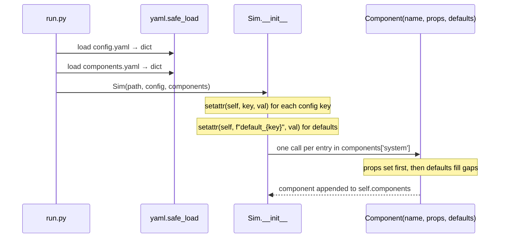

The YAML configuration system is the declarative backbone of MEM-CALVADOS: every simulation is defined by plain-text YAML files rather than imperative Python setup code. This page explains the three configuration classes that *produce* these files (`Config`, `Components`, `Job`), the merge semantics that govern how defaults and user overrides interact, and how the simulation engine *consumes* the resulting files at runtime. The scope here is strictly the configuration layer — force field parameters themselves are covered in [Ashbaugh-Hatch And Yukawa Potentials](10-ashbaugh-hatch-and-yukawa-potentials), and the downstream build/simulate pipeline in [Sim Class Workflow](16-sim-class-workflow).

Sources: [cfg.py](calvados/cfg.py#L1-L147), [default_config.yaml](calvados/data/default_config.yaml#L1-L50)

## Architecture: A Two-Phase Producer/Consumer Design

The system follows a clean separation between *preparation* and *execution*. In the preparation phase, a user script (typically `prepare.py`) instantiates the three configuration classes and writes YAML files plus launcher scripts into a run directory. In the execution phase — which may happen on a remote cluster hours later — `run.py` reloads those YAML files as flat dictionaries and hands them to the `Sim` engine. This design means a simulation is fully specified by its directory contents, making runs reproducible, inspectable, and cluster-portable.

```mermaid
flowchart LR
    subgraph prep ["Phase 1: Preparation (prepare.py)"]
        C["Config(**kwargs)"] -->|writes| CC["config.yaml"]
        C -->|writes| RP["run.py"]
        K["Components(**defaults)"] -->|defaults block| KY["components.yaml"]
        K -->|add(named)| KY
        J["Job(**kwargs)"] -->|renders Jinja| JS["job.sh"]
    end
    subgraph pkg ["Package Data (read-only defaults)"]
        D1["default_config.yaml"]
        D2["default_component.yaml"]
        D3["default_job.yaml"]
        D4["templates/*.jinja"]
    end
    subgraph run ["Phase 2: Execution (cluster)"]
        RP -->|yaml.safe_load| S["Sim(path, config, components)"]
        CC --> S
        KY --> S
        JS -->|sbatch/qsub| RP
    end
    D1 --> C
    D2 --> K
    D3 --> J
    D4 --> J
```

Reading the diagram left to right: package-shipped defaults flow into the configuration classes at construction time, user keyword arguments override them, and the merged result is serialized to the run directory. The `run.py` script and `job.sh` submission script form the bridge between phases — the latter is what a cluster scheduler ultimately executes.

Sources: [cfg.py](calvados/cfg.py#L13-L131), [sim.py](calvados/sim.py#L871-L881), [robust.jinja](calvados/data/templates/robust.jinja#L1-L27)

A subtle but important detail: all defaults are loaded through `importlib.resources.files('calvados')` rather than relative file paths. This means defaults resolve against the *installed package location*, so the system works identically whether running from a source checkout or a pip-installed environment.

Sources: [cfg.py](calvados/cfg.py#L16-L17), [cfg.py](calvados/cfg.py#L66-L67), [cfg.py](calvados/cfg.py#L102-L103)

## The Config Class: Simulation-Level Settings

`Config` governs everything that describes the *system as a whole*: physical conditions (temperature, ionic strength, pH), force field parameters (εLJ, cutoffs), runtime behavior (step count, write frequency, platform), and equilibration flags. Construction follows a strict pattern — the package default file is loaded first, then every keyword argument overwrites the corresponding key via a shallow assignment loop:

```python
config = Config(
  sysname = sysname,
  box = [L, L, L],          # nm
  temp = 293.15,            # K
  ionic = 0.19,             # M
  pH = 7.5,
  ...
)
config.write(path, name='config.yaml', analyses=analyses)
```

Sources: [cfg.py](calvados/cfg.py#L13-L38), [single_IDR/prepare.py](examples/single_IDR/prepare.py#L26-L43)

Notably, the default `config.yaml` does not contain `box`, `temp`, `ionic`, or `pH` — these keys exist only because the example supplies them. Keys absent from *both* the defaults file and your kwargs will surface later as `AttributeError` when `Sim.__init__` tries to promote them to attributes. The 50 keys that ship as defaults fall into six functional groups:

| Category | Representative Keys | Purpose |
|---|---|---|
| Force field | `eps_lj`, `cutoff_lj`, `cutoff_yu`, `fixed_lambda` | Interaction strengths and range truncation |
| Runtime | `steps`, `wfreq`, `platform`, `threads`, `runtime`, `restart`, `frestart` | Simulation length, output cadence, hardware |
| Equilibration | `slab_eq`, `bilayer_eq`, `box_eq`, `pressure_coupling`, `steps_eq`, `k_eq` | Multi-stage relaxation protocols |
| Pressure control | `pressure`, `boxscaling_xyz`, `pressure_ramp`, `pressure_max`, `pressure_tensor` | Barostat configuration and diagnostics |
| Restraints/PMF | `custom_restraints`, `custom_restraint_type`, `fcustom_restraints`, `pmf_force`, `fpmf` | External file-driven biasing |
| Placement/geometry | `topol`, `slab_width`, `slab_outer`, `ext_force`, `ext_force_expr` | Initial topology and boundary forces |

Sources: [default_config.yaml](calvados/data/default_config.yaml#L1-L50)

Two conditional flags deserve special attention because they switch on entire subsystems. Setting `pressure_tensor: true` swaps the integrator from Langevin to a custom velocity-Verlet `CustomIntegrator` with kinetic-energy bookkeeping, and `slab_eq: true` activates slab restraints that are later removed from the system before production. These booleans are read by `Sim.__init__` at load time and branch into fundamentally different simulation code paths.

Sources: [sim.py](calvados/sim.py#L41-L53), [sim.py](calvados/sim.py#L772-L827)

> [!TIP]
> Watch for a unit-conversion subtlety: `eps_lj` is specified in the config in kcal/mol, and `Sim.__init__` multiplies it by 4.184 to convert to OpenMM's kJ/mol. If you ever read `sim.eps_lj` mid-run, you are seeing converted units, not the YAML value.

### Code Generation as a Side Effect

`Config.write()` does more than dump YAML — it also generates a `run.py` launcher into the same directory. This generated script embeds a hardcoded call to `sim.run(path, fconfig, fcomponents)` and appends any user-supplied analysis code (passed via the `analyses` string). This is why example scripts define multi-line `analyses` strings importing post-processing functions like `save_conf_prop`: the analysis is scheduled to run *after* the trajectory completes, in the same cluster job.

Sources: [cfg.py](calvados/cfg.py#L24-L60), [single_IDR/prepare.py](examples/single_IDR/prepare.py#L50-L57)

## The Components Class: Defaults Plus Named Overrides

Where `Config` describes one flat parameter set, `Components` manages a *two-section* document. The serialized `components.yaml` always has the same shape: a `defaults` block populated from `default_component.yaml` (merged with constructor kwargs), and a `system` block holding one entry per named component added via `add()`. The `add()` method strips the `name` key and stores the remainder as the component's property dict — so `components.add(name='A1')` with no other arguments produces a component inheriting everything from defaults.

Sources: [cfg.py](calvados/cfg.py#L64-L95), [default_component.yaml](calvados/data/default_component.yaml#L1-L44)

The component defaults cover per-molecule concerns that `Config` cannot express: molecular identity (`molecule_type`, `nmol`), input sources (`ffasta`, `fcharges`, `pdb_folder`), charge assignment (`charge_termini`, `alpha`, `pH`-related terminal patching), restraint strategies (`restraint`, `restraint_type`, `k_harmonic`, `k_go`), AlphaFold-derived restraints (`colabfold`, `bfac_shift`, `pae_width`), RNA bond parameters (`rna_kb1`, `rna_ka`), and placement rules (`random`, `subvolume`, `pos_bead`, `fixed_bead`). The full class hierarchy that interprets `molecule_type` — dispatching to `Protein`, `Lipid`, `RNA`, `Crowder`, and seven other types — is documented in [Component Class Hierarchy](7-component-class-hierarchy).

Sources: [default_component.yaml](calvados/data/default_component.yaml#L1-L44), [sim.py](calvados/sim.py#L55-L92)

One deliberate omission matters for correctness: `fresidues` has no entry in `default_component.yaml`. The residue parameter table (which defines σᵢ, λᵢ, charges, and masses per amino acid) must be supplied explicitly — either as a `Components()` constructor kwarg or per component. If missing, `Component.__init__` raises a `FileNotFoundError` with a message naming the offending component, a guard enforced by catching the resulting `AttributeError` during CSV lookup.

Sources: [cfg.py](calvados/cfg.py#L37), [components.py](calvados/components.py#L14-L30)

### Merge Precedence at Three Layers

The defaults-overrides pattern recurs at every layer of the stack, and understanding its order is essential when debugging why a parameter "didn't take." The merge is always *shallow* — a full key replacement, never a recursive dict merge — and always resolves in the same direction:

| Layer | Base (loses) | Override (wins) | Mechanism |
|---|---|---|---|
| `Config.__init__` | `default_config.yaml` | constructor kwargs | loop assignment `config[key] = val` |
| `Components.__init__` | `default_component.yaml` | constructor kwargs | loop assignment on the `defaults` dict |
| Per-component entry | inherited `defaults` | keys in `components['system'][name]` | `if key not in properties` fallback |
| `Job.__init__` | `default_job.yaml` + injected `folder` | constructor kwargs | loop assignment on `settings` |

Sources: [cfg.py](calvados/cfg.py#L20-L22), [cfg.py](calvados/cfg.py#L86-L95), [components.py](calvados/components.py#L17-L24), [cfg.py](calvados/cfg.py#L99-L107)

The third row is the most consequential: a per-component key only shadows the default if it is *present in the component's own property dict*. This is implemented not at YAML-load time but inside `Component.__init__` — component properties are `setattr`-ed first, then defaults fill only the gaps. In practice this means you can define a system-wide default like `nmol: 50` and override it to `nmol: 1` for a single named component without touching anything else.

Sources: [components.py](calvados/components.py#L17-L24)

## Runtime Consumption: From YAML Keys to Object Attributes

The execution phase begins in `sim.run()`, which performs two bare `yaml.safe_load` calls and passes the resulting dicts straight into `Sim.__init__`. There, the configuration is materialized through attribute promotion: every config key becomes a `Sim` attribute, every `defaults` key becomes a `default_`-prefixed attribute, and `components['system']` becomes `comp_dict`. There is no schema validation — the YAML *is* the interface contract.



Sources: [sim.py](calvados/sim.py#L871-L881), [sim.py](calvados/sim.py#L24-L53), [components.py](calvados/components.py#L14-L24)

This attribute-promotion pattern has a practical consequence for extension: adding a new config key requires no changes to the parsing layer. You add the key to `default_config.yaml`, reference `self.new_key` wherever it is needed, and the `setattr` loop wires it up automatically. The same applies to component properties — `molecule_type` dispatch in `make_components` uses `properties.get(...)` with defaults-based fallback, so unrecognized component types degrade gracefully to the generic `Component` class rather than crashing.

Sources: [sim.py](calvados/sim.py#L31-L38), [sim.py](calvados/sim.py#L59-L92)

## The Job Class: Jinja-Templated Cluster Submission

The `Job` class closes the loop by turning configuration into an executable cluster artifact. Its settings are minimal — batch system (`SLURM` or `PBS`), conda environment name, template file name, and the path to source in `.bashrc` — and it auto-injects the package's `data/templates` directory as the template search folder. `Job.write()` renders the chosen Jinja2 template with a merged namespace: `**self.settings` (job parameters) plus `**config.config` (every simulation parameter), plus explicit `fconfig`, `fcomponents`, and `path` bindings. Because the *entire config* is in scope, templates can branch on simulation settings — `robust.jinja` requests a GPU resource only when `platform == 'CUDA'`, otherwise falling back to `--cpus-per-task={{threads}}`.

Sources: [cfg.py](calvados/cfg.py#L99-L121), [default_job.yaml](calvados/data/default_job.yaml#L1-L5), [robust.jinja](calvados/data/templates/robust.jinja#L7-L26)

The repository ships three templates targeting different sites — `robust.jinja`, `computerome.jinja`, and `deic.jinja` — selectable via the `template` key. Submission itself is a thin `os.system` wrapper: `sbatch` for SLURM, `qsub` for PBS, with PBS restricted to single jobs and a 0.5-second sleep between submissions when batching multiple jobs. Cluster-specific configuration strategies are covered further in [Job Submission And Cluster Templates](18-job-submission-and-cluster-templates).

Sources: [cfg.py](calvados/cfg.py#L109-L131), [templates/](calvados/data/templates)

## Putting It Together: A Complete Preparation Script

The canonical usage from `examples/single_IDR/prepare.py` compresses the entire system into three constructions and two writes. First, `Config` receives the physical and runtime settings; second, `Components` receives per-molecule defaults plus input file paths, then `add(name=...)` registers the molecule; finally both are written, producing `config.yaml`, `components.yaml`, and `run.py` in the run directory. A `Job` object would optionally be created and written to add `job.sh` for cluster execution.

| Step | Call | Files Produced |
|---|---|---|
| 1 | `Config(**kwargs)` then `.write(path, analyses=...)` | `config.yaml`, `run.py` |
| 2 | `Components(**defaults)` then `.add(name=...)`, `.write(path)` | `components.yaml` |
| 3 | `Job(**kwargs)` then `.write(path, config, components)` | `job.sh` |

Sources: [single_IDR/prepare.py](examples/single_IDR/prepare.py#L26-L73), [cfg.py](calvados/cfg.py#L24-L30)

> [!TIP]
> The `analyses` string passed to `Config.write()` is raw code text injected into the generated `run.py` — it executes inside the simulation job, inheriting the cluster allocation. Use it for trajectory post-processing that needs the same environment, but keep it idempotent: if the job restarts from a checkpoint, the appended analysis code runs again.

## Summary: Design Properties and Trade-offs

The configuration system favors *explicitness over validation*. Because `Sim` blindly promotes YAML keys to attributes, there is no schema enforcement, no type checking, and no warning for misspelled keys — a typo like `wfreq` written as `wfrew` will silently produce a `Sim` lacking that attribute, failing only when first dereferenced. The compensating virtues are zero-boilerplate extensibility, human-readable run directories that double as complete experiment records, and clean decoupling of preparation (your laptop) from execution (the cluster).

| Property | Behavior | Implication |
|---|---|---|
| Merge depth | Shallow (key-level) | Nested structures replaced wholesale, not merged |
| Validation | None at load; guarded only where enforced | `fresidues` missing → explicit `FileNotFoundError` |
| Serialization | `yaml.dump`; components preserve insertion order (`sort_keys=False`) | `components.yaml` readable in definition order |
| Extension | Add key to defaults + reference as attribute | No parser changes needed |
| Portability | Defaults via `importlib.resources` | Works from source tree or installed package |

Sources: [cfg.py](calvados/cfg.py#L20-L22), [cfg.py](calvados/cfg.py#L80-L84), [sim.py](calvados/sim.py#L31-L33), [components.py](calvados/components.py#L26-L30)

To see how the parsed configuration drives system construction, continue to [Component Class Hierarchy](7-component-class-hierarchy) for the `molecule_type` dispatch, [Sim Class Workflow](16-sim-class-workflow) for the build/simulate lifecycle, or revisit [Quick Start](2-quick-start) for a hands-on run-through of the preparation phase.