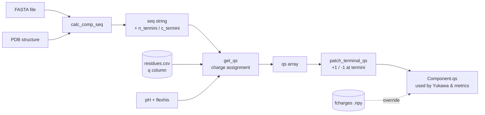
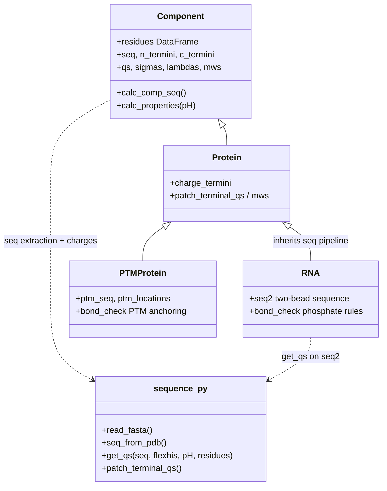

This page explains how MEM-CALVADOS converts raw sequence input (FASTA files or PDB structures) into the per-bead parameter arrays — charges, masses, sizes, hydropathies — that drive the coarse-grained model. It covers the sequence I/O utilities, the residue parameter tables that serve as the single source of truth for charge states, the pH-dependent histidine treatment, terminus patching, charge overrides, and the component-specific sequence expansions for RNA and PTM-labeled proteins.

## Sequence Input: FASTA and PDB Extraction

Every component's sequence originates from one of two input paths, selected in `Component.calc_comp_seq`. The FASTA path is the default: `read_fasta` parses the file into a BioPython dictionary keyed by record ID, and the component looks itself up by name (`records[self.name].seq`). For a plain chain, the termini are trivially the first and last residues — `n_termini = [0]` and `c_termini = [len(self.seq)-1]` — a bookkeeping detail that matters later when terminal charges are patched.

The PDB path is taken when a component carries structural restraints. `seq_from_pdb` opens the structure with MDAnalysis and, crucially, does **not** assume residues are numbered from 1: it walks each segment and accumulates residue indices to compute explicit N- and C-terminus positions for every chain. Three-letter residue names are converted to one-letter codes via a `convert_aa_code` dictionary, which the calling component builds directly from its residue table (the `three` → `one` mapping); unrecognized names map to `X`. The function returns the sequence string plus the termini index lists, so multi-segment PDBs (e.g., oligomeric assemblies) receive correct terminal patches per chain.

Sources: [components.py](calvados/components.py#L32-L42), [sequence.py](calvados/sequence.py#L30-L32), [sequence.py](calvados/sequence.py#L34-L64)

Two auxiliary utilities round out the I/O layer: `write_fasta` merges new records into an existing FASTA while skipping duplicate IDs, and `record_from_seq` wraps a plain string into a `SeqRecord` for output. These support the sequence-design workflows described later on this page.

Sources: [sequence.py](calvados/sequence.py#L66-L88)

## The Residue Parameter Table: Single Source of Truth

Charge states are **never hard-coded into components**. Instead, each component carries a `fresidues` path to a CSV file that `Component.__init__` loads via pandas and indexes by the one-letter code column (`set_index('one')`). A missing `fresidues` raises a `FileNotFoundError` at construction time — the model refuses to build without an explicit residue table.

Sources: [calvados/components.py](calvados/components.py#L26-L30)

The package ships two tables. The bundled default (`calvados/data/residues.csv`) covers the 20 standard amino acids with columns `three,one,MW,lambdas,sigmas,q,bondlength`. The root-level `residues.csv` is the extended CALVADOS 3 table: it adds bonded parameters (`bondk`, `angle`, `anglek`) and contextual metrics (`omega`, `TMT`), plus six non-standard residues — `B`/SEB, `O`/CHO (**q = +1**), `J`/PHO (**q = −1**), `U`/MID, `Z`/TPO, `X`/TDO — used for lipid-mimetic and PTM beads. Note the two files use *opposite* column orderings for the code columns (`three,one,...` vs `one,three,...`); the pandas index set on `one` makes this transparent to downstream code.

| Column | Meaning | Consumed by |
|---|---|---|
| `one` / `three` | 1- and 3-letter codes | index; 3→1 map for PDB input |
| `MW` | residue mass (Da) | `calc_mw`, terminus patching |
| `lambdas` | hydropathy λ (Ashbaugh–Hatch) | AH potential parameterization |
| `sigmas` | bead diameter (nm) | AH/Yukawa pair parameters |
| `q` | formal charge state (e) | Yukawa electrostatics, SCD, κ |
| `bondlength` | virtual-bond length (nm) | initial geometry |
| `bondk`, `angle`, `anglek` | bonded terms (extended table) | `Lipid` bond/angle forces |
| `omega`, `TMT` | contextual metrics (extended table) | optional per-residue arrays |

Sources: [calvados/data/residues.csv](calvados/data/residues.csv#L1-L21), [residues.csv](residues.csv#L1-L27)

> [!TIP]
> Because charges live in a user-suppliable CSV, swapping `fresidues` to a custom table (like `residues_C2RNA.csv` in the RNA examples) changes electrostatic behavior system-wide without touching any Python. Validate the `q` column against your intended force field version before comparing trajectories across studies.

## Charge Assignment: The Dual-Path `get_qs`

The central routine is `get_qs(seq, flexhis, pH, residues)`, which returns the per-residue charge array and its absolute value. It dispatches on one criterion: whether a residues DataFrame was passed. Components always pass one (`get_qs(self.seq, flexhis=True, pH=pH, residues=self.residues)`), so the table lookup path dominates in practice; the table-free fallback exists for standalone sequence analysis.

**Table path.** Each residue's charge is `residues.loc[s].q` — i.e., whatever the CSV declares. The single exception is histidine under `flexhis=True`: instead of the table's `q = 0`, histidine receives the pH-dependent partial charge

`q(H) = 1 / (1 + 10^(pH − 6))`

a Henderson–Hasselbalch form with a pKa of 6. At the default pH 7 this yields ≈ +0.091 e, so histidines are weakly positive rather than neutral. Both `Component.calc_properties` and the RNA component call `get_qs` with `flexhis=True` hard-wired.

**Fast path.** `get_qs_fast` is a numba-JIT function implementing the same convention from hard-coded residue classes: `R`, `K` → +1; `E`, `D` → −1; and — a deliberate convention — lowercase `p` → −1, representing a phosphorylated residue; everything else neutral, with histidine again pH-scaled when `flexhis` is set. This path is used by charge-sensitive sequence metrics (`calc_SCD`, `calc_qpatch`, the fast-kappa machinery) where table lookups would be the bottleneck.

| Residue | Table path (`residues.csv`) | Fast path (`get_qs_fast`) |
|---|---|---|
| `R`, `K` (ARG, LYS) | +1 | +1 |
| `D`, `E` (ASP, GLU) | −1 | −1 |
| `H` (HIS), `flexhis=True` | +1/(1+10^(pH−6)) ≈ 0.09 at pH 7 | same formula |
| `H` (HIS), `flexhis=False` | 0 (table value) | 0 |
| `p` (lowercase, phospho) | requires table entry | −1 |
| `O`/CHO (choline, extended table) | +1 | 0 (not recognized) |
| `J`/PHO (phosphate, extended table) | −1 | 0 (not recognized) |
| All other standard residues | 0 (table value) | 0 |

Sources: [sequence.py](calvados/sequence.py#L92-L130), [calvados/components.py](calvados/components.py#L57), [calvados/components.py](calvados/components.py#L326)

> [!TIP]
> The case sensitivity of `p` versus `P` is load-bearing: `P` is proline (neutral), while lowercase `p` is the phosphorylation proxy carrying −1 in the fast path and the phosphate bead letter in RNA sequences. Mixing cases in a FASTA will silently change your charge profile.

## Terminal Charge Patching

The residue table's `q` column describes **backbone-free side-chain charges**. Real peptides carry ionizable termini, so after `get_qs`, `Protein.calc_properties` calls `patch_terminal_qs` with the component's `n_termini`/`c_termini` index lists. The `charge_termini` setting (default `'both'` in `default_component.yaml`) controls which termini are patched: `'N'` adds +1 to every N-terminus, `'C'` subtracts 1 from every C-terminus, and `'both'` does both, leaving a neutral-protein net charge shifted by 0 only for sequences with equal counts of both termini. Masses are patched in lockstep by `patch_terminal_mws` (+2 Da at N, +16 Da at C), keeping molecular-weight reporting consistent with the charged model.

This two-stage design — table lookup then index-based patching — is what makes the multi-segment bookkeeping from `seq_from_pdb` meaningful: a dimeric PDB input gets +1/−1 on *each* chain's termini, not just the global first and last residues.

Sources: [calvados/components.py](calvados/components.py#L177-L186), [sequence.py](calvados/sequence.py#L132-L148), [calvados/data/default_component.yaml](calvados/data/default_component.yaml#L4)

## Explicit Charge Overrides: `fcharges`

When full control is needed — modified residues, custom protonation, experimental constraints — a component may set `fcharges` to the path of a `.npy` file. In `calc_properties`, a non-`None` `fcharges` short-circuits the entire `get_qs` + terminus patching pipeline: `self.qs = np.load(self.fcharges)`. The loaded array then feeds the Yukawa electrostatic interactions exactly like a computed one, but nothing validates its length against `nbeads` at this stage, so the file must match the bead count of the sequence. The default component template ships `fcharges: null`, making table-derived charges the norm.

Sources: [calvados/components.py](calvados/components.py#L56-L59), [calvados/data/default_component.yaml](calvados/data/default_component.yaml#L8)

## Sequence-Level Electrostatic Metrics

The charge arrays produced above feed a family of analytical descriptors used to characterize (and design) sequences. These operate purely on sequence order — no 3D structure involved:

- **SCD** (`calc_SCD`, numba-JIT): sequence charge decoration from Sawle & Ghosh (JCP 2015), eq. 14 — sums `q_i·q_j·|i−j|^0.5` over all pairs, normalized by N. Positive SCD indicates attractions between like-charge blocks relevant to condensation.
- **Charge dipole** (`seq_dipole` / `seq_com`): computes the charge-weighted center and the first moment of charge along the sequence, positive when positive charge dominates toward the N-terminus.
- **κ** (`calc_kappa`): delegates to the `localcider` library's `get_kappa` (Das & Pappu) — charge segregation degree.
- **Charge patchiness** (`calc_qpatch`): an electrostatic self-energy over a sequence-distance map, with optional terminus charges, normalized by the pair count.
- **Pair-energy previews**: `q_pairs` builds a `q_i·q_j` map, scales it by the Debye–Hückel dielectric factor from `interactions.genParamsDH(temp, ionic)`, and evaluates a Yukawa-energy proxy on a worm-like-chain distance profile `r = r0·|i−j|^β` — a pre-simulation estimate of electrostatic self-energy.

Sources: [sequence.py](calvados/sequence.py#L190-L200), [sequence.py](calvados/sequence.py#L150-L172), [sequence.py](calvados/sequence.py#L248-L252), [sequence.py](calvados/sequence.py#L333-L348), [sequence.py](calvados/sequence.py#L416-L450)

## Sequence Design Utilities

Beyond analysis, `sequence.py` provides a small metropolis-driven design loop. `split_seq` partitions a sequence into positive (`K`, `R`), negative (`D`, `E`), and neutral residues, shuffling each class; `construct_maxdipseq` assembles `positive + neutral + negative` to maximize charge dipole. `single_swap` performs random position exchanges and reports whether the swap involved a charged residue (`charge_swap`), which lets callers accept only charge-preserving moves. The `metropolis` function applies a Boltzmann-like acceptance test on penalty energies such as `dip_energy` (quadratic in reduced dipole) and `k_energy` (quadratic in κ), enabling sequence generation with target charge patterning.

Sources: [sequence.py](calvados/sequence.py#L254-L282), [sequence.py](calvados/sequence.py#L284-L323), [sequence.py](calvados/sequence.py#L299-L311)

## Component-Specific Sequence Expansions

Not all components map one sequence letter to one bead. Two subclasses override `calc_comp_seq` to reshape the sequence before charge assignment:

**RNA** converts each nucleotide letter `s` into a two-bead motif: `seq2 += f'p{s}'`. The result is an alternating phosphate–base chain where even indices are phosphate beads (`i % 2 == 0`) and odd indices are bases. All per-bead arrays — `sigmas`, `lambdas`, `bondlengths`, `mws`, and charges via `get_qs` — are computed from `seq2`, and `nbeads` becomes `len(seq2)` (twice `nres`). This means the phosphate beads' charge states come from the residue table's `p` entry — requiring an RNA-specific table (such as the `residues_C2RNA.csv` shipped with the RNA example), since the standard 20-amino-acid table has no `p` row.

**PTMProtein** appends a post-translational-modification sub-sequence read from the same FASTA under the key `ptm_name`. For each entry in `ptm_locations` (1-based positions on the protein), the PTM sequence is concatenated to the main sequence, extending `nbeads_protein` → `len(seq)`. The custom `bond_check` then connects protein residues linearly, bonds the PTM's first bead to its anchor position (`ptm_loc − 1`), and chains PTM beads together while excluding bonds between *different* PTM copies. Because charges are computed after this expansion (in the inherited `calc_properties`), PTM beads inherit whatever `q` values the chosen residues table declares for their letters — e.g., +1 for CHO or −1 for PHO in the extended table.

Sources: [calvados/components.py](calvados/components.py#L345-L356), [calvados/components.py](calvados/components.py#L315-L330), [calvados/components.py](calvados/components.py#L633-L645), [calvados/components.py](calvados/components.py#L647-L666)

## How Charges Reach the Simulation

The final `qs` array is consumed downstream in two directions. Within force construction, each pair of charged beads contributes a Yukawa (screened Coulomb) term with per-residue `q` entering the parameter expression — details of which belong to [Ashbaugh-Hatch And Yukawa Potentials](10-ashbaugh-hatch-and-yukawa-potentials) and [Force Groups And Interaction Exclusions](12-force-groups-and-interaction-exclusions). The scaled restraint path also consults charges directly: during Go-restraint setup, `add_scaled_yu` pairs are only added where `self.qs[i] * self.qs[j] != 0` — a nonzero-charge product gate applied to weakly restrained contacts.

The component type dispatching (which subclass processes a given `molecule_type` from the components YAML) is covered in [Component Class Hierarchy](7-component-class-hierarchy), and how `fresidues`, `fcharges`, and `charge_termini` are configured per-component in YAML is covered in [YAML Configuration System](5-yaml-configuration-system).

Sources: [calvados/components.py](calvados/components.py#L272-L274)

## Summary: The Charge Pipeline at a Glance

| Stage | Function | Input → Output |
|---|---|---|
| 1. Input parse | `read_fasta` / `seq_from_pdb` | FASTA or PDB → `seq`, termini lists |
| 2. Table load | `Component.__init__` | `fresidues` CSV → indexed DataFrame |
| 3. Per-residue lookup | `calc_properties` | seq + table → σ, λ, MW, bond length arrays |
| 4. Charge assignment | `get_qs` / `get_qs_fast` | seq + table + pH → `qs`, `qs_abs` |
| 5. Terminus patch | `patch_terminal_qs` / `_mws` | `qs` + termini lists → patched charges/masses |
| 6. Override (optional) | `np.load(fcharges)` | `.npy` file → replaces stages 4–5 |
| 7. Expansion (RNA/PTM) | subclass `calc_comp_seq` | reshaped seq → re-run stages 3–5 |
