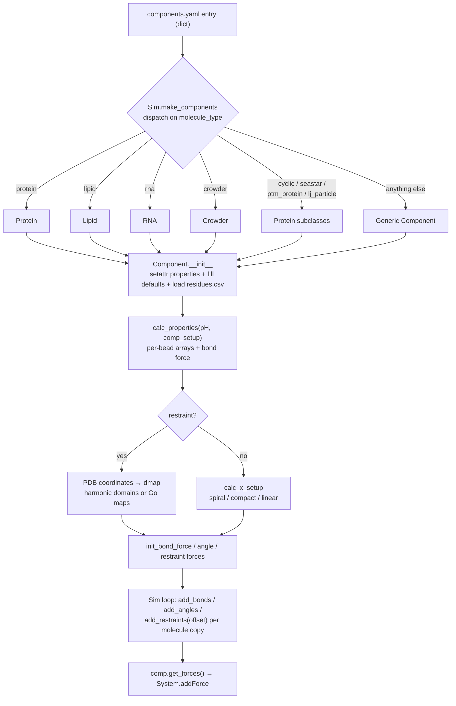
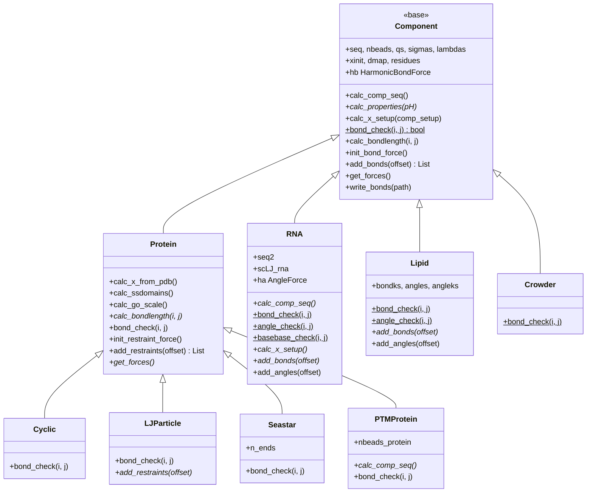

This page explains how CALVADOS models every species in a simulation — proteins, RNA, lipids, crowders, and their specialized variants — as a **Component** object, and how a single inheritance tree turns declarative YAML entries into OpenMM bonded forces, restraints, and particle arrays. It covers the base class contract, the template-method pattern that subclasses implement, the concrete class gallery, and the offset/exclusion mechanics that hand component-local data to the system builder. For the surrounding machinery, see [Architecture Overview](4-architecture-overview), [YAML Configuration System](5-yaml-configuration-system), and [Sim Class Workflow](16-sim-class-workflow).

## Where Components Sit in the Build Pipeline

A simulation defines its contents in a `components.yaml` file (written by `cfg.Components`), where each named entry is a plain dictionary of properties. At runtime, `Sim.build_system` calls `Sim.make_components`, which acts as a **factory**: it reads each entry's `molecule_type` key (falling back to the configured default), instantiates the matching class, injects the simulation-level `eps_lj`, computes properties with the run's `pH`, and initializes restraint forces if requested. The resulting objects are collected in a NumPy array, reordered so proteins come first, and then iterated over — once per molecule copy (`comp.nmol`) — to place particles, add interactions, and register forces.

Sources: [cfg.py](calvados/cfg.py#L64-L95), [sim.py](calvados/sim.py#L55-L106), [sim.py](calvados/sim.py#L108-L136), [sim.py](calvados/sim.py#L138-L180)

Sources: [sim.py](calvados/sim.py#L55-L106), [sim.py](calvados/sim.py#L221-L242), [sim.py](calvados/sim.py#L317-L334)

## The `Component` Base Class: Dynamic Attribute Assembly

The base class performs no chemistry itself; it is an **attribute assembler** plus a set of template methods. Its constructor takes the component's name, its YAML property dict, and the shared defaults dict, then applies a two-pass merge: every user-supplied key is assigned verbatim via `setattr`, and every key present in defaults but *absent* from the user dict is filled in. This is why component files stay short — a `protein` entry needs only `name`, `ffasta`, and `fresidues`, inheriting the rest from `data/default_component.yaml`. Finally, it loads the per-residue parameter table (`residues.csv`, indexed by one-letter code) into a pandas DataFrame, raising a clear `FileNotFoundError` if `fresidues` was never supplied.

Sources: [components.py](calvados/components.py#L11-L30), [default_component.yaml](calvados/data/default_component.yaml#L1-L44)

> [!TIP]
> Because properties are injected via `setattr` without validation, a typo in a `components.yaml` key (e.g. `k_harmonic` misspelled) is silently stored as an unknown attribute and only surfaces later as an `AttributeError` deep in the build. When debugging a failed build, diff your component keys against `default_component.yaml`.

## Per-Bead Property Computation

`calc_properties` is the base-class **template method** that derives everything downstream code needs. After resolving the sequence (from a PDB when restraints are active, otherwise from a FASTA record keyed by component name), it computes the parallel per-bead arrays that the whole pipeline consumes: `sigmas`, `lambdas`, `bondlengths`, `mws` (all looked up per residue from the CSV), plus charges `qs` — either computed at the given `pH` via `get_qs` with flexible histidines, or loaded from a precomputed `.npy` file via `fcharges`. Two optional CSV columns extend the model when present: `omega` (W4 SA parameter, used by lipids) and `TMT` (bead-type tags used to assign bilayer force groups in `Sim`). It finishes by initializing the harmonic bond force (`init_bond_force`).

Sources: [components.py](calvados/components.py#L32-L64), [sequence.py](calvados/sequence.py#L34-L64)

| Attribute group | Members | Producer |
|---|---|---|
| Identity | `name`, `molecule_type`, `nmol` | YAML / defaults |
| Sequence | `seq`, `n_termini`, `c_termini`, `nres`, `nbeads` | `calc_comp_seq` |
| Per-bead physics | `sigmas`, `lambdas`, `bondlengths`, `mws`, `qs`, (`omegas`, `tmt`) | `calc_properties` |
| Geometry | `xinit`, (`dimensions`), `dmap` | `calc_x_setup` / PDB path |
| OpenMM forces | `hb` (bonds), `ha` (angles), `cs` (restraints), `scLJ`/`scYU` | `init_*_force` |
| Bookkeeping | `bond_pairlist`, `exclusion_map`, `forces` | `add_*` / `get_forces` |

Sources: [components.py](calvados/components.py#L44-L64), [components.py](calvados/components.py#L66-L92)

## Template Methods: The Subclass Contract

The hierarchy follows a classic **template-method** design: the base class owns the control flow (double loops over bead pairs, offset translation, force bookkeeping) while subclasses override small *hook* predicates and parameter functions to change topology without touching the loops. The most important hooks:

| Hook method | Base behavior | Who overrides |
|---|---|---|
| `calc_comp_seq()` | FASTA → one-bead seq, termini at `[0]` and `[N-1]` | `RNA` (two-bead `seq2`), `PTMProtein` (PTM grafting) |
| `calc_properties()` | per-bead arrays + `init_bond_force` | `Protein` (terminal patch + restraints), `RNA`, `Lipid`, `Crowder` |
| `calc_x_setup()` | spiral / compact / linear initial geometry | `RNA` (d=0.58, 2 beads/residue) |
| `bond_check(i, j)` | `False` — no bonds at all | all concrete classes |
| `calc_bondlength(i, j)` | mean of the two bead bondlengths | `Protein` (restraint-aware) |
| `add_bonds(offset)` | generic bonded loop with global offset | `Protein`, `RNA`, `Lipid` |
| `get_forces()` | `[self.hb]` | every subclass adds its own force list |
| `write_bonds(path)` | bond table dump | `RNA`, `Lipid` (add angles / base–base tables) |

Sources: [components.py](calvados/components.py#L32-L116), [components.py](calvados/components.py#L177-L338), [components.py](calvados/components.py#L315-L448), [components.py](calvados/components.py#L456-L537)

## The Class Tree at a Glance

Sources: [components.py](calvados/components.py#L11-L118), [components.py](calvados/components.py#L309-L450), [components.py](calvados/components.py#L539-L667)

| Class | `molecule_type` | Parent | Setup used at dispatch | Bonded topology | Angles | Restraints |
|---|---|---|---|---|---|---|
| `Component` | *(fallback)* | — | linear | none (`bond_check` → False) | — | — |
| `Protein` | `protein` | `Component` | compact | consecutive (i, i+1), skipping termini | — | harmonic / Go |
| `RNA` | `rna` | `Component` | spiral, d=0.58 | P–P (i, i+2) and P–B (i, i+1) | (i, i+2, i+4) | — |
| `Lipid` | `lipid` | `Component` | linear | consecutive with per-residue `bondk` | (i, i+1, i+2) per-residue | — |
| `Crowder` | `crowder` | `Component` | compact | consecutive | — | — |
| `Cyclic` | `cyclic` | `Protein` | compact | consecutive + head-to-tail wrap (0 ↔ N-1) | — | inherited |
| `LJParticle` | `lj_particle` | `Protein` | compact | none | — | harmonic, all pairs |
| `Seastar` | `seastar` | `Protein` | compact | star branches from bead 0 (`n_ends`) | — | inherited |
| `PTMProtein` | `ptm_protein` | `Protein` | compact | chain + residue↔PTM grafts | — | inherited |

The "setup" column comes from the factory in `Sim.make_components`, not from the classes themselves — the same class builds differently depending on `comp_setup`.

Sources: [components.py](calvados/components.py#L11-L667), [sim.py](calvados/sim.py#L55-L106)

## `Protein`: Restraint-Aware Polymers

`Protein` is the richest subclass. Its `calc_properties` override calls the base implementation, then patches terminal charges and masses according to `charge_termini` (`both`, `none`, etc.) using `patch_terminal_qs`/`patch_terminal_mws` — the termini list comes from `calc_comp_seq`. From there it branches: if `restraint` is enabled, coordinates are read from `<pdb_folder>/<name>.pdb` (`calc_x_from_pdb`), an internal distance matrix `dmap` is computed, and either secondary-structure domain bounds (`calc_ssdomains` from a `fdomains` YAML, for `harmonic` type) or B-factor/PAE-based Go scaling maps (`calc_go_scale` producing `scale` and `bondscale`) are prepared. Otherwise, an idealized initial geometry is generated via `calc_x_setup`. For details on the restraint physics themselves, see [AF-Guided Harmonic And Go Restraints](13-af-guided-harmonic-and-go-restraints).

Sources: [components.py](calvados/components.py#L177-L197), [components.py](calvados/components.py#L124-L155), [components.py](calvados/components.py#L66-L79)

Two Protein-only refinements shape the bonded network. First, `bond_check` requires `j == i+1` **and** that the pair does not straddle an N/C terminus — essential for multi-chain PDB inputs. Second, `calc_bondlength` becomes restraint-aware: for Go restraints, each bond's rest length blends the ideal value `d0` with the PDB-derived `dmap` distance, weighted by the sigmoid `bondscale`, so strongly restrained regions are pinned to the predicted structure while weakly restrained ones relax toward the ideal chain. Both `bond_check` and the restraint loop live on top of the same offset-aware `add_bonds`/`add_restraints` machinery inherited in structure from the base class.

Sources: [components.py](calvados/components.py#L199-L238), [components.py](calvados/components.py#L249-L281)

## `RNA`: A Two-Bead-per-Nucleotide Model

`RNA` departs from the base contract most visibly in sequence handling: `calc_comp_seq` builds `seq2`, expanding each nucleotide into a phosphate-plus-base pair (`p` + base), so `nbeads = 2 × nres`. Its `bond_check` encodes the topology in index parity: even-indexed beads are phosphates, bonded to the next phosphate (`j == i+2`) and to their base (`j == i+1`), with distinct force constants `rna_kb1`/`rna_kb2`. Angles connect (i, i+2, i+4) triples, and a base–base scaled-Lennard-Jones force (`scLJ_rna`) restrains consecutive bases with parameters `rna_nb_sigma`, `rna_nb_scale`. The geometry override builds its initial spiral from the phosphate subsequence only (`bondlengths[1::2]`) and explicitly disallows the compact setup, since a 3D grid packing is meaningless for a two-bead ladder.

Sources: [components.py](calvados/components.py#L309-L415), [components.py](calvados/components.py#L382-L387)

## `Lipid` and `Crowder`: Single-Chain Building Blocks

`Lipid` keeps one bead per residue (super's property computation) but pulls three extra columns from the residue CSV — `bondk`, `angle`, `anglek` — into per-bead arrays, making its bonded stiffness and equilibrium angle residue-dependent. Its `bond_check` is a plain `j == i+1` without termini logic (lipid chains are always continuous), and `add_angles` attaches harmonic angles at (i, i+1, j) with `j == i+2`. `Crowder` is the minimal viable subclass: it merely re-enables consecutive bonding and, per the code comment, expects `calc_x_setup` to be overridden in user-defined custom crowder components when needed. Note that geometry (`compact` vs `linear`) is decided by the dispatch loop, and that unknown `molecule_type` strings fall all the way back to the generic `Component` with `linear` setup — a documented extension path for custom components without subclassing.

Sources: [components.py](calvados/components.py#L450-L556), [components.py](calvados/components.py#L545-L549), [sim.py](calvados/sim.py#L59-L92)

## Protein Variants: `Cyclic`, `LJParticle`, `Seastar`, `PTMProtein`

The four `Protein` subclasses demonstrate how much behavior a single overridden hook can buy:

- **`Cyclic`** extends `bond_check` with one extra condition — `(j == nbeads-1) and i == 0` — closing the chain head-to-tail while inheriting all restraint machinery unchanged.
- **`LJParticle`** disables bonding entirely (`bond_check` returns False) and overrides `add_restraints` to iterate *all* pairs (`j` from `i+1`), enabling pure harmonic walls of Lennard-Jones fluid beads.
- **`Seastar`** builds a branched peptide: for `n_ends > 2` it divides the chain into equal-length branches, each bonded to the central bead 0 (`condition1`), falling back to the linear `Protein` check for 0–2 ends.
- **`PTMProtein`** overrides `calc_comp_seq` to append `len(ptm_seq)` extra beads per PTM copy at each `ptm_locations` index, then `bond_check` stitches the graph together: normal backbone bonds within the protein, one residue↔PTM graft per location, PTM-internal chaining, and an explicit guard against bonding the first beads of *different* PTMs to each other.

Sources: [components.py](calvados/components.py#L558-L602), [components.py](calvados/components.py#L604-L625), [components.py](calvados/components.py#L627-L667)

## Offsets, Exclusions, and Force Hand-off

A subtle but load-bearing convention: all `add_bonds` / `add_angles` / `add_restraints` methods take an **`offset`** — the global index of the component's first bead in the full system — and translate local indices `i, j` into `i+offset, j+offset` when calling `hb.addBond(...)` and friends. Every method returns an `exclusion_map` of the bonded pairs, which `Sim` feeds to the nonbonded AH/YU forces so covalently connected beads do not double-count interactions; the pairlists themselves are recorded 1-based for human-readable output files (`bonds_<name>.txt`, `restr_<name>.txt`, `angles_<name>.txt`). Finally, `comp.get_forces()` assembles the component's intramolecular OpenMM force objects (`hb`, plus `ha`/`cs`/`scLJ`/`scYU` where applicable) and `Sim.add_forces_to_system` registers each onto the shared `openmm.System`. Interaction-force assignment by force group is covered in [Force Groups And Interaction Exclusions](12-force-groups-and-interaction-exclusions).

Sources: [components.py](calvados/components.py#L94-L116), [components.py](calvados/components.py#L227-L307), [components.py](calvados/components.py#L302-L307), [sim.py](calvados/sim.py#L317-L334)

> [!TIP]
> The `exclusion_map` returned by every `add_bonds`/`add_restraints`/`add_angles` call is the *only* link between the bonded topology and nonbonded exclusions. If you override an `add_*` method in a custom subclass and forget to append to (or return) the exclusion map, your bonded pairs will also feel the full AH/YU nonbonded potential — a classic source of exploding initial trajectories.

## Extending the Hierarchy

Adding a new component type follows the template-method recipe: (1) subclass `Component` (or `Protein` if you want restraint support), (2) override `bond_check` — and `calc_bondlength` if your rest lengths are non-trivial, (3) override `calc_properties` only if you need extra per-bead arrays or extra forces (`init_angle_force`-style), (4) add a dispatch branch in `Sim.make_components` mapping a new `molecule_type` string to your class, remembering that the branch also chooses the default `comp_setup`. The `Crowder` docstring ("can be overwritten in custom component") and the generic `Component` fallback show the two sanctioned extension styles — subclassing for new topology, or raw YAML `molecule_type: <unknown>` for new parameters on the default linear chain.

Sources: [components.py](calvados/components.py#L539-L556), [sim.py](calvados/sim.py#L59-L106)

## Where to Go Next

The hierarchy hands off to the rest of the pipeline in a well-defined order: initial coordinates produced by `calc_x_setup` are positioned by the topology logic in [Initial Geometry And Placement](8-initial-geometry-and-placement); `Lipid` objects are packed into membranes as described in [Bilayer Assembly And Topologies](9-bilayer-assembly-and-topologies); the restraint forces initialized here are given their mathematical treatment in [AF-Guided Harmonic And Go Restraints](13-af-guided-harmonic-and-go-restraints); and the residue-level charge/`get_qs` details behind `calc_properties` are unpacked in [Sequence Processing And Charge States](6-sequence-processing-and-charge-states).