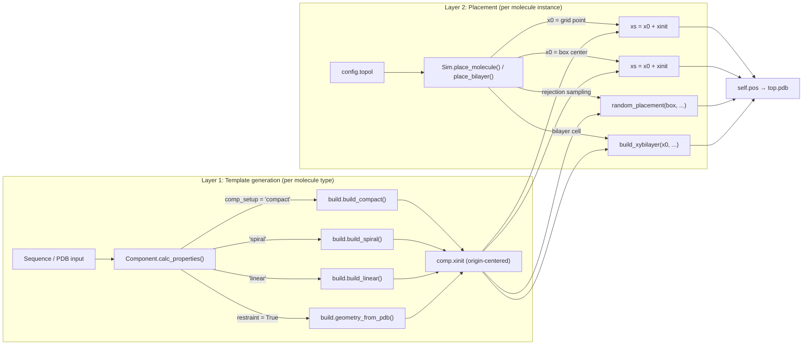
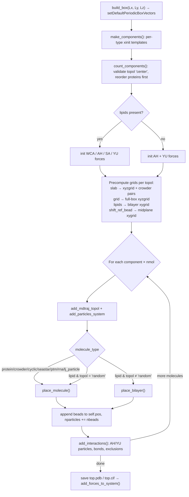

This page documents how MEM-CALVADOS generates starting coordinates before any dynamics run. The system separates the problem into two orthogonal layers: **intra-molecular conformation templates** (`xinit` arrays, one per molecule type, always centered at the origin) and **inter-molecular placement transforms** (translations onto grid points, box centers, or rejection-sampled positions, dispatched by the `topol` config option). The machinery lives in three places: geometric primitives in `calvados/build.py`, template selection in `calvados/components.py`, and orchestration in `Sim.build_system()` / `Sim.place_molecule()` in `calvados/sim.py`. Bonded topology construction and force-field assignment are covered in [Component Class Hierarchy](7-component-class-hierarchy) and [Bilayer Assembly And Topologies](9-bilayer-assembly-and-topologies) respectively.

## Two Orthogonal Geometry Layers

Every molecule enters the system through the same algebraic pattern: `xs = x0 + comp.xinit`. The template `xinit` is a `(nbeads, 3)` NumPy array describing the molecule's *internal shape* relative to its own centroid; `x0` is a single translation vector chosen by the active topology. Because templates are always origin-centered and placement is translation-only, the builder never rotates molecules — a folded PDB structure keeps its exact orientation as written into the output topology.

Sources: [components.py](/calvados/components.py#L72-L79), [sim.py](/calvados/sim.py#L400-L436), [build.py](/calvados/build.py#L84-L124)

## Conformation Templates: The xinit Vectors

Template selection is driven by the `comp_setup` string passed to `Component.calc_x_setup()`, which dispatches to one of three `build.py` primitives using the per-residue `bondlengths` array loaded from the residues table. The default spacing parameter is `d = 0.38` nm, approximating the residue-to-residue distance along a polypeptide chain.

Sources: [components.py](/calvados/components.py#L72-L79), [sim.py](/calvados/sim.py#L59-L95)

| Template | Builder | Geometry produced | Key parameters |
|---|---|---|---|
| `linear` | `build.build_linear` | Chain growing along z; each bead sits at the cumulative midpoint of consecutive bond lengths; z-centered by subtracting the mean | `n_per_res` (extra beads per residue), `ys` (per-residue y offsets) |
| `spiral` | `build.build_spiral` | Beads on an **Archimedes spiral** (`r = b·φ`, `b = separation/(2π)`) unrolled along z; `arc` sets arc length per bead (0.38 nm default), `separation` sets 0.7 nm between consecutive turnings | `arc`, `separation`, `delta`, `n_per_res` |
| `compact` | `build.build_compact` | Space-filling **boustrophedon (snake) walk** through a cubic lattice of side `N = ceil(∛nbeads) − 1`, with direction flips per axis, scaled by spacing `d` | `d` (lattice spacing) |
| PDB-derived | `build.geometry_from_pdb` | α-carbon positions (or per-residue centers of mass when `use_com`), converted Å → nm; also returns box dimensions from the file | `use_com` |

Sources: [build.py](/calvados/build.py#L84-L152), [build.py](/calvados/build.py#L290-L310)

The mapping from `molecule_type` to template is fixed inside `Sim.make_components()` and is *not* configurable from YAML:

| `molecule_type` | Component class | `comp_setup` |
|---|---|---|
| `protein` | `Protein` | `compact` |
| `lipid` | `Lipid` | `linear` |
| `crowder` | `Crowder` | `compact` |
| `rna` | `RNA` | `spiral` |
| `cyclic`, `seastar`, `ptm_protein`, `lj_particle` | respective classes | `compact` |
| anything else | generic `Component` | `linear` |

Sources: [sim.py](/calvados/sim.py#L59-L92)

One exception bypasses the parametric builders entirely: when `Protein.restraint` is enabled, `calc_properties()` calls `calc_x_from_pdb()` so that `xinit` becomes the **actual folded structure** from `<pdb_folder>/<name>.pdb`, and a periodic distance map (`calc_dmap`) is derived from those coordinates for downstream restraints. This is the same coordinate array later consumed by the AF-guided restraint machinery described in [AF-Guided Harmonic And Go Restraints](13-af-guided-harmonic-and-go-restraints).

Sources: [components.py](/calvados/components.py#L177-L198), [components.py](/calvados/components.py#L124-L128), [components.py](/calvados/components.py#L66-L70)

> [!TIP]
> Because `random=False` in `random_placement` skips translation entirely (`xs = xinit` as written), a component with `random: false` in its YAML lands exactly on its origin-centered template — useful for assembling custom multi-molecule starting structures by hand before turning dynamics on.

## Placement Topologies: The topol Dispatch

`Sim.place_molecule()` is the single funnel through which every non-lipid molecule passes (and lipids too, when `topol == 'random'`). It reads the `topol` string from the config — default `'center'` per `default_config.yaml` — and applies one of five strategies:

Sources: [sim.py](/calvados/sim.py#L400-L436), [data/default_config.yaml](/calvados/data/default_config.yaml#L3-L3)

| `topol` | Strategy | Anchor point `x0` | Notes |
|---|---|---|---|
| `center` | Direct translation | `box * 0.5` | Hard-validated: raises `ValueError` if more than one component or molecule exists |
| `slab` | Sequential grid consumption | Next row of a precomputed `xyzgrid` | Grid covers `[box[0], box[1], slab_width]`, offset to `z = box[2]/2 − slab_width/2`; crowders get paired grids outside `slab_outer` above and below the midplane |
| `grid` | Sequential grid consumption | Next row of `build_xyzgrid(nmolecules, box)` | Fills the whole box in a staggered lattice |
| `shift_ref_bead` | Reference-bead anchoring | Grid point on the midplane (`z = box[2] * 0.5`) | If `ref_bead ≥ 0`: `xs = xinit − xinit[ref_bead] − pos_bead + x0`, pinning the chosen bead at `x0 − pos_bead` for controlled transmembrane insertion depth; if `ref_bead < 0` and the anchor is within 10 nm of the midplane, the chain is shifted directionally away using `pos_bead` |
| anything else (default) | Rejection sampling | Random draw in `box`, or in `comp.subvolume` if set | Delegates to `build.random_placement` with `ntries=100000` |

Sources: [sim.py](/calvados/sim.py#L400-L436), [sim.py](/calvados/sim.py#L129-L130), [sim.py](/calvados/sim.py#L187-L206), [sim.py](/calvados/sim.py#L417-L432)

The `slab` and `shift_ref_bead` topologies share one important structural detail: grids are **precomputed once** in `build_system()` before the molecule loop, and `place_molecule()` consumes them sequentially via the `self.grid_counter` index. The slab grid interleaves species — proteins and RNA share one grid sized `nproteins + nrnas`, while crowders are appended as two mirrored half-box grids positioned `slab_outer` nm above and below the box midplane, so the slab region itself stays crowder-free.

Sources: [sim.py](/calvados/sim.py#L182-L206), [data/default_config.yaml](/calvados/data/default_config.yaml#L36-L37)

The dispatcher in `build_system()` routes each molecule by type: proteins, crowders, cyclics, seastars, and PTM-proteins always go through `place_molecule()`; lipids go through `place_bilayer()` *unless* `topol == 'random'`, in which case they too are rejection-sampled anywhere in the box; RNA and `lj_particle` molecules follow `place_molecule()`. Whatever the route, every bead is appended to `self.pos` and `self.nparticles` is incremented, keeping the global bead offset in lockstep with molecule placement.

Sources: [sim.py](/calvados/sim.py#L231-L241), [sim.py](/calvados/sim.py#L244-L263)

## Lattice Grid Builders

Two deterministic grid builders underpin the slab, grid, and bilayer topologies. Both emit cell centers rather than lattice corners, guaranteeing minimum clearance from periodic walls equal to half a cell.

Sources: [build.py](/calvados/build.py#L198-L287)

| Property | `build_xygrid` (2D) | `build_xyzgrid` (3D) |
|---|---|---|
| Grid extents | `nx = ceil(√N)`, `ny = ceil(N/nx)` over `box[0] × box[1]` | Cell counts proportional to the box's aspect ratio, then adjusted up/down until `prod(nxyz) ≥ N` |
| Cell sizes | `dx = box[0]/nx`, `dy = box[1]/ny` | `dx, dy, dz` dividing each axis by its cell count |
| Staggering | None — rows and columns align | Alternating half-cell shifts: rows offset in x/y based on running-index parity, and z-layers shifted `dz/2` when the xy-plane parity flag flips |
| Consumed by | Bilayer lipid anchors; protein/RNA xy anchors in `shift_ref_bead` | `slab` molecules, `grid` molecules, and crowder double-grids |
| Stopping rule | Stops once `N` points emitted | Iterates exactly `N` times |

Sources: [build.py](/calvados/build.py#L198-L213), [build.py](/calvados/build.py#L215-L287)

The 3D staggering matters for slab systems: without the half-cell x/y/z offsets, `ceil(√N)`-style layouts would stack molecules into perfectly collinear columns, producing artificial initial correlations and higher clash rates in dense slabs.

## Bilayer Insertion Mechanics

Lipids are never placed by the generic grid consumers. `Sim.place_bilayer()` instead drives `build.build_xybilayer()`, which transforms the lipid's linear z-template into a leaflet of a planar bilayer at the box midplane:

1. Translate the template so that **bead index 1** (the anchor bead) sits at `z = 0`, then lift everything to `z = box[2]/2 − 1.5` nm — the anchor lands 1.5 nm below the midplane.
2. For the `upward` leaflet, **reverse the bead order** (`xs[::-1,:]`) and shift `+3` nm, flipping the chain direction so the two leaflets mirror each other across the midplane.
3. Validate against walls (`check_walls`) and existing particles with a stricter **0.5 nm** clash cutoff (vs. the 0.3 nm default elsewhere); failure returns `inserted = False`.

Sources: [build.py](/calvados/build.py#L175-L196)

The retry loop in `place_bilayer()` handles failures by re-seeding: each attempt first tries cell `bilayergrid[0]` upward, then downward; if both fail, a random *remaining* cell is promoted to index 0 and the consumed slot is deleted, shrinking the anchor pool. Insertion succeeds only when walls and clash checks both pass.

Sources: [sim.py](/calvados/sim.py#L438-L454)

> [!TIP]
> `check_clash` appends `[90, 90, 90]` to the box lengths because MDAnalysis's `distance_array` requires a full 6-element box vector (three lengths plus three angles) — silently hard-coding orthorhombic 90° cells. This is why periodic minimum-image clash detection works even though the builder never reads angles from the config.

## Clash Avoidance and Retry Semantics

For all rejection-sampled placements (`topol == 'random'` and the catch-all default branch), `build.random_placement()` implements a plain rejection loop with three gates, evaluated per trial:

| Check | Function | Criterion | Consequence on failure |
|---|---|---|---|
| Wall containment | `check_walls` | All coordinates in `[0, box]` per axis | Retry with a new random draw |
| Inter-molecular clash | `check_clash` | Minimum periodic distance to all placed beads ≥ `cutoff` (0.3 nm default; 0.5 nm for bilayers) | Retry with a new random draw |
| Trial budget | loop counter | `ntries` not exceeded (10 000 default in the builder; 100 000 from `place_molecule`) | `ValueError("Tried Ntriesx to add molecule. Giving up.")` |

Sources: [build.py](/calvados/build.py#L42-L63), [build.py](/calvados/build.py#L154-L173), [sim.py](/calvados/sim.py#L430-L432)

The random draw itself comes from `draw_starting_vec`, a uniform sample of `np.random.random(3) * box` — i.e., uniform over the full box volume with no rejection refinement of the proposal distribution. In packed slab systems this means insertion cost grows roughly linearly with occupied fraction, which is precisely why the deterministic grid topologies exist for high-density starting states.

Sources: [build.py](/calvados/build.py#L77-L82)

## End-to-End Placement Pipeline

The full sequence from config to an OpenMM-ready system with coordinates is centralized in `Sim.build_system()`. Placement happens strictly *before* force registration, and the resulting coordinates are written to `top.pdb` / `top.cif` as the canonical restart and analysis anchor.

Sources: [sim.py](/calvados/sim.py#L138-L157), [sim.py](/calvados/sim.py#L182-L241), [sim.py](/calvados/sim.py#L306-L315)

The examples exercise these paths directly: `single_IDR` uses `topol='center'` with a single component (the only legal configuration for that topology); `slab_IDR` uses `topol='slab'` with `slab_width=20` nm and adds 100 copies via `components.add(name=..., nmol=100)`, which the slab grid must accommodate; `bilayer` computes lipid count analytically from `area_per_lipid = 0.6 nm²` (`N_lipids = ceil(Lx·Ly/area_per_lipid) · 2`) and relies on `place_bilayer()` plus `bilayer_eq=True` membrane barostatting to relax the lattice into a fluid patch.

Sources: [examples/single_IDR/prepare.py](/examples/single_IDR/prepare.py#L29-L33), [examples/slab_IDR/prepare.py](/examples/slab_IDR/prepare.py#L28-L43), [examples/slab_IDR/prepare.py](/examples/slab_IDR/prepare.py#L80-L80), [examples/bilayer/prepare.py](/examples/bilayer/prepare.py#L16-L32), [examples/bilayer/prepare.py](/examples/bilayer/prepare.py#L65-L65)

Note that placement-only concerns end here: slab systems additionally attach equilibration restraints (`slab_eq`) toward the box center, and bilayers attach a membrane barostat — both are post-placement stabilization mechanisms covered in [Slab Equilibration And Barostats](15-slab-equilibration-and-barostats), while how `top.pdb` feeds the simulation context belongs to [Sim Class Workflow](16-sim-class-workflow) and [OpenMM Integration And Reporters](17-openmm-integration-and-reporters). Configuration plumbing for all `topol`-related keywords is documented in [YAML Configuration System](5-yaml-configuration-system).

## Key Invariants to Remember

- **Templates are origin-centered; placement is translation-only** — no rotation is ever applied at build time, so all orientation information comes from the template generator or the input PDB.
Sources: [sim.py](/calvados/sim.py#L405-L436), [build.py](/calvados/build.py#L99-L100)
- **Grids are stateful and sequential** — `grid_counter` advances one molecule at a time, so component ordering in `components.yaml` (with proteins deliberately moved to the front of the array) determines which molecule gets which grid cell.
Sources: [sim.py](/calvados/sim.py#L132-L136), [sim.py](/calvados/sim.py#L182-L183)
- **Lipid leaflet geometry is hard-coded** — anchor at 1.5 nm below midplane, +3 nm upper-leaflet shift, 0.5 nm clash cutoff; these constants live in `build_xybilayer`, not in config.
Sources: [build.py](/calvados/build.py#L175-L196)
- **Rejection sampling has no fallback** — exhausted trials raise immediately rather than relaxing the cutoff, so an over-packed box fails at build time by design.
Sources: [build.py](/calvados/build.py#L154-L173)