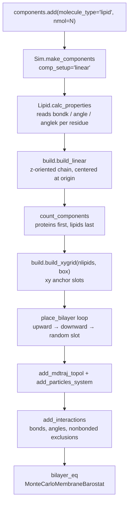
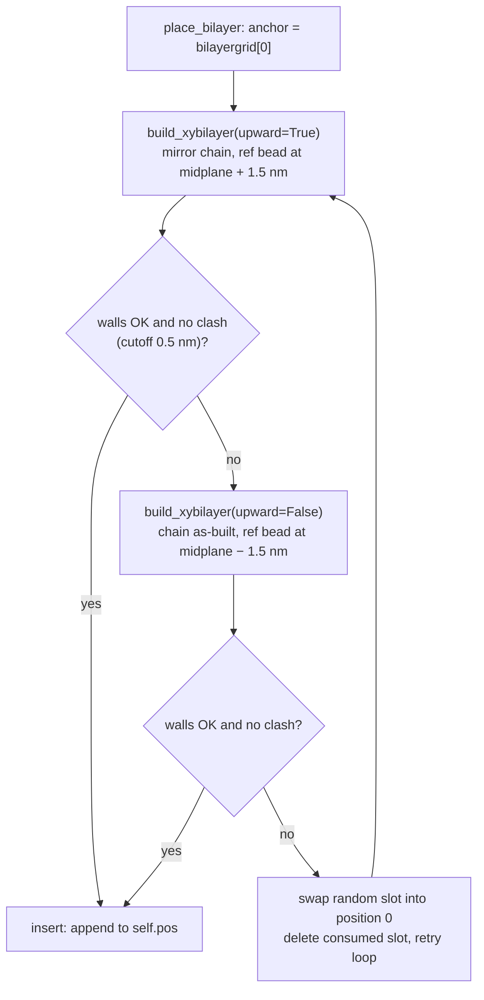

This page dissects how CALVADOS turns a `molecule_type='lipid'` component definition into a physically assembled planar bilayer. The pipeline spans three layers of the codebase: the **`Lipid` component class** (per-residue bonded topology: bonds and angles), the **geometry primitives** in `build.py` (linear z-chains, the xy anchor grid, leaflet mirroring), and the **orchestration layer** in `Sim` (grid allocation, clash-driven placement retry, mdtraj/OpenMM topology registration, and the membrane barostat). All statements below are verified against the source; lipid *interaction* physics (WCA/SA/AH terms) is intentionally out of scope here and covered in [Lipid Interactions: WCA And SA Terms](11-lipid-interactions-wca-and-sa-terms).

## Architectural Flow: From Lipid Definition To Assembled Bilayer

The assembly is a deterministic sequence of handoffs between modules. The `Sim.make_components` dispatcher maps `molecule_type='lipid'` to the `Lipid` class and — critically — fixes the initial-geometry strategy to `comp_setup='linear'`, meaning every lipid starts as a vertical chain grown along z before it is mirrored into a leaflet.



Ordering matters: `count_components` moves protein components to the front of the array and lipids to the end, because protein placement consumes `xyzgrid` slots before lipid placement consumes the separate `bilayergrid` (sim.py#L121-L136). For a lipid-only system like the `examples/bilayer` case, the grid is allocated in `build_system` as soon as `self.nlipids > 0` (sim.py#L196-L197).

Sources: [sim.py](calvados/sim.py#L65-L68), [sim.py](calvados/sim.py#L121-L136), [sim.py](calvados/sim.py#L196-L197), [components.py](calvados/components.py#L450-L467)

## Lipid Component: Per-Residue Bonded Topology

The `Lipid` class (subclass of `Component`) extends the generic residue table with three bonded-parameter columns read per residue from the component's `residues.csv`: `bondk` (bond force constant), `angle` (equilibrium angle in radians), and `anglek` (angle force constant). These are loaded unconditionally in `Lipid.calc_properties` — a lipid residues file that lacks them will fail with a `KeyError`, making them a hard schema requirement (components.py#L456-L467).

The topology predicates are deliberately minimal. A bond exists only between consecutive beads (`j == i+1`); an angle exists only over bead triplets (`j == i+2`, evaluated as `addAngle(i, i+1, j)`). Unlike `Protein`, which suppresses terminal bonds via `condition_termini`, the lipid chain is fully continuous head-to-tail — there is no terminal patching logic (components.py#L469-L481).

Both bonded terms use **per-bead parameters indexed at `i`**: `add_bonds` takes the equilibrium length `bondlengths[i]` and stiffness `bondks[i]`, while `add_angles` takes `angles[i]` and `angleks[i]`. This is what allows a single chain to mix stiff headgroup bonds with softer tail bonds — the parameter localization lives entirely in the residues file, not in the class (components.py#L494-L524).

| Class | Bond predicate | Angle predicate | Parameter source | Terminal handling |
|---|---|---|---|---|
| `Protein` | `j == i+1` (skips patched termini) | none | `kb` (global) | `n_termini`/`c_termini` excluded |
| `RNA` | even-`i` P–P (`j == i+2`) and P–B (`j == i+1`), two stiffnesses | `i%2==0` and `j == i+4` | `rna_kb1/kb2`, `rna_pa/ka` | none (two-bead model) |
| `Lipid` | `j == i+1` (always) | `j == i+2` | per-residue `bondks[i]`, `angles[i]`, `angleks[i]` | none (continuous chain) |

When `verbose=True`, `Sim.add_interactions` triggers `comp.write_bonds(path)`, which dumps both the bond list (`bonds_{name}.txt`) and the angle list (`angles_{name}.txt`) with 1-based indices — a debugging artifact for auditing the generated topology (components.py#L526-L537, sim.py#L546-L550).

> [!TIP]
> Every bonded pair returned by `comp.add_bonds(offset)` / `comp.add_angles(offset)` is immediately fed into `Sim.add_exclusions`, which registers the pair in **all five** nonbonded forces (`wca`, `ah_pp`, `ah`, `sa`, `yu`) for lipid systems. Bonded exclusions are therefore not optional bookkeeping — forgetting this plumbing would let WCA clashes destroy the chain on the first step (sim.py#L456-L467, sim.py#L487-L498).

Sources: [components.py](calvados/components.py#L456-L467), [components.py](calvados/components.py#L469-L481), [components.py](calvados/components.py#L494-L524), [components.py](calvados/components.py#L526-L537), [sim.py](calvados/sim.py#L456-L467), [sim.py](calvados/sim.py#L487-L498)

## Geometry Primitives: Linear Chains And The XY Anchor Grid

Lipid initial geometry comes from the base `Component.calc_x_setup` with `comp_setup='linear'`, which calls `build.build_linear`: a chain grown along +z where each bead's z is the cumulative sum of averaged bond lengths, then centered at its own mean so the chain straddles z=0 (build.py#L84-L100, components.py#L72-L79). The mirror-symmetric leaflet transform in the next section depends on this centering.

The lateral positions come from `build_xygrid`, which tiles `N` anchor slots across the box cross-section: `nx = ceil(sqrt(N))`, `ny = ceil(N/nx)`, with spacing `dx = box[0]/nx`, `dy = box[1]/ny`, and each slot offset by half a cell so points are cell-centered (build.py#L198-L213). This grid is shared infrastructure — the same function places proteins in `topol='shift_ref_bead'` mode (sim.py#L198-L206).

The number of anchors is derived from a target area per lipid, as shown in the reference example:

```python
Lx = 10; Ly = Lx
area_per_lipid = .6
N_lipids = int(np.ceil(Lx*Ly/area_per_lipid)*2)   # ×2 for the two leaflets
```

With `Lx=Ly=10` nm and 0.6 nm² per lipid, this yields ≈334 lipids, and the config sets `box=[10, 10, 120]` nm — a tall box that leaves z-headroom above the bilayer for later protein insertion.

| Parameter | Value in example | Role in assembly |
|---|---|---|
| `topol` | `'bilayer'` | routes lipids to `place_bilayer` instead of random placement |
| `bilayer_eq` | `True` | attaches `MonteCarloMembraneBarostat` |
| `area_per_lipid` | `0.6` nm² | determines `N_lipids = ceil(Lx·Ly/A)·2` |
| `box` z-extent | `120.` nm | wall-check headroom for both leaflets |
| `molecule_type` | `'lipid'` | selects `Lipid` class + linear geometry |

Sources: [build.py](calvados/build.py#L84-L100), [build.py](calvados/build.py#L198-L213), [components.py](calvados/components.py#L72-L79), [examples/bilayer/prepare.py](examples/bilayer/prepare.py#L16-L19), [examples/bilayer/prepare.py](examples/bilayer/prepare.py#L24-L44), [examples/bilayer/prepare.py](examples/bilayer/prepare.py#L65-L65)

## Leaflet Placement: The `build_xybilayer` Mirror Transform

`build_xybilayer` is the core assembly function. Given one grid anchor `x0` and the lipid's z-chain `xinit`, it performs a sequence of rigid transforms, then validates insertion:

1. **Anchor + center**: `xs = x0 + xinit`, then the chain is re-centered vertically on its **second bead** (`xs[:,2] -= xs[1,2]`) — bead index 1 becomes the z-reference.
2. **Lower-leaflet offset**: the reference bead is placed at `box[2]/2 − 1.5` nm, i.e. 1.5 nm below the box midplane (`upward=False` path).
3. **Upper-leaflet mirror** (`upward=True`): the bead order is reversed (`xs[::-1,:]`, flipping the chain in z) and the whole chain shifted `+3` nm, placing the reference bead at `box[2]/2 + 1.5` nm — the exact mirror image across the midplane.
4. **Validation**: `check_walls` rejects chains poking outside the periodic box; `check_clash` with a **0.5 nm cutoff** (tighter than the 0.3 nm used for random protein placement) rejects overlap with all previously placed beads. Either failure sets `inserted=False` (build.py#L175-L196).

The caller, `Sim.place_bilayer`, runs a retry loop around this: first attempt `upward=True` with `bilayergrid[0]` as anchor; if that fails, retry `upward=False`; if both fail, a random unused grid slot is swapped into position 0 and the loop repeats (sim.py#L438-L454).



> [!TIP]
> On success the loop exits **without consuming the grid slot** — `bilayergrid[0]` remains the anchor for the next molecule. Because the slot still holds the previous lipid's xy position, the second lipid's upward attempt inevitably clashes with the first; it therefore falls through to the downward transform, which occupies the vacant space below the midplane. The net effect is that **each xy cell self-assembles one upward + one downward lipid pair**, and only after the slot is saturated both ways does the random-swap rotation advance to a fresh anchor. The alternation is an emergent property of clash-driven retry, not an explicit leaflet counter (sim.py#L443-L450, build.py#L183-L195).

| Transform | `upward=False` (lower leaflet) | `upward=True` (upper leaflet) |
|---|---|---|
| Bead order along z | as built by `build_linear` | reversed (`xs[::-1,:]`) |
| z-translation | ref bead → `box[2]/2 − 1.5` nm | ref bead → `box[2]/2 − 1.5 + 3` nm |
| Reference bead distance from midplane | 1.5 nm below | 1.5 nm above |
| Clash cutoff | 0.5 nm | 0.5 nm |

Sources: [build.py](calvados/build.py#L175-L196), [build.py](calvados/build.py#L154-L173), [sim.py](calvados/sim.py#L438-L454)

## Topology Registration In mdtraj And OpenMM

Assembly is incomplete until the same connectivity exists in the analysis topology and the simulation system. Both registrations reuse the class-level predicates, guaranteeing that the mdtraj visualization topology, the OpenMM `HarmonicBondForce`, and the written bond files describe identical connectivity.

In `add_mdtraj_topol`, lipids join the generic branch: each residue is renamed to its three-letter code via `comp.residues.loc[resname,'three']`, each bead becomes a `CA` carbon atom, and consecutive bonds are added wherever `comp.bond_check(i, i+1)` passes. Note the chain-splitting guard `if len(comp.c_termini) > 1 and idx == comp.c_termini[0]` — a lipid whose residues file defines multiple `c_termini` entries gets multiple mdtraj chains, which is the hook for multi-tail/branched lipid representations (sim.py#L563-L588).

In `add_interactions`, the global particle offset is computed as `self.nparticles - comp.nbeads` and passed down so that class-local bond indices become system-global indices. Bonds are added for **every** component type; angles are added only for `rna` and `lipid`, reflecting that lipids are the only straight-chain component that needs angular stiffness to maintain bilayer packing (sim.py#L500-L540).

A third piece of topology bookkeeping happens during the same molecule loop: every bead is classified into index sets via its `TMT` residue column value — `tmt < −5` → MID, `tmt < −4` → CHD (the `CHO`/`PHO` charged headgroup beads), `tmt < 0` → negatively charged serine-class, `tmt > 0` → tail-class (`lipid_ltl`). These sets drive the lipid interaction-group partitioning (`wca`, `ah`, `sa` groups) which is documented separately in [Lipid Interactions: WCA And SA Terms](11-lipid-interactions-wca-and-sa-terms) and [Force Groups And Interaction Exclusions](12-force-groups-and-interaction-exclusions). What matters for assembly is that this classification is computed at build time from the same residues file, so a lipid's residue schema (`TMT`, `omega`, plus the standard `MW`/`lambdas`/`sigmas`/`q`/`bondlength`) fully determines both its topology and its interaction class (sim.py#L212-L263, components.py#L60-L63).

Sources: [sim.py](calvados/sim.py#L563-L588), [sim.py](calvados/sim.py#L500-L540), [sim.py](calvados/sim.py#L212-L263), [components.py](calvados/components.py#L60-L63)

## Membrane-Aware Equilibration Topology

The `bilayer_eq` flag completes the bilayer as a *simulation* topology, not just a static structure. When enabled, `add_forces_to_system` attaches an OpenMM `MonteCarloMembraneBarostat` configured with `XYIsotropic` scaling in the membrane plane, `ZFixed` along the normal, zero surface tension (`0*bar*nanometer`), and an update frequency of 10000 steps (sim.py#L362-L369). This keeps the lateral area under zero-tension control while holding box height constant — matching the flat-geometry assumption baked into `build_xybilayer`. The system summary echoes this as `Equilibration under zero lateral tension` (sim.py#L395-L396). A deeper treatment of pressure coupling belongs to [Slab Equilibration And Barostats](15-slab-equilibration-and-barostats).

Sources: [sim.py](calvados/sim.py#L362-L369), [sim.py](calvados/sim.py#L395-L396)

## Worked Example: Minimal Bilayer Build

The `examples/bilayer/prepare.py` script is the canonical invocation of everything above. The essential calls, in dependency order:

```python
config = Config(
  box = [Lx, Ly, 120.],        # nm — tall z for wall-check headroom
  topol = 'bilayer',           # route lipids through place_bilayer
  bilayer_eq = True,           # MonteCarloMembraneBarostat
  ...
)
components.add(name=args.name, molecule_type='lipid', nmol=N_lipids, restraint=False)
```

Note that `restraint=False` is passed explicitly for the lipid: the `Components` defaults include `restraint = False`, but stating it guards against inheriting a restraint default from other component blocks. Since this example ships its own `input/residues.csv`, the lipid residue rows (with `bondk`, `angle`, `anglek`, `TMT`, `omega` columns) travel with the example rather than relying on the amino-acid-only default table in `calvados/data/residues.csv` (components.py#L26-L30, components.py#L456-L467).

Sources: [examples/bilayer/prepare.py](examples/bilayer/prepare.py#L24-L44), [examples/bilayer/prepare.py](examples/bilayer/prepare.py#L54-L66), [components.py](calvados/components.py#L26-L30)

## Key Takeaways

The bilayer assembler is a three-layer design with clean separation of concerns: **schema** (residues.csv columns define all per-residue topology), **geometry** (`build.py` primitives perform pure transforms with boolean insertion verdicts), and **orchestration** (`Sim` owns state: the particle counter, the anchor grid, and the retry loop). The leaflet mirror trick — build one z-chain, then reverse-and-shift for the upper leaflet — means the bilayer has no dedicated leaflet data structure; its structure is an emergent consequence of clash-driven placement against a shared anchor slot. This makes the code compact but also means assembly correctness rests entirely on the 0.5 nm clash cutoff and the tall-box wall check.

**Suggested continuation**: for the class hierarchy behind `Lipid` and its sibling components see [Component Class Hierarchy](7-component-class-hierarchy); for how non-lipid initial geometries (spiral, compact, grid) are built see [Initial Geometry And Placement](8-initial-geometry-and-placement); for the interaction forces acting on the assembled bilayer see [Lipid Interactions: WCA And SA Terms](11-lipid-interactions-wca-and-sa-terms); for barostat dynamics during equilibration see [Slab Equilibration And Barostats](15-slab-equilibration-and-barostats).
