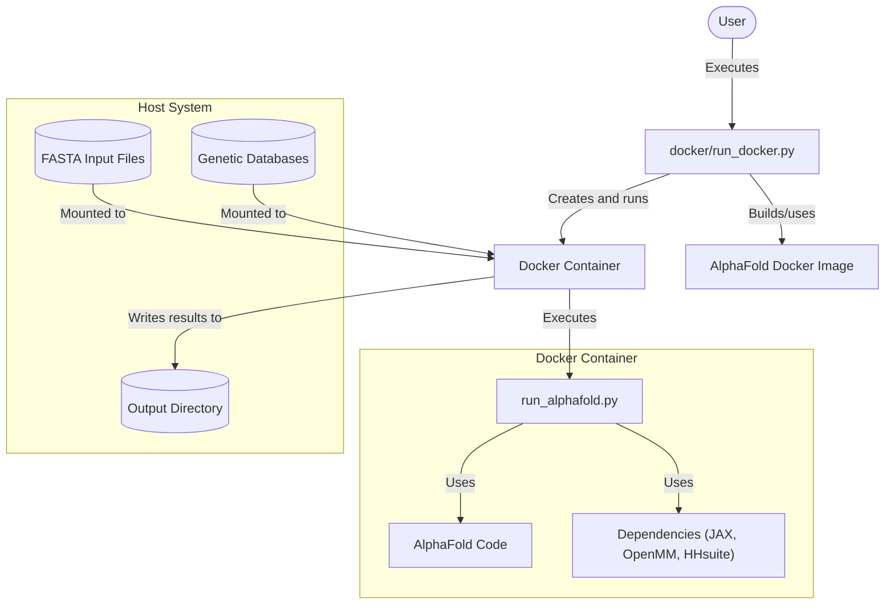
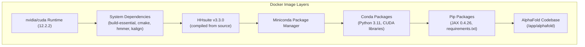
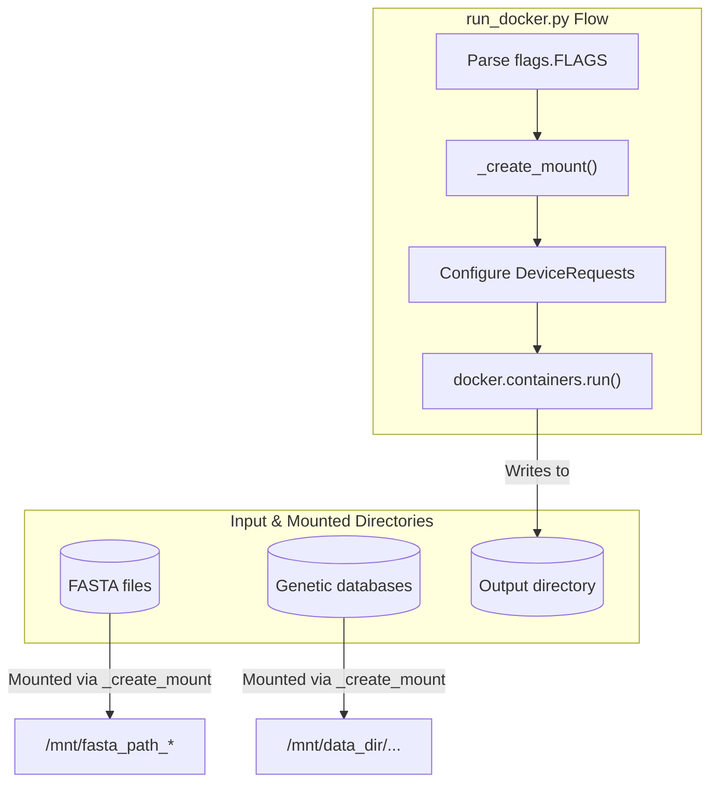
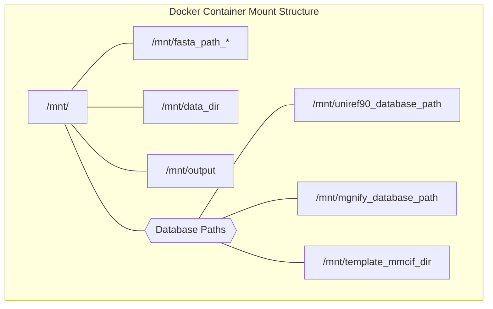

# Docker Environment

<details>
<summary>Relevant source files</summary>

The following files were used as context for generating this wiki page:

- [.dockerignore](.dockerignore)
- [docker/Dockerfile](docker/Dockerfile)
- [docker/run_docker.py](docker/run_docker.py)
- [pyproject.toml](pyproject.toml)
- [requirements.txt](requirements.txt)
- [run_alphafold_test.py](run_alphafold_test.py)

</details>


This document details the Docker-based execution environment for AlphaFold. It covers the Docker image structure, how to build and run the AlphaFold container, and the configuration options available. For information about preparing data needed by AlphaFold, see section 2.2.

## Overview

AlphaFold uses Docker to create a consistent, isolated environment with all necessary dependencies for protein structure prediction. The Docker environment handles complex dependencies like CUDA, JAX, and OpenMM, making it much easier to deploy AlphaFold across different systems.

### Natural Language to Code Entity Space: Execution Flow
The following diagram maps high-level execution steps to the specific code entities responsible for managing the Docker environment.



Sources: [docker/Dockerfile:1-91](), [docker/run_docker.py:15-25]()

## Docker Image Structure

The AlphaFold Docker image is built from the `docker/Dockerfile` in the repository and contains all necessary components to run protein structure predictions.

### Base Image and Core Components

The Docker image is based on `nvidia/cuda:12.2.2-cudnn8-runtime-ubuntu20.04` [docker/Dockerfile:15-16]() to support GPU acceleration. It installs several key components in layers:

1.  **System Dependencies**: Build tools (`build-essential`, `cmake`), `git`, `hmmer`, `kalign`, and `cuda-command-line-tools` [docker/Dockerfile:25-37]().
2.  **HHsuite**: Compiled from source (v3.3.0) and installed to `/opt/hhsuite` [docker/Dockerfile:40-47]().
3.  **Miniconda**: Python package manager installed to `/opt/conda` [docker/Dockerfile:50-53]().
4.  **Conda Packages**: Python 3.11, `pip`, and CUDA libraries [docker/Dockerfile:59-61]().
5.  **Python Dependencies**: JAX 0.4.26 with CUDA 12 support, plus packages from `requirements.txt` [docker/Dockerfile:69-73]().
6.  **AlphaFold Code**: The complete codebase copied to `/app/alphafold` [docker/Dockerfile:63]().



Sources: [docker/Dockerfile:15-74]()

### Entrypoint Configuration

The Docker image configures an entrypoint script (`/app/run_alphafold.sh`) that runs `ldconfig` to ensure GPU visibility, then executes `run_alphafold.py` [docker/Dockerfile:87-91]().


The `ldconfig` command is necessary due to a quirk with Debian-based NVIDIA Docker images where GPUs are not visible until the dynamic linker cache is updated [docker/Dockerfile:81-83](). The SETUID bit is added to `/sbin/ldconfig.real` to allow non-root users to run this command [docker/Dockerfile:76]().

Sources: [docker/Dockerfile:76-91]()

## Running AlphaFold with Docker

The repository provides `docker/run_docker.py` to simplify running AlphaFold in Docker. This script handles mounting directories, setting up GPU access, and passing command-line arguments to the container.

### Key Components and Data Flow

The script uses `docker.types.Mount` to bind host directories into the container [docker/run_docker.py:150-155]().



Sources: [docker/run_docker.py:133-157](), [docker/run_docker.py:159-250]()

### Configuration Flags

The script defines several `absl.flags` to control the environment:

| Flag | Default | Description |
|-----------|---------|-------------|
| `--use_gpu` | `True` | Enable NVIDIA runtime to run with GPUs [docker/run_docker.py:29](). |
| `--gpu_devices` | `'all'` | Comma separated list of devices to pass to NVIDIA_VISIBLE_DEVICES [docker/run_docker.py:47](). |
| `--fasta_paths` | `None` | Paths to FASTA files (required) [docker/run_docker.py:51](). |
| `--data_dir` | `None` | Path to genetic and template databases (required) [docker/run_docker.py:66](). |
| `--output_dir` | `'/tmp/alphafold'` | Path to store results [docker/run_docker.py:61](). |
| `--model_preset` | `'monomer'` | Model configuration (monomer, multimer, etc.) [docker/run_docker.py:88](). |
| `--db_preset` | `'full_dbs'` | Database configuration (full or reduced) [docker/run_docker.py:81](). |
| `--docker_user` | `os.geteuid()` | UID:GID with which to run the container [docker/run_docker.py:120](). |

Sources: [docker/run_docker.py:29-126]()

## Python Dependencies

Dependencies are managed through `requirements.txt` and `pyproject.toml`.

### Core Dependencies

| Package | Version | Purpose |
|---------|---------|---------|
| `dm-haiku` | 0.0.12 | Neural network library for JAX [requirements.txt:3](). |
| `jax` | 0.4.26 | Core computation engine [requirements.txt:5](). |
| `numpy` | 1.24.3 | Numerical computing [requirements.txt:8](). |
| `openmm[cuda12]` | 8.2.0 | Structure relaxation [requirements.txt:9](). |
| `tensorflow-cpu` | 2.16.1 | Input feature processing [requirements.txt:13](). |

The project requires Python >= 3.10 [pyproject.toml:22]().

Sources: [requirements.txt:1-14](), [pyproject.toml:39-51]()

## Building and Execution Details

### Build Command
To build the image manually:
```bash
docker build -f docker/Dockerfile -t alphafold .
```

### Mount Points and Data Organization
The script `run_docker.py` maps host paths to a standard container structure under `_ROOT_MOUNT_DIRECTORY = '/mnt/'` [docker/run_docker.py:130]().



Sources: [docker/run_docker.py:130-215]()

### GPU Visibility Fix
The Dockerfile includes a specific workaround for `libffi` to avoid `undefined_symbol` errors:
`ln -sf /usr/lib/x86_64-linux-gnu/libffi.so.7 /opt/conda/lib/libffi.so.7` [docker/Dockerfile:79]().

Sources: [docker/Dockerfile:79-83]()

---