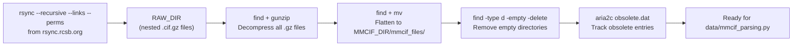
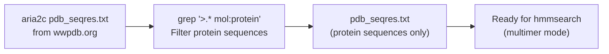
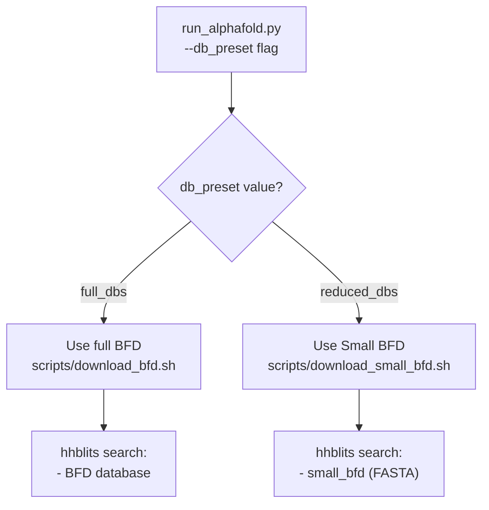

# Database Setup

<details>
<summary>Relevant source files</summary>

The following files were used as context for generating this wiki page:

- [scripts/download_all_data.sh](scripts/download_all_data.sh)
- [scripts/download_alphafold_params.sh](scripts/download_alphafold_params.sh)
- [scripts/download_bfd.sh](scripts/download_bfd.sh)
- [scripts/download_mgnify.sh](scripts/download_mgnify.sh)
- [scripts/download_pdb70.sh](scripts/download_pdb70.sh)
- [scripts/download_pdb_mmcif.sh](scripts/download_pdb_mmcif.sh)
- [scripts/download_pdb_seqres.sh](scripts/download_pdb_seqres.sh)
- [scripts/download_small_bfd.sh](scripts/download_small_bfd.sh)
- [scripts/download_uniprot.sh](scripts/download_uniprot.sh)
- [scripts/download_uniref30.sh](scripts/download_uniref30.sh)
- [scripts/download_uniref90.sh](scripts/download_uniref90.sh)

</details>


## Purpose and Scope

This document describes the genetic databases required by AlphaFold and the procedures for downloading and configuring them. The databases provide sequence and structural data used by the data pipeline for Multiple Sequence Alignment (MSA) generation and template search. This page covers database requirements, download scripts, directory structure, and the `--db_preset` configuration option.

## Required Databases

AlphaFold requires several genetic databases for MSA generation and template search. The databases are queried by tools like `jackhmmer`, `hhblits`, and `hhsearch` during the data pipeline stage.

### Database Categories and Usage

| Database | Purpose | Tools | Size (Uncompressed) | Download Size | Required For |
|----------|---------|-------|---------------------|--------------|--------------|
| **BFD** | Sequence search for deep MSAs | `hhblits` | ~1.8 TB | ~271.6 GB | `full_dbs` preset |
| **Small BFD** | Reduced sequence search | `hhblits` | ~17 GB | ~9.6 GB | `reduced_dbs` preset |
| **MGnify** | Metagenomic sequences | `jackhmmer` | ~120 GB | ~67 GB | All configurations |
| **UniRef90** | Sequence clusters for MSA | `jackhmmer` | ~67 GB | ~34 GB | All configurations |
| **UniRef30** | Deep sequence clusters | `hhblits` | ~206 GB | ~52.5 GB | All configurations |
| **PDB70** | Template structures (monomer) | `hhsearch` | ~56 GB | ~19.5 GB | Monomer mode |
| **PDB mmCIF** | Structure template files | `mmcif_parsing.py` | ~238 GB | ~43 GB | All configurations |
| **PDB Seqres** | Template sequences (multimer) | `hmmsearch` | ~0.2 GB | ~0.2 GB | Multimer mode |
| **UniProt** | Full UniProt sequences | `jackhmmer` | ~105 GB | ~53 GB | Multimer mode |
| **Model Parameters** | Neural network weights | N/A | ~5.3 GB | ~5.3 GB | All configurations |

Sources: `scripts/download_all_data.sh:48-77` [scripts/download_all_data.sh:48-77](), `scripts/download_small_bfd.sh:33-34` [scripts/download_small_bfd.sh:33-34]()

## Download Scripts and Procedures

The `scripts/` directory contains shell scripts for downloading databases. The master script `scripts/download_all_data.sh` orchestrates the download process using `aria2c` and `rsync`.

### Download Script Architecture

```mermaid
graph TB
    subgraph "Master Script"
        MasterScript["scripts/download_all_data.sh<br/>Orchestrates all downloads"]
    end
    
    subgraph "Sequence Database Scripts"
        BFD["scripts/download_bfd.sh<br/>Source: Google Storage Mirror<br/>aria2c download"]
        SmallBFD["scripts/download_small_bfd.sh<br/>Source: Google Storage<br/>aria2c download"]
        MGnify["scripts/download_mgnify.sh<br/>Source: Google Storage Mirror<br/>aria2c download"]
        UniRef30["scripts/download_uniref30.sh<br/>Source: Google Storage<br/>aria2c download"]
        UniRef90["scripts/download_uniref90.sh<br/>Source: UniProt FTP<br/>aria2c download"]
        UniProt["scripts/download_uniprot.sh<br/>Source: UniProt FTP<br/>aria2c download"]
    end
    
    subgraph "Structure Database Scripts"
        PDB70["scripts/download_pdb70.sh<br/>Source: MPI Bioinformatics<br/>aria2c download"]
        PDBMMCIF["scripts/download_pdb_mmcif.sh<br/>Source: RCSB PDB<br/>rsync + gunzip + flatten"]
        PDBSeqres["scripts/download_pdb_seqres.sh<br/>Source: RCSB PDB FTP<br/>aria2c + grep filter"]
    end
    
    subgraph "Model Weights"
        Params["scripts/download_alphafold_params.sh<br/>Source: Google Storage<br/>aria2c + tar extract"]
    end
    
    MasterScript --> BFD
    MasterScript --> SmallBFD
    MasterScript --> MGnify
    MasterScript --> UniRef30
    MasterScript --> UniRef90
    MasterScript --> UniProt
    MasterScript --> PDB70
    MasterScript --> PDBMMCIF
    MasterScript --> PDBSeqres
    MasterScript --> Params
```



### Prerequisites

Required tools:
- `aria2c`: Parallel download utility (install via `apt install aria2`) [scripts/download_all_data.sh:27-30]()
- `rsync`: File synchronization tool [scripts/download_all_data.sh:32-35]()
- Sufficient disk space: ~2.62 TB (full) or ~500 GB (reduced)

Sources: `scripts/download_all_data.sh:22-35` [scripts/download_all_data.sh:22-35]()

### Basic Usage

Download full databases (default):
```bash
bash scripts/download_all_data.sh <DOWNLOAD_DIR>
```

Download reduced databases:
```bash
bash scripts/download_all_data.sh <DOWNLOAD_DIR> reduced_dbs
```

The script checks for `aria2c` and `rsync` before proceeding [scripts/download_all_data.sh:27-35](). It then invokes specific sub-scripts for each database [scripts/download_all_data.sh:48-77]().

## Database Processing Details

Individual download scripts perform post-processing to prepare databases for use by AlphaFold's search tools.

### PDB mmCIF Processing (`scripts/download_pdb_mmcif.sh`)



The script flattens the nested directory structure into a single `mmcif_files/` directory [scripts/download_pdb_mmcif.sh:56-60]() for efficient lookup by the pipeline. It also fetches `obsolete.dat` to track retired PDB entries [scripts/download_pdb_mmcif.sh:65]().

Sources: `scripts/download_pdb_mmcif.sh:48-65` [scripts/download_pdb_mmcif.sh:48-65]()

### PDB Seqres Processing (`scripts/download_pdb_seqres.sh`)



The script filters the full PDB seqres file to include only protein sequences (excluding DNA/RNA), ensuring compatibility with multimer search requirements [scripts/download_pdb_seqres.sh:41-42]().

Sources: `scripts/download_pdb_seqres.sh:34-43` [scripts/download_pdb_seqres.sh:34-43]()

### Key Processing Patterns

| Script | Download Method | Post-Processing | Output Format |
|--------|----------------|-----------------|---------------|
| `download_bfd.sh` | `aria2c` | Extract tar [scripts/download_bfd.sh:41]() | HHsuite database files |
| `download_small_bfd.sh` | `aria2c` | Gunzip [scripts/download_small_bfd.sh:40]() | FASTA file |
| `download_mgnify.sh` | `aria2c` | Gunzip [scripts/download_mgnify.sh:42]() | FASTA file |
| `download_uniref30.sh` | `aria2c` | Extract tar [scripts/download_uniref30.sh:41]() | HHsuite database files |
| `download_uniref90.sh` | `aria2c` | Gunzip [scripts/download_uniref90.sh:40]() | FASTA file |
| `download_uniprot.sh` | `aria2c` | Gunzip + Cat [scripts/download_uniprot.sh:48-53]() | Merged FASTA file |
| `download_pdb70.sh` | `aria2c` | Extract tar [scripts/download_pdb70.sh:39]() | HHsuite database files |
| `download_pdb_mmcif.sh` | `rsync` | Gunzip + Flatten [scripts/download_pdb_mmcif.sh:53-60]() | Flattened `.cif` files |
| `download_alphafold_params.sh`| `aria2c` | Extract tar [scripts/download_alphafold_params.sh:39]() | `.npz` weight files |

Sources: `scripts/download_uniprot.sh:52-53` [scripts/download_uniprot.sh:52-53](), `scripts/download_alphafold_params.sh:34-41` [scripts/download_alphafold_params.sh:34-41]()

## Expected Directory Structure

After running the download scripts, the data directory has the following structure:

```
$DOWNLOAD_DIR/                             
    bfd/                                   # Full BFD database [scripts/download_bfd.sh:33]
    mgnify/                                # MGnify FASTA [scripts/download_mgnify.sh:33]
        mgy_clusters_2022_05.fa
    params/                                # Model weights [scripts/download_alphafold_params.sh:33]
        params_model_1.npz
        ...
    pdb70/                                 # PDB70 HHsuite db [scripts/download_pdb70.sh:33]
    pdb_mmcif/                             # mmCIF structures [scripts/download_pdb_mmcif.sh:38]
        mmcif_files/                       # Flattened directory
        obsolete.dat
    pdb_seqres/                            # PDB Seqres FASTA [scripts/download_pdb_seqres.sh:33]
        pdb_seqres.txt
    small_bfd/                             # Reduced BFD [scripts/download_small_bfd.sh:33]
        bfd-first_non_consensus_sequences.fasta
    uniref30/                              # UniRef30 HHsuite db [scripts/download_uniref30.sh:33]
    uniprot/                               # Full UniProt FASTA [scripts/download_uniprot.sh:34]
        uniprot.fasta
    uniref90/                              # UniRef90 FASTA [scripts/download_uniref90.sh:33]
        uniref90.fasta
```

## Database Presets

The `--db_preset` flag in `run_alphafold.py` controls which databases are queried.

### Database Selection Flow



The `download_all_data.sh` script uses the second argument to decide between `full_dbs` and `reduced_dbs` [scripts/download_all_data.sh:38-43](). If `reduced_dbs` is selected, it runs `download_small_bfd.sh` [scripts/download_all_data.sh:52](); otherwise, it runs `download_bfd.sh` [scripts/download_all_data.sh:55]().

Sources: `scripts/download_all_data.sh:38-56` [scripts/download_all_data.sh:38-56]()

## Updating Existing Installations

To update databases, it is generally recommended to remove the existing directory and re-run the specific download script.

### Update Procedure

1. **UniProt (Multimer)**:
   ```bash
   rm -rf <DOWNLOAD_DIR>/uniprot
   bash scripts/download_uniprot.sh <DOWNLOAD_DIR>
   ```
2. **PDB Structure Data**:
   ```bash
   rm -rf <DOWNLOAD_DIR>/pdb_mmcif
   bash scripts/download_pdb_mmcif.sh <DOWNLOAD_DIR>
   bash scripts/download_pdb_seqres.sh <DOWNLOAD_DIR>
   ```
   *Note: PDB mmCIF and Seqres should be updated together to maintain synchronization.*

3. **Model Parameters**:
   The current version uses the `2022-12-06` parameters [scripts/download_alphafold_params.sh:34]().

Sources: `scripts/download_alphafold_params.sh:34` [scripts/download_alphafold_params.sh:34](), `scripts/download_uniprot.sh:51-54` [scripts/download_uniprot.sh:51-54]()

---