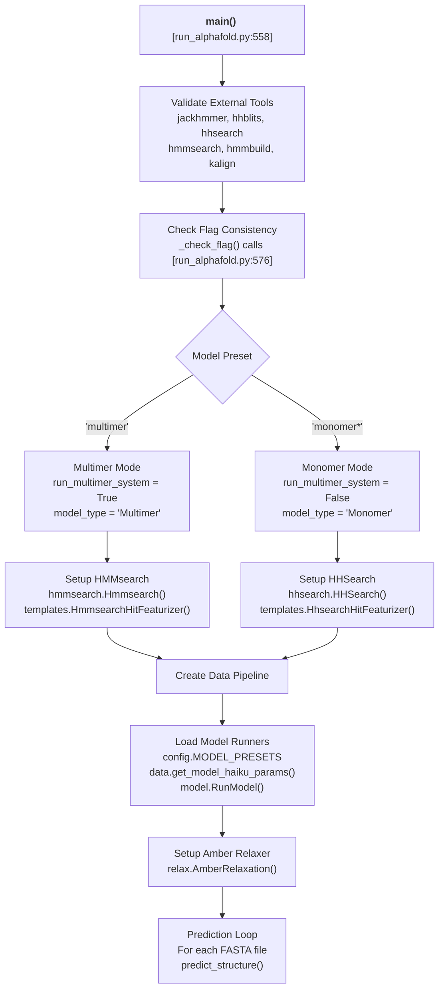

# Running AlphaFold

<details>
<summary>Relevant source files</summary>

The following files were used as context for generating this wiki page:

- [docker/run_docker.py](docker/run_docker.py)
- [run_alphafold.py](run_alphafold.py)
- [run_alphafold_test.py](run_alphafold_test.py)

</details>


This page describes the main execution pipeline for AlphaFold predictions via the `run_alphafold.py` script. It covers the prediction workflow from FASTA input through feature generation, model inference, structure relaxation, and output generation.

For Docker containerization and environment setup, see [Docker Environment](#2.1). For database installation and configuration, see [Database Setup](#2.2). For a detailed reference of all command-line flags and configuration options, see [Command-Line Interface](#2.4).

---

## Overview

The AlphaFold prediction pipeline is orchestrated by `run_alphafold.py`, which serves as the main entry point for structure prediction [run_alphafold.py:15-15](). The script accepts FASTA files as input and produces predicted protein structures along with confidence metrics and auxiliary outputs [run_alphafold.py:57-65]().

The execution flow follows this sequence:

1.  **Initialization**: Parse command-line flags and validate configuration [run_alphafold.py:558-610]().
2.  **Pipeline Setup**: Initialize data pipeline for either monomer or multimer mode [run_alphafold.py:611-667]().
3.  **Model Loading**: Load model configurations and pre-trained parameters [run_alphafold.py:669-686]().
4.  **Feature Generation**: Process input sequences to generate model-ready features [run_alphafold.py:367-377]().
5.  **Model Inference**: Run predictions using one or more models with different random seeds [run_alphafold.py:385-446]().
6.  **Structure Refinement**: Apply Amber relaxation to improve local geometry [run_alphafold.py:481-514]().
7.  **Output Generation**: Rank predictions and save results in multiple formats [run_alphafold.py:521-551]().

**Sources**: [run_alphafold.py:15-733]()

---

## Main Entry Point and Configuration

### Script Initialization

The `main()` function [run_alphafold.py:558-717]() serves as the entry point and performs the following initialization steps:

### Execution Flow Diagram

Title: AlphaFold Execution Flow


**Sources**: [run_alphafold.py:558-717]()

### Pipeline Mode Selection

The script supports two execution modes determined by the `--model_preset` flag [run_alphafold.py:169-175]():

| Mode | Model Preset Values | Template Search | Pairing Database | Data Pipeline Class |
|------|-------------------|-----------------|-----------------|---------------------|
| **Monomer** | `monomer`, `monomer_casp14`, `monomer_ptm` | HHsearch on PDB70 | N/A | `pipeline.DataPipeline` |
| **Multimer** | `multimer` | HMMsearch on PDB seqres | UniProt | `pipeline_multimer.DataPipeline` |

The mode selection logic occurs at [run_alphafold.py:585-599]():

```python
run_multimer_system = 'multimer' in FLAGS.model_preset
model_type = 'Multimer' if run_multimer_system else 'Monomer'
```

For multimer predictions, the data pipeline [run_alphafold.py:656-664]() wraps the monomer pipeline and adds cross-chain MSA pairing capabilities.

**Sources**: [run_alphafold.py:585-599](), [run_alphafold.py:611-667]()

---

## Data Pipeline Initialization

### Template Search Configuration

The template search mechanism differs between monomer and multimer modes:

*   **Monomer Mode** [run_alphafold.py:627-639](): Uses `hhsearch.HHSearch` to search the PDB70 database and featurizes hits using `templates.HhsearchHitFeaturizer`.
*   **Multimer Mode** [run_alphafold.py:612-625](): Uses `hmmsearch.Hmmsearch` to search the PDB seqres database and featurizes hits using `templates.HmmsearchHitFeaturizer`.

Both featurizers use the `max_template_date` [run_alphafold.py:148-152]() to filter templates by release date and are limited to `MAX_TEMPLATE_HITS = 20` [run_alphafold.py:261-261]().

### Data Pipeline Construction

The monomer data pipeline is instantiated at [run_alphafold.py:641-654](). If multimer mode is selected, it is passed into the `pipeline_multimer.DataPipeline` [run_alphafold.py:656-664]().

**Sources**: [run_alphafold.py:612-667]()

---

## Model Runner Configuration

### Loading Model Parameters

The script loads model configurations and parameters for all models specified by the preset [run_alphafold.py:669-682]():

Title: Model Runner Initialization

```mermaid
graph LR
    Preset["`**MODEL_PRESETS**
    config.MODEL_PRESETS[preset]`"] --> ModelNames["`Model Names List
    e.g. ['model_1', 'model_2', ...]`"]
    
    ModelNames --> Loop{"`For each model`"}
    
    Loop --> GetConfig["`**model_config()**
    config.model_config(name)`"]
    GetConfig --> GetParams["`**get_model_haiku_params()**
    data.get_model_haiku_params()`"]
    
    GetParams --> CreateRunner["`**RunModel**
    model.RunModel(config, params)`"]
    
    CreateRunner --> MultiSeeds{"`Multimer?`"}
    MultiSeeds -->|Yes| MakeN["`Create N instances
    num_multimer_predictions_per_model`"]
    MultiSeeds -->|No| Make1["`Create 1 instance`"]
    
    MakeN --> Runners["`**model_runners**
    Dict[str, RunModel]`"]
    Make1 --> Runners
```


### Model Preset Selection

The available model presets are defined in `config.MODEL_PRESETS` [run_alphafold.py:169-175](). The ensemble size is set based on the preset [run_alphafold.py:601-604]():

```python
if FLAGS.model_preset == 'monomer_casp14':
  num_ensemble = 8
else:
  num_ensemble = 1
```

For multimer predictions, multiple seeds are generated per model [run_alphafold.py:678-682](), controlled by `num_multimer_predictions_per_model` [run_alphafold.py:193-201]().

**Sources**: [run_alphafold.py:669-686](), [run_alphafold.py:169-201]()

---

## Prediction Workflow

### The predict_structure Function

The core prediction logic is implemented in `predict_structure()` [run_alphafold.py:345-556](), which orchestrates the entire prediction pipeline for a single input.

### Prediction Logic Diagram

Title: predict_structure Execution

```mermaid
graph TB
    Start["`**predict_structure()**
    [run_alphafold.py:345]`"] --> CreateDirs["`Create Output Directories
    output_dir/{fasta_name}/
    output_dir/{fasta_name}/msas/`"]
    
    CreateDirs --> Features["`**Generate Features**
    data_pipeline.process()
    → feature_dict`"]
    
    Features --> SaveFeatures["`Save features.pkl
    Pickled NumPy arrays`"]
    
    SaveFeatures --> ModelLoop{"`For each model_runner`"}
    
    ModelLoop --> ProcessFeatures["`**Process Features**
    model_runner.process_features()
    Add random seed, crop/pad`"]
    
    ProcessFeatures --> Predict["`**Run Prediction**
    model_runner.predict()
    JAX inference (JIT compiled)`"]
    
    Predict --> SaveConfidence["`Save Confidence Metrics
    confidence_{model}.json
    pae_{model}.json`"]
    
    SaveConfidence --> SaveResults["`Save Prediction Results
    result_{model}.pkl
    NumPy arrays`"]
    
    SaveResults --> CreateProtein["`**Create Protein Object**
    protein.from_prediction()
    Convert to atom coordinates`"]
    
    CreateProtein --> SaveUnrelaxed["`Save Unrelaxed Structure
    unrelaxed_{model}.pdb
    unrelaxed_{model}.cif`"]
    
    SaveUnrelaxed --> NextModel{"`More models?`"}
    NextModel -->|Yes| ModelLoop
    NextModel -->|No| Rank
    
    Rank["`**Rank Models**
    Sort by ranking_confidence
    (pLDDT or iptm+ptm)`"] --> SelectRelax{"`models_to_relax`"}
    
    SelectRelax -->|BEST| RelaxBest["`Relax Top-Ranked Model`"]
    SelectRelax -->|ALL| RelaxAll["`Relax All Models`"]
    SelectRelax -->|NONE| SkipRelax["`Skip Relaxation`"]
    
    RelaxBest --> DoRelax["`**Amber Relaxation**
    amber_relaxer.process()
    OpenMM energy minimization`"]
    RelaxAll --> DoRelax
    
    DoRelax --> SaveRelaxed["`Save Relaxed Structures
    relaxed_{model}.pdb
    relaxed_{model}.cif`"]
    
    SaveRelaxed --> SaveRanked
    SkipRelax --> SaveRanked["`Save Ranked Structures
    ranked_{0,1,2,3,4}.pdb
    ranked_{0,1,2,3,4}.cif`"]
    
    SaveRanked --> SaveMetadata["`Save Metadata
    ranking_debug.json
    timings.json
    relax_metrics.json`"]
```


**Sources**: [run_alphafold.py:345-556]()

### Feature Generation Phase

The feature generation phase [run_alphafold.py:367-377]() calls the data pipeline to produce model-ready features and writes them to disk as `features.pkl`.

### Model Inference Loop

For each model, the script performs prediction [run_alphafold.py:385-446](). It derives a `model_random_seed` [run_alphafold.py:392-392](), processes features via `model_runner.process_features` [run_alphafold.py:394-396](), and executes the JAX inference via `model_runner.predict` [run_alphafold.py:401-403]().

**Sources**: [run_alphafold.py:387-446]()

---

## Confidence Metrics and Ranking

### Confidence Score Calculation

The script saves confidence metrics in JSON format:

*   **Per-Residue Confidence (pLDDT)**: Computed and saved via `_save_confidence_json_file` [run_alphafold.py:288-298]().
*   **Predicted Aligned Error (PAE)**: Saved via `_save_pae_json_file` [run_alphafold.py:326-342]() for models that produce pairwise error estimates.

### Model Ranking

Models are ranked by their `ranking_confidence` score [run_alphafold.py:473-479](). The best model is assigned index 0 [run_alphafold.py:538-545]().

**Sources**: [run_alphafold.py:427-479](), [run_alphafold.py:538-545]()

---

## Structure Relaxation

### Amber Relaxation Configuration

Structures are refined using Amber force field minimization [run_alphafold.py:688-695](). Relaxation constants (energy tolerance, stiffness, etc.) are defined at [run_alphafold.py:262-266]().

### Selective Relaxation

The `ModelsToRelax` enum [run_alphafold.py:50-55]() and the `--models_to_relax` flag [run_alphafold.py:213-225]() control which predictions are relaxed:
*   `BEST`: Relax only the top-ranked model [run_alphafold.py:482-482]().
*   `ALL`: Relax all models [run_alphafold.py:484-484]().
*   `NONE`: Skip relaxation [run_alphafold.py:486-486]().

**Sources**: [run_alphafold.py:481-514](), [run_alphafold.py:688-695]()

---

## Output File Organization

### Output Directory Structure

The script creates a structured output directory for each prediction target [run_alphafold.py:556-598]().

| File Type | Pattern | Description |
|-----------|---------|-------------|
| **Features** | `features.pkl` | Input feature dictionary [run_alphafold.py:374-377]() |
| **Raw Results** | `result_model_*.pkl` | Complete model output [run_alphafold.py:442-445]() |
| **Unrelaxed PDB** | `unrelaxed_model_*.pdb` | Coordinates with pLDDT in B-factors [run_alphafold.py:461-463]() |
| **Unrelaxed mmCIF** | `unrelaxed_model_*.cif` | mmCIF format structure [run_alphafold.py:465-471]() |
| **Relaxed PDB** | `relaxed_model_*.pdb` | Minimized structure [run_alphafold.py:505-507]() |
| **Ranked PDB** | `ranked_{0-4}.pdb` | Confidence-sorted output [run_alphafold.py:538-541]() |
| **Confidence** | `confidence_model_*.json` | Per-residue pLDDT [run_alphafold.py:428-430]() |
| **PAE** | `pae_model_*.json` | Pairwise error matrix [run_alphafold.py:433-435]() |

**Sources**: [run_alphafold.py:374-551]()

---

## Error Handling and Validation

### Flag Validation

The script validates flag consistency using `_check_flag()` [run_alphafold.py:269-275](). This ensures required database paths are provided for the selected `db_preset` and `model_preset` [run_alphafold.py:576-599]().

### Required Flags

Several flags are marked as required to ensure the pipeline has all necessary data and tool paths [run_alphafold.py:720-730]().

### External Tool Validation

The script verifies the existence of all required binary paths (JackHMMER, HHblits, etc.) before starting the pipeline [run_alphafold.py:562-574]().

**Sources**: [run_alphafold.py:269-275](), [run_alphafold.py:562-609](), [run_alphafold.py:720-730]()

---

## Random Seed Management

### Seed Generation

If no seed is provided via `--random_seed` [run_alphafold.py:184-192](), a random value is generated [run_alphafold.py:697-700](). This seed is used to derive per-model seeds [run_alphafold.py:392-392](), ensuring that different model runs (or multimer predictions) explore different stochastic variations while remaining reproducible if the seed is fixed.

**Sources**: [run_alphafold.py:184-192](), [run_alphafold.py:392-395](), [run_alphafold.py:697-700]()

---