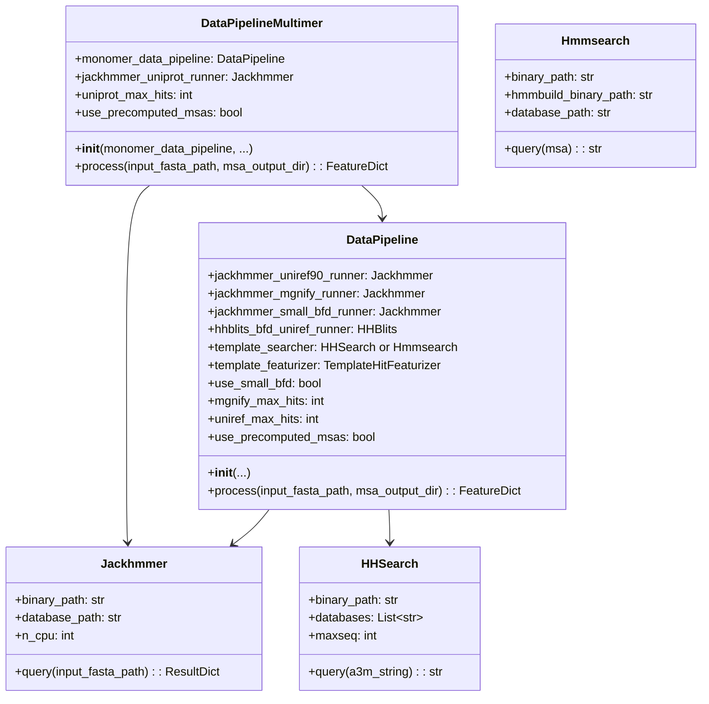
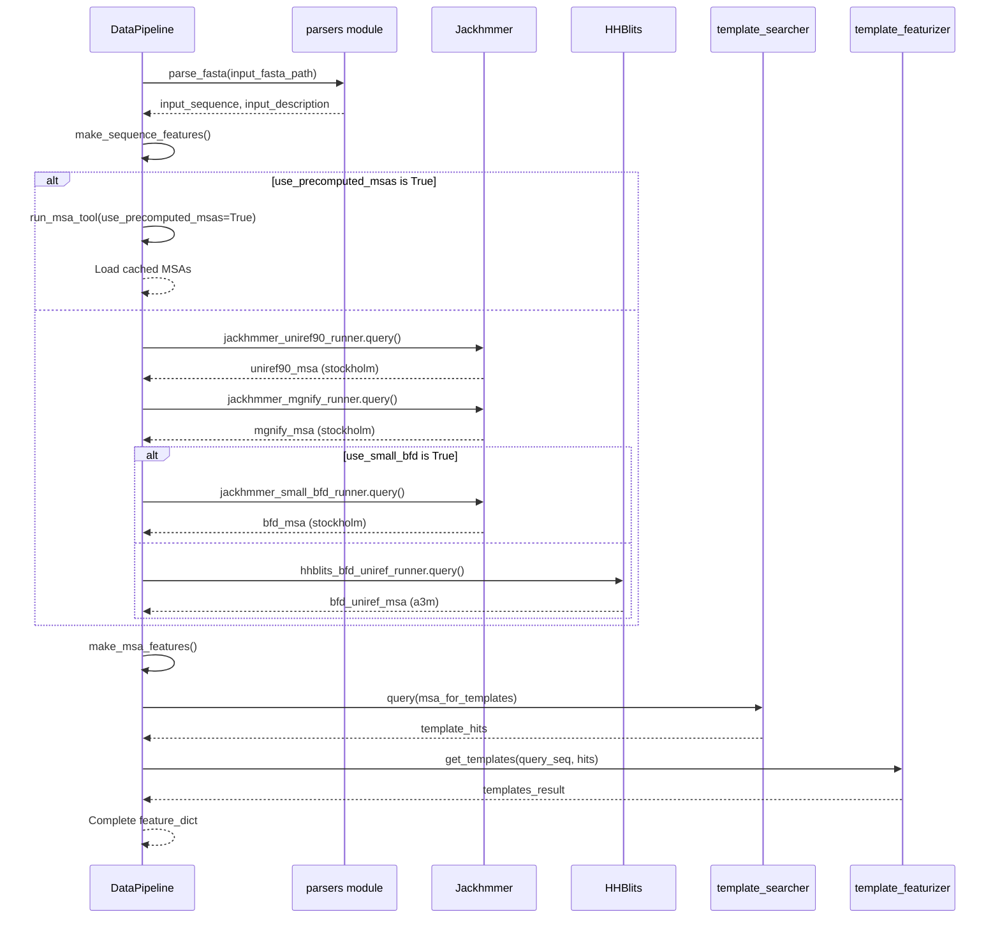

# Data Pipeline

Relevant source files

The following files were used as context for generating this wiki page:

- [alphafold/common/protein.py](alphafold/common/protein.py)
- [alphafold/data/msa_pairing.py](alphafold/data/msa_pairing.py)
- [alphafold/data/pipeline.py](alphafold/data/pipeline.py)
- [alphafold/data/pipeline_multimer.py](alphafold/data/pipeline_multimer.py)
- [alphafold/data/templates.py](alphafold/data/templates.py)
- [alphafold/data/tools/hhsearch.py](alphafold/data/tools/hhsearch.py)
- [alphafold/data/tools/hmmbuild.py](alphafold/data/tools/hmmbuild.py)
- [alphafold/data/tools/hmmsearch.py](alphafold/data/tools/hmmsearch.py)
- [alphafold/model/tf/protein_features.py](alphafold/model/tf/protein_features.py)

The Data Pipeline transforms raw FASTA protein sequences into model-ready feature dictionaries containing multiple sequence alignments (MSAs), template structural information, and sequence-derived features. This page provides a technical overview of the pipeline architecture and processing stages.

The pipeline consists of two main implementations:
- `pipeline.DataPipeline`: Monomer protein processing [alphafold/data/pipeline.py:123]()
- `pipeline_multimer.DataPipeline`: Multi-chain complex processing [alphafold/data/pipeline_multimer.py:184]()

For detailed information on specific pipeline components, see:
- [MSA Generation](#3.1) for sequence alignment details
- [Template Processing](#3.2) for structural template handling
- [Multimer MSA Pairing](#3.3) for protein complex processing
- [Feature Processing](#3.4) for final feature preparation

## Overview

The Data Pipeline executes the following stages:

1.  **FASTA Parsing**: Extract target sequences from input files [alphafold/data/pipeline.py:176-185]()
2.  **MSA Generation**: Query sequence databases using `Jackhmmer` and `HHBlits` [alphafold/data/pipeline.py:146-167]()
3.  **Template Search**: Identify structural templates via `HHSearch` or `Hmmsearch` [alphafold/data/pipeline.py:168-169]()
4.  **Feature Extraction**: Generate sequence features, MSA features, and template features [alphafold/data/pipeline.py:231-243]()
5.  **Feature Assembly**: Combine all features into a dictionary for model input [alphafold/data/pipeline.py:243]()

### Data Pipeline Architecture Diagram

```mermaid
flowchart TD
    subgraph Input["Input Layer"]
        fasta["FASTA File"]
    end

    subgraph Pipeline["pipeline.DataPipeline"]
        process["process()"]
        
        subgraph SeqProcessing["Sequence Processing"]
            parse["parsers.parse_fasta()"]
            seq_feat["make_sequence_features()"]
        end
        
        subgraph MSAGeneration["MSA Generation"]
            jack_uni["jackhmmer_uniref90_runner"]
            jack_mgn["jackhmmer_mgnify_runner"]
            jack_bfd["jackhmmer_small_bfd_runner"]
            hhblits["hhblits_bfd_uniref_runner"]
            
            parse_sto["parsers.parse_stockholm()"]
            parse_a3m["parsers.parse_a3m()"]
            msa_feat["make_msa_features()"]
        end
        
        subgraph TemplateProcessing["Template Processing"]
            temp_search["template_searcher"]
            temp_feat["template_featurizer"]
            hhsearch_class["hhsearch.HHSearch"]
            hmmsearch_class["hmmsearch.Hmmsearch"]
        end
    end

    subgraph ExternalTools["External Binaries"]
        jackhmmer_bin["jackhmmer"]
        hhblits_bin["hhblits"]
        hhsearch_bin["hhsearch"]
        hmmsearch_bin["hmmsearch"]
        kalign_bin["kalign"]
    end

    subgraph Databases["Sequence Databases"]
        uniref90_db["uniref90_database_path"]
        mgnify_db["mgnify_database_path"]
        bfd_db["bfd_database_path"]
        small_bfd_db["small_bfd_database_path"]
        uniref30_db["uniref30_database_path"]
        pdb70_db["pdb70_database_path"]
        pdb_seqres["pdb_seqres_database_path"]
        template_mmcif["template_mmcif_dir"]
    end

    subgraph Output["Output Features"]
        feature_dict["feature_dict"]
    end

    fasta --> process
    process --> parse
    parse --> seq_feat
    
    process --> jack_uni
    process --> jack_mgn
    process --> jack_bfd
    process --> hhblits
    
    jack_uni --> jackhmmer_bin
    jack_mgn --> jackhmmer_bin
    jack_bfd --> jackhmmer_bin
    hhblits --> hhblits_bin
    
    jackhmmer_bin --> uniref90_db
    jackhmmer_bin --> mgnify_db
    jackhmmer_bin --> small_bfd_db
    hhblits_bin --> bfd_db
    hhblits_bin --> uniref30_db
    
    jack_uni --> parse_sto
    jack_mgn --> parse_sto
    jack_bfd --> parse_sto
    hhblits --> parse_a3m
    
    parse_sto --> msa_feat
    parse_a3m --> msa_feat
    
    process --> temp_search
    temp_search --> hhsearch_class
    temp_search --> hmmsearch_class
    hhsearch_class --> hhsearch_bin
    hmmsearch_class --> hmmsearch_bin
    
    hhsearch_bin --> pdb70_db
    hmmsearch_bin --> pdb_seqres
    
    temp_search --> temp_feat
    temp_feat --> template_mmcif
    temp_feat --> kalign_bin
    
    seq_feat --> feature_dict
    msa_feat --> feature_dict
    temp_feat --> feature_dict
```

Sources:
- [alphafold/data/pipeline.py:123-243]()
- [alphafold/data/pipeline_multimer.py:184-206]()

## Pipeline Initialization

The `DataPipeline` class is instantiated with configuration for various genetic databases and search tools. For multimer predictions, a `pipeline_multimer.DataPipeline` wraps a monomer pipeline instance to process individual chains before pairing.

### DataPipeline Class Structure

### Initialization Parameters

The pipeline is initialized with the following key parameters:

| Parameter | Type | Description |
|-----------|------|-------------|
| `jackhmmer_binary_path` | str | Path to jackhmmer executable [alphafold/data/pipeline.py:129]() |
| `hhblits_binary_path` | str | Path to hhblits executable [alphafold/data/pipeline.py:130]() |
| `uniref90_database_path` | str | UniRef90 FASTA database [alphafold/data/pipeline.py:131]() |
| `mgnify_database_path` | str | MGnify FASTA database [alphafold/data/pipeline.py:132]() |
| `template_searcher` | TemplateSearcher | `HHSearch` or `Hmmsearch` instance [alphafold/data/pipeline.py:136]() |
| `template_featurizer` | TemplateHitFeaturizer | Template feature extractor [alphafold/data/pipeline.py:137]() |
| `use_small_bfd` | bool | Whether to use reduced BFD database [alphafold/data/pipeline.py:138]() |
| `use_precomputed_msas` | bool | Whether to load cached MSAs [alphafold/data/pipeline.py:141]() |

Sources:
- [alphafold/data/pipeline.py:126-143]()
- [alphafold/data/pipeline_multimer.py:187-206]()

## Data Processing Workflow

The `process()` method orchestrates the complete feature generation pipeline. It handles MSA generation, template search, and feature assembly.

### Process Execution Sequence

### MSA Caching

When `use_precomputed_msas=True`, the pipeline reads MSAs from disk using `run_msa_tool` [alphafold/data/pipeline.py:94-120]() rather than running search binaries.

Sources:
- [alphafold/data/pipeline.py:174-243]()
- [alphafold/data/pipeline.py:94-120]()

## Sequence Feature Generation

The `make_sequence_features()` function constructs basic features directly from the input sequence [alphafold/data/pipeline.py:37-54]().

| Feature Name | Shape | Data Type | Description |
|--------------|-------|-----------|-------------|
| `aatype` | `[num_res, 21]` | float32 | One-hot encoding of amino acid types |
| `residue_index` | `[num_res]` | int32 | Zero-based residue position indices |
| `seq_length` | `[num_res]` | int32 | Total sequence length (repeated) |
| `sequence` | `[1]` | object | Original amino acid sequence string |

Sources:
- [alphafold/data/pipeline.py:37-54]()
- [alphafold/model/tf/protein_features.py:43-51]()

## Multiple Sequence Alignment Generation

The pipeline generates MSAs from UniRef90, MGnify, and BFD/UniRef30 databases.

### MSA Feature Conversion

The `make_msa_features()` function converts parsed `Msa` objects into feature arrays [alphafold/data/pipeline.py:57-91]().

| Feature | Shape | Type | Description |
|---------|-------|------|-------------|
| `msa` | `[num_seq, num_res]` | int32 | Integer-encoded aligned sequences |
| `deletion_matrix_int` | `[num_seq, num_res]` | int32 | Deletion counts per position |
| `num_alignments` | `[num_res]` | int32 | Total number of sequences in MSA |
| `msa_species_identifiers` | `[num_seq]` | object | Species IDs for each sequence |

Sources:
- [alphafold/data/pipeline.py:57-91]()
- [alphafold/model/tf/protein_features.py:45-48]()

## Template Search and Feature Extraction

Template structures provide 3D coordinate priors. The pipeline identifies homologs and extracts coordinates from mmCIF files.

### Template Search Tools

Template search is performed using:
- **Monomer Mode**: `hhsearch.HHSearch` querying PDB70 [alphafold/data/tools/hhsearch.py:29]()
- **Multimer Mode**: `hmmsearch.Hmmsearch` querying PDB SEQRES [alphafold/data/tools/hmmsearch.py:29]()

### Template Features

| Feature | Shape | Type | Description |
|---------|-------|------|-------------|
| `template_aatype` | `[num_templates, num_res, 22]` | float32 | One-hot template AA types |
| `template_all_atom_positions` | `[num_templates, num_res, 37, 3]` | float32 | 3D atom coordinates |
| `template_all_atom_masks` | `[num_templates, num_res, 37]` | float32 | Atom presence masks |

Sources:
- [alphafold/data/templates.py:88-95]()
- [alphafold/model/tf/protein_features.py:60-68]()
- [alphafold/data/tools/hhsearch.py:111-116]()
- [alphafold/data/tools/hmmsearch.py:135-145]()

## Multimer Feature Processing

For multimer predictions, `pipeline_multimer.DataPipeline` processes each chain individually and then performs pairing.

1.  **Chain Processing**: Each chain is processed via `monomer_data_pipeline` [alphafold/data/pipeline_multimer.py:228-233]().
2.  **Monomer to Multimer Conversion**: `convert_monomer_features` reshapes features for multimer compatibility [alphafold/data/pipeline_multimer.py:79-105]().
3.  **Assembly Features**: `add_assembly_features` adds `asym_id`, `sym_id`, and `entity_id` to distinguish between chains [alphafold/data/pipeline_multimer.py:130-167]().
4.  **MSA Pairing**: Cross-chain sequences are paired based on species information [alphafold/data/msa_pairing.py:153-185]().

Sources:
- [alphafold/data/pipeline_multimer.py:79-167]()
- [alphafold/data/msa_pairing.py:153-185]()

## Summary

The Data Pipeline transforms a FASTA sequence into a standardized `FeatureDict`. This dictionary includes evolutionary context (MSAs) and structural priors (templates) required for the model to perform folding.

For details on how these features are transformed into model tensors, see [Feature Processing](#3.4).

---