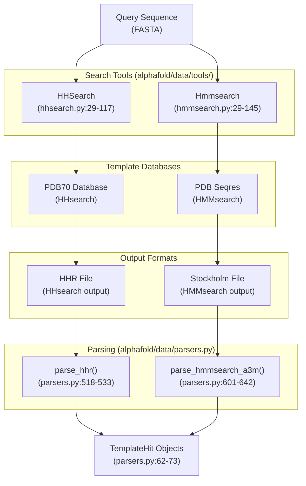
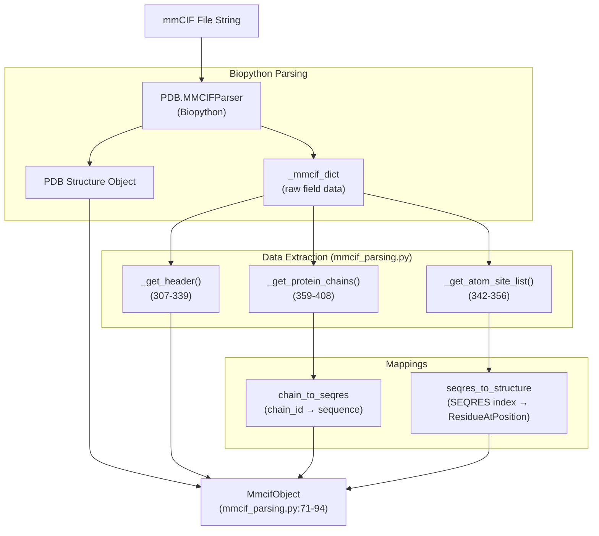
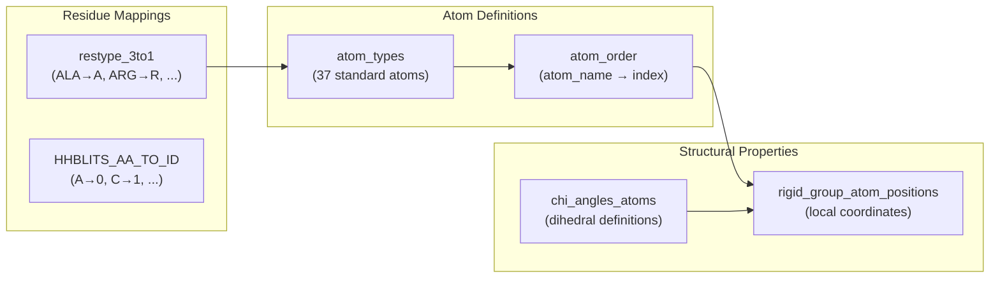

# Template Processing

Relevant source files

The following files were used as context for generating this wiki page:

- [alphafold/common/protein.py](alphafold/common/protein.py)
- [alphafold/common/residue_constants.py](alphafold/common/residue_constants.py)
- [alphafold/data/mmcif_parsing.py](alphafold/data/mmcif_parsing.py)
- [alphafold/data/pipeline.py](alphafold/data/pipeline.py)
- [alphafold/data/pipeline_multimer.py](alphafold/data/pipeline_multimer.py)
- [alphafold/data/templates.py](alphafold/data/templates.py)
- [alphafold/data/tools/hhsearch.py](alphafold/data/tools/hhsearch.py)
- [alphafold/data/tools/hmmbuild.py](alphafold/data/tools/hmmbuild.py)
- [alphafold/data/tools/hmmsearch.py](alphafold/data/tools/hmmsearch.py)
- [alphafold/model/tf/protein_features.py](alphafold/model/tf/protein_features.py)
- [alphafold/relax/utils.py](alphafold/relax/utils.py)

## Purpose and Scope

This document describes the template processing subsystem within AlphaFold's data pipeline. Template processing identifies structural templates from the Protein Data Bank (PDB) that are homologous to the query sequence and extracts their structural information for use by the neural network.

The pipeline performs automated structural template search via HHsearch or HMMsearch and handles template feature extraction from mmCIF files, including coordinate mapping and residue-level metadata extraction.

**Sources:** [alphafold/data/templates.py:15-15](), [alphafold/data/mmcif_parsing.py:15-15]()

## Overview

Template processing consists of two main phases:

1. **Template Search**: Using sequence-structure alignment tools (HHsearch or HMMsearch) to identify protein structures similar to the query sequence.
2. **Structure Extraction**: Parsing mmCIF files to extract atomic coordinates, residue mappings, and metadata for identified templates.

The process is managed by the `DataPipeline` [alphafold/data/pipeline.py:123-143]() which coordinates the `TemplateSearcher` [alphafold/data/pipeline.py:34-34]() and the `TemplateHitFeaturizer` [alphafold/data/templates.py:441-441]().

**Sources:** [alphafold/data/pipeline.py:168-169](), [alphafold/data/templates.py:88-95]()

## Template Search Workflow

**Template Search Workflow**: The query sequence is compared against template databases using either HHsearch (for HMM-HMM comparison) or HMMsearch (for HMM-sequence comparison). The tools produce different output formats, which are parsed into a unified `TemplateHit` representation.

**Sources:** [alphafold/data/tools/hhsearch.py:72-117](), [alphafold/data/tools/hmmsearch.py:83-145](), [alphafold/data/parsers.py:518-642]()

### HHsearch and HMMsearch Execution

The `HHSearch` class [alphafold/data/tools/hhsearch.py:29-31]() wraps the binary and queries databases using A3M input [alphafold/data/tools/hhsearch.py:72-109]().

The `Hmmsearch` class [alphafold/data/tools/hmmsearch.py:29-30]() uses `Hmmbuild` [alphafold/data/tools/hmmbuild.py:27-28]() to construct a profile from a Stockholm MSA before searching the sequence database [alphafold/data/tools/hmmsearch.py:83-88]().

**Sources:** [alphafold/data/tools/hhsearch.py:84-90](), [alphafold/data/tools/hmmsearch.py:98-112]()

## mmCIF File Parsing

After template search identifies candidate structures, their atomic coordinates and metadata are extracted from mmCIF format files.

**mmCIF Parsing Workflow**: The parsing process uses Biopython to extract the 3D structure and raw mmCIF dictionary, then processes this data to create SEQRES-to-structure mappings.

**Sources:** [alphafold/data/mmcif_parsing.py:170-214](), [alphafold/data/mmcif_parsing.py:254-290]()

### Core mmCIF Data Structures

| Data Structure | Purpose | Key Fields |
|----------------|---------|------------|
| `AtomSite` | Individual atom information | `residue_name`, `author_chain_id`, `mmcif_seq_num` [alphafold/data/mmcif_parsing.py:43-51]() |
| `ResidueAtPosition` | Maps SEQRES to structure | `position`, `name`, `is_missing` [alphafold/data/mmcif_parsing.py:63-68]() |
| `MmcifObject` | Complete parsed file | `header`, `structure`, `chain_to_seqres` [alphafold/data/mmcif_parsing.py:71-94]() |
| `ParsingResult` | Parse operation result | `mmcif_object`, `errors` [alphafold/data/mmcif_parsing.py:97-108]() |

**Sources:** [alphafold/data/mmcif_parsing.py:34-108]()

## Residue Constants and Chemical Properties

Template processing relies on `residue_constants.py` for atom definitions and rigid group coordinates.

**Residue Constants Structure**: The module provides mappings used throughout template processing and coordinate transformations.

**Sources:** [alphafold/common/residue_constants.py:34-78](), [alphafold/common/residue_constants.py:143-163](), [alphafold/common/residue_constants.py:526-533]()

### Rigid Group Atom Positions
AlphaFold represents atoms relative to 8 rigid groups (0: backbone, 3: psi-group, 4-7: chi1-4 groups). The coordinates in `rigid_group_atom_positions` [alphafold/common/residue_constants.py:143-200]() define the geometry used to reconstruct the full protein structure from frame rotations.

**Sources:** [alphafold/common/residue_constants.py:131-142]()

## Template Feature Integration

The `TemplateHitFeaturizer` processes `TemplateHit` objects to generate numerical features.

### Feature Definitions
The final template features used by the model include:
- `template_aatype`: One-hot encoded amino acid types [alphafold/data/templates.py:89-89]().
- `template_all_atom_masks`: Binary mask for atom presence [alphafold/data/templates.py:90-90]().
- `template_all_atom_positions`: XYZ coordinates of all 37 atom types [alphafold/data/templates.py:91-91]().
- `template_sum_probs`: HHsearch sum of probabilities [alphafold/data/templates.py:94-94]().

**Sources:** [alphafold/data/templates.py:88-95](), [alphafold/model/tf/protein_features.py:58-68]()

### Prefiltering Logic
Before parsing mmCIF files, AlphaFold applies prefilters to template hits:
1. **Date Cutoff**: Excludes templates released after a specified date [alphafold/data/templates.py:108-126]().
2. **Alignment Ratio**: Excludes hits with low overlap to the query [alphafold/data/templates.py:76-77]().
3. **Redundancy**: Excludes hits that are exact subsequences of the query [alphafold/data/templates.py:80-81]().

**Sources:** [alphafold/data/templates.py:175-208]()

## Multimer Template Processing

For multimer models, monomer template features are reshaped and converted:
- `template_aatype` is remapped from HHsearch order to AlphaFold's internal order [alphafold/data/pipeline_multimer.py:100-101]().
- `template_all_atom_masks` is renamed to `template_all_atom_mask` [alphafold/data/pipeline_multimer.py:102-103]().
- Entity and symmetry IDs are added to distinguish between chains in homomers and heteromers [alphafold/data/pipeline_multimer.py:130-167]().

**Sources:** [alphafold/data/pipeline_multimer.py:79-106]()

## Summary

Template processing provides structural context to the model by:
1. Identifying homologs via **HHsearch** or **HMMsearch**.
2. Parsing structural data from **mmCIF** files into a standardized `MmcifObject`.
3. Filtering hits based on **release date** and **alignment quality**.
4. Mapping coordinates to the **atom37** representation using **residue constants**.

**Sources:** [alphafold/data/templates.py:15-24](), [alphafold/data/pipeline.py:123-173](), [alphafold/data/mmcif_parsing.py:71-108]()

---