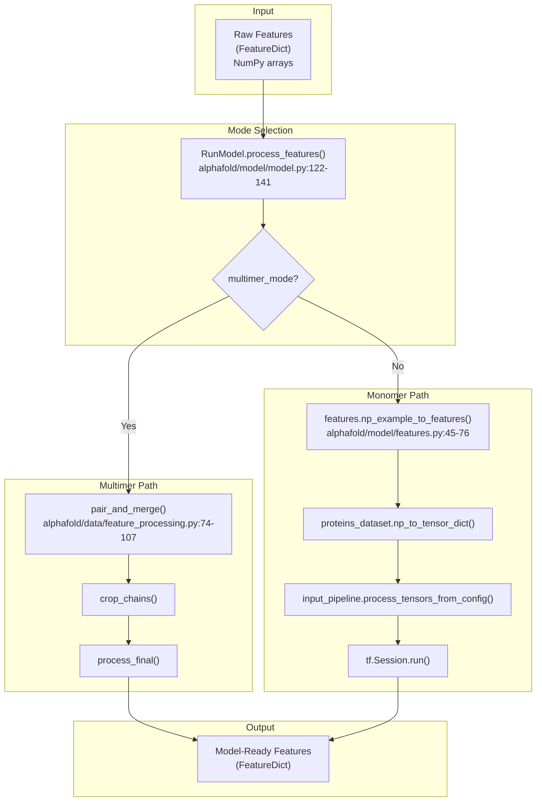
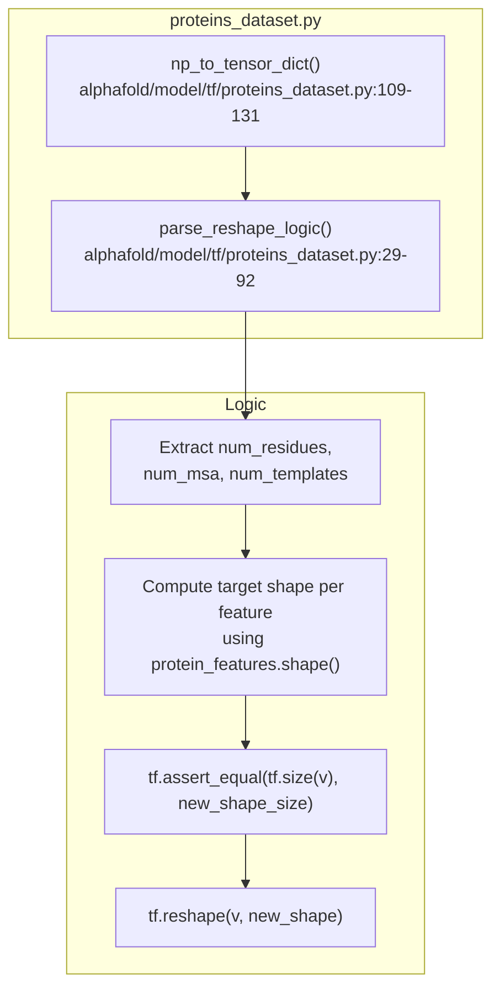

# Feature Processing

Relevant source files

The following files were used as context for generating this wiki page:

- [alphafold/data/feature_processing.py](alphafold/data/feature_processing.py)
- [alphafold/data/msa_identifiers.py](alphafold/data/msa_identifiers.py)
- [alphafold/model/features.py](alphafold/model/features.py)
- [alphafold/model/model.py](alphafold/model/model.py)
- [alphafold/model/tf/data_transforms.py](alphafold/model/tf/data_transforms.py)
- [alphafold/model/tf/input_pipeline.py](alphafold/model/tf/input_pipeline.py)
- [alphafold/model/tf/proteins_dataset.py](alphafold/model/tf/proteins_dataset.py)

## Purpose and Scope

This page describes the feature processing subsystem that converts raw NumPy feature arrays into model-ready tensors with proper shapes, data types, and preprocessing applied. This is the final step of the data pipeline before features are fed into the neural network.

The raw features are produced by earlier stages of the data pipeline (see [MSA Generation](3.1), [Template Processing](3.2), and [Multimer MSA Pairing](3.3)). This page focuses on the transformation of those raw features into the format expected by the model architecture (see [Model Architecture](4) and [Model Execution](4.4)).

## Overview

Feature processing differs significantly between monomer and multimer modes:

- **Multimer mode**: Raw features are processed via `alphafold/data/feature_processing.py` [alphafold/data/feature_processing.py:15-17](). This involves chain-aware cropping, sequence pairing, and merging.
- **Monomer mode**: Raw features undergo a TensorFlow-based input pipeline defined in `alphafold/model/tf/input_pipeline.py` [alphafold/model/tf/input_pipeline.py:15-17](), including MSA clustering, masking, and data augmentation.

The processing ensures that all features have correct:
- **Shapes**: Matching expected dimensions for sequence length, MSA depth, and number of templates.
- **Data types**: Conversion to appropriate numeric types (e.g., casting `int64` to `int32`).
- **Values**: Application of masks, crops, and other transformations specified in the model configuration.

**Feature Processing Pipeline Overview**

Sources: [alphafold/model/model.py:122-141](), [alphafold/model/features.py:45-76](), [alphafold/data/feature_processing.py:74-107]()

## Monomer Processing (TensorFlow Pipeline)

In monomer mode, features pass through a complex TensorFlow-based transformation pipeline. This is orchestrated by `features.np_example_to_features` [alphafold/model/features.py:45-76]().

### Non-Ensembled Transformations
These functions are applied once to the input tensors [alphafold/model/tf/input_pipeline.py:34-61]():
- `correct_msa_restypes`: Reorders MSA amino acid types to match `residue_constants` [alphafold/model/tf/data_transforms.py:92-110]().
- `cast_64bit_ints`: Casts `int64` features to `int32` for model compatibility [alphafold/model/tf/data_transforms.py:35-40]().
- `squeeze_features`: Removes singleton dimensions and fake sequence dimensions [alphafold/model/tf/data_transforms.py:113-139]().
- `make_msa_mask`: Generates masks for MSA sequences.

### Ensembled Transformations
These operations can be repeated to create multiple "ensembles" for the model [alphafold/model/tf/input_pipeline.py:64-127]():
- `sample_msa`: Randomly selects a subset of MSA sequences up to `max_msa_clusters` [alphafold/model/tf/data_transforms.py:173-198]().
- `nearest_neighbor_clusters`: Assigns extra MSA sequences to their nearest neighbor in the sampled subset [alphafold/model/tf/data_transforms.py:222-224]().
- `random_crop_to_size`: Crops the sequence and MSA to a fixed `crop_size` [alphafold/model/tf/input_pipeline.py:108-114]().

Sources: [alphafold/model/tf/input_pipeline.py:34-127](), [alphafold/model/tf/data_transforms.py:35-224]()

## Multimer Processing (NumPy Pipeline)

Multimer processing is performed using NumPy and is integrated earlier in the pipeline via `alphafold/data/feature_processing.py`.

### Chain Pairing and Merging
The `pair_and_merge` function [alphafold/data/feature_processing.py:74-107]() handles the complex logic of combining multiple chains:
1. **Unmerged Processing**: Initial cleanup of individual chain features.
2. **MSA Pairing**: If the complex is not a homomer, sequences are paired across chains using `msa_pairing.create_paired_features` [alphafold/data/feature_processing.py:93]().
3. **Cropping**: MSAs are cropped to `MSA_CROP_SIZE` (default 2048) while balancing paired and unpaired sequences [alphafold/data/feature_processing.py:110-140]().
4. **Merging**: Chains are merged into a single global feature dictionary [alphafold/data/feature_processing.py:101-105]().

### Final Processing
The `process_final` function [alphafold/data/feature_processing.py:198-204]() applies last-minute corrections:
- `_correct_msa_restypes`: Maps MSA indices to the AlphaFold internal order [alphafold/data/feature_processing.py:207-212]().
- `_make_seq_mask`: Creates a mask based on `entity_id` [alphafold/data/feature_processing.py:215-217]().
- `_filter_features`: Removes any features not present in `REQUIRED_FEATURES` [alphafold/data/feature_processing.py:24-54]().

Sources: [alphafold/data/feature_processing.py:74-217]()

## Feature Reshaping and Validation

The `proteins_dataset` module handles the conversion of NumPy arrays to TensorFlow tensors with proper validation in the monomer pipeline.

**Feature Reshaping Logic**

### Dimension Extraction
The `parse_reshape_logic` function [alphafold/model/tf/proteins_dataset.py:29-92]() extracts dynamic dimensions:
- `num_residues`: From `seq_length` [line 36]().
- `num_msa`: From `num_alignments` [line 39]().
- `num_templates`: From `template_domain_names` [line 45]().

It then uses `protein_features.shape()` to resolve the specific shape for every feature name (e.g., `[NUM_MSA_SEQ, NUM_RES]` for the `msa` feature) and enforces these shapes using `tf.reshape` [lines 87-90]().

Sources: [alphafold/model/tf/proteins_dataset.py:29-131]()

## Key Feature Definitions

| Feature Name | Mode | Shape (Simplified) | Description |
|--------------|------|--------------------|-------------|
| `aatype` | Both | `[N_res]` | Amino acid types (0-20) |
| `msa` | Both | `[N_seq, N_res]` | Multiple Sequence Alignment indices |
| `deletion_matrix` | Both | `[N_seq, N_res]` | Number of deletions at each position |
| `residue_index` | Both | `[N_res]` | Residue index in the sequence |
| `template_aatype` | Both | `[N_temp, N_res]` | Amino acid types for template structures |
| `bert_mask` | Both | `[N_seq, N_res]` | Mask used for BERT-style MSA training |

Sources: [alphafold/data/feature_processing.py:24-54](), [alphafold/model/tf/data_transforms.py:43-50]()

## Integration with RunModel

The `RunModel` class in `alphafold/model/model.py` serves as the entry point for feature processing during inference.

- **`process_features`** [alphafold/model/model.py:122-141](): The primary method called by the prediction script. It routes to the appropriate pipeline based on `self.multimer_mode`.
- **`eval_shape`** [alphafold/model/model.py:143-151](): Uses `jax.eval_shape` to determine the output shapes of the model given a processed feature dictionary. This is useful for pre-allocating memory or debugging.

Sources: [alphafold/model/model.py:122-151]()

---