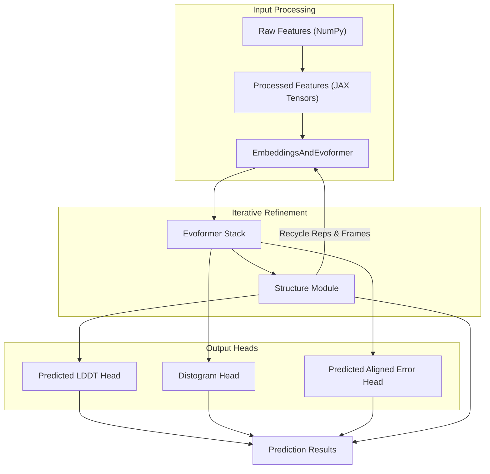
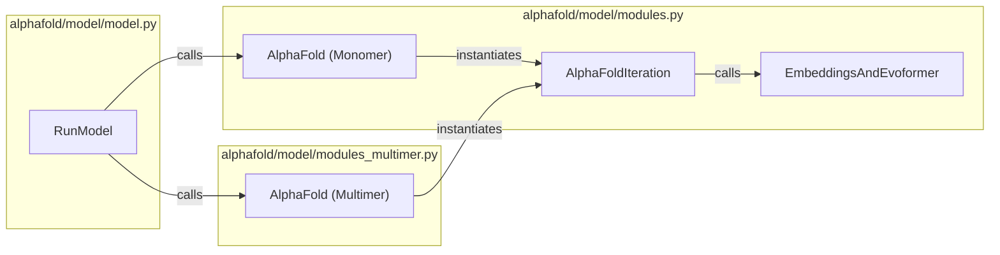

# Model Architecture

Relevant source files

The following files were used as context for generating this wiki page:

- [alphafold/model/config.py](alphafold/model/config.py)
- [alphafold/model/features.py](alphafold/model/features.py)
- [alphafold/model/model.py](alphafold/model/model.py)
- [alphafold/model/modules.py](alphafold/model/modules.py)
- [alphafold/model/modules_multimer.py](alphafold/model/modules_multimer.py)
- [alphafold/model/tf/proteins_dataset.py](alphafold/model/tf/proteins_dataset.py)

The AlphaFold model architecture is a deep learning system designed to predict protein structures from amino acid sequences with high accuracy. This page provides a high-level deep dive into the neural network architecture, from configuration to execution.

## Core Architecture Overview

AlphaFold transforms sequence and evolutionary information into 3D coordinates through a series of specialized neural network modules. The process is iterative, using a recycling mechanism to refine the structural representation.

Sources: [alphafold/model/modules.py:134-213](), [alphafold/model/model.py:72-102]()

## Architecture Components

The architecture is divided into several logical subsystems, each covered in detail in child pages:

### 1. Configuration System
The model's behavior is governed by a hierarchical configuration system. It defines presets for monomer and multimer modes, as well as `CONFIG_DIFFS` that specify variations between model versions (e.g., model_1 vs model_1_ptm).
*   **Key Entities**: `MODEL_PRESETS`, `CONFIG_DIFFS`, `BaseConfig`.
*   **Details**: For details, see [Configuration System](#4.1).

Sources: [alphafold/model/config.py:30-118](), [alphafold/model/base_config.py:20-30]()

### 2. Evoformer Stack
The Evoformer is the core processing engine of AlphaFold. It acts on two main representations: the MSA representation and the Pair representation. Through a series of blocks, it performs row-wise and column-wise attention on the MSA, and updates the pair representation using triangle multiplicative updates and triangle attention.
*   **Key Entities**: `EmbeddingsAndEvoformer`, `EvoformerIteration`, `TriangleMultiplication`, `OuterProductMean`.
*   **Details**: For details, see [Evoformer Stack](#4.2).

Sources: [alphafold/model/modules.py:399-479](), [alphafold/model/modules_multimer.py:526-816]()

### 3. Structure Module
The Structure Module converts the abstract representations from the Evoformer into explicit 3D coordinates. It uses Invariant Point Attention (IPA) to update residue frames and iteratively refines the protein backbone and side-chain geometry.
*   **Key Entities**: `StructureModule`, `InvariantPointAttention`, `BackboneUpdate`.
*   **Details**: For details, see [Structure Module](#4.3).

Sources: [alphafold/model/modules.py:214-216](), [alphafold/model/folding.py:18-50]()

### 4. Model Execution
Execution is managed by the `RunModel` class, which wraps the Haiku-transformed JAX functions. It handles feature preprocessing, parameter initialization, and the orchestration of the prediction workflow, including JIT compilation for performance.
*   **Key Entities**: `RunModel`, `hk.transform`, `jax.jit`, `predict`.
*   **Details**: For details, see [Model Execution](#4.4).

Sources: [alphafold/model/model.py:72-184]()

### 5. Model Utilities
The codebase includes various utilities for numerical stability and specialized neural network layers. This includes custom Haiku modules, stable softmax implementations, and context managers for bfloat16 precision.
*   **Key Entities**: `stable_softmax`, `bfloat16_context`, `LayerStack`.
*   **Details**: For details, see [Model Utilities](#4.5).

Sources: [alphafold/model/utils.py:1-50](), [alphafold/model/layer_stack.py:1-40]()

## Code Entity Map

The following diagram maps the high-level architecture concepts to the specific classes and functions in the codebase.

Sources: [alphafold/model/model.py:86-99](), [alphafold/model/modules.py:276-396](), [alphafold/model/modules_multimer.py:411-523]()

## Recycling and Ensembling

AlphaFold utilizes a recycling mechanism (Suppl. Alg. 2) where the output of the structure module and the updated representations are fed back into the start of the model for a fixed number of iterations (controlled by `num_recycle`). In monomer mode, the model can also perform ensembling by averaging representations across multiple stochastic passes.

| Feature | Monomer Behavior | Multimer Behavior |
| :--- | :--- | :--- |
| **Recycling** | 3 iterations by default | Up to 20 iterations with early stopping |
| **Ensembling** | Controlled by `ensemble_representations` | Handled via MSA sampling inside the model |
| **MSA Sampling** | Done in `AlphaFoldIteration` | Managed in `modules_multimer.py` |

Sources: [alphafold/model/modules.py:134-213](), [alphafold/model/modules_multimer.py:15-21](), [alphafold/model/config.py:146-148]()

---