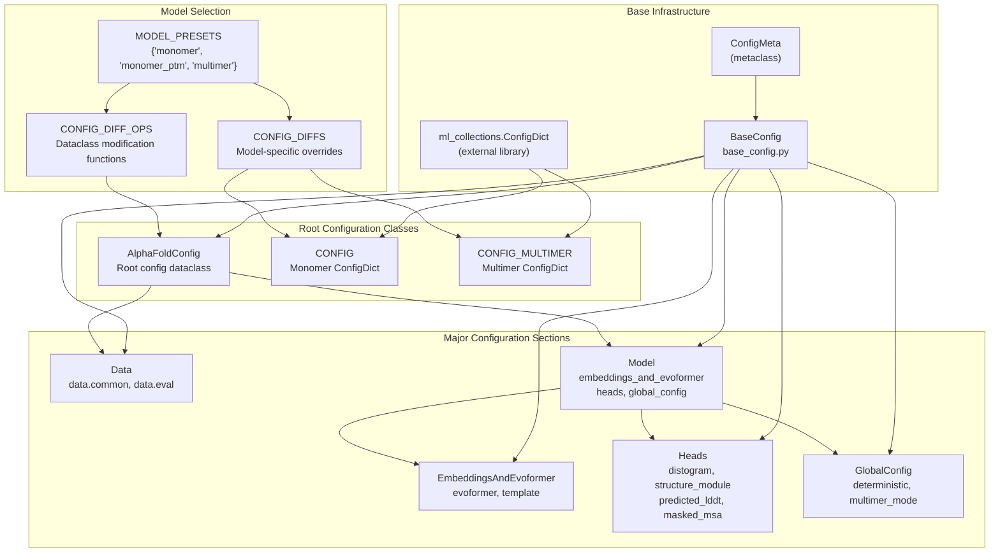
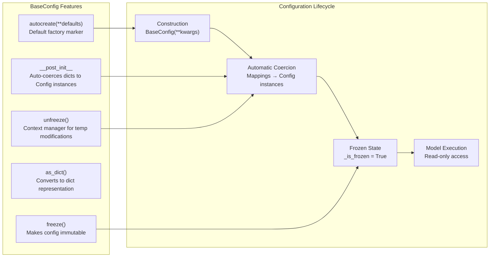
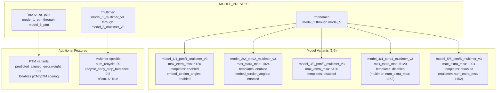
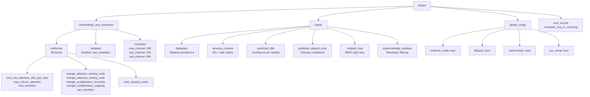

# Configuration System

<details>
<summary>Relevant source files</summary>

The following files were used as context for generating this wiki page:

- [alphafold/model/base_config.py](alphafold/model/base_config.py)
- [alphafold/model/base_config_test.py](alphafold/model/base_config_test.py)
- [alphafold/model/config.py](alphafold/model/config.py)
- [alphafold/model/config_test.py](alphafold/model/config_test.py)

</details>


## Purpose and Scope

The Configuration System manages all hyperparameters and architectural settings for AlphaFold models. It provides a flexible preset-based system that supports both monomer and multimer predictions with different model variants. The system uses two complementary configuration formats: legacy `ml_collections.ConfigDict` objects and modern frozen dataclass-based configurations.

For information about how configurations are used during model execution, see [Model Execution](#4.4). For details on the neural network architecture defined by these configurations, see [Evoformer Stack](#4.2) and [Structure Module](#4.3).

**Sources:** [alphafold/model/config.py:1-23]()

## Configuration Architecture Overview

The configuration system is built on a hierarchical class structure with two parallel representations: mutable dictionary-based configs and immutable dataclass-based configs.



**Sources:** [alphafold/model/base_config.py:69-131](), [alphafold/model/config.py:689-993]()

## Configuration Formats

### ml_collections.ConfigDict Format

The legacy configuration format uses `ml_collections.ConfigDict`, a mutable dictionary-based configuration object. Two base configurations are defined:

| Configuration | Purpose | Key Features |
|--------------|---------|--------------|
| `CONFIG` | Monomer predictions | Single chain, optional templates, 3 recycles [alphafold/model/config.py:136-168]() |
| `CONFIG_MULTIMER` | Multimer predictions | Multi-chain, always uses templates, 20 recycles, early stopping [alphafold/model/config.py:460-686]() |

The `model_config()` function returns a `ConfigDict` by applying model-specific overrides from `CONFIG_DIFFS`:

```python
def model_config(name: str) -> ml_collections.ConfigDict
```

This function:
1. Validates the model name exists in `CONFIG_DIFFS` [alphafold/model/config.py:996-997]()
2. Selects base config (`CONFIG` or `CONFIG_MULTIMER`) based on name [alphafold/model/config.py:998-1001]()
3. Applies flattened overrides using `update_from_flattened_dict()` [alphafold/model/config.py:1004-1005]()

**Sources:** [alphafold/model/config.py:136-457](), [alphafold/model/config.py:460-686](), [alphafold/model/config.py:995-1005]()

### BaseConfig Dataclass Format

The modern configuration format uses frozen dataclasses derived from `BaseConfig`. This provides:

- **Type safety**: Field types are enforced at construction [alphafold/model/base_config.py:132-138]()
- **Immutability**: Configs can be frozen to prevent modification via `freeze()` [alphafold/model/base_config.py:186-188]()
- **Automatic coercion**: Dictionary values are automatically converted to nested config objects in `__post_init__` [alphafold/model/base_config.py:94-128]()
- **Default factories**: Fields can use `autocreate()` for automatic initialization [alphafold/model/base_config.py:48-50]()



The `get_model_config()` function returns a frozen `AlphaFoldConfig` dataclass:

```python
@functools.lru_cache
def get_model_config(name: str, frozen: bool = True) -> AlphaFoldConfig
```

This function:
1. Validates the model name [alphafold/model/config.py:1009-1010]()
2. Constructs `AlphaFoldConfig` from appropriate base dict [alphafold/model/config.py:1011-1015]()
3. Applies model-specific modifications via functions in `CONFIG_DIFF_OPS` [alphafold/model/config.py:1017-1018]()
4. Optionally freezes the configuration [alphafold/model/config.py:1020-1021]()

**Sources:** [alphafold/model/base_config.py:42-200](), [alphafold/model/config.py:1008-1022]()

## Model Presets System

The preset system defines three categories of models with five variants each:



### Configuration Override Details

| Model | max_extra_msa | Templates | embed_torsion_angles | PAE Weight | Notes |
|-------|---------------|-----------|---------------------|------------|-------|
| model_1 | 5120 | ✓ | ✓ | 0.0 | Full template pipeline [alphafold/model/config.py:56-63]() |
| model_2 | 1024 | ✓ | ✓ | 0.0 | Reduced extra MSA [alphafold/model/config.py:64-70]() |
| model_3 | 5120 | ✗ | ✗ | 0.0 | Template-free, large MSA [alphafold/model/config.py:71-74]() |
| model_4 | 5120 | ✗ | ✗ | 0.0 | Template-free, large MSA [alphafold/model/config.py:75-78]() |
| model_5 | 1024 | ✗ | ✗ | 0.0 | Template-free, default MSA [alphafold/model/config.py:79-81]() |
| *_ptm variants | Same | Same | Same | 0.1 | Adds PAE head weight [alphafold/model/config.py:85-108]() |
| *_multimer_v3 | N/A | ✓ | N/A | 0.1 | 20 recycles, early stopping [alphafold/model/config.py:460-686]() |

**Sources:** [alphafold/model/config.py:30-53](), [alphafold/model/config.py:55-118]()

## Configuration Construction Flow

```mermaid
graph TB
    subgraph "Dictionary-Based Path"
        model_name_dict["model_name<br/>(e.g., 'model_3_ptm')"]
        model_config_func["model_config(name)<br/>config.py:995-1005"]
        select_base_dict["Select base:<br/>CONFIG or CONFIG_MULTIMER"]
        deep_copy_dict["copy.deepcopy()"]
        apply_diffs_dict["update_from_flattened_dict()<br/>CONFIG_DIFFS[name]"]
        result_dict["ml_collections.ConfigDict<br/>Mutable configuration"]
    end
    
    subgraph "Dataclass-Based Path"
        model_name_dc["model_name<br/>(e.g., 'model_3_ptm')"]
        get_model_config_func["get_model_config(name, frozen=True)<br/>config.py:1008-1022"]
        select_base_dc["Select base:<br/>CONFIG or CONFIG_MULTIMER"]
        construct_dc["AlphaFoldConfig(**base.to_dict())"]
        apply_diff_ops["CONFIG_DIFF_OPS[name](cfg)<br/>Modify dataclass in-place"]
        freeze_dc["cfg.freeze()<br/>Make immutable"]
        result_dc["AlphaFoldConfig<br/>Frozen dataclass"]
        lru_cache["@functools.lru_cache<br/>Cache per model"]
    end
    
    model_name_dict --> model_config_func
    model_config_func --> select_base_dict
    select_base_dict --> deep_copy_dict
    deep_copy_dict --> apply_diffs_dict
    apply_diffs_dict --> result_dict
    
    model_name_dc --> get_model_config_func
    get_model_config_func --> lru_cache
    lru_cache --> select_base_dc
    select_base_dc --> construct_dc
    construct_dc --> apply_diff_ops
    apply_diff_ops --> freeze_dc
    freeze_dc --> result_dc
```



### Dataclass Modification Functions

The `CONFIG_DIFF_OPS` dictionary maps model names to functions that modify `AlphaFoldConfig` instances [alphafold/model/config.py:1155-1185]():

- **Template models** (1, 2): Enable template processing and set `embed_torsion_angles` via `_apply_model_1_diff` and `_apply_model_2_diff` [alphafold/model/config.py:1025-1044]()
- **Template-free models** (3, 4, 5): Modify `max_extra_msa` if needed via `_apply_model_3_diff` etc. [alphafold/model/config.py:1047-1061]()
- **PTM variants**: Set `predicted_aligned_error.weight = 0.1` via `_apply_ptm_diff` [alphafold/model/config.py:1064-1066]()
- **Multimer v1/v2**: Apply `_common_updates()` for numerical optimizations in Triangle Multiplication [alphafold/model/config.py:1082-1094]()
- **Multimer v3**: Minimal changes (models 4 and 5 modify `num_extra_msa`) [alphafold/model/config.py:1097-1111]()

**Sources:** [alphafold/model/config.py:1025-1185]()

## Configuration Structure

### Top-Level Structure

The `AlphaFoldConfig` class contains two major sections:

```
AlphaFoldConfig
├── model: Model                    (required)
│   ├── embeddings_and_evoformer
│   ├── global_config
│   ├── heads
│   ├── num_recycle
│   └── resample_msa_in_recycling
└── data: Data                      (optional, used during training)
    ├── common
    └── eval
```

**Sources:** [alphafold/model/config.py:990-993]()

### Data Configuration Section

The `data` section controls feature processing and training data preparation:

| Field | Type | Purpose |
|-------|------|---------|
| `data.common.masked_msa` | `MaskedMsa` | BERT-style MSA masking probabilities [alphafold/model/config.py:139-143]() |
| `data.common.max_extra_msa` | `int` | Maximum extra MSA sequences (1024 or 5120) [alphafold/model/config.py:144]() |
| `data.common.use_templates` | `bool` | Enable/disable template processing [alphafold/model/config.py:167]() |
| `data.common.num_recycle` | `int` | Number of recycling iterations [alphafold/model/config.py:146]() |
| `data.eval.max_msa_clusters` | `int` | Maximum clustered MSA sequences (512) [alphafold/model/config.py:214]() |
| `data.eval.max_templates` | `int` | Maximum template structures (4) [alphafold/model/config.py:215]() |
| `data.eval.feat` | `Dict[str, Any]` | Expected feature shapes with placeholders [alphafold/model/config.py:170-211]() |

The `data.eval.feat` dictionary defines expected tensor shapes using placeholders:
- `NUM_RES`: Number of residues [alphafold/model/config.py:25]()
- `NUM_MSA_SEQ`: Clustered MSA sequences [alphafold/model/config.py:26]()
- `NUM_EXTRA_SEQ`: Extra MSA sequences [alphafold/model/config.py:27]()
- `NUM_TEMPLATES`: Template structures [alphafold/model/config.py:28]()

**Sources:** [alphafold/model/config.py:137-238](), [alphafold/model/config.py:696-722]()

### Model Configuration Section



**Key Configuration Classes:**

| Class | Purpose | Key Fields |
|-------|---------|------------|
| `EmbeddingsAndEvoformer` | Evoformer stack configuration | `evoformer_num_block` (48), `evoformer`, `template` [alphafold/model/config.py:858-872]() |
| `Evoformer` | Single Evoformer block config | Attention and triangle operation configs [alphafold/model/config.py:796-815]() |
| `Template` | Template processing config | `enabled`, `max_templates`, `template_pair_stack` [alphafold/model/config.py:843-855]() |
| `GlobalConfig` | Cross-cutting concerns | `multimer_mode`, `bfloat16`, `use_remat` [alphafold/model/config.py:881-890]() |
| `Heads` | Output head configurations | `structure_module`, `distogram`, `predicted_lddt`, etc. [alphafold/model/config.py:978-988]() |

**Sources:** [alphafold/model/config.py:239-457](), [alphafold/model/config.py:858-988]()

### Structure Module Configuration

The `structure_module` head contains settings for 3D structure prediction:

```python
structure_module:
  num_layer: 8                          # IPA iterations [alphafold/model/config.py:934]
  num_head: 12                          # Attention heads [alphafold/model/config.py:935]
  num_channel: 384                      # Hidden dimension [alphafold/model/config.py:936]
  
  # Invariant Point Attention
  num_point_qk: 4                       # Point query/key pairs [alphafold/model/config.py:937]
  num_point_v: 8                        # Point value pairs [alphafold/model/config.py:938]
  num_scalar_qk: 16                     # Scalar query/key dim [alphafold/model/config.py:939]
  num_scalar_v: 16                      # Scalar value dim [alphafold/model/config.py:940]
  
  # Loss configurations
  fape:                                 # Frame Aligned Point Error
    clamp_distance: 10.0                # [alphafold/model/config.py:945]
    loss_unit_distance: 10.0            # [alphafold/model/config.py:946]
```

**Monomer vs Multimer Differences:**

| Feature | Monomer | Multimer |
|---------|---------|----------|
| `position_scale` | 10.0 | 20.0 [alphafold/model/config.py:643]() |
| FAPE type | Single `fape` config | `interface_fape` + `intra_chain_fape` [alphafold/model/config.py:654-665]() |
| `num_recycle` | 3 | 20 [alphafold/model/config.py:603]() |
| `recycle_early_stop_tolerance` | N/A | 0.5 [alphafold/model/config.py:604]() |

**Sources:** [alphafold/model/config.py:413-443](), [alphafold/model/config.py:642-674](), [alphafold/model/config.py:931-955]()

### Global Configuration

The `global_config` section contains settings that affect the entire model:

| Field | Monomer | Multimer | Purpose |
|-------|---------|----------|---------|
| `multimer_mode` | `False` | `True` | Enables multi-chain logic [alphafold/model/config.py:609]() |
| `bfloat16` | N/A | `True` | Use bfloat16 precision [alphafold/model/config.py:601]() |
| `deterministic` | `False` | `False` | Disable dropout/randomness [alphafold/model/config.py:882]() |
| `use_remat` | `False` | `False` | Gradient checkpointing [alphafold/model/config.py:884]() |
| `zero_init` | `True` | `True` | Zero-initialize linear layers [alphafold/model/config.py:886]() |
| `subbatch_size` | 4 | 4 | Subbatching for memory [alphafold/model/config.py:883]() |

**Sources:** [alphafold/model/config.py:379-386](), [alphafold/model/config.py:601-610](), [alphafold/model/config.py:881-890]()

## Configuration Consistency Testing

Both configuration formats are tested to ensure consistency in `alphafold/model/config_test.py`:

```python
@parameterized.parameters(config.CONFIG_DIFFS.keys())
def test_config_dict_and_dataclass_agree(self, model_name):
    """Ensures model_config() and get_model_config() return same values."""
    config_dict_json = json.dumps(config.model_config(model_name).to_dict())
    config_dataclass_json = json.dumps(
        config.get_model_config(model_name).as_dict(include_none=False)
    )
    self.assertJsonEqual(config_dict_json, config_dataclass_json)
```

This test runs for all models in `CONFIG_DIFFS.keys()` to ensure both construction paths produce equivalent configurations.

**Sources:** [alphafold/model/config_test.py:22-35]()

---