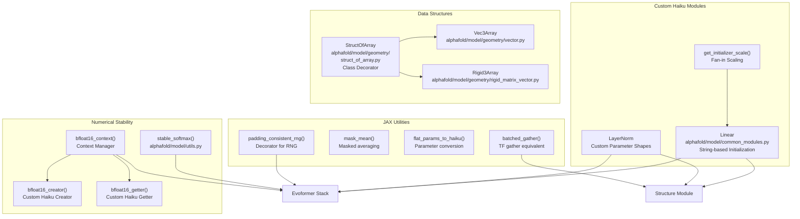
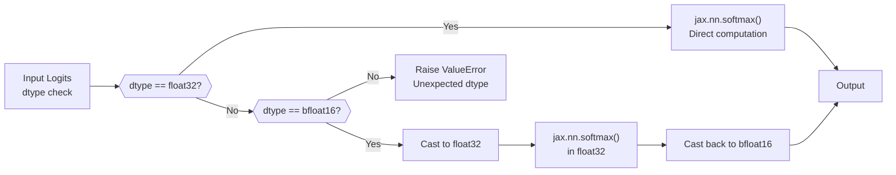
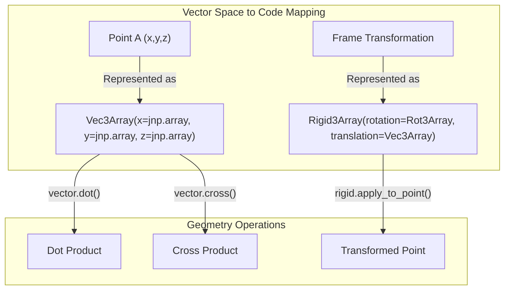

# Model Utilities

Relevant source files

The following files were used as context for generating this wiki page:

- [alphafold/model/common_modules.py](alphafold/model/common_modules.py)
- [alphafold/model/geometry/rigid_matrix_vector.py](alphafold/model/geometry/rigid_matrix_vector.py)
- [alphafold/model/geometry/rotation_matrix.py](alphafold/model/geometry/rotation_matrix.py)
- [alphafold/model/geometry/struct_of_array.py](alphafold/model/geometry/struct_of_array.py)
- [alphafold/model/geometry/vector.py](alphafold/model/geometry/vector.py)
- [alphafold/model/prng_test.py](alphafold/model/prng_test.py)
- [alphafold/model/r3.py](alphafold/model/r3.py)
- [alphafold/model/utils.py](alphafold/model/utils.py)
- [docker/requirements.txt](docker/requirements.txt)

## Purpose and Scope

This document covers the utility functions and modules that support the AlphaFold model implementation. These utilities provide three primary categories of functionality:

1.  **Numerical Stability**: Functions for handling `bfloat16` precision and numerically stable operations.
2.  **Custom Neural Network Modules**: Haiku-based layers with AlphaFold-specific initialization and features.
3.  **JAX Helper Functions**: Utilities for array operations, masking, parameter conversion, and random number generation.
4.  **Geometric Utilities**: Efficient struct-of-array representations for 3D coordinates and transformations.

For information about the core model architecture components that use these utilities, see [Model Architecture](). For geometric transformations and rigid body operations, see [Atom Representations and Geometry]().

---

## System Overview

**Sources:** [alphafold/model/utils.py:1-178](), [alphafold/model/common_modules.py:1-202](), [alphafold/model/geometry/struct_of_array.py:1-233](), [alphafold/model/geometry/vector.py:32-48](), [alphafold/model/geometry/rigid_matrix_vector.py:31-37]()

---

## Numerical Stability Utilities

### BFloat16 Precision Handling

AlphaFold supports mixed-precision training and inference using `bfloat16` (Brain Floating Point 16-bit), which provides memory and computational efficiency while maintaining numerical stability. The utilities in [alphafold/model/utils.py]() handle the complexities of `bfloat16` operations.

#### Stable Softmax

The `stable_softmax()` function ensures numerical stability for softmax operations, particularly when working with `bfloat16`:

The `bfloat16` path explicitly converts to `float32` before computing softmax to avoid numerical issues with large negative values [alphafold/model/utils.py:34-38](). Large negatives occur when masking logits by adding large negative values so they softmax to zero.

#### BFloat16 Context Manager

The `bfloat16_context()` [alphafold/model/utils.py:59-62]() provides a context manager that modifies Haiku's parameter creation and retrieval:

*   **`bfloat16_creator`**: Creates `float32` variables even when `bfloat16` is requested [alphafold/model/utils.py:44-48]().
*   **`bfloat16_getter`**: Casts the stored `float32` parameters to `bfloat16` upon retrieval [alphafold/model/utils.py:51-56]().

**Sources:** [alphafold/model/utils.py:29-62]()

---

## Custom Haiku Modules

### Linear Layer

The `Linear` class in [alphafold/model/common_modules.py:54-135]() extends standard Haiku linear layers with AlphaFold-specific features:

| Feature | Description |
| :--- | :--- |
| **Arbitrary Rank** | Supports inputs and outputs of arbitrary rank beyond 2D [alphafold/model/common_modules.py:58](). |
| **String Initializers** | Specifies initializers via strings: `'linear'`, `'relu'`, or `'zeros'` [alphafold/model/common_modules.py:77-78](). |
| **Einsum Projection** | Uses `jnp.einsum` for flexible projection across `num_input_dims` [alphafold/model/common_modules.py:122-124](). |

**Initialization Formula:**
The `get_initializer_scale` function [alphafold/model/common_modules.py:31-51]() computes fan-in scaling. The standard deviation is adjusted for truncation using `TRUNCATED_NORMAL_STDDEV_FACTOR` (~0.8796) [alphafold/model/common_modules.py:25-27]().

### LayerNorm

The custom `LayerNorm` [alphafold/model/common_modules.py:138-201]() differs from `hk.LayerNorm` by ensuring parameter shapes are always vectors (1D) rather than higher-rank tensors [alphafold/model/common_modules.py:141-143](). It also includes internal `float32` casting for `bfloat16` inputs to maintain stability [alphafold/model/common_modules.py:173-175]().

**Sources:** [alphafold/model/common_modules.py:31-201]()

---

## Geometric Representations

AlphaFold uses specialized data structures for 3D geometry to improve performance and precision on accelerators like TPUs, which are suboptimal for small 3x3 matrix multiplications [alphafold/model/geometry/vector.py:37-40]().

### Vec3Array and Rot3Array

*   **`Vec3Array`**: Represents 3D vectors as a "Struct of Arrays" (separate `x`, `y`, `z` arrays) [alphafold/model/geometry/vector.py:33-48]().
*   **`Rot3Array`**: Represents 3x3 rotation matrices using 9 separate components (`xx`, `xy`, etc.) [alphafold/model/geometry/rotation_matrix.py:33-44]().
*   **`Rigid3Array`**: Combines a `Rot3Array` and `Vec3Array` to represent a full rigid transformation [alphafold/model/geometry/rigid_matrix_vector.py:32-36]().

### Struct of Array Pattern

The `StructOfArray` class decorator [alphafold/model/geometry/struct_of_array.py:191-233]() automates the conversion of standard dataclasses into PyTrees that JAX can manipulate efficiently.

**Sources:** [alphafold/model/geometry/vector.py:32-113](), [alphafold/model/geometry/rotation_matrix.py:32-73](), [alphafold/model/geometry/rigid_matrix_vector.py:31-51](), [alphafold/model/geometry/struct_of_array.py:191-233]()

---

## JAX Helper Functions

### Masked Mean
The `mask_mean()` function [alphafold/model/utils.py:80-109]() computes averages while ignoring masked elements. It handles broadcasting where the mask may have a size of 1 in a dimension that the value tensor does not [alphafold/model/utils.py:102-103]().

### Padding-Consistent RNG
`padding_consistent_rng()` [alphafold/model/utils.py:124-178]() is a decorator that ensures random number generation is invariant to padding. It works by generating a grid of RNG keys based on indices using `jax.random.fold_in` [alphafold/model/utils.py:162-165](), so that the random value at index `(i, j)` remains the same regardless of the total array shape.

### Batched Gather
`batched_gather()` [alphafold/model/utils.py:72-77]() implements a JAX version of `tf.gather` with support for `axis` and `batch_dims` by recursively applying `jax.vmap` over `jnp.take`.

**Sources:** [alphafold/model/utils.py:72-178]()

---