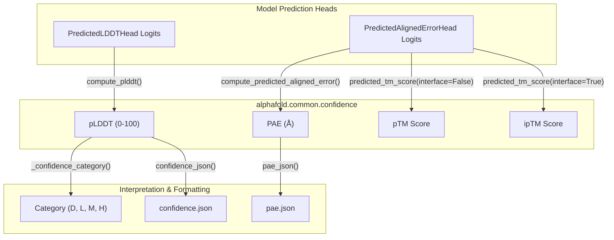
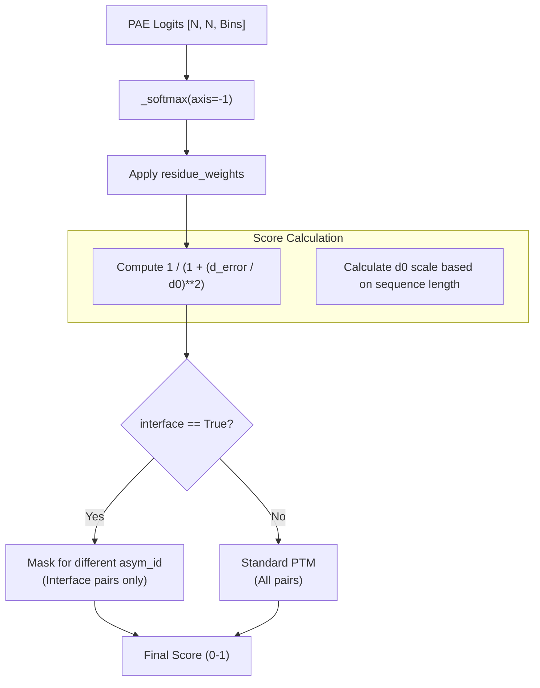

# Confidence Metrics

Relevant source files

The following files were used as context for generating this wiki page:

- [alphafold/common/confidence.py](alphafold/common/confidence.py)
- [alphafold/common/confidence_test.py](alphafold/common/confidence_test.py)
- [alphafold/model/lddt.py](alphafold/model/lddt.py)
- [alphafold/model/lddt_test.py](alphafold/model/lddt_test.py)
- [alphafold/notebooks/notebook_utils.py](alphafold/notebooks/notebook_utils.py)

This page describes the confidence metrics used in AlphaFold to evaluate the reliability of protein structure predictions. These metrics help users assess different aspects of prediction quality, from per-residue accuracy to pairwise residue position confidence and overall model quality.

## Overview of Confidence Metrics

AlphaFold provides several complementary confidence metrics to help assess prediction quality:

- **pLDDT** (predicted Local Distance Difference Test): Per-residue confidence score (0-100).
- **PAE** (Predicted Aligned Error): Pairwise residue position confidence (in Ångstroms).
- **pTM** (predicted TM-score): Overall fold quality assessment (0-1).
- **ipTM** (predicted interface TM-score): Interface quality in multimers (0-1).

### Confidence Metric Flow

The following diagram illustrates how raw model logits are transformed into human-interpretable confidence scores within the `alphafold/common/confidence.py` module.

Sources: [alphafold/common/confidence.py:15-205](), [alphafold/model/lddt.py:19-25]()

---

## pLDDT (predicted Local Distance Difference Test)

The pLDDT score is a per-residue confidence metric ranging from 0 to 100. It is a predictor of the lDDT-Cα metric, which measures local structure accuracy without requiring global superposition.

### Calculation Logic
The function `compute_plddt` [alphafold/common/confidence.py:30-44]() implements the logic:
1.  **Input**: Logits of shape `[num_res, num_bins]` from the model's LDDT head.
2.  **Softmax**: Logits are converted to probabilities using a custom `_softmax` implementation [alphafold/common/confidence.py:23-27]().
3.  **Bin Centers**: The range [0, 1] is divided into bins. The center of each bin is calculated as `(0.5 * bin_width)`.
4.  **Expectation**: The final score is the expected value (probability-weighted sum of bin centers) multiplied by 100.

### Confidence Categories
The internal helper `_confidence_category` [alphafold/common/confidence.py:47-58]() maps scores to qualitative labels:
*   **H (High)**: 90-100
*   **M (Medium)**: 70-90
*   **L (Low)**: 50-70
*   **D (Disordered)**: 0-50

Sources: [alphafold/common/confidence.py:23-58](), [alphafold/model/lddt.py:19-101]()

---

## PAE (Predicted Aligned Error)

PAE measures the expected distance error (in Ångstroms) between residue $i$ and residue $j$ when the structures are aligned on residue $i$.

### Implementation Details
The `compute_predicted_aligned_error` function [alphafold/common/confidence.py:127-155]() processes the logits from the `PredictedAlignedErrorHead`:
1.  **Probability Calculation**: Softmax is applied across the bin dimension of the `[num_res, num_res, num_bins]` logit tensor.
2.  **Bin Center Mapping**: `_calculate_bin_centers` [alphafold/common/confidence.py:84-99]() derives centers from the `breaks` array (the edges of the error bins).
3.  **Expected Error**: `_calculate_expected_aligned_error` [alphafold/common/confidence.py:102-124]() computes the sum of probabilities multiplied by bin centers.

### JSON Export
The `pae_json` function [alphafold/common/confidence.py:158-181]() formats the square PAE matrix for storage, rounding values to one decimal place to match the AlphaFold Database (AFDB) style.

Sources: [alphafold/common/confidence.py:84-181]()

---

## pTM and ipTM (predicted TM-scores)

The `predicted_tm_score` function [alphafold/common/confidence.py:184-205]() calculates global quality scores based on the PAE distribution.

### Algorithm Flow
The function supports both standard pTM and interface-specific ipTM:

*   **pTM**: Uses all residue pairs to estimate the Template Modeling score (TM-score).
*   **ipTM**: Only considers pairs of residues that belong to different chains (asymmetric units), identified by the `asym_id` array [alphafold/common/confidence.py:199-201]().

Sources: [alphafold/common/confidence.py:184-212]()

---

## Data Structures and Testing

### Confidence JSON Format
The `confidence_json` function [alphafold/common/confidence.py:61-81]() produces a serialized dictionary containing:
*   `residueNumber`: 1-based index of residues.
*   `confidenceScore`: pLDDT values rounded to 2 decimal places.
*   `confidenceCategory`: The D/L/M/H classification.

### Validation
Confidence calculations are verified in `alphafold/common/confidence_test.py`:
*   `test_pae_json`: Ensures rounding and JSON structure for PAE [alphafold/common/confidence_test.py:25-32]().
*   `test_confidence_json`: Validates pLDDT categorization and indexing [alphafold/common/confidence_test.py:34-48]().
*   `alphafold/model/lddt_test.py` provides ground-truth comparisons for the underlying lDDT metric implementation [alphafold/model/lddt_test.py:21-90]().

Sources: [alphafold/common/confidence.py:61-81](), [alphafold/common/confidence_test.py:15-52](), [alphafold/model/lddt_test.py:21-90]()

---