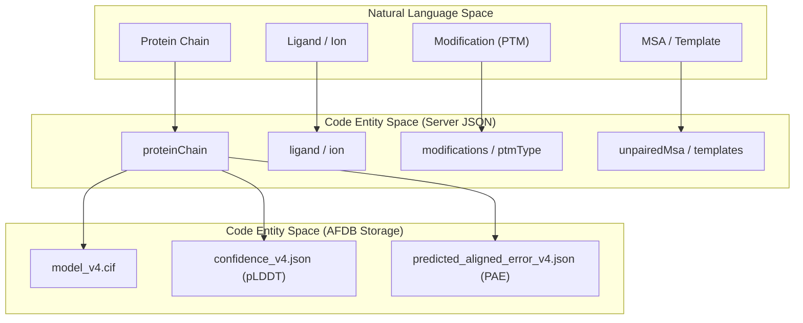
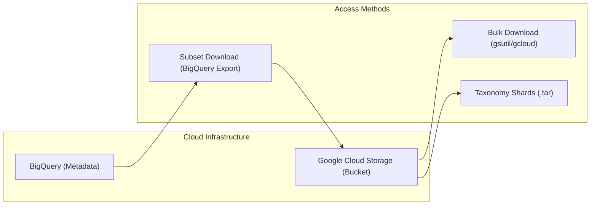

# AlphaFold Server and Database

Relevant source files

The following files were used as context for generating this wiki page:

- [afdb/README.md](afdb/README.md)
- [server/README.md](server/README.md)
- [server/example.json](server/example.json)

This section provides a technical overview of the external-facing components of the AlphaFold ecosystem: the **AlphaFold Server** and the **AlphaFold Protein Structure Database (AFDB)**. While the core AlphaFold codebase facilitates local execution, these services provide high-throughput access to structural predictions and a standardized API for complex job submissions including ligands, nucleic acids, and post-translational modifications.

### System Overview

The AlphaFold Server utilizes a JSON-based job submission format to define complex molecular systems, while the AFDB provides access to over 214 million pre-computed structures.

#### Relationship between Server and Database
The following diagram illustrates the relationship between the local code entities, the Server's job specification, and the Database storage.

**Entity Mapping: Input to Storage**

Sources: [server/README.md:48-60](), [afdb/README.md:68-83]()

---

## AlphaFold Server API

The AlphaFold Server API allows users to automate the submission of modeling jobs via a structured JSON format [server/README.md:15-17](). This format is the standard for describing heterogeneous systems that include proteins, DNA, RNA, ligands, and ions [server/README.md:48-56]().

### Key Capabilities
*   **Entity Specification**: Define multiple `sequences` within a single job, including `proteinChain`, `dnaSequence`, `rnaSequence`, `ligand`, and `ion` [server/README.md:48-56]().
*   **Advanced Protein Modeling**: Supports post-translational modifications (PTMs) using `ptmType` (CCD codes) and glycosylation via the `glycans` field [server/README.md:80-99]().
*   **Custom Inputs**: Users can provide their own Multiple Sequence Alignments (MSA) in A3M format using `unpairedMsa` or specify custom structural templates via the `templates` field containing `mmcif` strings [server/README.md:111-121]().
*   **Job Control**: Manage reproducibility using `modelSeeds` and control template usage with `maxTemplateDate` [server/README.md:27-34]().

For details on the JSON schema and entity definitions, see [AlphaFold Server API](#7.1).

Sources: [server/README.md:1-135](), [server/example.json:1-135]()

---

## AlphaFold Protein Structure Database (AFDB)

The AFDB is a collaborative project between Google DeepMind and EMBL-EBI, hosting 214 million protein structure predictions [afdb/README.md:5-9](). The data is hosted on Google Cloud Public Datasets and is accessible via Google Cloud Storage and BigQuery [afdb/README.md:9-12]().

### Data Structure and Access
The database provides three primary files for every UniProt entry, identified by the format `AF-[UniProt Accession]-F[Fragment Number]` [afdb/README.md:65-66]().

| File Type | Description | Key Metric |
| :--- | :--- | :--- |
| `model_v4.cif` | Atomic coordinates and metadata | 3D Coordinates |
| `confidence_v4.json` | Per-residue confidence scores | pLDDT |
| `predicted_aligned_error_v4.json` | Per-residue pair error confidence | PAE |

**Data Flow: AFDB Access Patterns**

Sources: [afdb/README.md:9-12](), [afdb/README.md:68-88]()

### Metadata and Sharding
*   **Metadata**: Available via BigQuery for complex filtering or through `accession_ids.csv` and `sequences.fasta` stored in the root of the bucket [afdb/README.md:9-12, 90-105]().
*   **Taxonomy Shards**: Predictions are grouped by NCBI taxonomy ID for easier downloading of specific proteomes [afdb/README.md:87-88]().

For details on bulk downloading, BigQuery schema, and file formats, see [AlphaFold Protein Structure Database](#7.2).

Sources: [afdb/README.md:1-105]()

---