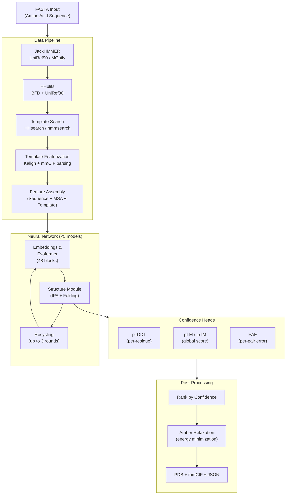

**AlphaFold** is DeepMind's open-source implementation of the inference pipeline for AlphaFold v2 — the breakthrough system that achieved atomic-level accuracy in protein structure prediction at CASP14. This repository (v2.3.2) provides the complete production-ready code for running both **monomer** and **multimer** structure predictions, from raw amino acid sequences to 3D atomic coordinates with confidence metrics.


Sources: [README.md](/README.md#L1-L20), [version.py](/alphafold/version.py#L15-L17)

## What AlphaFold Does

Given one or more protein amino acid sequences (in FASTA format), AlphaFold produces predicted 3D structures in PDB and mmCIF format, annotated with per-residue and per-pair confidence scores. The pipeline operates in four sequential phases:

1. **Data Pipeline** — Searches genetic databases (UniRef90, MGnify, BFD/UniRef30) for evolutionary homologs via MSA tools (JackHMMER, HHblits), then finds structural templates from the PDB (via HHsearch or hmmsearch). These inputs are assembled into a feature dictionary.
2. **Model Inference** — Feeds features through the neural network (Evoformer → Structure Module) across 5 trained model parameters, with optional recycling (up to 3 rounds) to refine predictions.
3. **Confidence Scoring** — Computes pLDDT (per-residue confidence), pTM (predicted TM-score), and PAE (predicted aligned error) for each model output.
4. **Amber Relaxation** — Applies physics-based energy minimization (Amber force field) to resolve stereochemical violations in the predicted structures.

> [!TIP]
> The five model checkpoints are not redundant — they differ in training configuration (template usage, extra MSA depth, ensembling). Running all five and ranking by confidence is essential for production-quality predictions.

Sources: [run_alphafold.py](/run_alphafold.py#L263-L340), [pipeline.py](/alphafold/data/pipeline.py#L126-L281), [model.py](/alphafold/model/model.py#L57-L185)

## Architecture at a Glance

The following diagram shows the end-to-end flow from a FASTA input to the final ranked, relaxed PDB outputs:



Sources: [run_alphafold.py](/run_alphafold.py#L263-L490), [modules.py](/alphafold/model/modules.py#L121-L250), [model.py](/alphafold/model/model.py#L131-L185)

## Project Structure

The repository is organized into self-contained Python packages, each responsible for a distinct pipeline stage:

```
alphafold/
├── common/                  # Shared data types and constants
│   ├── protein.py           #   Protein dataclass (atoms, residues, chains, B-factors)
│   ├── confidence.py        #   pLDDT, pTM, PAE computation
│   ├── residue_constants.py #   Amino acid mappings and atom type tables
│   └── mmcif_metadata.py   #   mmCIF format metadata
├── data/                    # Input feature construction
│   ├── pipeline.py          #   Monomer DataPipeline (MSA + templates → features)
│   ├── pipeline_multimer.py #   Multimer DataPipeline (chain pairing + merging)
│   ├── templates.py         #   Template hit featurization
│   ├── parsers.py           #   FASTA, A3M, Stockholm parsers
│   ├── msa_pairing.py       #   Cross-chain MSA pairing logic
│   ├── feature_processing.py#   Feature cropping and subsampling
│   └── tools/               #   Wrappers for external bioinformatics tools
│       ├── jackhmmer.py     #     JackHMMER (HMMER3)
│       ├── hhblits.py       #     HHblits (HH-suite)
│       ├── hhsearch.py      #     HHsearch template search
│       ├── hmmsearch.py     #     hmmsearch template search (multimer)
│       └── kalign.py        #     Kalign multiple sequence aligner
├── model/                   # Neural network architecture
│   ├── modules.py           #   AlphaFold monomer (Evoformer, heads, recycling)
│   ├── modules_multimer.py  #   AlphaFold multimer variant
│   ├── folding.py           #   Invariant Point Attention + Structure Module
│   ├── config.py            #   Model presets and hyperparameter configs
│   ├── model.py             #   RunModel (JIT-compiled inference driver)
│   ├── features.py          #   Feature preprocessing for model input
│   ├── quat_affine.py       #   Quaternion-based rigid body transforms
│   ├── r3.py                #   3D vector and rigid body algebra
│   ├── geometry/            #   Vector and matrix geometric primitives
│   └── tf/                  #   Shape placeholders and legacy TF utilities
├── relax/                   # Post-prediction refinement
│   ├── relax.py             #   AmberRelaxation orchestrator
│   ├── amber_minimize.py    #   L-BFGS energy minimization via OpenMM
│   └── utils.py             #   B-factor overwrite and validation
└── version.py               #   Single source of truth: __version__ = '2.3.2'

run_alphafold.py             # Main entry point (flags + predict_structure)
docker/                      # Dockerfile + run_docker.py for containerized runs
scripts/                     # Database download scripts (556 GB total)
```

Sources: [version.py](/alphafold/version.py#L15-L17), [run_alphafold.py](/run_alphafold.py#L1-L50)

## Model Presets

AlphaFold ships with four model presets, each selecting a different set of 5 trained model checkpoints and data pipeline configuration:

| Preset | Models | Template Search | Key Difference | Use Case |
|---|---|---|---|---|
| **`monomer`** | model_1 … model_5 | HHsearch (PDB70) | Standard CASP14-quality inference | Single-chain proteins |
| **`monomer_casp14`** | model_1 … model_5 | HHsearch (PDB70) | 8× ensemble evaluation (slower, more robust) | Reproducing CASP14 results |
| **`monomer_ptm`** | model_1_ptm … model_5_ptm | HHsearch (PDB70) | Adds Predicted Aligned Error head → pTM score | Single-chain with domain confidence |
| **`multimer`** | model_1_multimer_v3 … model_5_multimer_v3 | hmmsearch (PDB seqres) | Cross-chain MSA pairing + ipTM scoring | Multi-chain protein complexes |

The five models within each preset differ in their Evoformer configuration — specifically the **extra MSA depth** (`max_extra_msa`: 1024 vs 5120), **template usage** (enabled/disabled), and **torsion angle embedding**. Models 1–2 use templates; models 3–5 do not, providing diversity in the prediction ensemble.

Sources: [config.py](/alphafold/model/config.py#L24-L85), [run_alphafold.py](/run_alphafold.py#L600-L660)

## Technology Stack

AlphaFold's implementation sits at the intersection of **bioinformatics**, **deep learning**, and **computational chemistry**:

| Layer | Technology | Purpose |
|---|---|---|
| **Deep Learning Framework** | JAX + Haiku | Differentiable programming, JIT compilation, GPU/TPU acceleration |
| **MSA Generation** | JackHMMER (HMMER3), HHblits (HH-suite v3.3.0) | Profile HMM searches against genetic databases |
| **Template Search** | HHsearch / hmmsearch + Kalign | Structural homolog detection and alignment |
| **Relaxation** | OpenMM (Amber ff14SB force field) | Physics-based energy minimization |
| **I/O Formats** | BioPython (PDB/mmCIF), NumPy, Pickle | Protein structure serialization and parsing |
| **Containerization** | Docker + NVIDIA Container Toolkit | Reproducible GPU-enabled deployment |

Sources: [Dockerfile](/docker/Dockerfile#L1-L92), [requirements.txt](/requirements.txt)

## Key Capabilities and Constraints

**Capabilities:**
- Predict structures for single-chain proteins (monomer) and multi-chain complexes (multimer)
- Output per-residue confidence (pLDDT: 0–100 scale) and inter-domain/inter-chain confidence (pTM, ipTM, PAE)
- Generate both PDB and mmCIF formatted outputs with B-factor encoded confidence
- Run with full or reduced genetic databases (2.62 TB vs ~200 GB uncompressed)
- Optionally reuse precomputed MSAs to skip the slow database search step

**Constraints:**
- **Linux only** — no macOS or Windows support
- **GPU required** — modern NVIDIA GPU with sufficient VRAM (larger proteins need more memory)
- **Large storage** — full databases require ~3 TB disk (SSD recommended for MSA search performance)
- **Not deterministic** — GPU inference introduces non-determinism even with fixed random seeds
- **Inference only** — this is the prediction pipeline, not a training codebase

> [!TIP]
> The MSA generation phase is typically the bottleneck (minutes to hours depending on sequence and database size), not the neural network inference. Using `--use_precomputed_msas=True` on subsequent runs with the same sequence can skip this entirely.

Sources: [README.md](/README.md#L43-L90), [run_alphafold.py](/run_alphafold.py#L210-L260)

## Output Artifacts

For each prediction target, AlphaFold produces the following files in the output directory:

| File | Description |
|---|---|
| `ranked_{0-4}.pdb` | Predicted structures ranked by confidence (0 = best) |
| `ranked_{0-4}.cif` | Same predictions in mmCIF format |
| `unrelaxed_model_{n}.pdb` | Raw model outputs before Amber relaxation |
| `relaxed_model_{n}.pdb` | Energy-minimized model outputs |
| `result_{model_name}.pkl` | Full prediction result dictionary (pickled) |
| `features.pkl` | Input feature dictionary from the data pipeline |
| `confidence_{model_name}.json` | Per-residue pLDDT scores and categories |
| `pae_{model_name}.json` | Predicted aligned error matrix |
| `ranking_debug.json` | All model confidences and ranking order |
| `timings.json` | Wall-clock time for each pipeline stage |
| `msas/` | Intermediate MSA files (Stockholm/A3M format) |

Sources: [run_alphafold.py](/run_alphafold.py#L340-L490), [confidence.py](/alphafold/common/confidence.py#L31-L70)

## Where to Go Next

Now that you understand what AlphaFold is and how its pipeline is structured, here's a recommended reading path through the documentation:

1. **[Quick Start](2-quick-start)** — Get AlphaFold running with Docker and predict your first protein structure
2. **[Output Interpretation](3-output-interpretation)** — Understand pLDDT scores, PAE matrices, and how to assess prediction quality
3. **[Architecture Overview](7-architecture-overview)** — Deep dive into how the Evoformer, Structure Module, and Recycling interact
4. **[Model Presets and Variants](21-model-presets-and-variants)** — Choose the right model configuration for your use case
5. **[Docker Deployment](23-docker-deployment)** — Production deployment patterns and GPU configuration

For domain-specific exploration, the **Deep Dive** section covers each subsystem in detail — from [MSA Generation Workflow](8-msa-generation-workflow) and [Evoformer and Embeddings](11-evoformer-and-embeddings) to [Amber Relaxation](19-amber-relaxation) and [Protein Data Representation](20-protein-data-representation).