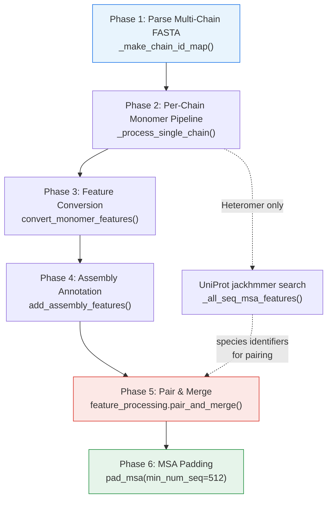
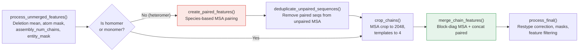

AlphaFold's multimer pipeline extends the monomer data pipeline to predict structures of multi-chain protein complexes. The core architectural challenge is **cross-chain MSA pairing** — constructing a joint MSA that captures evolutionary co-variation between interacting chains. This page dissects the three-module assembly system (`pipeline_multimer` → `feature_processing` → `msa_pairing`) that transforms per-chain monomer features into a unified feature dictionary ready for the Evoformer.

## Pipeline Orchestration: From FASTA to Unified Features

The multimer `DataPipeline.process()` method is the top-level entry point. It accepts a multi-sequence FASTA file and produces a single merged `FeatureDict` spanning all chains. The orchestration follows a strict five-phase sequence, where each phase depends on outputs from the prior:



Phase 1 parses the input FASTA and builds a `chain_id_map` — a mapping from PDB-format chain IDs (A, B, C, …) to `_FastaChain` dataclass instances holding each chain's sequence and description. This map is serialized to `chain_id_map.json` for downstream use. The system validates that chain count does not exceed **62** (the PDB format limit, corresponding to `PDB_CHAIN_IDS = 'ABCDEFGHIJKLMNOPQRSTUVWXYZabcdefghijklmnopqrstuvwxyz0123456789'`).

Sources: [pipeline_multimer.py](/alphafold/data/pipeline_multimer.py#L39-L77), [protein.py](/alphafold/common/protein.py#L34-L35)

## Per-Chain Monomer Processing with UniProt Pairing Features

For each unique sequence in the input, `_process_single_chain()` runs the **standard monomer `pipeline.DataPipeline`** on that chain in isolation — generating uniref90, mgnify, and BFD/UniRef30 MSAs plus template hits via HHsearch/HMMsearch. This reuses the monomer infrastructure unchanged.

Critically, for **heteromers** (where `len(set(input_seqs)) > 1`), an additional UniProt jackhmmer search is performed via `_all_seq_msa_features()`. This unclustered UniProt MSA serves a different purpose than the monomer MSA: it provides **species identifiers** for cross-chain pairing. The method extracts only `msa`, `msa_mask`, `deletion_matrix`, `deletion_matrix_int`, and `msa_species_identifiers` from the UniProt result, suffixing each key with `_all_seq` to distinguish them from the monomer MSA features. Species identifiers are parsed from UniProt description lines using the regex pattern `tr|Accession|EntryName_SpeciesCode` (e.g., `tr|A0A146SKV9|A0A146SKV9_FUNHE` yields species `FUNHE`).

Identical chains (homomeric copies) are handled efficiently: the pipeline checks `sequence_features` cache and deep-copies features for duplicate sequences rather than re-running the expensive monomer pipeline.

Sources: [pipeline_multimer.py](/alphafold/data/pipeline_multimer.py#L218-L310), [msa_identifiers.py](/alphafold/data/msa_identifiers.py#L25-L72)

## Monomer-to-Multimer Feature Conversion

`convert_monomer_features()` reshapes per-chain features produced by the monomer pipeline into the format expected by multimer models. The key transformations are:

| Feature | Monomer Format | Multimer Format | Transformation |
|---------|---------------|-----------------|----------------|
| `aatype` | One-hot `(N_res, 21)` | Integer `(N_res,)` | `np.argmax(axis=-1)` |
| `template_aatype` | One-hot `(N_templ, N_res, 21)` | Integer `(N_templ, N_res)` | `argmax` + remap via `MAP_HHBLITS_AATYPE_TO_OUR_AATYPE` |
| `sequence` | Shape `(1,)` object | Scalar object | Squeeze leading dim |
| `domain_name` | Shape `(1,)` object | Scalar object | Squeeze leading dim |
| `num_alignments` | Shape `(N_res,)` | Scalar | Squeeze leading dim |
| `seq_length` | Shape `(N_res,)` | Scalar | Squeeze leading dim |
| `template_all_atom_masks` | Key name with 's' | Renamed to `template_all_atom_mask` | Key rename |

Additionally, `auth_chain_id` is injected as a new feature carrying the PDB chain identifier. The one-hot → integer conversion for `aatype` is significant: the multimer model's embedding layers perform their own one-hot encoding internally, so the pre-encoded representation from the monomer pipeline must be inverted.

Sources: [pipeline_multimer.py](/alphafold/data/pipeline_multimer.py#L79-L105)

## Assembly Feature Annotation: Entity, Symmetry, and Asymmetry IDs

`add_assembly_features()` annotates each residue with three integer ID arrays that encode the **structural topology** of the complex:

- **`entity_id`**: Groups chains by identical sequence. Two chains with the same amino acid sequence share an `entity_id`. This distinguishes homomers from heteromers.
- **`sym_id`**: Symmetry operation identifier. For a homodimer with entity A, the two copies receive `sym_id` 1 and 2 respectively. For a heterodimer, both chains receive `sym_id` 1.
- **`asym_id`**: Unique chain identifier. Every chain gets a distinct `asym_id`, assigned sequentially.

The function groups chains by sequence, then constructs new dictionary keys of the form `{entity_letter}_{sym_id}` (e.g., `A_1`, `A_2` for a homodimer, `A_1`, `B_1` for a heterodimer). The `int_id_to_str_id()` helper encodes entity numbers in reverse-spreadsheet naming (1→A, 2→B, …, 27→AA), matching mmCIF conventions.

Sources: [pipeline_multimer.py](/alphafold/data/pipeline_multimer.py#L130-L167)

## The Core: Pair and Merge Pipeline

`feature_processing.pair_and_merge()` is the central function that transforms per-chain feature dictionaries into a single complex-level `FeatureDict`. It executes five sub-stages in strict order:



### Stage 1: Unmerged Feature Processing

`process_unmerged_features()` operates on each chain independently before any cross-chain logic. It converts the integer deletion matrix to float32, computes `deletion_mean` (per-residue average deletion probability across the MSA), constructs `all_atom_mask` from the amino acid type using `STANDARD_ATOM_MASK`, initializes `all_atom_positions` to zeros (filled later by the structure module), sets `assembly_num_chains` to the total chain count, and computes `entity_mask` as `(entity_id != 0)`.

Sources: [feature_processing.py](/alphafold/data/feature_processing.py#L236-L272)

### Stage 2–3: MSA Pairing (Heteromers Only)

For heteromers, MSA pairing is the critical innovation. The goal is to construct **paired MSA rows** — alignments where sequences from different chains come from the **same species** and likely represent interacting partners in vivo. This is implemented in `msa_pairing.create_paired_features()`:

1. **`pair_sequences()`** — For each chain, `MSAStatistics.from_chain_features()` computes per-row species identifiers, sequence similarity to the target, and gap fraction. Chains are then grouped by species. For each species present in ≥2 chains, `_match_rows_by_sequence_similarity()` selects the top-k rows (by descending similarity) where k = min(count across chains). Species present in only one chain are **skipped entirely**, as they provide no pairing signal. Species with >600 sequences in any chain are also skipped (computational guardrail). The target sequences (row 0) are always paired first.

2. **`reorder_paired_rows()`** — Paired rows are ordered by: (a) number of chains in the pairing (all-chain pairings first), then (b) product of row indices (proxy for e-value ranking). This prioritizes the strongest evolutionary couplings.

3. **`pad_features()`** — Adds a padding row (gap sequence) at the end of each `_all_seq` feature. This pad row is selected when a chain lacks a paired sequence for a given species, ensuring rectangular arrays.

4. **`deduplicate_unpaired_sequences()`** — Removes any unpaired MSA rows that duplicate a sequence already present in the paired MSA, preventing redundant evolutionary information from inflating the MSA.

> [!TIP]
> MSA pairing is the primary mechanism by which AlphaFold-Multimer captures inter-chain evolutionary signal. Without it, the model would receive only block-diagonal MSAs with no cross-chain correlation — equivalent to predicting each chain independently. The UniProt database (unclustered) is essential because clustered databases like UniRef90 destroy the species-level pairing signal.

Sources: [msa_pairing.py](/alphafold/data/msa_pairing.py#L70-L319), [feature_processing.py](/alphafold/data/feature_processing.py#L74-L107)

### Stage 4: MSA Cropping

`crop_chains()` enforces memory and compute budgets by truncating each chain's MSA. The default `MSA_CROP_SIZE` is **2048** and `MAX_TEMPLATES` is **4**. For heteromers, the cropping strategy is nuanced: the paired MSA (`_all_seq` features) is cropped to at most `msa_crop_size // 2 = 1024` rows. The unpaired MSA crop size is then **reduced by the number of non-gapped paired rows**, keeping the total MSA size per chain roughly constant. This prevents paired sequences from inflating memory beyond the monomer budget. For homomers, simple truncation to `msa_crop_size` suffices since no pairing occurs.

Sources: [feature_processing.py](/alphafold/data/feature_processing.py#L110-L195)

### Stage 5: Chain Feature Merging

`merge_chain_features()` constructs the final unified feature dictionary through a carefully ordered sequence:

1. **`_pad_templates()`** — Pads each chain's template features to `max_templates` (4) rows with zeros, ensuring uniform template count.

2. **`_merge_homomers_dense_msa()`** — Groups chains by `entity_id` and merges identical chains by concatenating their MSA features along the residue dimension (`axis=1`), producing a **dense MSA** where homomeric copies share alignment rows. This is critical: a homodimer A₁A₂ should see the same MSA aligned to both copies, not a block-diagonal MSA with independent rows.

3. **`_merge_features_from_multiple_chains()`** — The central merge operation, applying different concatenation strategies per feature type:

| Feature Category | Merge Strategy | Axis | Rationale |
|-----------------|---------------|------|-----------|
| MSA features (unpaired) | Block-diagonal | `axis=1` (residues) | No evolutionary coupling between heteromer chains in unpaired MSA |
| MSA features (paired, `_all_seq`) | Concatenate | `axis=1` (residues) | Paired rows encode cross-chain evolutionary signal |
| Sequence features | Concatenate | `axis=0` (residues) | Chains are spatially sequential in the complex |
| Template features | Concatenate | `axis=1` (residues) | Template hits span the full complex |
| Chain features (`num_alignments`, `seq_length`) | Sum | — | Scalar accumulation across chains |

4. **`_concatenate_paired_and_unpaired_features()`** (heteromers only) — Stacks the paired MSA rows (`_all_seq`) **above** the block-diagonal unpaired rows along `axis=0`, producing the final MSA: `msa = concat([msa_all_seq, msa_block_diag], axis=0)`. The paired rows come first so the Evoformer processes the most informative cross-chain signals in the initial rows.

5. **`_correct_post_merged_feats()`** — Recomputes `seq_length`, `num_alignments`, and constructs `cluster_bias_mask` and `bert_mask`. For heteromers, `cluster_bias_mask` is 1 only for the first (target) row and 0 elsewhere. The `bert_mask` is constructed by concatenating the paired MSA mask (all 1s) with the block-diagonal unpaired MSA mask, ensuring the masked language model training signal respects the MSA structure.

> [!TIP]
> The block-diagonal MSA structure for unpaired rows is the default merging strategy when no cross-chain pairing is available (homomers/monomers). Off-diagonal blocks are filled with gap tokens and zero masks, effectively making the Evoformer's attention within those rows chain-local. Only the paired rows (prepended at the top) carry cross-chain information — this architectural choice keeps the memory footprint linear in chain count for unpaired regions.

Sources: [msa_pairing.py](/alphafold/data/msa_pairing.py#L349-L543)

### Stage 6: Final Processing

`process_final()` applies four post-merge corrections: `_correct_msa_restypes()` remaps MSA residue types from HHblits ordering to AlphaFold's internal ordering via `MAP_HHBLITS_AATYPE_TO_OUR_AATYPE`; `_make_seq_mask()` creates `seq_mask = (entity_id > 0)`; `_make_msa_mask()` creates `msa_mask` as all-ones masked by `seq_mask`; and `_filter_features()` retains only the 24 features listed in `REQUIRED_FEATURES`, discarding intermediate keys like `msa_all_seq` and `deletion_matrix_int`.

Sources: [feature_processing.py](/alphafold/data/feature_processing.py#L24-L57), [feature_processing.py](/alphafold/data/feature_processing.py#L198-L233)

## MSA Padding and Output

After `pair_and_merge()` returns, `pad_msa()` ensures the MSA has at least **512** sequences. If the merged MSA has fewer rows, it zero-pads `msa`, `deletion_matrix`, `bert_mask`, `msa_mask`, and `cluster_bias_mask` along the sequence dimension. This prevents the `extra_msa` subset (created during TF input pipeline processing) from being zero-sized, which would cause shape errors in the model.

The final output is a single `FeatureDict` with keys spanning the full complex — all chains' residues concatenated — ready for `model.RunModel.process_features()` and subsequent neural network inference.

Sources: [pipeline_multimer.py](/alphafold/data/pipeline_multimer.py#L170-L181), [pipeline_multimer.py](/alphafold/data/pipeline_multimer.py#L269-L320)

## Homomer vs. Heteromer: Feature Assembly Decision Tree

The pipeline dynamically adapts its behavior based on the input complex type, which is determined by `_is_homomer_or_monomer()` checking whether `num_unique_chains == 1`:

| Aspect | Homomer / Monomer | Heteromer |
|--------|-------------------|-----------|
| UniProt `_all_seq` MSA | Not generated | Generated via jackhmmer against UniProt |
| MSA pairing | Skipped | Species-based `create_paired_features()` |
| Deduplication | Skipped | `deduplicate_unpaired_sequences()` |
| Unpaired MSA merge | Block-diagonal | Block-diagonal |
| Paired MSA merge | N/A | Concatenated above unpaired |
| Homomer dense MSA | Chains merged by entity_id | Chains merged by entity_id |
| `cluster_bias_mask` | 1 for first row of each block | 1 for row 0 only |
| `bert_mask` | Block-diagonal only | Paired mask ⊕ block-diagonal mask |

For a homodimer A₁A₂, the pipeline merges both copies into a single dense MSA block — the same evolutionary alignment applies to both chains since they share identical sequence. For a heterodimer AB, the MSA has a paired block on top (species-matched rows across both chains) followed by a block-diagonal unpaired block (A's MSA and B's MSA as independent blocks).

Sources: [feature_processing.py](/alphafold/data/feature_processing.py#L60-L107), [msa_pairing.py](/alphafold/data/msa_pairing.py#L358-L408)

## Required Feature Set

The multimer pipeline's `REQUIRED_FEATURES` frozenset defines the 24 features that survive the final filtering step. These are the precise inputs the multimer neural network expects:

```
aatype, all_atom_mask, all_atom_positions, all_chains_entity_ids,
all_crops_all_chains_mask, all_crops_all_chains_positions,
all_crops_all_chains_residue_ids, assembly_num_chains, asym_id,
bert_mask, cluster_bias_mask, deletion_matrix, deletion_mean,
entity_id, entity_mask, mem_peak, msa, msa_mask, num_alignments,
num_templates, queue_size, residue_index, resolution, seq_length,
seq_mask, sym_id, template_aatype, template_all_atom_mask,
template_all_atom_positions
```

Note the three multimer-specific features absent from the monomer pipeline: **`asym_id`**, **`entity_id`**, and **`sym_id`** — the assembly annotation triple that enables the model to distinguish chain identity, sequence equivalence, and symmetry relationships.

Sources: [feature_processing.py](/alphafold/data/feature_processing.py#L24-L57)

## Navigation

The multimer feature assembly feeds directly into the neural network. To understand how these assembled features are consumed:

- **[Evoformer and Embeddings](11-evoformer-and-embeddings)** — How the paired MSA and assembly IDs initialize the Evoformer's attention patterns
- **[Invariant Point Attention](12-invariant-point-attention)** — The geometric attention mechanism that leverages `asym_id` for chain-aware structural reasoning
- **[MSA Generation Workflow](8-msa-generation-workflow)** — The monomer MSA generation that underpins per-chain features before multimer assembly