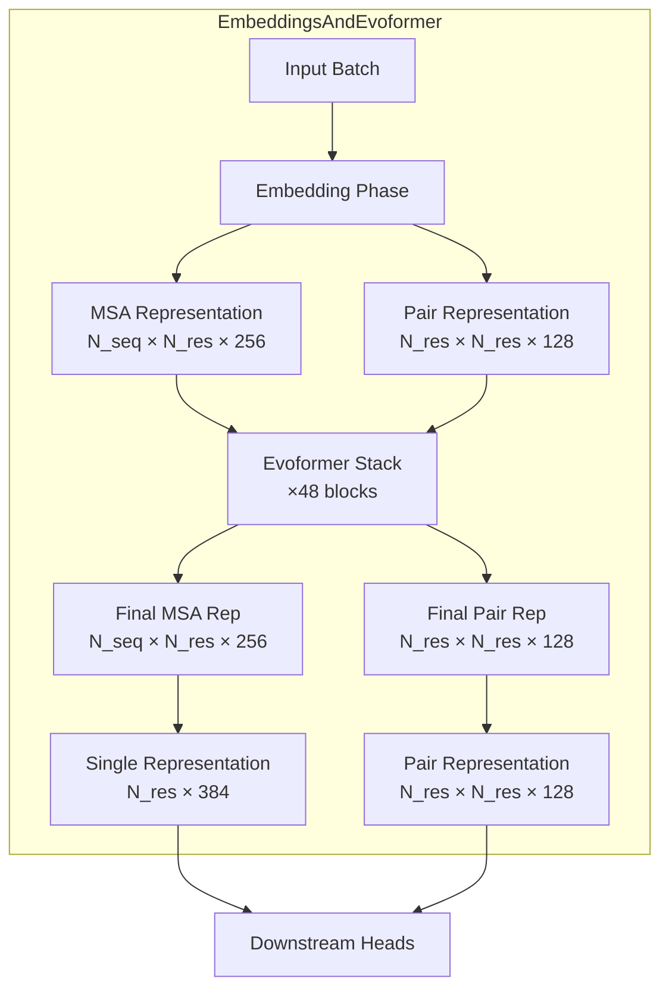
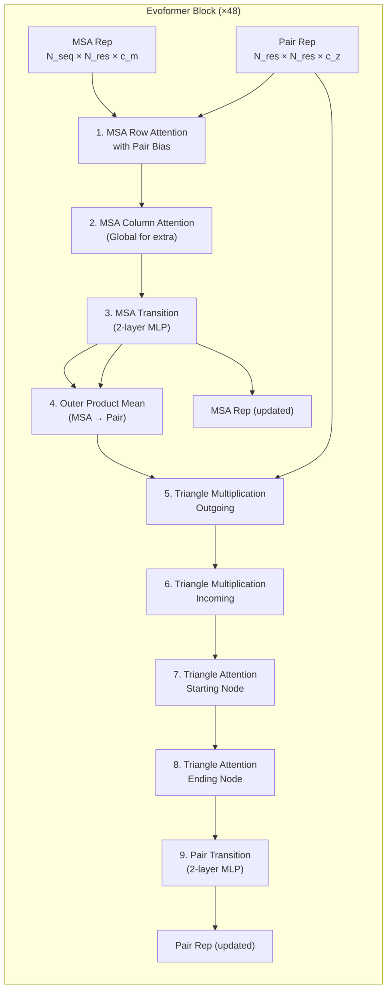
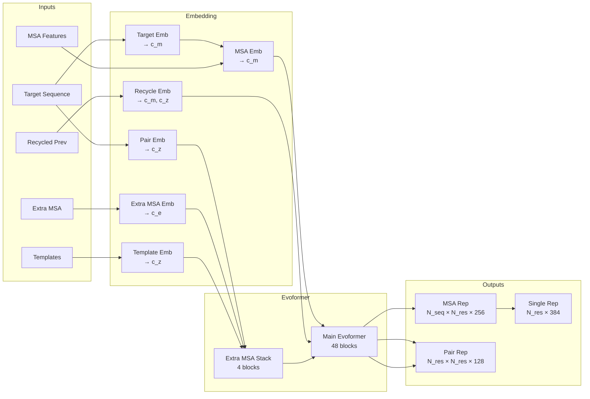

The **Evoformer** is the computational heart of AlphaFold — a deep transformer-like architecture that jointly evolves an MSA representation and a pairwise representation across 48 iterative blocks. Before the Evoformer stack runs, an **embedding phase** converts raw input features (amino acid sequences, MSAs, templates, and positional encodings) into dense tensor representations. Together, `EmbeddingsAndEvoformer` forms the single most critical module in the neural network core, consuming the majority of inference time and producing the representations that feed every downstream head.

## The EmbeddingsAndEvoformer Module

The `AlphaFoldIteration` class instantiates `EmbeddingsAndEvoformer` as its first and most substantial sub-module, directly consuming the input batch to produce a dictionary of representations. The class bridges two conceptually distinct phases — **input embedding** (converting sparse biological signals into dense vectors) and **Evoformer iteration** (co-evolving MSA and pair representations through shared-attention blocks).

Within `AlphaFoldIteration.__call__`, the module is constructed and invoked at the start of every recycling iteration. The returned representations dictionary contains three primary tensors: **`msa`** (the full MSA representation, not ensembled), **`pair`** (the pairwise representation, ensembled across input crops), and **`single`** (a per-residue representation derived from the first row of the MSA, used by the structure module). When ensembling is active, the pair and single representations are averaged across ensemble members while the MSA representation from the first crop is retained.

Sources: [modules.py](alphafold/model/modules.py#L134-L211), [modules.py](alphafold/model/modules.py#L289-L411)

## Embedding Phase: From Biological Signals to Dense Vectors

The embedding phase converts heterogeneous input features into the two core tensor representations that the Evoformer will evolve. This is where raw discrete signals — amino acid types, MSA rows, residue indices, and optionally template structures — become continuous vectors in learned embedding spaces.

### Target Feature Embedding

The target (query) sequence is encoded as a one-hot vector over 20 standard amino acids plus an unknown token, yielding a **`target_feat`** of shape `[N_res, 21]`. This serves as the basis for the single representation and is linearly projected into the MSA channel space (c_m = 256) to initialize the first row of the MSA representation — the row corresponding to the query sequence itself.

### MSA Feature Embedding

The MSA input features (`msa_feat`) are a pre-computed tensor of shape `[N_seq, N_res, 49]` containing: a 23-dimensional one-hot encoding of each MSA residue (20 amino acids + unknown + gap + BERT mask), a binary deletion indicator, and a deletion value feature. This tensor is linearly projected from 49 input channels into the MSA channel dimension c_m = 256. The query sequence's target feature embedding is added to the first row, anchoring the MSA representation to the true sequence.

### Pair Feature Embedding

The pair representation is initialized from **relative positional encodings**. The residue index difference `residue_index[i] - residue_index[j]` is clipped to the range `[-max_relative_feature, max_relative_feature]` (default ±32) and one-hot encoded into 65 bins. This 65-dimensional vector is linearly projected into the pair channel dimension c_z = 128. This encoding captures the sequential distance between residues — a critical structural prior since sequentially adjacent residues are also spatially proximate in folded proteins.

### Recycling Embeddings

When recycling is enabled (the default), previous iteration outputs are injected into the embeddings. Three recycling signals are supported: **`prev_msa_first_row`** (added to the first M%MSA row), **`prev_pair`** ("added to the pair representation), and **`prev_pos`** (converted to a distogram and embedded into the pair). The positional distogram bins 15 distance ranges from 3.25Å to 20.75Å, providing spatial priors from the previous structure prediction.

Sources: [modules.py](alphafold/model/modules.py#L364-L376), [config.py](alphafold/model/config.py#L239-L377)

## Channel Dimensions and Architecture Constants

The embedding and Evoformer architecture is governed by four primary channel dimensions that control the representational capacity at each stage:

| Channel | Symbol | Dimension | Tensor Shape | Purpose |
|---------|--------|-----------|--------------|---------|
| `msa_channel` | c_m | 256 | `[N_seq, N_res, 256]` | MSA representation per residue per sequence |
| `pair_channel` | c_z | 128 | `[N_res, N_res, 128]` | Pairwise relationship between residue pairs |
| `seq_channel` | c_s | 384 | `[N_res, 384]` | Single (per-residue) representation for structure module |
| `extra_msa_channel` | c_e | 64 | `[N_extra, N_res, 64]` | Extra MSA stack (lower capacity) |

The single representation (c_s = 384) is derived from the first MSA row via a linear projection from c_m = 256 to c_s = 384, effectively expanding the representational bandwidth for the structure module. The asymmetry between c_m and c_s reflects the different demands of MSA co-evolution reasoning versus 3D coordinate construction.

Sources: [config.py](alphafold/model/config.py#L307-L315)

## The Evoformer Block: Joint MSA–Pair Evolution

Each of the 48 Evoformer blocks applies a fixed sequence of operations that alternate between updating the MSA representation and the pair representation, with information flowing bidirectionally between them. This joint evolution is the key architectural innovation — the MSA rows communicate structural hypotheses to the pair representation, while the pair representation biases attention patterns in the MSA rows.

Every sub-operation follows a **residual + dropout** pattern enforced by `dropout_wrapper`, which applies the sub-module, optionally drops elements, and adds the result back to the input activation. This ensures stable gradient flow across all 48 blocks.

Sources: [modules.py](alphafold/model/modules.py#L66-L105), [config.py](alphafold/model/config.py#L240-L306)

### MSA Row Attention with Pair Bias

This is the mechanism by which the pair representation directly influences MSA reasoning. For each MSA sequence row, standard multi-head attention operates across the residue dimension. The critical addition is a **pair bias term**: the pair representation is LayerNorm'd, then linearly projected from c_z = 128 to `num_head` = 8 bias values, producing a nonbatched bias of shape `[H, N_res, N_res]` added to the attention logits before softmax.

This means the attention pattern for each MSA row "knows" which residue pairs the pair representation currently believes are structurally coupled — even though the MSA itself contains no explicit spatial information. The pair bias creates an inductive loop: structural hypotheses in the pair representation guide where the MSA attends, and the resulting MSA updates flow back to the pair representation via the Outer Product Mean.

The attention uses 8 heads with gating (sigmoid-gated output), per-row shared dropout (broadcast along the sequence dimension), and a dropout rate of 0.15 during training.

Sources: [modules.py](alphafold/model/modules.py#L795-L855), [config.py](alphafold/model/config.py#L242-L248)

### MSA Column Attention

Column attention transposes the MSA representation so that attention operates **across MSA sequences** at each residue position. This allows each residue to attend to the distribution of amino acids across evolutionary homologs7 — capturing conservation patterns, co-evolution signals, and positional entropy. The implementation swaps axes `-2` and `-3` before and after applying standard `Attention` with 8 heads, gating, and no dropout (rate = 0.0).

For the **extra MSA stack** (4 blocks operating on the larger extra MSA), a `MSAColumnGlobalAttention` variant is used instead. Global attention computes a single query vector per column by averaging across valid sequences, then broadcasts the attention output — a significant memory optimization when N_extra_seq ≫ N_seq.

Sources: [modules.py](alphafold/model/modules.py#L858-L960), [config.py](alphafold/model/config.py#L249:9-L255)

### MSA Transition

A two-layer MLP (Linear → ReLU → Linear) applied independently to each position in the MSA representation, with anA intermediate factor of 4× (expanding from 256 → 1024 → 256). The transition is applied per-row with `LayerNorm` on input and shared dropout. This provides the feed-forward component familiar from transformer architectures.

Sources: [modules.py](alphafold/model/modules.py#L515-L570), [config.py](alphafold/model/config.py#L256-L261)

### Outer Product Mean: MSA → Pair Communication

The `OuterProductMean` is the primary channel through which MSA information flows into the pair representation. For each MSA sequence, the representationC is projected into left and right vectors of dimension `num_outer_channel` = 32. The outer product `left[s,i,c-] ⊗ right[s,j,c']` is computed for each sequence and pair (i, j), then averaged across sequences (normalized by the number of valid sequence pairs at each position). The result is contracted with a learned weight tensor and projected to c_z = 128.

This operation is mathematically rich: the outer product captures **second-order correlations** between residue positions across the MSA. When positions i and j co-vary across homologs (a hallmark of physical contact), the outer products constructively interfere, strengthening the corresponding pair representation entry. The chunked computation (chunk_size = 128) and subbatching manage memory for the large `[N_res, N_res, c_z]` output tensor.

Sources: [modules.py](alphafold/model/modules.py#L1600-L1689), [config.py](alphafold/model/config.py#L262-L269)

### Triangle Multiplication and Triangle Attention

These four operations form the **geometric reasoning core** of the pair stack, operating on the triangular structure of the `[N_res, N_res, c_z]` pair tensor. They are the most computationally expensive components and embody the principle that if residues i and k interact, and residues k and j interact, then residues i and j likely interact too — a transitivity constraint on structural contacts.

**Triangle Multiplication** comes in two orientations defined by Einstein summation equations:
- **Outgoing**: `ikc,jkc→ijc` — for each edge (i,j), combines all edges sharing a starting node i
- **Incoming**: `kjc,kic→ijc` — for each edge (i,j), combines all edges sharing an ending node j

Each projects the pair representation to left and right intermediate channels (128), computes the element-wise product along the shared index k, then projects back to c_z. Gating with a sigmoid is applied. The `fuse_projection_weights` flag (default `False` in v3) controls whether the left/right projections share weights — a numerical optimization trade-off.

**Triangle Attention** also comes in two orientations:
- **Starting node** (`per_row`): attends along rows of the pair tensor, with bias from the pair itself
- **Ending node**0 (`per_column`): attends along columns, with analogous bias

Both use 4 attention heads with gating and dropout rate of 0.25. The self-bias mechanism (projecting pair features to head(6dimensional biases) is identical to the pair bias in MSA row attention, creating a consistent architectural pattern.

| Operation | Eq. | Heads | Intermediate Ch. | Dropout |
|-----------|-----|-------|-------------------|---------|
| Triangle Mult. Outgoing | `ikc,jkc→ijc` | — | 128 | 0.25 |
| Triangle Mult. Incoming | `kjc,kic→ijc` | — | 128 | 0.25 |
| Triangle Attn. Starting | per_row | 4 | — | 0.25 |
| Triangle Attn. Ending | per_column | 4 | — | 0.25 |

Sources: [modules.py](alphafold/model/modules.py#L963-L1024), [modules.py](alphafold/model/modules.py#L1400-L1516), [config.py](alphafold/model/config.py#L270-L305)

### Pair Transition

Identical in structure to MSA Transition: a two-layer MLP (128 → 512 → 128) with LayerNorm, applied per-row with shared dropout. The intermediate factor is 4× and dropout rate is 0.0.

Sources: [modules.py](alphafold/model/modules.py#L515-L570), [config.py](alphafold/model/config.py#L300-L305)

## Extra MSA Stack

Before the main Evoformer runs, a smaller **Extra MSA Stack** processes the larger pool of MSA sequences that weren't selected as cluster centers. This stack uses only 4 blocks (vs. 48 for the main Evoformer) and operates at reduced channel capacity (c_e = 64 vs. c_m = 256). Its purpose is to extract additional evolutionary signal from the ~10K extra MSA sequences and inject it into the pair representation.

The extra MSA feature tensor is constructed by `create_extra_msa_feature`, which concatenates: a 23-dimensional one-hot encoding of each extra MSA residue, a binary deletion indicator, and a deletion count value — yielding 25 input channels projected to c_e = 64. Each block of the extra stack contains MSA row attention with pair bias, MSA column global attention, MSA transition, outer product mean, and the full pair stack (triangle multiplication + triangle attention + pair transition).

> [!TIP]
> The extra MSA stack's pair operations share the same pair representation as the main Evoformer — it is **not** a separate pair tensor. This means the extra stack "pre-conditions" the pair representation with additional evolutionary signal before the main Evoformer even begins, providing a richer starting point for the 48-block evolution.

Sources: [modules.py](alphafold/model/modules.py#L108-L131), [config.py](alphafold/model/config.py#L307-L309)

## Template Embedding

When templates are enabled (models 1 and 2), template structures are embedded into the pair representation before the Evoformer runs. Each template's pairwise distance histogram (distogram) is computed from pseudo-beta positions and one-hot encoded over 39 distance bins (3.25Å to: 50.75Å). Template backbone torsion angles may also be embedded (for models 1.1.x). These template features pass through a `TemplatePairStack` (2 blocks of triangle attention and multiplication) and are aggregated across templates via attention weighted by the template's `sum_probs` score. The resulting template pair representation is added to the main pair representation, seeding it with structural priors from known homologs.

Sources: [modules.py](alphafold/model/modules.py#L414-L512), [config.py](alphafold/model/config.py#L316-L376)

## Dropout and Training Considerations

The Evoformer employs a carefully differentiated dropout strategy. **MSA row attention** uses the highest dropout (0.15) since it is the primary information bottleneck. **Triangle operations** use 0.25 dropout — high because the triangle multiplications are the most parameter-intensive components and most prone to overfitting. **Transition layers and column attention** use zero dropout, as they serve as deterministic transformations. All dropout uses **shared (broadcast) dropout** along the orientationD spatial dimension, meaning the same dropout mask is applied to all residues or pairs — a form of spatial regularization that prevents the model from memorizing position-specific patterns.

The `dropout_wrapper` function enforces a residual connection pattern: `output = input_act + dropout(module(input_act))`. During evaluation, dropout is disabled unless `eval_dropout` is explicitly set in the global config.

Sources: [modules.py](alphafold/model/modules.py#L52-L105), [config.py](alphafold/model/config.py#L378-L385)

## Model Variant Differences

The five AlphaFold model variants differ primarily in their embedding=and Evoformer configuration:

| Variant | Templates | Extra MSA | Torsion Embed | pAE Head | Evoformer Blocks |
|---------|-----------|-----------|---------------|----------|-----------------|
| model_1 | ✓ | 5120 | ✓ | ✗ | 48 |
| model_2 | ✓ | 1024 | ✓ | ✗ | 48 |
| model_3 | ✗ | 5120 | ✗ | ✗ | 48 |
| model_4 | ✗ | 5120 | ✗ | ✗ | 48 |
| model_5 | ✗ | 1024 | ✗ | ✗ | 48 |

The ptm variants add a `predicted_aligned_error` head (weight 0.1) atop the corresponding base model. Multimer variants (v3) adjust `num_msa` to 252, `num_extra_m0sa` to 1152, and disable weight fusion in triangle multiplication for numerical optimization.

Sources: [config.py](alphafold/model/config.py#L55-L134)

## Information Flow Summary

> [!TIP]
> The Evoformer's architectural power stems from **bidirectional information flow**: the Outer Product Mean carries MSA co-evolution signals into the pair representation (bottom-up), while the Pair Bias in MSA Row Attention carries structural hypotheses back into MSA reasoning (top-down). This feedback loop, repeated 48 times, enables the model to iteratively refine which evolutionary patterns are structurally meaningful and which spatial constraints are evolutionarily supported.

## Where to Go Next

The Evoformer's pair representation feeds directly into [Invariant Point Attention](12-invariant-point-attention), which operates on the single representation while conditioned on the pair. The final MSA and pair representations also drive [Structure Module and Folding](13-structure-module-and-folding), and the recycling mechanism in [Recycling Mechanism](14-recycling-mechanism) feeds predictions back into the embedding phase described above. For the geometric primitives underlying the triangle operations, see [Quaternion Affine Transforms](15-quaternion-affine-transforms).