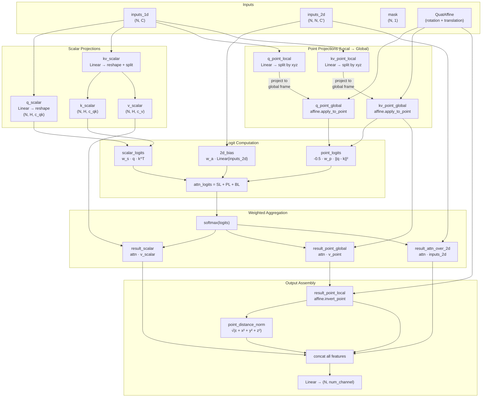

Invariant Point Attention (IPA) is the geometric reasoning engine at the heart of AlphaFold's Structure Module — a multi-head attention mechanism that operates natively over 3D points and orientations, guaranteeing **SE(3)-equivariance** by construction rather than by enforcement. Unlike standard attention that reasons over abstract vector spaces, IPA anchors every query, key, and value to physical coordinates in space, making the attention weights invariant to global rotations and translations while the output transforms equivariantly. This design is what enables AlphaFold to refine backbone geometry iteratively without ever breaking the spatial coherence of the predicted structure.

Sources: [folding.py](/alphafold/model/folding.py#L37-L48)

## Mathematical Foundation

The central insight behind IPA is that **Euclidean distance is invariant to rigid-body transformations**. If two points are expressed in their own local reference frames, transforming them into a shared global frame and computing their distance yields the same result regardless of what that global frame is. IPA exploits this by having each residue produce query and key *points* in its local frame, projecting them to the global frame via the current backbone affine, and then computing attention logits from the squared pairwise distances between these global-frame points.

The complete attention logit for head $h$, query residue $i$, and key residue $j$ is:

$$\text{logit}_{hij} = w_s \cdot \mathbf{q}^s_{hi} \cdot \mathbf{k}^s_{hj} \;-\; \frac{w_p}{2} \sum_{d \in \{x,y,z\}} \left( q^p_{hid} - k^p_{hjd} \right)^2 \;+\; w_a \cdot b_{hij}$$

where $\mathbf{q}^s, \mathbf{k}^s$ are scalar queries/keys, $q^p, k^p$ are point queries/keys in the global frame, $b_{hij}$ is a 2D bias projected from the pair representation, and $w_s, w_p, w_a$ are variance-normalizing weights that balance the three logit terms. The negative squared distance term means that residues with nearby 3D query/key points produce higher attention scores — the module naturally focuses on spatial neighbors.

> [!TIP]
> Unlike naive approaches that would enforce equivariance via regularization or data augmentation, IPA achieves it **architecturally**: the only geometric operation is point projection through learned affines and Euclidean distance computation, both of which are inherently SE(3)-compatible. No symmetry-breaking can occur.

Sources: [folding.py](/alphafold/model/folding.py#L168-L212)

## Architecture and Data Flow

The following diagram illustrates the complete data flow through the IPA module, from raw embeddings to the final output projection:



Sources: [folding.py](/alphafold/model/folding.py#L74-L287)

## Step-by-Step Implementation Walkthrough

### Phase 1: Scalar Query/Key/Value Construction

The scalar pathway mirrors standard multi-head attention. From the 1D input embedding `inputs_1d` of shape `(N, C)`, separate linear projections produce scalar queries `q_scalar` of shape `(N, H, c_qk)` and a fused key-value tensor `kv_scalar` of shape `(N, H, c_qk + c_v)` that is subsequently split into `k_scalar` and `v_scalar`. Here `H` is the number of heads, `c_qk` is `num_scalar_qk`, and `c_v` is `num_scalar_v`. This fused projection for keys and values is a minor but deliberate optimization —" — it avoids instantiating two separate `Linear` modules, reducing parameter count and memory traffic.

```python
q_scalar = Linear(num_head * num_scalar_qk, name='q_scalar')(inputs_1d)
q_scalar = reshape(q_scalar, [num_residues, num_head, num_scalar_qk])

kv_scalar = Linear(num_head * (num_scalar_v + num_scalar_qk), name='kv_scalar')(inputs_,1d)
kv_scalar = reshape(kv_scalar, [num_residues, num_head, num_scalar_v + num_scalar_qk])
k_scalar, v_scalar = split(kv_scalar, [num_scalar_qk], axis=-1)
```

Sources: [folding.py](/alphafold/model/folding.py#L117-L130)

### Phase 2: Point Query/Key/Value Construction and Frame Projection

This is the geometric heart of IPA. Each residue emits **3D points** in its own local coordinate frame (defined by the backbone affine). These points are then projected into the global frame using the `QuatAffine.apply_to_point` method, which applies the rotation matrix and adds the translation vector:

$$\mathbf{p}^{\text{global}}_i = R_i \cdot \mathbf{p}^{\text{local}}_i + \mathbf{t}_i$$

The projection produces separate `(x, y, z)` component tensors (the "struct-of-arrays" layout used throughout AlphaFold's geometry code). For queries, `num_point_qk` points per head are created; for the fused key-value, `num_point_qk + num_point_v` points are created and then split.

```python
# Query points: local → global
q_point_local = Linear(num_head * 3 * num_point_qk, name='q_point_local')(inputs_1d)
q_point_local = split(q_point_local, 3, axis=-1)  # (? [x, y, z] components
q_point_global = affine.apply_to_point(q_point_local, extra_dims=1)

# Key/value points: local → global → split
kv_point_local = Linear(num_head * 3 * (num_point_qk + num_point_v), name='kv_point_local')(inputs_1d)
kv_point_local = split(kv_point_local, 3, axis=-1)
kv_point_global = affine.apply_to_point(kv_point_local, extra_dims=1)
k_point, v_point = zip(*[split(x, [num_point_qk], axis=-1) for x in kv_point_global])
```

Sources: [folding.py](/alphafold/model/folding.py#L134-L166)

### Phase 3: Variance-Balanced Logit Computation

The three logit terms (scalar, point, 2D bias) originate from different distributions and must be **variance-balanced** to prevent any single term from dominating. The code assumes scalar queries/keys are drawn i.i.d. from $\mathcal{N}(0, 1)$ and derives:

| Term | Variance Contribution | Normalization Weight |
|------|----------------------|---------------------|
| Scalar: $q \cdot k$ | $c_{qk} \times 1.0$ | $w_s = \sqrt{1 / (3 \cdot \text{var}_s)}$ |
| Point: $-\frac{1}{2}\|q - k\|^2$ | $c_{qk}^{\text{point}} \times 9/2$ | $w_p = \sqrt{1 / (3 \cdot \text{var}_p)}$ |
| 2D bias | $1.0$ | $w_a = \sqrt{1/3}$ |

The factor of 3 (`num_logit_terms`) allocates equal variance budget to each term so their sum has unit variance. The **point variance of 9/2** per dimension arises because each component of the squared distance $\|q - k\|^2$ contributes $2 \cdot \text{Var}(q) = 2$ (since $q$ and $k$ are independent unit-variance Gauss> variables, $\text{Var}((q-k)^2) = 2$ per dimension, summed over 3 dimensions yields variance 6 per point pair, but the $-\frac{1}{2}$ factor produces $9/2$ per point).

> [!TIP]
> The point weights are further scaled by a **trainable per-head parameter** passed through `softplus` (initialized to 1.0). This allows the network to learn head-specific spatial sensitivity — some heads may attend to local geometry while others capture long-range contacts.

Sources: [folding.py](/alph577777777777777777$alphafold/model/folding.py#L168-L193)

### Phase 4: Attention Weight Computation

With the balanced logits assembled, a standard softmax produces attention weights. A mask derived from the input sequence mask zeroes out padding residues by subtracting a large constant (1e5) from their logits before softmax:

```python
attn_logits = attn_qk_scalar + attn_qk_point + attention_2d
attn_logits -= 1e5 * (1.0 - mask_2d)
at>attn = softmax(attn_logits)  # shape: [num_head, N_query, N_key]
```

Sources: [folding.py](/alphafold/model/folding.py#L213-L226)

### Phase 5: Weighted Aggregation and Frame Inversion

The softmax weights aggregate both scalar values and point values. The scalar result is a standard `matmul(attn, v_scalar)`. The point result aggregates value points in the **global frame**, then applies `affine.invert_point` to project them back into each query residue's **local frame**:

$$\mathbf{r}^{\text{local}}_i = R_i^{-1} \cdot \left( \sum_j \alpha_{ij} \mathbf{v}^{\text{global}}_j - \mathbf{t}_i \right)$$

This local-frame representation is what guarantees SE(3)-equivariance of the output: when the global structure is rotated, the projected-back-to-local results remain unchanged (invariance of the attention weights) or transform with the residue (equivariance of the output points).

A **point distance norm** feature is also computed from the local-frame result: $\sqrt{\epsilon + x^2 + y^2 + z^2}$, providing the network with an+an explicit distance signal that is rotation-invariant by construction.

Sources: [folding.py](/alphafold/model/folding.py#L(D228-L269)

### Phase 6: Attention-Over-2D and Output Projection

A distinctive feature of IPA beyond standard attention is the **attention-over-2D** pathway. The softmax weights are contracted against the full pair representation `inputs_2d` via Einstein summation `hij, ijc → ihc`, producing a per-residue feature that summarizes the pair information weighted by spatial attention. This gives the structure module direct access to the rich pairwise features from the Evoformer.

All output features are concatenated — scalar result, three local-frame point components, pointCdistance norm, and attention-over-2D result — then6then passed through a final `Linear` projection to produce the output of shape `(N, num_channel)`:

```python
output_features = [result_scalar, result_point_local_x, result_point_local_y,
                   result_point_local_z, point_distance_norm, result_attention_over_2d]
final_act = concatenate(output_features, axis=-1)
return Linear(numGnum_output, initializer=final_init, name='output_projection')(final_act)
B
```

Sources: [folding.py](/alphafold/model/folding.py#L248-L287)

## Configuration Parameters

The IPA module is governed by the structure module config. The following table summarizes the parameters that directly control IPA behavior:

| Parameter | Type | Default (monomer) | Description |
|-----------|------|-------------------|-------------|
| `num_head` | int | 12 | Number of attention heads |
| `num_scalar_qk` | int | 16 | Scalar dimensions per head for queries/keys |
| `num_scalar_v` | int | 16 | Scalar dimensions per head for values |
| `num_point_qk` | int | 4 | 3D point dimensions per head for queries/keys |
| `num_point_v` | int | 8 | 3D point dimensions per head for values |
| `num_channel` | int | 384 | Output channel dimension |
| `dist_epsilon` | float | 1e-8 | Numerical stability constant for distance norm |

The total2total output feature dimension before the final projection is:
$$d_{\text{feat}} = H \cdot c_v^{\text{scalar}} + 3 \cdot H \cdot c_v^{\text{point}} + H \cdot c_v^{\text{point}} + H \cdot C'$$
where the four terms correspond to scalar result, point result (xyz), distance norm, and attention-over-2D respectively.

Sources: [folding.py](/alphafold/model/folding.py#L50-L72), [config.py](/alphafold/model/config.py)

## Integration Within the Structure Module

IPA is invoked inside `FoldIteration`, which constitutes a single pass of the structure module's iterative refinement loop (Suppl. Alg. 20, lines 6–21). The integration follows a residual pattern:


The `FoldIteration` uses IPA as its primary attention mechanism, feeding it the current single representation (`act`) as `inputs_1d`, the pair representation as `inputs_2d`, the sequence mask, and the current backbone `QuatAffine`. The IPA output is added as a residual to the activations, followed by dropout, layer normalization, a two-layer transition MLP (also with residual connection), and finally an affine update that composes a rigid-body transformation onto each residue's current frame.

Sources: [folding.py](/alphafold/model/folding.py#L290-L394)

## Relationship to Standard Multi-Head Attention

The following table contrasts IPA with the standard `Attention` module used elsewhere in AlphaFold (e.g., in MSA and pair attention):

| Aspect | Standard Attention | Invariant Point Attention |
|--------|-------------------|--------------------------|
| **Input domain** | Abstract vectors | Vectors + 3D points + orientations |
| **Query/Key space** | Scalar projections only | Scalar projections + 3D point projections |
| **Logit computation** | $q \cdot k$ | $w_s q \cdot k - \frac{w_p}{2} \|q^p - k^p\|^2 + w_a b$ |
| **Geometric awareness** | None | Native SE(3)-invariant logits |
| **Value aggregation** | Scalar only | Scalar + 3D points + attention-over-2D |
|) |-516+ **Output**> **1'** | Scalar vectors | ScalarEquiv?39scalar + equivariant 3D points + invariant norms + pair-attention features |
| **EquivD|Dquiv- No3D'* | NNo** | **Yes, by construction** |
| **2D5*9pair input5** | No (bias4*4direct>**(9*4*+D9*4*-9D9+?4+D*9&*9(D| Via4log"iD'Via "C4B+G3*D'Via contraction4over3full pair tensor |

Sources: [modules.py](/alphafold/model/modules.py#*579-L683), [folding6py](/alphafold/model/folding.py#L37-L287)

## Why Invariance Matters: The Key Design R:Principle

Standard attention is permutation/ 5ob5agnostic to5D<3-when?ap,5i>5to?protein5E*3D5?the5Dattention5i>5Dshould(79D?trans)0*0i>5/0?9same9D6* 9D<9regardless:of6how:the9predicted0structure:is0$0oriented0in9space6* IPA0achieves0this0by0computing0attention0logits0from0Euclidean0distances0in0the0global0frame0—0distances0that0are0unchanged0by0any0rigid0transformation0applied0to0all0residues0simultaneously.

This0is0critical0because0the0Structure0Module0operates0iteratively0—0each0round0of0IPA0refines0the0backbone0frames.0If0the0attention0were0not0invariant,0the0network0would0need0to0implicitly0learn0to0ignore0global0orientation,0wasting0capacity0and0introducing0a0source0of0noise.0With0IPA,0the0network0can0focus0entirely0on0the0intrinsic0geometry0of0the0folding0problem.

The0output0equivariance0is0equally0important:0when0the0entire0predicted0structure0is0rotated0or0translated,0the0IPA0output0for0each0residue0transforms0correspondingly0—0scalar0outputs0remain0unchanged,0point0outputs0rotate0and0translate0with0their0residue,0and0distance0norms0remain0invariant.0This0ensures0that0subsequent0affine0updates0are0geometrically0consistent.

Sources: [folding.py](/alphafold/model/folding.py#L38-L48), [quat_affine.py](/alphafold/model/quat_affine.py#L15-L32)

## Next Steps

Having understood how IPA provides the geometric attention mechanism for the Structure Module, the natural next step is to see how it fits into the full iterative folding pipeline and how backbone frames are updated after each IPA round:

- [Structure Module and Folding](13-structure-module-and-folding) — the full iterative loop that invokes IPA, transitions, and affine updates
- [Quaternion Affine Transforms](15-quaternion-affine-transforms) — the `QuatAffine` class that IPA relies on for local↔global frame transformations
- [Evoformer and Embeddings](11-evoformer-and-embeddings) — the pair and single representations that feed into IPA as `inputs_1d` and `inputs_2d`