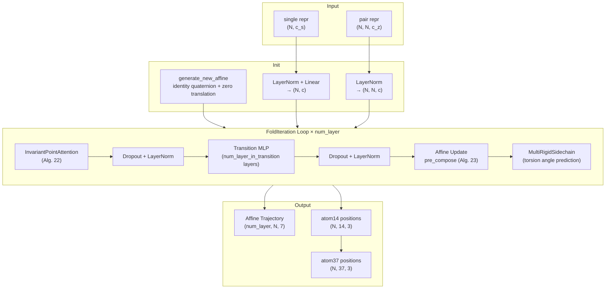
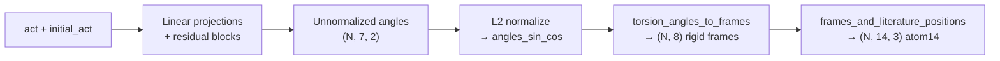

The Structure Module is AlphaFold's terminal neural network head — the mechanism by which learned residue-level representations are decoded into full 3D atomic coordinates. It operates as an iterative refinement loop that progressively updates per-residue rigid body transformations (rotations + translations) through geometry-aware attention, producing a trajectory of increasingly accurate backbone affines and, in its final iteration, a complete all-atom model including side chains. The module is formally defined in Jumper et al. (2021) Supplementary Algorithm 20 and implemented across two primary files: [`folding.py`](alphafold/model/folding.py) for the neural network architecture and loss computation, and [`all_atom.py`](alphafold/model/all_atom.py) for the rigid body algebra, torsion angle geometry, and atom coordinate assembly.

Sources: [folding.py](alphafold/model/folding.py#L1-L31), [all_atom.py](alphafold/model/all_atom.py#L1-L34)

## Architectural Overview

The Structure Module transforms Evoformer output representations into 3D coordinates through a three-stage pipeline. First, the Evoformer's single and pair representations are projected into the structure module's hidden channel space. Then, an iterative loop of `FoldIteration` blocks — each containing Invariant Point Attention → Transition MLP → Backbone Affine Update — refines residue positions over multiple layers. Finally, the `MultiRigidSidechain` sub-module predicts torsion angles from the refined activations and constructs all-atom coordinates via rigid group frame composition.



The loop runs for `config.num_layer` iterations (typically 8), accumulating an affine trajectory that is consumed by the backbone FAPE loss. Only the final iteration's sidechain output is used for atom-level losses and the final predicted structure.

Sources: [folding.py](alphafold/model/folding.py#L397-L462), [folding.py](alphafold/model/folding.py#L465-L525)

## Invariant Point Attention

Invariant Point Attention (IPA) is the geometric core of each FoldIteration. Unlike standard attention that operates purely in feature space, IPA grounds its attention logits in 3D Euclidean geometry — the distance between query and key **points** projected into the global frame contributes a geometry-aware term to the attention score. This ensures that the attention pattern is **SE(3)-equivariant**: rotating or translating the input structure produces a correspondingly transformed output.

### Three-Stream Attention Logit Computation

The attention logits are the sum of three independently weighted terms, each allocated equal variance:

| Term | Computation | Variance Factor |
|------|------------|-----------------|
| **Scalar** | `q_scalar · k_scalar` (standard dot-product) | `1 / (3 × num_scalar_qk)` |
| **Point** | `-0.5 × Σ ‖q_point - k_point‖²` (negative squared distance in global frame) | `1 / (3 × 9/2 × num_point_qk)` |
| **2D Bias** | `Linear(inputs_2d)` projected per-head | `1/3` |

The point variance of `9/2` per point pair derives from the assumption that query and key point coordinates are drawn iid from N(0,1), giving `Var[0.5‖q‖² - ⟨q,k⟩] = 9/2` for 3D points. The trainable per-head weights (`trainable_point_weights`, initialized to 1.0 via softplus⁻¹) modulate the point contribution, allowing the network to learn how much geometric information should influence attention.

Sources: [folding.py](alphafold/model/folding.py#L37-L287)

### Point Projection Through Local and Global Frames

Each residue emits query and key **points** in its own local reference frame (defined by the current affine). These local points are projected into the global frame via `affine.apply_to_point()`, enabling distance computation between points from different residues. After attention-weighted aggregation of value points in the global frame, the result points are projected back into the query residue's local frame via `affine.invert_point()`. This round-trip through the global frame is what guarantees SE(3)-invariance of the output features — a critical property, since the structure module must produce updates that are meaningful regardless of the protein's global orientation.

The output features fed into the final linear projection are:
1. **Scalar attention result**: reshaped to `(N, num_head × num_scalar_v)`
2. **Point attention result** (local frame): three coordinate components, each `(N, num_head × num_point_v)`
3. **Point distance feature**: `√(ε + x² + y² + z²)` — an rotation-invariant scalar encoding of the aggregated point magnitude
4. **2D attention-over-pairs result**: `einsum('hij,ijc→ihc', attn, inputs_2d)` — a contraction over the key residue dimension, analogous to how standard attention contracts over the key sequence position

Sources: [folding.py](alphafold/model/folding.py#L131-L287)

## FoldIteration: The Core Refinement Block

Each `FoldIteration` implements one step of the iterative structure refinement loop (Algorithm 20, lines 6–21). The block has three sequential stages:

### Stage 1 — Invariant Point Attention
The current activations `act` (shape `(N, num_channel)`) and the pair features `static_feat_2d` (shape `(N, N, c)`) are fed into IPA along with the current per-residue `affine`. The IPA output is added as a residual, followed by dropout and LayerNorm.

### Stage 2 — Transition MLP
A shallow MLP with `num_layer_in_transition` layers (typically 2) processes the attended activations. All intermediate layers use ReLU activation with `'relu'` initializer; the final layer uses the `final_init` scheme (`'zeros'` if `global_config.zero_init`, else `'linear'`). A residual connection adds the input, followed by dropout and LayerNorm.

### Stage 3 — Affine Update and Sidechain Construction
A linear layer maps the activations to a 6-dimensional `affine_update` (3 rotation + 3 translation components). This update is **pre-composed** with the current affine via `affine.pre_compose(affine_update)`, meaning the update is interpreted in the residue's local frame — a subtle but important design choice that improves training stability by ensuring small updates in local coordinates produce small changes in the global structure.

After the affine update, `MultiRigidSidechain` is called to predict torsion angles and construct all-atom coordinates. Critically, `affine.scale_translation(c.position_scale)` is passed to sidechain construction, scaling translations from the internal Ångstrom representation. A `stop_gradient` is then applied to the affine rotation to prevent gradient flow through the rotation component during the next iteration, a regularization technique that stabilizes the iterative loop.

Sources: [folding.py](alphafold/model/folding.py#L290-L394)

## MultiRigidSidechain: From Activations to All-Atom Coordinates

The `MultiRigidSidechain` module is the bridge between the Structure Module's per-residue hidden state and explicit atomic coordinates. It operates in three steps:

### Step 1 — Torsion Angle Prediction
The activations from the current and initial iteration (`[act, initial_act]`) are each projected through a ReLU → Linear pathway into `num_channel` dimensions and summed. Residual blocks (each: ReLU → Linear → ReLU → Linear + skip) further refine the representation. A final linear layer outputs 14 values per residue, reshaped as `(N, 7, 2)` — the unnormalized sin/cos encoding of 7 torsion angles: `[pre_ω, φ, ψ, χ₁, χ₂, χ₃, χ₄]`. L2 normalization produces the final `angles_sin_cos` on the unit circle.

### Step 2 — Torsion Angles to Frames
`all_atom.torsion_angles_to_frames()` converts the predicted torsion angles into 8 rigid group frames per residue (backbone, pre-omega, phi, psi, chi1–chi4). This uses per-residue-type default frames from `residue_constants.restype_rigid_group_default_frame`, composed with rotation matrices constructed from the sin/cos angles around the x-axis. Critically, chi2–chi4 frames are **chained** to their predecessor frame rather than applied independently, reflecting the physical dependency structure of sidechain torsions.

### Step 3 — Frames to Atom Positions
`all_atom.frames_and_literature_positions_to_atom14_pos()` maps each atom to its parent rigid group, transforms the canonical (literature) local-frame position of that atom through the corresponding group's global frame, and masks out non-existent atoms. This produces the final `(N, 14, 3)` atom14 coordinate tensor.



Sources: [folding.py](alphafold/model/folding.py#L989-L1066), [all_atom.py](alphafold/model/all_atom.py#L495-L596), [all_atom.py](alphafold/model/all_atom.py#L599-L644)

## All-Atom Representations: atom14 vs atom37

AlphaFold employs two complementary all-atom representations that serve different purposes:

| Property | atom14 | atom37 |
|----------|--------|--------|
| **Slots per residue** | 14 (max heavy atoms for any AA) | 37 (fixed name→slot mapping) |
| **Slot semantics** | Residue-type-dependent (slot 5 = Nδ2 for Asn, Cδ1 for Ile) | Name-fixed (slot 12 always = Cδ1) |
| **Density** | Dense — no wasted slots for small residues | Sparse — many slots zeroed out |
| **Used internally** | ✅ (computationally efficient) | ❌ |
| **Used at output** | ❌ | ✅ (facilitates conversion to standard formats) |

Conversion is handled by `atom14_to_atom37()` and `atom37_to_atom14()`, which use per-residue gather indices (`residx_atom37_to_atom14`, `residx_atom14_to_atom37`) and existence masks to remap and mask atoms appropriately.

Sources: [all_atom.py](alphafold/model/all_atom.py#L15-L34), [all_atom.py](alphafold/model/all_atom.py#L75-L112)

## Rigid Group Frame System

The all-atom reconstruction relies on a hierarchical rigid group decomposition. Each residue is divided into up to 8 rigid groups whose internal atom positions are fixed (determined by literature bond lengths and angles), and whose collective orientation is determined by the backbone frame and torsion angles:

| Group Index | Name | Atoms Depend On |
|-------------|------|-----------------|
| 0 | Backbone | N, CA, C (defines the local frame) |
| 1 | Pre-omega | Empty (placeholder) |
| 2 | Phi | Currently empty (only hydrogens) |
| 3 | Psi | O |
| 4 | Chi-1 | Sidechain atoms depending on χ₁ |
| 5 | Chi-2 | Sidechain atoms depending on χ₁, χ₂ |
| 6 | Chi-3 | Sidechain atoms depending on χ₁, χ₂, χ₃ |
| 7 | Chi-4 | Sidechain atoms depending on χ₁, χ₂, χ₃, χ₄ |

The `atom37_to_frames()` function computes ground-truth frames from experimental coordinates, while `torsion_angles_to_frames()` reconstructs frames from predicted angles. Both handle naming ambiguities — certain amino acids (Asp, Glu, Phe, Tyr, Arg) have symmetric atom naming that creates ambiguous chi angles, resolved by tracking alternative frames rotated 180° around the x-axis.

Sources: [all_atom.py](alphafold/model/all_atom.py#L115-L285), [all_atom.py](alphafold/model/all_atom.py#L495-L596)

## Loss Functions

The Structure Module loss is a weighted combination of four distinct terms, each targeting a different aspect of structural accuracy:

### Backbone FAPE Loss

The Frame Aligned Point Error (FAPE) measures the average distance between predicted and ground-truth positions after aligning each pair of corresponding frames. Applied across the full affine trajectory (all iterations), it provides a learning signal that encourages every intermediate structure to be reasonable, not just the final one:

```
FAPE = mean over iterations, frames, positions:
    clamp(|T_pred⁻¹(p_pred) - T_gt⁻¹(p_gt)|, max=clamp_distance) / length_scale
```

When `use_clamped_fape` is present in the batch (during training), the loss interpolates between clamped and unclamped versions, following the clamping schedule described in Supplementary Section 1.11.5.

Sources: [folding.py](alphafold/model/folding.py#L634-L698), [all_atom.py](alphafold/model/all_atom.py#L1159-L1195)

### Sidechain FAPE Loss

Computed only on the final iteration's output, this applies FAPE to all-atom positions using the 8 rigid group frames. Ground truth frames are first **renamed** using `compute_renamed_ground_truth()` — which selects the naming convention (original vs. alternative atom swap) that minimizes distance to the prediction, ensuring consistent gradient direction across all loss terms.

Sources: [folding.py](alphafold/model/folding.py#L701-L743), [folding.py](alphafold/model/folding.py#L573-L631)

### Supervised Chi Angle Loss

Directly supervises the predicted torsion angles against ground truth chi angles in sin/cos space. Handles π-periodic chi angles (where χ and χ+π are equivalent) by computing the error under both interpretations and taking the minimum:

```python
sq_chi_error = min(
    Σ(sin_cos_true - pred)²,
    Σ(sin_cos_true_shifted - pred)²
)
```

An additional **angle norm loss** penalizes deviations of the unnormalized angles from unit norm, encouraging the network to produce well-conditioned sin/cos encodings.

Sources: [folding.py](alphafold/model/folding.py#L907-L970)

### Structural Violation Loss

A physics-informed regularizer that penalizes geometrically impossible structures through three sub-components:

| Violation Type | Function | Checks |
|----------------|----------|--------|
| **Between-residue bonds** | `between_residue_bond_loss` | C–N bond length, ∠CA-C-N, ∠C-N-CA angles |
| **Between-residue clashes** | `between_residue_clash_loss` | Van der Waals overlap between non-bonded atoms in different residues |
| **Within-residue violations** | `within_residue_violations` | Bond length/angle and steric violations within a single residue |

Each uses a flat-bottom loss: no penalty within tolerance, linear penalty beyond. The `tolerance_factor_soft` (for gradients) and `tolerance_factor_hard` (for violation counting) are measured in standard deviations of empirical PDB distributions.

Sources: [folding.py](alphafold/model/folding.py#L746-L865), [all_atom.py](alphafold/model/all_atom.py#L685-L845), [all_atom.py](alphafold/model/all_atom.py#L847-L971), [all_atom.py](alphafold/model/all_atom.py#L974-L1055)

## Loss Composition

The total Structure Module loss combines all terms with configurable weights:

```python
loss = (1 - weight_frac) × backbone_fape
     + weight_frac × sidechain_fape
     + chi_weight × chi_loss
     + angle_norm_weight × angle_norm_loss
     + structural_violation_loss_weight × violation_loss
```

The `weight_frac` parameter (from `config.sidechain.weight_frac`) interpolates between backbone-only and sidechain-dominated FAPE. The structural violation loss weight is typically small — it acts as a soft constraint rather than a primary objective, since the FAPE losses already provide strong structural supervision.

> [!TIP]
> The `global_config.zero_init` flag controls whether the final linear layers in IPA, Transition, and Affine Update are zero-initialized. When True (the default), the Structure Module starts as an identity transformation — each FoldIteration initially outputs the input affine unchanged. This "zero init" scheme is critical for training stability: it ensures the iterative loop begins from a reasonable backbone (initialized as identity quaternions at the origin) and gradually learns to produce non-trivial updates.

> [!TIP]
> The `affine.pre_compose()` operation applies the backbone update in the residue's **local frame** rather than the global frame. This means a small update vector always produces a small structural change regardless of the residue's current orientation. Combined with `stop_gradient` on the rotation component after each iteration, this creates a locally-Euclidean approximation that behaves like gradient descent on the manifold of rigid body transformations — a key insight that enables stable iterative refinement without explicit Lie group parameterization.

Sources: [folding.py](alphafold/model/folding.py#L527-L570)

## StructureModule Head: Output Assembly

The `StructureModule` class orchestrates the full pipeline and assembles the output dictionary. After `generate_affines()` produces the iterative trajectory, the head:

1. Extracts the final iteration's sidechain atom14 positions
2. Converts atom14 → atom37 via `all_atom.atom14_to_atom37()`
3. Applies the atom37 existence mask
4. Scales the affine trajectory by `position_scale` for the translation components
5. Returns either full output (when `compute_loss=True`) or a minimal subset (`final_atom_positions`, `final_atom_mask`, `representations`) for inference

The loss method is called separately and orchestrates ground truth renaming, violation computation, and the weighted loss aggregation described above.

Sources: [folding.py](alphafold/model/folding.py#L465-L525)

## Torsion Angle Geometry: From Angles to Atoms

The path from predicted torsion angles to 3D coordinates involves two sequential operations in `all_atom.py`:

**`torsion_angles_to_frames(aatype, backb_to_global, torsion_angles_sin_cos)`** — For each residue, gathers the amino-acid-specific default rigid group frames from `residue_constants.restype_rigid_group_default_frame`. Constructs rotation matrices around the x-axis from the predicted sin/cos values. Composes default frames with torsion rotations, then chains chi2–chi4 frames to their parent frames (since χ₂ is defined relative to the χ₁ frame, not the backbone). Finally, transforms all frames to the global coordinate system by composing with the backbone-to-global rigid.

**`frames_and_literature_positions_to_atom14_pos(aatype, all_frames_to_global)`** — For each atom, identifies its parent rigid group (via `restype_atom14_to_rigid_group`), maps the group frame to per-atom frames using one-hot group masks, gathers the canonical local-frame position from `restype_atom14_rigid_group_positions`, and transforms each atom from local to global coordinates via the rigid body transformation. Non-existent atoms are masked out.

Sources: [all_atom.py](alphafold/model/all_atom.py#L495-L644)

## Symmetric Atom Renaming

Certain amino acids possess internal symmetry that creates naming ambiguities — e.g., the two oxygen atoms OD1 and OD2 in aspartate are interchangeable under a 180° rotation around the χ₂ bond. The `find_optimal_renaming()` function resolves this by comparing predicted inter-atomic distances against both the original and alternative ground truth, selecting whichever produces lower LDDT-like distance error. This is Algorithm 26 from the supplementary material and is essential for ensuring that all loss terms push ambiguous atoms in the same direction, avoiding conflicting gradients that would destabilize training.

Sources: [all_atom.py](alphafold/model/all_atom.py#L1058-L1156), [folding.py](alphafold/model/folding.py#L573-L631)

## Iteration Initialization and Affine Trajectory

The structure module begins with all residues placed at the origin with identity rotations via `generate_new_affine()`:

```python
quaternion = [1.0, 0.0, 0.0, 0.0]  # identity rotation
translation = [0.0, 0.0, 0.0]       # origin
```

The single representation is projected to `num_channel` dimensions via LayerNorm → Linear. The pair representation is similarly LayerNorm'd and passed as a static input to all FoldIteration steps (it does not evolve across iterations — only the single activations and affines are updated).

After the loop, all per-iteration outputs are stacked into a trajectory: `jax.tree.map(lambda *x: jnp.stack(x), *outputs)`. This trajectory is central to the backbone FAPE loss, which supervises **every** intermediate structure, not just the final one.

Sources: [folding.py](alphafold/model/folding.py#L397-L462), [folding.py](alphafold/model/folding.py#L973-L980)

---

**Next Steps**: The Structure Module's iterative refinement feeds into the recycling mechanism that reuses its output as input for subsequent Evoformer passes. For the mathematical foundations of the quaternion affine transformations used throughout, see [Quaternion Affine Transforms](15-quaternion-affine-transforms). For the rigid body algebra underlying frame composition and FAPE, see [Rigid Body and Vector Algebra](16-rigid-body-and-vector-algebra). For how the Structure Module's output is scored, see [pLDDT and pTM Scoring](17-plddt-and-ptm-scoring). For the recycling loop that wraps the entire Evoformer + Structure Module pipeline, see [Recycling Mechanism](14-recycling-mechanism).