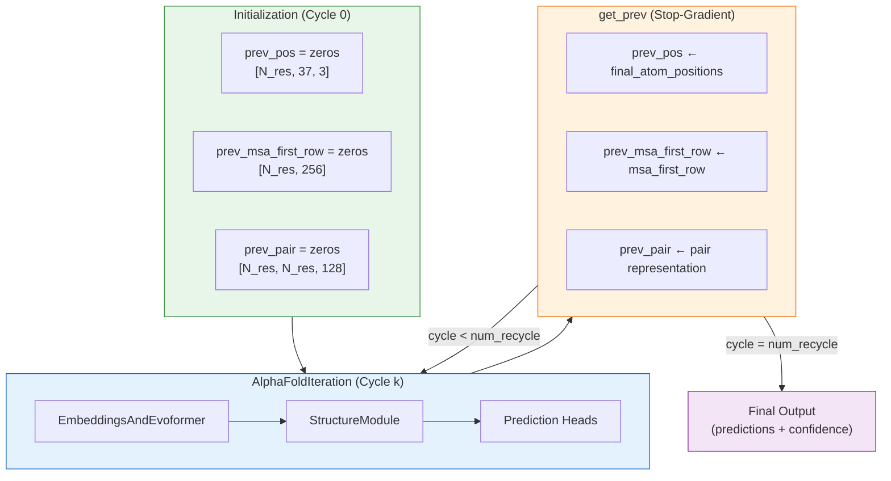

The recycling mechanism is AlphaFold's iterative refinement strategy: the model feeds its own output back as input across multiple passes, progressively sharpening structural predictions from coarse initial estimates into high-accuracy 3D coordinates. This self-conditioning loop — corresponding to **Suppl. Alg. 2 "Inference"** in Jumper et al. (2021) — is the final architectural stage that bridges the Evoformer's sequence reasoning with the Structure Module's geometric precision, enabling the network to resolve ambiguous regions that a single forward pass cannot.

Sources: [modules.py](/alphafold/model/modules.py#L289-L411), [config.py](/alphafold/model/config.py#L146-L148)

## Architectural Overview

Recycling operates as an outer loop around a single `AlphaFoldIteration`. Each iteration executes the full forward pass — Evoformer embeddings, attention blocks, and Structure Module — but receives **three recycled signals** from the previous iteration's output. The loop is driven by a Haiku `while_loop` that terminates after a configurable number of cycles (default: **3**). Critically, all recycled signals pass through `jax.lax.stop_gradient`, meaning gradients are **not** backpropagated through the recycling boundary during training — each iteration is trained independently while benefiting from the iterative refinement at inference time.



Sources: [modules.py](/alphafold/model/modules.py#L332-L338), [modules.py](/alphafold/model/modules.py#L364-L411)

## The Three Recycled Signals

The recycling mechanism transmits three distinct signals from one iteration to the next, each targeting a different representational layer within the model. These are controlled by two boolean configuration flags — `recycle_pos` and `recycle_features` — allowing selective activation.

| Signal | Source (Iteration Output) | Destination (Next Input) | Shape | Config Flag | Purpose |
|--------|---------------------------|--------------------------|-------|-------------|---------|
| **prev_pos** | `structure_module.final_atom_positions` | Input embedding of recycled coordinates | `[N_res, 37, 3]` | `recycle_pos` | Geometric self-conditioning: binned distance features between previously predicted atom positions |
| **prev_msa_first_row** | `representations.msa_first_row` | MSA row embedding | `[N_res, c_m]` (c_m=256) | `recycle_features` | Sequence-level self-conditioning: the single-sequence row of the MSA representation carries structural context back into the Evoformer |
| **prev_pair** | `representations.pair` | Pair embedding | `[N_res, N_res, c_z]` (c_z=128) | `recycle_features` | Pair-level self-conditioning: residue-pair representations encode inter-residue geometric relationships |

The `get_prev` function extracts these signals and applies `jax.lax.stop_gradient` to each, severing the computational graph at the recycling boundary:

```python
def get_prev(ret):
  new_prev = {
      'prev_pos': ret['structure_module']['final_atom_positions'],
      'prev_msa_first_row': ret['representations']['msa_first_row'],
      'prev_pair': ret['representations']['pair'],
  }
  return jax.tree.map(jax.lax.stop_gradient, new_prev)
```

> [!TIP]
> The `stop_gradient` wrapper is a deliberate design choice rooted in training stability. Without it, backpropagation through multiple recycling iterations would create an effectively unrolled recurrent network with very deep gradient paths, leading to instability. By cutting gradients at each recycling boundary, each `AlphaFoldIteration` is trained as if it receives fixed inputs — yet at inference time, the iterative feedback loop still provides progressive refinement.

Sources: [modules.py](/alphafold/model/modules.py#L332-L338)

## Recycling Loop Control Flow

The `AlphaFold` class implements the recycling loop with distinct behavior for **training** and **inference**:

**Inference mode** — The loop always runs for the maximum configured number of iterations (`num_recycle`, default 3). The `while_loop` body increments a cycle counter and calls `do_call` with `compute_loss=False` for all intermediate cycles. Only the final cycle computes full predictions.

**Training mode** — The number of recycling iterations is **randomly sampled** per training example via the `num_iter_recycling` feature in the batch. This value is clamped to not exceed `num_recycle`. Randomizing the iteration count during training ensures the model learns to produce useful predictions at every recycling stage, not just after the final iteration — a form of curriculum-aware regularization.

```python
if self.config.num_recycle:
  if 'num_iter_recycling' in batch:
    # Training time: num_iter_recycling is in batch.
    num_iter = batch['num_iter_recycling'][0]
    num_iter = jnp.minimum(num_iter, self.config.num_recycle)
  else:
    # Eval mode or tests: use the maximum number of iterations.
    num_iter = self.config.num_recycle

  body = lambda x: (
      x[0] + 1,
      get_prev(do_call(x[1], recycle_idx=x[0], compute_loss=False)),
  )
  if hk.running_init():
    _, prev = body((0, prev))
  else:
    _, prev = hk.while_loop(lambda x: x[0] < num_iter, body, (0, prev))
```

> [!TIP]
> During Haiku module initialization (`hk.running_init()`), only **one** iteration of the body is executed instead of the full `while_loop`. This is necessary because `while_loop` requires consistent shapes across iterations, and the initializer needs to discover parameter shapes through a single forward pass. The `while_loop` itself is used at runtime for its JAX XLA compilation efficiency — it avoids unrolling the loop in the Python interpreter.

Sources: [modules.py](/alphafold/model/modules.py#L378-L411)

## MSA Resampling in Recycling

A key configuration option — `resample_msa_in_recycling` (default: `True`) — controls whether the MSA is re-sampled at each recycling iteration. When enabled, the ensemble batch dimension is partitioned into `num_recycle + 1` segments, and each cycle receives a distinct MSA subsample via `jax.lax.dynamic_slice_in_dim`. This provides **stochastic diversity** across recycling iterations: different MSA subsets emphasize different evolutionary couplings, preventing the model from collapsing to a single structural hypothesis.

| `resample_msa_in_recycling` | MSA Handling per Cycle | Ensemble Size per Cycle | Trade-off |
|:---:|---|---|---|
| `True` | Each cycle gets a distinct MSA subsample (sliced from the ensemble batch) | `batch_size / (num_recycle + 1)` | More diverse structural exploration; requires larger ensemble batch |
| `False` | All cycles receive the full batch (identical MSA) | `batch_size` | Simpler, deterministic across cycles; no MSA diversity benefit |

The implementation partitions the batch along its first axis, where `recycle_idx` selects the appropriate slice:

```python
if self.config.resample_msa_in_recycling:
  num_ensemble = batch_size // (self.config.num_recycle + 1)
  def slice_recycle_idx(x):
    start = recycle_idx * num_ensemble
    size = num_ensemble
    return jax.lax.dynamic_slice_in_dim(x, start, size, axis=0)
  ensembled_batch = jax.tree.map(slice_recycle_idx, batch)
```

Sources: [modules.py](/alphafold/model/modules.py#L340-L362)

## Recycled Position Encoding

The `prev_pos` signal is not fed directly as raw 3D coordinates. Instead, it is processed through a **distogram binning** step within the `EmbeddingsAndEvoformer` module. Pairwise distances between Cβ atoms (Cα for glycine) of the recycled positions are computed and discretized into a histogram with configurable bins:

| Parameter | Default Value | Description |
|-----------|:---:|---|
| `prev_pos.min_bin` | 3.25 Å | Lower boundary of the first distance bin |
| `prev_pos.max_bin` | 20.75 Å | Upper boundary of the last distance bin |
| `prev_pos.num_bins` | 15 | Number of histogram bins |

This binning converts continuous 3D coordinates into a discrete, rotation-invariant representation that integrates naturally with the pair representation — the same encoding strategy used for template distance features. Binning provides robustness to small coordinate perturbations between recycling iterations and ensures the recycled signal has a fixed, compact shape regardless of the protein's absolute spatial extent.

Sources: [config.py](/alphafold/model/config.py#L312), [modules.py](/alphafold/model/modules.py#L366-L376)

## Configuration Summary

The recycling mechanism is governed by parameters spanning both the `data.common` and `model.embeddings_and_evoformer` config sections:

| Parameter | Location | Default | Effect |
|-----------|----------|:---:|---|
| `num_recycle` | `data.common` | 3 | Maximum number of recycling iterations at inference |
| `resample_msa_in_recycling` | `data.common` | `True` | Whether to subsample MSA differently each cycle |
| `recycle_pos` | `model.embeddings_and_evoformer` | `True` | Feed recycled atom positions back as input |
| `recycle_features` | `model.embeddings_and_evoformer` | `True` | Feed recycled MSA and pair representations back |
| `prev_pos.min_bin` | `model.embeddings_and_evoformer` | 3.25 | Minimum bin edge for recycled position distogram |
| `prev_pos.max_bin` | `model.embeddings_and_evoformer` | 20.75 | Maximum bin edge for recycled position distogram |
| `prev_pos.num_bins` | `model.embeddings_and_evoformer` | 15 | Number of bins for recycled position distogram |

Sources: [config.py](/alphafold/model/config.py#L146-L148), [config.py](/alphafold/model/config.py#L312-L314)

## Initialization and the Zero-Recycle Edge Case

At the start of the first recycling iteration (cycle 0), all `prev` signals are initialized to **zero tensors** with shapes matching their eventual populated values. This is critical: the model must produce a meaningful prediction from zeros alone on its first pass, without any self-conditioning signal. The zero initialization acts as a natural cold-start that the network learns to handle during training.

When `num_recycle` is set to 0, the recycling loop is skipped entirely and `do_call` is invoked once with the zero-initialized `prev` dictionary — effectively running AlphaFold as a single-pass model without iterative refinement. This mode is useful for ablation studies and for understanding the marginal contribution of recycling to prediction accuracy.

```python
prev = {}
emb_config = self.config.embeddings_and_evoformer
if emb_config.recycle_pos:
  prev['prev_pos'] = jnp.zeros([num_residues, residue_constants.atom_type_num, 3])
if emb_config.recycle_features:
  prev['prev_msa_first_row'] = jnp.zeros([num_residues, emb_config.msa_channel])
  prev['prev_pair'] = jnp.zeros([num_residues, num_residues, emb_config.pair_channel])
```

Sources: [modules.py](/alphafold/model/modules.py#L364-L376)

## Convergence Behavior and Practical Impact

Empirically, AlphaFold's recycling converges rapidly — the largest accuracy gains occur between cycles 0→1 and 1→2, with diminishing returns by cycle 3. This behavior is consistent with the model's training regime where `num_iter_recycling` is uniformly sampled from {0, 1, 2, 3}, ensuring that the model learns to produce high-quality outputs at every stage rather than only after the final cycle. The stop-gradient design further encourages each iteration to be independently competent, since no iteration can rely on receiving a "good" input from a prior cycle's gradients.

The recycling mechanism interacts with the [Evoformer and Embeddings](11-evoformer-and-embeddings) module (which consumes `prev_msa_first_row` and `prev_pair`) and the [Structure Module and Folding](13-structure-module-and-folding) (whose output provides `prev_pos`). For confidence estimation of the final prediction, see [pLDDT and pTM Scoring](17-plddt-and-ptm-scoring). The multimer variant implements an analogous recycling loop in `modules_multimer.AlphaFold`.
