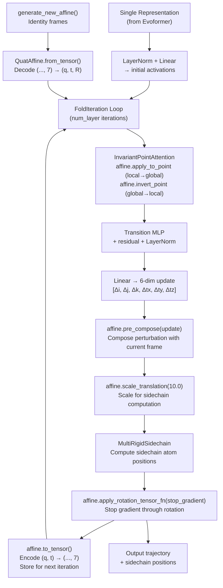

The `QuatAffine` system is AlphaFold's foundational geometric representation for backbone coordinate frames — encoding each residue's orientation and position as a **unit quaternion + translation vector** pair, with a **dual-tracked rotation matrix** kept in lockstep. This dual representation exists because quaternions are the natural parameterization for incremental rotation updates during the Structure Module's iterative folding loop (where small perturbations are expressed as near-identity quaternions), while rotation matrices provide the efficient, singularity-free mechanism for actually transforming points in 3D space. The JAX JIT compiler ensures that only the representation actually consumed by downstream operations is executed, so the redundant bookkeeping incurs no runtime penalty.

Sources: [quat_affine.py](/alphafold/model/quat_affine.py#L15-L32)

## Mathematical Foundation: Quaternions and SE(3)

A **quaternion** q = (r, i, j, k) encodes a 3D rotation when it lies on the unit 4-sphere (‖q‖ = 1). The mapping from quaternion to rotation matrix is a **bilinear form** in the quaternion components — specifically, R_ab = Σ_{p,q} Q_{pqab} · q_p · q_q, where `QUAT_TO_ROT` is the rank-4 coefficient tensor of shape (4, 4, 3, 3). This tensor captures all 16 quadratic terms: the diagonal entries (r², i², j², k²) produce the signed identity contributions, while the off-diagonal cross terms (ij, ik, jk, ir, jr, kr) produce the skew-symmetric contributions. The resulting rotation matrix follows the convention established by the [quaternion-to-rotation mapping](https://en.wikipedia.org/wiki/Quaternions_and_spatial_rotation).

A critical property is the **double cover**: both q and −q map to the same rotation matrix. The tests explicitly verify this — constructing `QuatAffine(q, t)` and `QuatAffine(-q, t)` yields identical rotation matrices and translations. This is not a bug but a topological feature of S³ → SO(3), and the code is careful to compare rotations (not raw quaternions) whenever equivalence matters.

The affine transformation itself is an element of **SE(3)** — the Special Euclidean group — composing rotation followed by translation: **x' = Rq · x + t**. The `QuatAffine` object thus stores the full rigid body state of each backbone frame.

Sources: [quat_affine.py](/alphafold/model/quat_affine.py#L44-L57), [quat_affine_test.py](/alphafold/model/quat_affine_test.py#L67-L79)

## Constant Tensors: Precomputed Bilinear Forms

The module defines three compile-time constant tensors that eliminate per-call computation of quaternion algebra coefficients:

| Constant | Shape | Purpose |
|---|---|---|
| `QUAT_TO_ROT` | (4, 4, 3, 3) | Bilinear coefficients mapping quaternion pairs → 3×3 rotation matrix entries |
| `QUAT_MULTIPLY` | (4, 4, 4) | Bilinear coefficients for Hamilton product q₁·q₂ |
| `QUAT_MULTIPLY_BY_VEC` | (4, 3, 4) | Slice of `QUAT_MULTIPLY[:, 1:, :]` for multiplying quaternion by pure-vector quaternion (0, v) |

The `QUAT_TO_ROT` tensor encodes the standard formula where diagonal indices contribute ±1 along the rotation matrix diagonal (e.g., r² + i² − j² − k² for R₁₁), while off-diagonal indices contribute ±2 to cross terms (e.g., 2(ij + kr) for R₁₂). These are stored as `np.float32` constants and are embedded into the JAX computation graph at trace time, avoiding any runtime construction overhead.

Sources: [quat_affine.py](/alphafold/model/quat_affine.py#L44-L89)

## The QuatAffine Class

### Construction and Internal State

```python
QuatAffine(quaternion, translation, rotation=None, normalize=True, unstack_inputs=False)
```

The constructor accepts a quaternion of shape `(..., 4)` and a translation of shape `(..., 3)`. When `normalize=True` (the default), the quaternion is L2-normalized along its last axis — this is essential because the neural network's `affine_update` output produces unnormalized quaternions that must be projected back to the unit sphere. If `rotation` is not provided, it is **derived from the quaternion** via `quat_to_rot()`, establishing the dual-track invariant. The internal state stores rotation as a **list-of-lists** (3×3 nested structure of arrays) and translation as a **3-element list**, rather than as single tensors — this is a deliberate choice to avoid triggering low-precision matrix multiplication hardware (tensor cores / MXU) that would degrade coordinate geometry accuracy.

Sources: [quat_affine.py](/alphafold/model/quat_affine.py#L200-L247), [r3.py](/alphafold/model/r3.py#L23-L31)

### Tensor Serialization

The `to_tensor()` and `from_tensor()` methods provide a **7-element flat encoding**: `[q_r, q_i, q_j, q_k, t_x, t_y, t_z]`. This is the representation stored in the Structure Module's activation dictionary under the key `'affine'`, and it flows through the iterative folding loop as a standard JAX array. The `from_tensor` class method splits at indices [4, 5, 6] to recover the quaternion and three scalar translations.

Sources: [quat_affine.py](/alphafold/model/quat_affine.py#L249-L289)

## Core Operations

### pre_compose — Incremental Frame Update

This is the **most critical operation** in the Structure Module's inner loop. It implements the composition of a new small perturbation with the current frame:

```
new_affine = current_affine ∘ update
```

The `update` parameter is a **6-element vector**: `[Δi, Δj, Δk, Δt_x, Δt_y, Δt_z]`. The quaternion update uses the **small-angle approximation** where the perturbation quaternion is (1, Δi, Δj, Δk) — near-identity, avoiding the need for explicit normalization of the perturbation. The new quaternion is computed as:

```
q_new = q_current + q_current ⊗ (0, Δi, Δj, Δk)
```

where ⊗ denotes Hamilton multiplication (implemented via `quat_multiply_by_vec`). This linearized update is exact in the limit of small rotations and avoids the singularity issues that Euler angles would face. The translation update is first **rotated into the current frame** via `apply_rot_to_vec`, then added — ensuring the translation perturbation is expressed in local coordinates.

Sources: [quat_affine.py](/alphafold/model/quat_affine.py#L291-L320), [folding.py](/alphafold/model/folding.py#L373-L383)

### apply_to_point and invert_point — Point Transformation

`apply_to_point(point, extra_dims=0)` computes **R · point + t**, transforming points from the local frame to the global frame. The `extra_dims` parameter broadcasts the rotation and translation across additional trailing dimensions — this is essential for Invariant Point Attention, where each residue produces multiple query/key/value points per attention head, requiring the frame to be applied across the head dimension.

`invert_point(transformed_point, extra_dims=0)` computes the inverse transformation: **Rᵀ · (point − t)**, exploiting the fact that for rotation matrices, R⁻¹ = Rᵀ. This is used in IPA to project globally-frame attention results back into each residue's local reference frame.

Sources: [quat_affine.py](/alphafold/model/quat_affine.py#L322-L375)

### apply_rotation_tensor_fn — Gradient Stop on Rotation

```python
affine = affine.apply_rotation_tensor_fn(jax.lax.stop_gradient)
```

This applies a tensor function (typically `stop_gradient`) to **only the rotation components** (quaternion and rotation matrix), leaving translations untouched. In the Structure Module, this is called at the end of each `FoldIteration` to **stop gradient flow through the rotation** while allowing gradients to flow through translations. This is a key regularization: it prevents the network from "cheating" by rotating frames to trivially reduce loss, forcing it to learn meaningful translational corrections instead.

Sources: [quat_affine.py](/alphafold/model/quat_affine.py#L265-L272), [folding.py](/alphafold/model/folding.py#L391-L391)

### scale_translation — Position Scaling

Multiplies the translation by a scalar factor while preserving rotation. The Structure Module applies `position_scale` (default 10.0) to convert from Ångström coordinates to the model's internal length scale before computing sidechain positions, then scales back when outputting the trajectory. This stabilizes training by keeping both rotation and translation parameters in a similar numeric range.

Sources: [quat_affine.py](/alphafold/model/quat_affine.py#L274-L282), [folding.py](/alphafold/model/folding.py#L385-L386)

## Conversion Utilities

### quat_to_rot — Quaternion to Rotation Matrix

Implements the bilinear formula R = Σ QUAT_TO_ROT[p,q,:,:] · q_p · q_q by reshaping the coefficient tensor to (4, 4, 9), performing the weighted sum, and unstacking the result into a 3×3 list-of-lists. This runs on every `QuatAffine` construction when `rotation=None`.

### rot_to_quat — Rotation Matrix to Quaternion

The **inverse direction** — extracting a quaternion from a rotation matrix. This constructs a 4×4 symmetric matrix K = ⅓ · (trace·I + R + Rᵀ − 2·I), then finds its **eigenvector corresponding to the largest eigenvalue** via `jnp.linalg.eigh`. The eigenvector is the quaternion. This is **extremely expensive on GPU** (self-adjoint eigendecomposition), so the docstring explicitly warns to run this on CPU when possible. In practice, AlphaFold rarely calls this direction — it's primarily used for verification in tests.

Sources: [quat_affine.py](/alphafold/model/quat_affine.py#L93-L158)

## Backbone Canonicalization Functions

### make_canonical_transform

Given the N, Cα, C atom positions of a residue, computes the affine transform that places the residue in a **canonical reference frame**: Cα at the origin, C on the positive x-axis, and N in the xy-plane. This is achieved through three sequential operations: (1) translate by −Cα, (2) rotate around z-axis to place C's projection on the x-axis, (3) rotate around y-axis to place C on the x-axis, (4) rotate around x-axis to place N in the xy-plane.

### make_transform_from_reference

The inverse operation — given N, Cα, C positions, returns the rotation and translation that maps the canonical reference frame to the actual residue frame. This is used to construct ground-truth backbone frames for FAPE loss computation. Note the swapped return order: (rotation, translation) vs. make_canonical_transform's (translation, rotation), because the rotation here is applied **before** the translation.

Sources: [quat_affine.py](/alphafold/model/quat_affine.py#L401-L511)

## Integration in the Structure Module Pipeline

The following diagram shows how `QuatAffine` flows through the Structure Module's iterative folding process:



Each iteration decodes the flat 7-vector back into a `QuatAffine`, applies IPA (which uses `apply_to_point` and `invert_point` to move points between local and global frames), computes a 6-DOF update, composes it via `pre_compose`, and stops gradients through the rotation before storing the updated frame. The full trajectory of frames across all iterations is returned for FAPE loss computation.

Sources: [folding.py](/alphafold/model/folding.py#L290-L394), [folding.py](/alphafold/model/folding.py#L397-L462)

## Relationship to r3.Rigids and geometry.Rigid3Array

AlphaFold employs **three parallel rigid body representations**, each optimized for a different context:

| Representation | Module | Storage Format | Primary Use |
|---|---|---|---|
| `QuatAffine` | `quat_affine.py` | quaternion (4) + rotation matrix (3×3 list) + translation (3-list) | Structure Module inner loop, IPA, frame updates |
| `Rigids` (namedtuple) | `r3.py` | `Rots` (9 named scalars) + `Vecs` (3 named scalars) | FAPE loss, all-atom computation, explicit named-tuple field access |
| `Rigid3Array` | `geometry/rigid_matrix_vector.py` | `Rot3Array` + `Vec3Array` (struct-of-array) | All-atom multimer, post-structure geometry operations |

The bridge functions are `rigids_from_quataffine()` and `rigids_to_quataffine()` in `r3.py`. The conversion from `QuatAffine` to `Rigids` flattens the rotation list-of-lists and translation list into the `Rots`/`Vecs` named tuples. The conversion from `Rigids` to `QuatAffine` sets `quaternion=None` (omitting the quaternion) and passes the rotation matrix directly — this avoids the expensive `rot_to_quat` eigendecomposition. The `QuatAffine` class permits `quaternion=None` in its constructor, treating this as a rotation-matrix-only instance.

> [!TIP]
> The list-of-lists rotation storage in `QuatAffine` is intentional: it prevents JAX from dispatching 3×3 matrix multiplications to tensor cores or MXU hardware that operate in reduced precision (bfloat16 on TPU, fp16 on GPU). For 3D geometry, this precision loss is unacceptable, so the code uses explicit element-wise expressions instead of `jnp.matmul`.

> [!TIP]
> The `pre_compose` method's small-angle quaternion update (1, Δi, Δj, Δk) is a first-order approximation that avoids normalization of the perturbation. This means the quaternion drifts off the unit sphere over iterations — but `QuatAffine.__init__` normalizes by default, and the from_tensor→QuatAffine round-trip in each FoldIteration implicitly re-normalizes, keeping the representation numerically stable.

Sources: [r3.py](/alphafold/model/r3.py#L107-L196), [rigid_matrix_vector.py](/alphafold/model/geometry/rigid_matrix_vector.py#L31-L76)

## Key API Summary

| Method | Signature | Semantics |
|---|---|---|
| `QuatAffine.__init__` | `(quaternion, translation, rotation=None, normalize=True, unstack_inputs=False)` | Construct from q + t; derives R if not provided |
| `to_tensor` | `() → (..., 7)` | Serialize to flat [q₀,q₁,q₂,q₃,tₓ,tᵧ,t_z] |
| `from_tensor` | `(tensor, normalize=False) → QuatAffine` | Deserialize from flat 7-vector |
| `pre_compose` | `(update: (..., 6)) → QuatAffine` | Compose small perturbation: new = self ∘ update |
| `apply_to_point` | `(point, extra_dims=0) → transformed_point` | Forward transform: R·x + t |
| `invert_point` | `(transformed_point, extra_dims=0) → point` | Inverse transform: Rᵀ·(x − t) |
| `apply_rotation_tensor_fn` | `(tensor_fn) → QuatAffine` | Apply fn to rotation parts only (e.g. stop_gradient) |
| `apply_tensor_fn` | `(tensor_fn) → QuatAffine` | Apply fn to all parts (rotation + translation) |
| `scale_translation` | `(position_scale) → QuatAffine` | Scale translation by factor, preserve rotation |

Sources: [quat_affine.py](/alphafold/model/quat_affine.py#L200-L378)

## Where to Go Next

The `QuatAffine` system operates within a broader geometric framework. For the named-tuple rigid body representation used in FAPE loss and all-atom computations, see [Rigid Body and Vector Algebra](16-rigid-body-and-vector-algebra). For the Structure Module that drives the iterative `QuatAffine` updates via `pre_compose`, see [Structure Module and Folding](13-structure-module-and-folding). For Invariant Point Attention's use of `apply_to_point` and `invert_point` to achieve SE(3)-equivariance, see [Invariant Point Attention](12-invariant-point-attention).