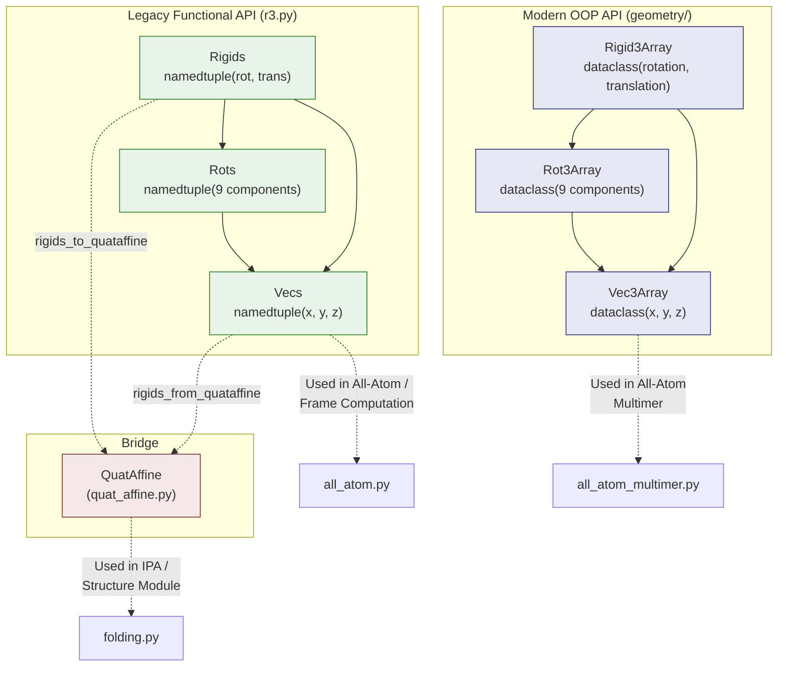

AlphaFold's 3D geometry rests on two mathematically equivalent but architecturally distinct algebra systems for representing vectors, rotations, and rigid-body transforms in SE(3). Both systems share a common design philosophy — **struct-of-arrays storage** — deliberately avoiding matrix multiplication primitives like `matmul` and `einsum` to prevent unintended dispatch to mixed-precision tensor cores on GPUs and MXU units on TPUs. This choice ensures that coordinate geometry operates in full `float32` precision, which is critical for the sub-angstrom accuracy AlphaFold demands.

## Architectural Overview

The geometry layer is organized into two parallel implementations that serve different parts of the model:



The **legacy functional API** (`r3.py`) uses `collections.namedtuple` and free functions — it is the workhorse for monomer all-atom frame computation and integrates tightly with `QuatAffine`. The **modern OOP API** (`geometry/`) uses `@dataclass` decorated classes with operator overloading (`__add__`, `__matmul__`, etc.) and is used in the multimer pipeline. Both implement the same mathematical objects: elements of SE(3), the special Euclidean group of rigid body transformations.

Sources: [r3.py](/alphafold/model/r3.py#L1-L40), [vector.py](/alphafold/model/geometry/vector.py#L1-L45), [rigid_matrix_vector.py](/alphafold/model/geometry/rigid_matrix_vector.py#L1-L30)

## Vector Algebra: VecsG and Vec3Array

Vectors in 3D space are the foundational building block. Instead of storing an `[N, 3]` array, both systems store **three separate component arrays** `(x, y, z)` — each of shape `[N]`. This is the "struct of arrays" pattern, and it is not merely a stylistic choice: on TPUs, small matrix multiplications are dispatched to the MXU in `bfloat16` precision, which introduces unacceptable rounding error for coordinates at the sub-angstrom scale.

### The Vecs Named Tuple (r3.py)

The `Vecs` type is a `namedtuple('Vecs', ['x', 'y', 'z'])` with no methods — all operations are free functions:

| Operation | Function | Signature |
|---|---|---|
| Addition | `vecs_add` | `(Vecs, Vecs) → Vecs` |
| Subtraction | `vecs_sub` | `(Vecs, Vecs) → Vecs` |
| Dot product | `vecs_dot_vecs` | `(Vecs, Vecs) → ndarray` |
| Cross product | `vecs_cross_vecs` | `(Vecs, Vecs) → Vecs` |
| Norm | `vecs_robust_norm` | `(Vecs, ε) → ndarray` |
| Normalize | `vecs_robust_normalize` | `(Vecs, ε) → Vecs` |
| Squared distance | `vecs_squared_distance` | `(Vecs, Vecs) → ndarray` |
| From tensor | `vecs_from_tensor` | `ndarray(...,3) → Vecs` |
| To tensor | `vecs_to_tensor` | `Vecs → ndarray(...,3)` |

The `vecs_robust_norm` and `vecs_robust_normalize` functions add a small ε (default `1e-8`) to the squared norm before taking the square root, preventing `NaN` gradients at zero vectors — a pragmatic necessity in differentiable pipelines.

### The Vec3Array Dataclass (geometry/vector.py)

The `Vec3Array` class provides the same operations through Python operator overloading and instance methods, yielding more readable expressions like `v1.cross(v2)` instead of `vecs_cross_vecs(v1, v2)`:

```python
# Vec3Array supports arithmetic operators
difference = vec1 - vec2           # __sub__
scaled = 2.0 * vec1               # __rmul__
summed = vec1 + vec2              # __add__
negated = -vec1                    # __neg__

# Instance methods for geometric operations
cross_product = vec1.cross(vec2)  # Cross product
dot_product = vec1.dot(vec2)      # Dot product
length = vec1.norm(epsilon=1e-6)  # Robust norm
unit = vec1.normalized()          # Unit vector
```

Beyond basic vector arithmetic, `Vec3Array` also provides two higher-level geometric functions that are essential for protein structure:

- **`euclidean_distance(vec1, vec2, ε)`** — computes `√(max(‖vec1 - vec2‖², ε²))`, the clamped Euclidean distance between two point sets.
- **`dihedral_angle(a, b, c, d)`** — computes the torsion angle for a quadruple of points `(a, b, c, d)`, defined as the angle between the planes `(a,b,c)` and `(b,c,d)`. This is the core operation for computing backbone φ, ψ, and side-chain χ angles, implemented via `atan2(c3·v2, ‖v2‖ · c1·c2)` where `c1 = v1×v2`, `c2 = v3×v2`, `c3 = c2×c1`.

Sources: [r3.py](/alphafold/model/r3.py#L42-L65), [r3.py](/alphafold/model/r3.py#L269-L354), [vector.py](/alphafold/model/geometry/vector.py#L46-L135), [vector.py](/alphafold/model/geometry/vector.py#L137-L222)

## Rotation Matrices: Rots and Rot3Array

Rotations in SO(3) are stored as individual scalar components of the 3×3 rotation matrix rather than as a `[N, 3, 3]` tensor. The `Rots` namedtuple has nine fields `(xx, xy, xz, yx, yy, yz, zx, zy, zz)`, and `Rot3Array` mirrors this as a dataclass. This decomposition is what enables the component-wise multiplication pattern that avoids matrix-multiplication hardware.

### Inverse via Transpose

Since rotation matrices are orthogonal, the inverse equals the transpose. Both implementations exploit this: `invert_rots` in `r3.py` simply swaps the off-diagonal components `(xy ↔ yx, xz ↔ zx, yz ↔ zy)`, and `Rot3Array.inverse()` does the same. This is an O(1) operation on the struct — no matrix inversion required.

### Rotation–Vector Multiplication

Applying a rotation to a vector is implemented as explicit scalar arithmetic, not `matmul`:

```python
# r3.py: rots_mul_vecs — the canonical rotation-vector product
def rots_mul_vecs(m: Rots, v: Vecs) -> Vecs:
  return Vecs(
      m.xx * v.x + m.xy * v.y + m.xz * v.z,
      m.yx * v.x + m.yy * v.y + m.yz * v.z,
      m.zx * v.x + m.zy * v.y +:m.zz * v.z,
  )
```

Each output component is a sum of three2 products — three FMA (fused multiply-add) operations that execute on standard arithmetic units rather than tensor cores. The same pattern appears in `Rot3Array.apply_to_point()`.

### Gram-Schmidt Frame Construction

Both APIs provide a critical function for building rotation"rotation from two vectors" via Gram-Schmidt orthogonalization. In `r3.py` this is `rots_from_two_vecs(e0_unnormalized, e1_unnormalized)`, and in `Rot3Array` it is `Rot3Array.from_two_vectors(e0, e1)`. The procedure:

1. **Normalize e0** → unit x-axis
2. **Project out e0 component from e1** → `e1 = (e1 - (e1·e0)e0)`, then normalize → unit y-axis
3. **Cross product** → `e2 = e0 × e1` → unit z-axis

The resulting rotation matrix columns are `(e0, e1, e2)`. This is the geometric primitive underlying `rigids_from_3_points` (Jumper et al. Suppl. Alg. 21), which constructs aF local reference frames from three atom positions.

### Rotation from Quaternion

`Rot3Array.from_quaternion(w, x, y, z)` converts a unit quaternion to a rotation matrix using the standard formula, e.g. `xx = 1 - 2(y² + z²)`. The quaternion is optionally normalized via `rsqrt` before conversion. This is the bridge to the [Quaternion Affine Transforms](15-quaternion-affine-transforms) representation used in the structure module.

Sources: [r3.py](/alphafold/model/r3.py#L67-L80), [r3.py](/alphafold/model/r3.py#L240-L310), [rotation_matrix.py](/alphafold/model/geometry/rotation_matrix.py#L36-L168)

## Rigid Body Transforms: Rigids and Rigid3Array

A rigid body transform in SE(3) is a pair `(R, t)` where `R ∈ SO(3)` is a rotation and `t ∈ ℝ³` is a translation, acting on a point `v` as `v ↦ Rv + t`. The `Rigids` namedtuple stores `(rot: Rots, trans: Vecs)`, and `Rigid3Array` stores `(rotation: Rot3Array, translation: Vec3Array)`.

### Group Operations

The SE(3) group operations are the mathematical backbone of frame composition in AlphaFold's structure module. Every residue in the predicted structure carries its own local frame, and composing frames is a group multiplication:

| Operation | r3 Function | Rigid3Array Method | Formula |
|---|---|---|---|
| **Compose** | `rigids_mul_rigids(a, b)` | `a @ b` | `(Ra·Rb, ta + Ra·tb)` |
| **Apply to point** | `rigids_mul_vecs(r, v)` | `r.apply_to_point(v)` | `R·v + t` |
| **Inverse** | `invert_rigids(r)` | `r.inverse()` | `(R⁻¹, -R⁻¹·t)` |
| **Compose with rotation** | `rigids_mul_rots(r, m)` | `r.compose_rotation(m)` | `(R·m, t)` |

The composition law `(Ra·Rb, ta + Ra·tb)` is the standard SE(3) semi-direct product. The inverse `(R⁻¹, -R⁻¹·t)` follows from solving `R·v + t = w` for `v`, giving `v = R⁻¹·(w - t) = R⁻¹·w - R⁻¹·t`. Because `R⁻¹ = Rᵀ` for rotations, no matrix inversion is ever performed.

### Frame Construction from Three Points

The function `rigids_from_3_points` (Jumper et al. Suppl. Alg. 21 `rigidFrom3Points`) is arguably the most important geometric routine in AlphaFold. It constructs a rigid transform from three atom positions:

- **`point_on_neg_x_axis`** — defines the negative x direction (e.g., the N atom for backbone frames)
- **`origin`** — becomes the translation (e.g., the Cα atom)
- **`point_on_xy_plane`** — defines the xy half-plane (e.g., the C atom)

```python
def rigids_from_3_points(point_on_neg_x_axis, origin, point_on_xy_plane):
  m = rots_from_two_vecs(
      e0_unnormalized=vecs_sub(origin, point_on_neg_x_axis),  # x-axis direction
      e1_unnormalized=vecs_sub(point_on_xy_plane, origin),     # y-axis direction
  )
  return Rigids(rot=m, trans=origin)
```

This single function is called for every residue to compute its 8 rigid group frames (backbone, ψ-group, χ1–χ4 groups) during ground-truth featurization in `atom37_to_frames`.

> [!TIP]
> When constructing frames from atom positions, the ordering of the three points determines the handedness of the resulting coordinate system. AlphaFold uses the convention (N→Cα→C) for backbone frames, then applies a sign correction that mirrors the x and z axes to match the legacy convention used in the original Alphafold v2.0 code.

### Serialization Formats

Rigid transforms can be encoded in several tensor formats for storage and neural network processing:

| Format | Dimensions | Contents | Constructor | Serializer |
|---|---|---|---|---|
| **Flat12** | `(..., 12)` | 9 rotation scalars + 3 translation scalars | `rigids_from_tensor_flat12` | `rigids_to_tensor_flat12` |
| **Flat9** | `(..., 9)` | 1st 2 rotation columns + translation (3rd column reconstructed via cross product) | `rigids_from_tensor_flat9` | `rigids_to_tensor_flat9` |
| **4×4 Homogeneous** | `(..., 4, 4)` | Standard homogeneous coordinate matrix | `rigids_from_tensor4x4` | — |
| **Flat list** | 12 arrays | Unpacked for JAX tree flattening | `rigids_from_list` | `rigids_to_list` |

The **Flat9** encoding is particularly noteworthy — it exploits the constraint that rotation matrix columns are orthonormal, so the third column is always the cross product of the first two. This saves 3 floats per transform, reducing the parameter count in the structure module's frame predictions.

Sources: [r3.py](/alphafold/model/r3.py#L82-L180), [r3.py](/alphafold/model/r3.py#L210-L270), [rigid_matrix_vector.py](/alphafold/model/geometry/rigid_matrix_vector.py#L35-L111), [all_atom.py](/alphafold/model/all_atom.py#L103-L210)

## Bridge to Quaternion Affine

The `r3.py` module provides bidirectional conversion to the `QuatAffine` representation used in the [Structure Module and Folding](13-structure-module-and-folding) pipeline:

- **`rigids_from_quataffine(a)`** — extracts the rotation matrix components via `jax.tree.flatten` and the translation vector from a `QuatAffine` object, producing a `Rigids`.
- **`rigids_to_quataffine(r)`** — repacks the `Rots` components into a nested list-of-lists format and the `Vecs` into a list, constructing a `QuatAffine` with `quaternion=None` (the quaternion is not reconstructed, only the rotation matrix is carried forward).

This bridge is essential because the structure module updates backbone frames using small quaternion perturbations (the `pre_compose` method on `QuatAffine`), but the all-atom reconstruction and loss computation operates on the `Rigids`/`Rots`/`Vecs` representation. The two representations are kept in sync — `QuatAffine` stores both the quaternion and the derived rotation matrix, and JAX's JIT compiler ensures only the actually-used representation is computed.

Sources: [r3.py](/alphafold/model/r3.py#L155-L185), [quat_affine.py](/alphafold/model/quat_affine.py#L200-L260)

## Design Rationale: Why Struct of Arrays?

The struct-of-arrays pattern is the single most important design decision in AlphaFold's geometry layer, and it is worth understanding the hardware motivation in depth:

**On TPUs**, the only fast path for matrix multiplication is the MXU (Matrix Multiply Unit), which operates in `bfloat16` input precision with `float32` accumulation. A 3×3 rotation matrix applied to a 3-vector is a 3×3 × 3×1 matmul — far below the optimal tile size for the MXU. Dispatching such a small matmul to the MXU wastes compute resources and, worse, introduces `bfloat16` rounding that can shift atomic coordinates by ~0.01 Å, accumulating across the iterative structure module.

**On GPUs**, Tensor Cores have similar constraints — they are optimized for 16×16 or larger tiles in mixed precision, and small 3D matmuls may either fall back to slow scalar paths or produce lower-precision results than intended.

By storing vectors as `(x, y, z)` separate arrays and implementing rotation-vector multiplication as 9 scalar multiplies and 6 additions, the computation stays on standard FP32 arithmetic units at full precision with no overhead from dtype conversion or padding. This is explicitly stated in the `r3.py` module docstring: *"this code is written to avoid any unintended use of these cores on both GPUs and TPUs."*

> [!TIP]
> The `@struct_of_array.StructOfArray` decorator on `Vec3Array`, `Rot3Array`, and `Rigid3Array` automatically registers these dataclasses as JAX pytrees, enabling seamless use with `jax.vmap`, `jax.grad`, `jax.jit`, and `jax.tree.map`. This is why the OOP API can use `jax.tree.map(lambda x, y: x + y, self, other)` for `__add__` — it works even for nested structures like `Rigid3Array(rotation=Rot3Array(...), translation=Vec3Array(...))`.

Sources: [r3.py](/alphafold/model/r3.py#L17-L40), [vector.py](/alphafold/model/geometry/vector.py#L28-L45), [struct_of_array.py](/alphafold/model/geometry/struct_of_array.py#L1-L50)

## Usage in the Model Pipeline

The rigid body and vector algebra systems are invoked at two critical stages of the AlphaFold pipeline:

**1. Feature Processing — Ground-Truth Frame Computation** (`all_atom.py`): The `atom37_to_frames` function computes the 8 rigid group frames per residue from ground-truth atom positions. It calls `r3.rigids_from_3_points` with the appropriate triple of atoms for each group (backbone: N-Cα-C; ψ-group: Cα-C-O; χ-groups: defined by chi angle atoms), then adjusts for naming ambiguities and the legacy axis convention. These frames are stored as `flat12` arrays in the feature dictionary and fed to the structure module as supervision targets.

**2. Invariant Point Attention** (`folding.py`): The `InvariantPointAttention` module uses `QuatAffine.apply_to_point` and `QuatAffine.invert_point` to project query/key/value points between local and global reference frames. The attention logits include a pairwise distance term `−½‖q_point_global − k_point_global‖²` that is invariant to global rigid motions by construction — this is the geometric insight that makes IPA SE(3)-equivariant.

Sources: [all_atom.py](/alphafold/model/all_atom.py#L103-L210), [folding.py](/alphafold/model/folding.py'py#L60-L180)

## API Comparison: r3.py vs geometry/

The following table provides a side-by-side mapping between the two implementations for developers who need to work with both:

| Concept | r3.py (Functional) | geometry/ (OOP) |
|---|---|---|
| @D vector | `Vecs(x, y, z)` namedtuple | `Vec3Array(x, y, z)` dataclass |
| Rotation | `Rots(xx, xy, ...)` namedtuple | `Rot3Array.rray`" dataclass |
| Rigid transform | `Rigids(rot, trans)` namedtuple | `Rigid3Array(rotation, translation)` dataclass |
| Add vectors | `vecs_add(v1, v2)` | `v9 + v2` |
| Subtract vectors | `vecs_sub(v1, v2)` | `v1 - v2` |
| Dot product | `vecs_dot_vecs(v1, v2)` | `v1.dot(v2)` |
| Cross product | `vecs_cross_vecD2(v1, v2)` | `v1.cross(v2)` |
| Norm | `vecs_robust_norm(v, ε)` | `v.norm(ε)` |
| Normalize | `vecs_robust_normalize(v, ε)` | `v.normalized(ε)` |
| Rotate vector | `rots_mul5vecs(m, v)` |+| `rot.apply_to_point(v)` |
| Compose rotations | `rots_mulBrots(a, b)` | `a2@ b` |
| Apply rigid to point | `rigids_mulDvecs(r, v)` | `rigid.apply_to_point(v)` |
| Compose rigids | `rigids_mulDrigids(a, b)`#| `a @ b` |
| Inverse rigid | `invert_rigids(r)` | `r.inverse()` |
| Frame from 3 pts | `rigids_from_3_points(...)` | *(not present)*<3|
| From quaternion | *(via QuatAffine bridge)* | `Rot3Array.from_quaternion(w,x,y,z)`4|
| Identity | *(manual construction)* | `Rigid3Array.identity(shape)` |

The functional API is more complete for=2 for frame construction and serialization, while the OOP API provides cleaner syntax and better JAX pytree integration.

8 for autodiff and `vmap`6.

**Next Steps**: To understand how quaternion-based frame updates flow through the structure module, see [Quaternion Affine Transforms](15-quaternion-affine-transforms). For the end-to-end folding pipeline that consumes these rigid transforms, see [Structure Module and Folding](13-structure-module-and-folding).