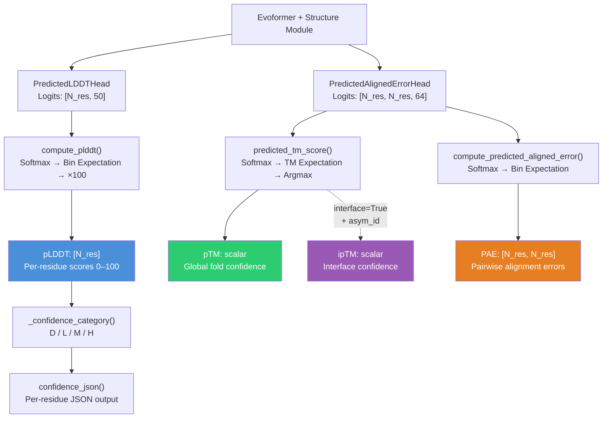

AlphaFold's confidence metrics are the bridge between raw neural network logits and actionable biological interpretation. Two scores dominate this landscape: **pLDDT** (predicted Local Distance Difference Test) provides per-residue local structural confidence on a 0–100 scale, while **pTM** (predicted Template Modeling score) delivers a single global measure of the entire structure's predicted correctness. Together, they form a dual-resolution confidence framework that lets you both zoom into individual residue reliability and assess the overall fold topology—critical for deciding whether a prediction is experimentally useful or merely speculative.

## The lDDT Foundation

Before understanding pLDDT, you must understand the metric it approximates: **lDDT** (local Distance Difference Test). Unlike global metrics such as RMSD that require superposition, lDDT evaluates structural accuracy by comparing inter-atomic distance matrices directly, making it inherently superposition-free and locally decomposable. The reference implementation in AlphaFold computes an approximate lDDT by measuring the fraction of pairwise distances (below a 15Å cutoff in the true structure) that agree within tolerance thresholds of 0.5Å, 1.0Å, 2.0Å, and 4.0Å:

```python
# Four tolerance thresholds, each contributing 0.25 to the score
score = 0.25 * (
    (dist_l1 < 0.5).astype(jnp.float32)
    + (dist_l1 < 1.0).astype(jnp.float32)
    + (dist_l1 < 2.0).astype(jnp.float32)
    + (dist_l1 < 4.0).astype(jnp.float32)
)
```

The function operates on distance difference `dist_l1 = |dmat_true − dmat_predicted|`, normalized over all scored pairs. Crucially, this is an **approximate** lDDT—it omits the physical plausibility correction (e.g., bond length violation penalties) defined in the original Mariani et al. (2013) paper. Self-interaction terms are explicitly excluded via `1.0 − jnp.eye(dmat_true.shape[1])`, and only true-structure pairs within the 15Å cutoff contribute, preventing noise from long-range, weakly-constrained distances.

Sources: [lddt.py](alphafold/model/lddt.py#L19-L101)

## pLDDT: From Logits to Per-Residue Confidence

The `PredictedLDDTHead` in AlphaFold's architecture outputs raw logits over a fixed number of bins (default 50, spanning the [0, 1] lDDT range). The `compute_plddt` function converts these logits into interpretable per-residue scores through a three-step pipeline:

1. **Bin center construction**: With `num_bins` bins and uniform width `bin_width = 1.0 / num_bins`, bin centers are placed at `[0.5 × bin_width, 1.5 × bin_width, …, (num_bins − 0.5) × bin_width]`. For the default 50 bins, this yields centers at 0.01, 0.03, …, 0.99.
2. **Softmax probability distribution**: Logits are converted to probabilities via softmax along the bin dimension, producing a categorical distribution over lDDT values for each residue.
3. **Expected value and rescaling**: The predicted lDDT is the probability-weighted sum of bin centers, then multiplied by 100 to rescale from [0, 1] to the familiar **[0, 100]** range.

```python
def compute_plddt(logits: np.ndarray) -> np.ndarray:
  num_bins = logits.shape[-1]
  bin_width = 1.0 / num_bins
  bin_centers = np.arange(start=0.5 * bin_width, stop=1.0, step=bin_width)
  probs = np.array(_softmax(logits, axis=-1))
  predicted_lddt_ca = np.sum(probs * bin_centers[None, :], axis=-1)
  return predicted_lddt_ca * 100
```

The input shape `[num_res, num_bins]` means each residue independently receives its own probability distribution and resulting pLDDT score—this is what makes pLDDT a **local** metric. The softmax numerically stabilizes by subtracting the per-axis maximum before exponentiation, preventing overflow for extreme logit values.

Sources: [confidence.py](alphafold/common/confidence.py#L23-L44)

## pLDDT Confidence Categories

AlphaFold discretizes the continuous pLDDT score into four interpretive categories that directly inform structural biology decisions:

| Category | pLDDT Range | Structural Interpretation | Typical Use |
|----------|------------|--------------------------|-------------|
| **D** (Disordered) | 0–49 | Predicted as intrinsically disordered or unstructured | Likely flexible loops / IDRs |
| **L** (Low) | 50–69 | Low confidence, unreliable local geometry | Avoid using in downstream modeling |
| **M** (Medium) | 70–89 | Generally reliable backbone, side chains may be wrong | Usable for fold-level analysis |
| **H** (High) | 90–100 | High confidence in both backbone and side chains | Suitable for detailed structural work |

The `_confidence_category` function implements this classification with half-open interval semantics: `[0, 50)` → D, `[50, 70)` → L, `[70, 90)` → M, `[90, 100]` → H. The `confidence_json` function serializes every residue's number, raw score (rounded to 2 decimal places), and category into a compact JSON string for visualization and downstream tooling:

```python
confidence = {
    'residueNumber': list(range(1, len(plddt) + 1)),
    'confidenceScore': [round(float(s), 2) for s in plddt],
    'confidenceCategory': [_confidence_category(s) for s in plddt],
}
```

This JSON format is what powers the per-residue coloring in AlphaFold's visual outputs, where blue (H), cyan (M), yellow (L), and orange (D) regions provide an at-a-glance confidence map.

Sources: [confidence.py](alphafold/common/confidence.py#L47-L81), [confidence_test.py](alphafold/common/confidence_test.py#L34-L48)

## pTM: Predicted Template Modeling Score

While pLDDT answers "is this residue placed correctly?", pTM answers "is the overall fold topology correct?". The `predicted_tm_score` function computes a predicted TM-score from the `PredictedAlignedErrorHead` logits, which output a `[num_res, num_res, num_bins]` tensor of error distribution logits over pairwise aligned distance errors.

The computation follows the TM-score formulation of Yang & Skolnick (2004), with the critical scaling parameter **d₀** defined as:

```
d₀ = 1.24 × (clipped_num_res − 15)^(1/3) − 1.8
```

where `clipped_num_res = max(num_res, 19)` prevents undefined or negative d₀ for very short chains. The algorithm proceeds through these stages:

1. **Bin centers from error breaks**: Given `[num_bins − 1]` bin edge values, bin centers are computed by adding half the uniform step size, with a catch-all bin appended at the end for the tail of the distribution.
2. **Softmax over bins**: Logits → probabilities for each residue pair's aligned distance error.
3. **TM-weighted expectation**: For each bin, the TM-score contribution is `1 / (1 + (bin_center / d₀)²)`. The predicted TM term for each pair is the probability-weighted sum of these contributions.
4. **Optimal alignment selection**: The final pTM is the per-alignment score corresponding to the residue that maximizes `per_alignment × residue_weights`—this selects the reference frame that gives the highest TM-score.

```python
# Core TM-score term computation
tm_per_bin = 1.0 / (1 + np.square(bin_centers) / np.square(d0))
predicted_tm_term = np.sum(probs * tm_per_bin, axis=-1)
# Select the alignment maximizing the weighted score
per_alignment = np.sum(predicted_tm_term * normed_residue_mask, axis=-1)
return np.asarray(per_alignment[(per_alignment * residue_weights).argmax()])
```

The `residue_weights` parameter (defaulting to all-ones) allows weighting by the experimentally resolved head's probability, and `asym_id` enables **interface pTM (ipTM)** computation for multimer predictions.

Sources: [confidence.py](alphafold/common/confidence.py#L184-L244)

## Interface pTM for Multimer Confidence

For multimer predictions, the global pTM can be misleading—a well-predicted monomer with poorly predicted chain interfaces might still score high. The **ipTM** (interface predicted TM-score) addresses this by masking the computation to only inter-chain residue pairs. When `interface=True` and `asym_id` (chain identifiers) is provided:

```python
pair_mask = np.ones(shape=(num_res, num_res), dtype=bool)
if interface:
    pair_mask *= asym_id[:, None] != asym_id[None, :]
```

This `pair_mask` zeros out all intra-chain pairs, restricting the TM-score expectation to interface residues only. The standard AlphaFold-Multimer confidence ranking uses a **weighted combination**: `0.8 × ipTM + 0.2 × pTM`, where ipTM dominates but pTM prevents degenerate cases where a small, well-predicted interface inflates the score despite poor overall fold quality.

The `pair_residue_weights` are then renormalized over the masked region so that the per-alignment sum remains a proper weighted average, ensuring numerical stability via the `1e-8` epsilon in the denominator.

Sources: [confidence.py](alphafold/common/confidence.py#L231-L244)

## Data Flow: From Network Heads to Final Scores

The following diagram traces the complete pipeline from neural network output to interpretable confidence metrics:



The `PredictedLDDTHead` consumes the single representation (per-residue embeddings) from the structure module, while the `PredictedAlignedErrorHead` consumes the pair representation. This architectural split is intentional: local confidence needs only single-residue context, while global alignment error inherently requires pairwise information. Both heads produce categorical distributions (logits over bins) rather than direct regressions, allowing the network to express uncertainty multimodally—a critical advantage for regions where multiple conformations are plausible.

Sources: [confidence.py](alphafold/common/confidence.py#L30-L155)

## Practical Interpretation Guide

The relationship between pLDDT and pTM provides complementary diagnostic information. A structure with **high pLDDT but low pTM** suggests well-predicted local geometry within an uncertain global fold—common for proteins with multiple possible domain arrangements. Conversely, **low pLDDT but moderate pTM** may indicate correct overall topology with flexible or disordered regions. The ideal prediction shows both high pLDDT (≥90 for structured regions) and high pTM (≥0.7).

| Scenario | pLDDT Pattern | pTM | Diagnosis | Action |
|----------|--------------|-----|-----------|--------|
| High confidence | Mostly H (90+) | ≥0.7 | Reliable structure | Use directly |
| Domain shift | H in cores, L/M in linkers | 0.5–0.7 | Correct domains, uncertain arrangement | Check domain orientations |
| Disordered regions | D/L in segments | Variable | IDRs or flexible loops | Extract only structured regions |
| Model failure | Predominantly L/D | <0.5 | Unreliable prediction | Do not use; check MSA depth |

> [!TIP]
> When evaluating multimer predictions, always prefer ipTM over pTM for ranking model confidence. The combined score `0.8 × ipTM + 0.2 × pTM` is the standard metric used in AlphaFold-Multimer's model ranking, as it specifically captures the quality of the biologically critical inter-chain interfaces rather than just the aggregate monomer quality.

> [!TIP]
> The pLDDT bins in `compute_plddt` use uniform width over [0, 1], meaning the network must learn to distribute probability across all 50 bins. For residues near the D/L boundary (pLDDT ≈ 50), the categorical distribution is often broad and bimodal—consider the raw probabilities rather than just the expected value when assessing borderline predictions.

Sources: [confidence.py](alphafold/common/confidence.py#L47-L58), [confidence.py](alphafold/common/confidence.py#L184-L244)

## Relationship to PAE and Model Ranking

pLDDT and pTM do not exist in isolation—they are part of a confidence ecosystem that includes the **Predicted Aligned Error (PAE)** matrix (detailed in [Predicted Aligned Error](18-predicted-aligned-error)). While pLDDT provides per-residue local confidence and pTM provides a single global number, PAE fills the gap by revealing *which* residue pairs are confidently positioned relative to each other and *which* are not. The PAE matrix is derived from the same `PredictedAlignedErrorHead` logits that feed pTM, using `compute_predicted_aligned_error` to compute expected aligned distance errors via the same softmax-over-bins → bin-center-expectation pattern.

In AlphaFold's model ranking (selecting the best of 5 models), the ranking metric for monomers is pTM, while for multimers it is the ipTM/pTM weighted combination. The pLDDT scores serve a different purpose: they are stored per-residue in the output PDB files as B-factor values, enabling immediate visual inspection in molecular graphics tools like PyMOL and ChimeraX.

For the complete post-prediction workflow including how these scores feed into relaxation decisions, see [Amber Relaxation](19-amber-relaxation). For the data structures that carry these scores through the pipeline, see [Protein Data Representation](20-protein-data-representation).
