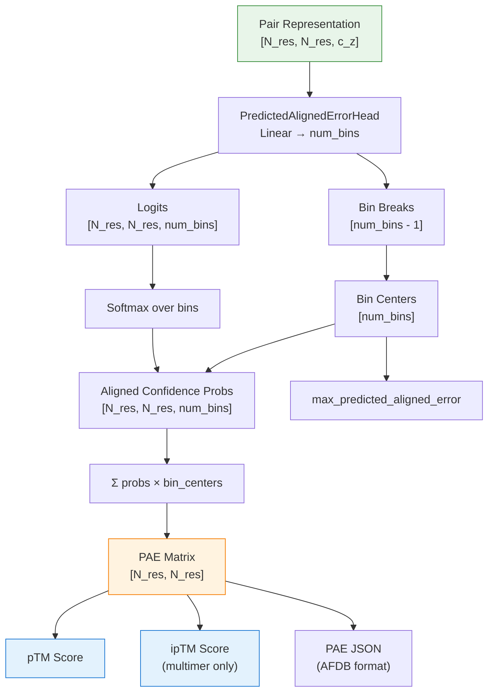
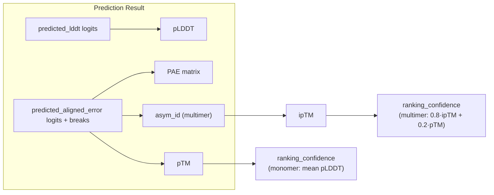

The **Predicted Aligned Error (PAE)** is AlphaFold's pairwise confidence metric that quantifies, for every residue pair *(i, j)*, the expected positional error of residue *j* when the predicted structure is superimposed onto the ground truth using residue *i* as the alignment anchor. Unlike the per-residue [pLDDT](17-plddt-and-ptm-scoring) score which captures local confidence, PAE captures **domain-level and inter-chain positional uncertainty**, making it indispensable for detecting relative domain placement errors in monomers and interface confidence in multimers. The metric is produced by a dedicated neural network head (`PredictedAlignedErrorHead`) that operates on the Evoformer's pair representation and outputs a discretized probability distribution over error bins, from which an expected value is derived.

Sources: [confidence.py](/alphafold/common/confidence.py#L102-L155), [model.py](/alphafold/model/model.py#L31-L69)

## Mathematical Foundation

PAE is grounded in the concept of **aligned distance error** — the distance between predicted and true positions after an optimal rigid-body superimposition that fixes one residue. For residues *i* and *j*, the aligned distance error is:

> PAE(i, j) = E[ ‖T_i(x̂_j) − x_j‖ ]

where **T_i*** is the rigid-body transform that optimally superimposes the local neighborhood of residue *i* in the predicted structure onto the true structure, *x̂_j* is the predicted position of residue *j*, and *x_j* is the true position.! The expectation is taken over the model's predicted probability distribution.

The network does not regress PAE directly. Instead, it produces **logits** over a fixed set of error3bins (defined by `alignment_confidence_breaks`), then applies softmax to obtain a probability distribution, and finally computes the expected value as a weighted sum of bin centers:

> PAE(i, j) = Σ_k P(i, j, k) · c_k

where *P(i, j, k)* is the predicted probability that the aligned error for pair *(i, j)* falls in bin *k*, and *c_k* is the center of bin *k*.

Sources: [confidence.py](/alphafold/common/confidence.py#L84-L124)

## Computational Pipeline

The PAE computation unfolds in two distinct phases: a **neural network forward pass** that produces logits from the pair representation, and a **post-processing pass** that converts logits into the final PAE matrix and derived scores (pTM, ipTM).



### Phase 1: Neural Network Head

The `PredictedAlignedErrorHead` consumes the Evoformer's pair representation `z ∈ ℝ^{N_res × N_res × c_z}` and applies a single `Linear` projection to produce logits over `num_bins` error bins. The bin breaks are constructed via `jnp.linspace` from `first_break` to `last_break` with `num_bins - 1` edges, yielding `num_bins` total bins. The output is symmetric by construction — the pair representation is already symmetric, so the logits maintain this property.

Sources: [modules.py](/alphafold/model/modules.py#L1519-L1557)

### Phase 2: Post-Processing and Metric Derivation

After the forward pass, `compute_predicted_aligned_error` in `confidence.py` orchestrates the conversion from logits to interpretable metrics. The softmax operation normalizes logits into a proper probability distribution over bins for each residue pair. Then `_calculate_expected_aligned_error` computes the dot product of these probabilities with the bin centers to yield the N_res × N_res PAE matrix.

The same logits and breaks are simultaneously fed into `predicted_tm_score` to derive the **pTM** (predicted TM-score) — a single scalar summarizing global fold confidence — and, in multimer mode, the **ipTM** (interface predicted TM-score) that restricts the TM-score computation to cross-chain residue pairs.

Sources: [confidence.py](/alphafold/common/confidence.py#L127-L155), [model.py](/alphafold/model/model.py#L39-L69)

## Implementation Detail

### Core Functions

| Function | Input | Output | Role |
|---|---|---|---|
| `compute_predicted_aligned_error` | logits `[N, N, B]`, breaks `[B-1]` | dict with PAE, probs, max_pae | Main entry point; softmax → expectation |
| `_calculate_expected_aligned_error` | breaks, probs `[N, N, B]` | PAE `[N, N]`, max_pae scalar | Weighted sum over bin centers |
| `_calculate_bin_centers` | breaks `[B-1]` | centers `[B]` | Derive midpoints + catch-all bin |
| `pae_json` | PAE `[N, N]`, max_pae | JSON string | AFDB-compatible serialization |
| `predicted_tm_score` | logits, breaks, asym_id | pTM or ipTM scalar | Global fold/interface confidence |

### Bin Construction

The bin edges are uniformly spaced from `first_break` to `last_break`. Bin centers are computed by shifting each edge by half the step size. A **catch-all bin** is appended at the end with center `bin_centers[-1] + step`, which captures any error exceeding the last break. The `max_predicted_aligned_error` is defined as the center of this final catch-all bin, setting the upper bound of the PAE scale.

```python
# Simplified from _calculate_bin_centers
step = breaks[1] - breaks[0]
bin_centers = breaks + step / 2
bin_centers = np.concatenate([bin_centers, [bin_centers[-1] + step]])
```

Sources: [confidence.py](/alphafold/common/confidence.py#L84-L99)

### PAE JSON Serialization

The `pae_json` function produces AFDB-compatible output, rounding PAE values to one decimal place and wrapping them in a list containing a single dictionary with keys `predicted_aligned_error` and `max_predicted_aligned_error`. The function validates that the PAE matrix is square before serialization.

Sources: [confidence.py](/alphafold/common/confidence.py#L158-L181)

## Integration in the Prediction Pipeline

The `get_confidence_metrics` function in `model.py` serves as the central orchestrator. It unconditionally computes pLDDT from the `PredictedLDDTHead` logits. When the `predicted_aligned_error` key is present in the prediction result (which it is for all model configurations that include the PAE head), it proceeds to compute the full PAE matrix, pTM, and — for multimer models — ipTM and the composite `ranking_confidence = 0.8 × ipTM + 0.2 × pTM`.



> [!TIP]
> For multimer predictions, always inspect the PAE matrix at **cross-chain residue pairs** (where `asym_id[i] ≠ asym_id[j]`) rather than within-chain pairs. The within-chain PAE is typically low regardless of interface quality, and the critical signal for assessing complex confidence lives in the off-diagonal blocks of the PAE matrix.

Sources: [model.py](/alphafold/model/model.py#L31-L69)

## Interpreting the PAE Matrix

The PAE matrix is an N_res × N_res heatmap where the **x-axis represents the "aligned-on" residue** (the anchor for superimposition) and the **y-axis represents the "predicted" residue** (the residue whose error is being measured). This asymmetry is critical: PAE(i, j) ≠ PAE(j, i) in general, because aligning on different residues produces different rigid-body transforms.

| PAE Pattern | Interpretation | Action |
|---|---|---|
| Low values everywhere | High confidence in both local and global structure | Trust the prediction |
| Low within domain, high between domains | Relative domain orientation is uncertain | Consider flexible linker; verify domain arrangement |
| Low within chain, high across chains (multimer) | Interface is uncertain | May need experimental validation of binding mode |
| Diagonally banded low region | A subdomain is confidently placed relative to nearby residues | Use subdomain as anchor for analysis |
| Uniformly high | Model has no reliable structural signal | Do not trust the prediction |

### Relationship to pLDDT and pTM

PAE, pLDDT, and pTM form a **hierarchical confidence system**: pLDDT provides per-residue local confidence (sensitive to backbone geometry within ~15Å), PAE provides pairwise relative confidence (sensitive to domain and chain positioning), and pTM distills the PAE matrix into a single global confidence scalar. A structure can have high pLDDT (locally well-folded domains) but high PAE between domains (uncertain relative placement), yielding a low pTM. This is the most common failure mode in protein complex prediction — well-folded chains arranged incorrectly relative to each other.

Sources: [confidence.py](/alphafold/common/confidence.py#L127-L155), [confidence.py](/alphafold/common/confidence.py#L184-L244)

## Next Steps

- Understand how pLDDT and pTM scoring complement PAE: [pLDDT and pTM Scoring](17-plddt-and-ptm-scoring)
- Explore the post-processing that follows confidence computation: [Amber Relaxation](19-amber-relaxation)
- Review how confidence metrics feed into model configuration and ranking: [Model Presets and Variants](21-model-presets-and-variants)