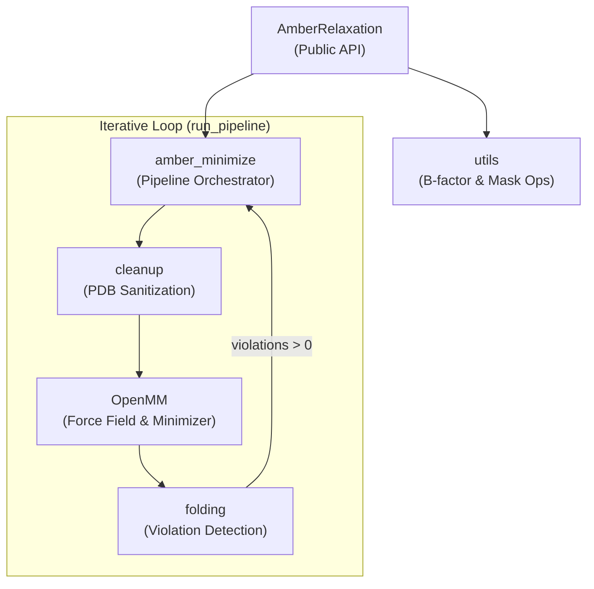
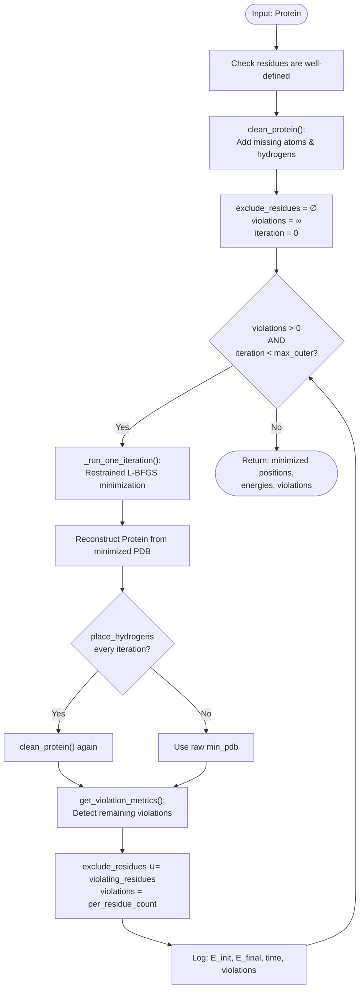

AlphaFold's neural network produces atom coordinates that, while globally accurate, can contain local **stereochemical violations** — unreasonable bond lengths, steric clashes, and distorted dihedral angles. The Amber Relaxation pipeline is the post-processing stage that resolves these physical implausibilities by performing **restrained energy minimization** with the Amber99SB force field via OpenMM. The result is a PDB structure that is both globally faithful to the deep learning prediction and locally consistent with the laws of chemistry.

Sources: [relax.py](alphafold/relax/relax.py#L15-L20), [amber_minimize.py](alphafold/relax/amber_minimize.py#L15-L33)

## Architecture and Module Interactions

The relaxation subsystem resides in `alphafold/relax/` and comprises four cooperating modules, each with a distinct responsibility in the minimization pipeline:

| Module | File | Role |
|---|---|---|
| **AmberRelaxation** | `relax.py` | Public-facing class; delegates to `amber_minimize.run_pipeline`, restores B-factors, computes RMSD |
| **amber_minimize** | `amber_minimize.py` | Core orchestrator: protein cleaning, iterative minimization loop, violation analysis |
| **cleanup** | `cleanup.py` | PDB sanitization via `pdbfixer`: adds missing atoms/hydrogens, removes heterogens, fixes edge cases |
| **utils** | `utils.py` | Utility functions: B-factor overwriting, atom-mask equality assertions (ignoring terminal OXT) |

Sources: [relax.py](alphafold/relax/relax.py#L23-L91), [amber_minimize.py](alphafold/relax/amber_minimize.py#L1-L37), [cleanup.py](alphafold/relax/cleanup.py#L15-L24), [utils.py](alphafold/relax/utils.py#L15-L19)

## The Iterative Relaxation Algorithm

The central innovation of AlphaFold's relaxation is that it is **violation-informed and iterative**. Rather than running a single minimization pass and hoping for the best, `run_pipeline` repeatedly minimizes the structure, each time relaxing the restraint on residues that still exhibit structural violations. This allows physically problematic regions greater freedom to settle into energetically favorable conformations.

### Outer Loop: Violation-Driven Exclusion

Each iteration of the outer loop performs one restrained minimization and then evaluates the result for remaining structural violations. Violating residues are **unioned** into the exclusion set, meaning the exclusion set only grows across iterations — residues never re-enter restraint once freed. The loop terminates early when `violations == 0`, so well-behaved structures typically complete in a single iteration.

Sources: [amber_minimize.py](alphafold/relax/amber_minimize.py#L446-L532)

### Inner Loop: Retry on Failure

Within `_run_one_iteration`, the actual OpenMM minimization is wrapped in a retry loop. If `_openmm_minimize` raises an exception (which can occur due to numerical instabilities in the force field or PDB parsing edge cases), the attempt is retried up to `max_attempts` times (default 100). Only if all attempts fail does a `ValueError` propagate.

Sources: [amber_minimize.py](alphafold/relax/amber_minimize.py#L383-L443)

## Restrained Energy Minimization

The core physics happens in `_openmm_minimize`. The function constructs an OpenMM simulation with the **Amber99SB force field** and then optionally adds a **harmonic restraining potential** that anchors atoms to their predicted positions.

### The Restraining Potential

The restraint is a harmonic spring applied to each atom in the restraint set:

**E_restraint = 0.5 × k × [(x - x₀)² + (y - y₀)² + (z - z₀)²]**

Where `k` is the stiffness constant (default 10.0 kcal/mol·Å²), and `(x₀, y₀, z₀)` are the reference coordinates from the predicted structure. This ensures the minimization cannot drift far from the deep learning prediction while still allowing local adjustment.

Sources: [amber_minimize.py](alphafold/relax/amber_minimize.py#L49-L76)

### Restraint Sets and Exclusions

Two restraint sets are supported, controlled by the `restraint_set` parameter:

| Restraint Set | Atoms Restrained | Use Case |
|---|---|---|
| `non_hydrogen` (default) | All heavy atoms | Standard relaxation — most precise |
| `c_alpha` | Only Cα atoms | Aggressive relaxation — allows backbone and sidechain freedom |

The `exclude_residues` list (zero-indexed) removes per-atom restraining for specific residues. In the iterative pipeline, this list is automatically populated with residues that exhibit violations, granting them additional freedom in subsequent iterations.

Sources: [amber_minimize.py](alphafold/relax/amber_minimize.py#L40-L47)

### OpenMM Configuration

The minimization is configured as follows:

| Parameter | Default | Description |
|---|---|---|
| Force field | `amber99sb.xml` | Standard all-atom force field for proteins |
| Constraints | `HBonds` | Bond lengths involving hydrogen are constrained rigidly |
| Integrator | `LangevinIntegrator(0, 0.01, 0.0)` | Zero-temperature Langevin — effectively a dummy integrator for energy minimization |
| Minimizer | L-BFGS | Quasi-Newton optimizer built into OpenMM |
| Platform | CUDA or CPU | Selectable via `use_gpu` flag |

Sources: [amber_minimize.py](alphafold/relax/amber_minimize.py#L79-L113)

## PDB Cleaning and Hydrogen Placement

Before any minimization can occur, the raw predicted PDB must be **chemically complete** — the Amber force field requires all atoms including hydrogens. The `clean_protein` function orchestrates this preparation through `cleanup.fix_pdb` and `cleanup.clean_structure`:

### fix_pdb Pipeline (via pdbfixer)

The five-step sanitization sequence is:

1. **Replace nonstandard residues** — e.g., selenomethionine (MSE) → methionine (MET)
2. **Remove heterogens** — strips water, ions, ligands; keeps only standard amino acid residues
3. **Add missing residues** — fills gaps in the chain sequence
4. **Add missing heavy atoms** — completes partial side chains and backbone atoms
5. **Add missing hydrogens** — places hydrogens assuming pH 7.0

### clean_structure Edge Cases

Two additional fixes are applied after pdbfixer:

- **Selenium replacement in MET**: Any methionine residue whose SD atom is selenium (Se) has it replaced with sulfur (S), because the standard Amber99SB force field does not parameterize Se
- **Remove single-residue chains**: A chain containing only one amino acid is both N-terminus and C-terminus simultaneously, for which no force field template exists — such chains are removed entirely

A safety check (`_check_cleaned_atoms`) verifies that no atom positions were inadvertently altered during the cleaning process.

Sources: [cleanup.py](alphafold/relax/cleanup.py#L27-L129), [amber_minimize.py](alphafold/relax/amber_minimize.py#L162-L191)

## Structural Violation Detection

After each minimization iteration, the pipeline evaluates whether the structure still contains physical violations. This reuses AlphaFold's own `folding.find_structural_violations` and `folding.compute_violation_metrics` functions — the same code used during training to compute the violation loss term.

The violation analysis works with a **denser atom14 representation** (14 atoms per residue, vs. the 37-slot atom37 representation), constructed by `make_atom14_positions`. This function also handles the **ambiguous atom naming** problem: 7 of the 20 amino acids have atoms whose naming is ambiguous (e.g., OD1/OD2 in aspartate). Alternative ground-truth positions are generated via renaming swap matrices so that violations are evaluated against both naming conventions.

Violations are categorized into three types:

| Violation Category | What It Detects |
|---|---|
| **Between-residue connections** | Bond length and angle deviations at peptide bonds |
| **Between-residue clashes** | Steric overlap between atoms in different residues |
| **Within-residue** | Bond length, angle, and dihedral deviations within a single residue |

The `total_per_residue_violations_mask` is a boolean array that flags any residue participating in any violation type — this is the mask fed back into the iterative loop to update the exclusion set.

> [!TIP]
> Violation computation is forced onto CPU via `jax.default_device(jax.local_devices(backend="cpu")[0])` to avoid CUDA errors that can occur with certain JAX versions when mixing OpenMM GPU operations with JAX GPU memory.

Sources: [amber_minimize.py](alphafold/relax/amber_minimize.py#L333-L380), [amber_minimize.py](alphafold/relax/amber_minimize.py#L194-L330)

## Configuration and Pipeline Integration

### Default Parameters

The `run_alphafold.py` entry point instantiates `AmberRelaxation` with these module-level constants:

| Constant | Value | Description |
|---|---|---|
| `RELAX_MAX_ITERATIONS` | `0` | No limit on L-BFGS steps per iteration |
| `RELAX_ENERGY_TOLERANCE` | `2.39` | kcal/(mol·nm), the OpenMM default force tolerance |
| `RELAX_STIFFNESS` | `10.0` | kcal/mol·Å², spring constant for restraining potential |
| `RELAX_EXCLUDE_RESIDUES` | `[]` | No residues manually excluded from restraints |
| `RELAX_MAX_OUTER_ITERATIONS` | `3` | Up to 3 violation-informed iterations (CASP14 used 1) |

Sources: [run_alphafold.py](run_alphafold.py#L262-L267)

### ModelsToRelax Selection

The `--models_to_relax` flag controls which of the five model predictions undergo relaxation:

| Option | Behavior |
|---|---|
| `BEST` (default) | Relax only the highest-confidence model |
| `ALL` | Relax all five model predictions (5× slower) |
| `NONE` | Skip relaxation entirely; output raw predictions |

### The AmberRelaxation.process Return Value

The `process` method returns a three-element tuple:

| Return | Type | Description |
|---|---|---|
| `min_pdb` | `str` | PDB string of the relaxed structure, with original B-factors restored |
| `debug_data` | `dict` | Contains `initial_energy`, `final_energy`, `attempts`, and `rmsd` (root-mean-square displacement between pre- and post-minimization positions) |
| `violations` | `list[float]` | Per-residue violation mask from the final iteration |

A critical post-processing step is **B-factor restoration**: the minimized PDB contains Amber-computed B-factors, but AlphaFold's output convention requires the **pLDDT confidence scores** in the B-factor column. The `utils.overwrite_b_factors` function replaces the Amber B-factors with the original prediction's pLDDT values, ensuring downstream consumers see the correct confidence scores.

Sources: [relax.py](alphafold/relax/relax.py#L60-L90), [utils.py](alphafold/relax/utils.py#L22-L61), [run_alphafold.py](run_alphafold.py#L481-L514)

## CASP14 vs. Current Default

The original CASP14 submission used `max_outer_iterations=1`, meaning a **single non-iterative minimization pass** — the exclusion set was never updated based on violations. The current default of `max_outer_iterations=3` (and a recommended value of 20 in the `AmberRelaxation` docstring) ensures that >95% of structures with initial violations are fully resolved. Since the loop terminates as soon as `violations == 0`, most structures complete in one iteration regardless, incurring negligible overhead for the common case.

Sources: [relax.py](alphafold/relax/relax.py#L43-L49)

> [!TIP]
> If your relaxation stage is failing or producing unexpected results, first try `--models_to_relax=none` to isolate whether the issue is in the minimization or the model prediction itself. Common failure modes include: poorly-defined residues (zero atoms), OpenMM platform incompatibility, and CUDA/JAX device conflicts during violation computation.

## What to Read Next

- **[Protein Data Representation](20-protein-data-representation)** — Understand the `Protein` namedtuple and atom37/atom14 representations that flow into relaxation
- **[pLDDT and pTM Scoring](17-plddt-and-ptm-scoring)** — Learn how the confidence scores (restored as B-factors after relaxation) are computed
- **[Structure Module and Folding](13-structure-module-and-folding)** — See how `find_structural_violations` and `compute_violation_metrics` are also used during training
- **[Docker Deployment](23-docker-deployment)** — Configure GPU acceleration for the relaxation stage via `--use_gpu_relax`